# ST_STORE&lt;SM_TRAITS&gt;::StDmpSinglePageAdd

- RVA: `0x0020502C`–`0x002053F8` (길이 `972` bytes)
- VA: `0x000000014020502C`
- 실행 섹션: `.text`
- PDB 이름 있음: `예`; PDB Function 태그: `아니요`
- unwind 정보 RVA: `0x0005CCA4`
- 디코드: `264`개 명령, `972/972` bytes 표시
- 미해석 바이트: `0` (있으면 어셈블리에 `.byte`로 보존)

> 이 문서는 커널 이미지의 기계어와 PDB 기호를 분석해 생성했습니다. 4번과 5번은 함수 원형과 자료형을 바이너리 사용 방식에서 추정한 C 해석이며 원본 소스 복구 결과는 아닙니다.

## 1. Dependencies

- 직접 호출 지점: **17**; 고유 호출 대상: **15**
- 직접 호출자로 확인된 함수: **2**
- RIP 상대 이미지 참조: **2**

### Outgoing calls
- `0x002050B5` → [ST_STORE<SM_TRAITS>::StDmpSinglePageFindSpace](../3B/ST_STORE_SM_TRAITS_StDmpSinglePageFindSpace_function_003B0980.md) (function, `0x003B0980`)
- `0x002050CB` → [SMKM_STORE<SM_TRAITS>::SmStReleaseStoreLockExclusive](../2D/SMKM_STORE_SM_TRAITS_SmStReleaseStoreLockExclusive_function_002DFE68.md) (function, `0x002DFE68`)
- `0x00205127` → [memcpy](../6C/memcpy_function_006C6840.md) (function, `0x006C6840`)
- `0x00205176` → [SmStoreCopyHashCompressedBuffer](../26/SmStoreCopyHashCompressedBuffer_function_0026B918.md) (function, `0x0026B918`)
- `0x002051D3` → [RtlCompressBuffer](../26/RtlCompressBuffer_function_0026A220.md) (function, `0x0026A220`)
- `0x00205242` → [memcpy](../6C/memcpy_function_006C6840.md) (function, `0x006C6840`)
- `0x00205254` → [ST_STORE<SM_TRAITS>::StDmpDummyPageRecordAllocate](../4B/ST_STORE_SM_TRAITS_StDmpDummyPageRecordAllocate_function_004BC160.md) (function, `0x004BC160`)
- `0x00205266` → [SMKM_STORE<SM_TRAITS>::SmStAcquireStoreLockExclusive](SMKM_STORE_SM_TRAITS_SmStAcquireStoreLockExclusive_function_00206630.md) (function, `0x00206630`)
- `0x00205277` → [SMKM_STORE<SM_TRAITS>::SmStAcquireStoreLockExclusive](SMKM_STORE_SM_TRAITS_SmStAcquireStoreLockExclusive_function_00206630.md) (function, `0x00206630`)
- `0x00205283` → [SmHpChunkAlloc](../26/SmHpChunkAlloc_function_002688E0.md) (function, `0x002688E0`)
- `0x002052A0` → [ST_STORE<SM_TRAITS>::StDmPageRecordUnprotect](../26/ST_STORE_SM_TRAITS_StDmPageRecordUnprotect_function_00268B30.md) (function, `0x00268B30`)
- `0x002052FE` → [ST_STORE<SM_TRAITS>::StDmpHashBytes](../4F/ST_STORE_SM_TRAITS_StDmpHashBytes_function_004F68D8.md) (function, `0x004F68D8`)
- `0x00205383` → [SmCrAuthEncrypt](../4D/SmCrAuthEncrypt_function_004D02A4.md) (function, `0x004D02A4`)
- `0x0020539B` → [SmHpChunkFree](../26/SmHpChunkFree_function_00268D50.md) (function, `0x00268D50`)
- `0x002053A9` → [_security_check_cookie](../6A/_security_check_cookie_function_006AC640.md) (function, `0x006AC640`)
- `0x002053D5` → [crc32](../46/crc32_function_00468F58.md) (function, `0x00468F58`)
- `0x002053E9` → [ST_STORE<SM_TRAITS>::StDmpSinglePageInsert](../4E/ST_STORE_SM_TRAITS_StDmpSinglePageInsert_function_004EBDF0.md) (function, `0x004EBDF0`)

### Direct callers
- [sub_00205DDB](Unknown_function_00205DDB.md) at `0x00205EF3`
- [ST_STORE&lt;SM_TRAITS&gt;::StNpLeafPageOut](../60/ST_STORE_SM_TRAITS_StNpLeafPageOut_function_0060E6C0.md) at `0x0060E761`

### Static image references
- `0x00205045` → RVA `0x00E0A740` (`.data`; read)
- `0x0020519C` → RVA `0x00011C18` (`.rdata`; read)

## 2. Other-region calls and transfers

- 다른 실행 섹션으로 향하는 call: **0**
- 별도 외부 분기/꼬리 이동을 확인하지 못했습니다.

## 3. Assembly (complete function range)

```asm
0020502C  40 55                           push rbp
0020502E  53                              push rbx
0020502F  56                              push rsi
00205030  57                              push rdi
00205031  41 54                           push r12
00205033  41 55                           push r13
00205035  41 56                           push r14
00205037  41 57                           push r15
00205039  48 8D 6C 24 E1                  lea rbp, [rsp - 0x1f]
0020503E  48 81 EC 88 00 00 00            sub rsp, 0x88
00205045  48 8B 05 F4 56 C0 00            mov rax, qword ptr [rip + 0xc056f4]
0020504C  48 33 C4                        xor rax, rsp
0020504F  48 89 45 07                     mov qword ptr [rbp + 7], rax
00205053  33 C0                           xor eax, eax
00205055  4C 89 45 EF                     mov qword ptr [rbp - 0x11], r8
00205059  33 F6                           xor esi, esi
0020505B  48 89 45 F7                     mov qword ptr [rbp - 9], rax
0020505F  89 45 FF                        mov dword ptr [rbp - 1], eax
00205062  48 8B D9                        mov rbx, rcx
00205065  8B 81 08 03 00 00               mov eax, dword ptr [rcx + 0x308]
0020506B  4C 8B E2                        mov r12, rdx
0020506E  8B 12                           mov edx, dword ptr [rdx]
00205070  4D 8B F8                        mov r15, r8
00205073  44 0F B6 C0                     movzx r8d, al
00205077  83 E2 07                        and edx, 7
0020507A  41 8B C0                        mov eax, r8d
0020507D  48 89 75 E7                     mov qword ptr [rbp - 0x19], rsi
00205081  F7 D8                           neg eax
00205083  89 75 DB                        mov dword ptr [rbp - 0x25], esi
00205086  4D 8B E9                        mov r13, r9
00205089  89 75 DF                        mov dword ptr [rbp - 0x21], esi
0020508C  1B C9                           sbb ecx, ecx
0020508E  F7 D1                           not ecx
00205090  83 E1 07                        and ecx, 7
00205093  3B CA                           cmp ecx, edx
00205095  73 0A                           jae 0x1402050a1
00205097  41 F7 D8                        neg r8d
0020509A  1B D2                           sbb edx, edx
0020509C  F7 D2                           not edx
0020509E  83 E2 07                        and edx, 7
002050A1  45 8B 45 00                     mov r8d, dword ptr [r13]
002050A5  48 8D 45 DB                     lea rax, [rbp - 0x25]
002050A9  4C 8D 4D E7                     lea r9, [rbp - 0x19]
002050AD  48 89 44 24 20                  mov qword ptr [rsp + 0x20], rax
002050B2  48 8B CB                        mov rcx, rbx
002050B5  E8 C6 B8 1A 00                  call 0x1403b0980
002050BA  8B F8                           mov edi, eax
002050BC  85 C0                           test eax, eax
002050BE  0F 88 DC 02 00 00               js 0x1402053a0
002050C4  48 8B 8B 20 03 00 00            mov rcx, qword ptr [rbx + 0x320]
002050CB  E8 98 AD 0D 00                  call 0x1402dfe68
002050D0  48 8B 45 E7                     mov rax, qword ptr [rbp - 0x19]
002050D4  41 BA 00 10 00 00               mov r10d, 0x1000
002050DA  44 8B B3 38 03 00 00            mov r14d, dword ptr [rbx + 0x338]
002050E1  41 8B 0C 24                     mov ecx, dword ptr [r12]
002050E5  4C 03 F0                        add r14, rax
002050E8  49 8B 74 24 08                  mov rsi, qword ptr [r12 + 8]
002050ED  48 89 45 E7                     mov qword ptr [rbp - 0x19], rax
002050F1  0F BA E1 1E                     bt ecx, 0x1e
002050F5  73 09                           jae 0x140205100
002050F7  49 8B 47 10                     mov rax, qword ptr [r15 + 0x10]
002050FB  8B 50 28                        mov edx, dword ptr [rax + 0x28]
002050FE  EB 42                           jmp 0x140205142
00205100  8B 83 08 03 00 00               mov eax, dword ptr [rbx + 0x308]
00205106  0F BA E0 0A                     bt eax, 0xa
0020510A  73 05                           jae 0x140205111
0020510C  41 8B D2                        mov edx, r10d
0020510F  EB 31                           jmp 0x140205142
00205111  0F BA E0 0F                     bt eax, 0xf
00205115  73 29                           jae 0x140205140
00205117  48 8B 8B 70 08 00 00            mov rcx, qword ptr [rbx + 0x870]
0020511E  4D 8B C2                        mov r8, r10
00205121  49 03 CA                        add rcx, r10
00205124  48 8B D6                        mov rdx, rsi
00205127  E8 14 17 4C 00                  call 0x1406c6840
0020512C  48 8B B3 70 08 00 00            mov rsi, qword ptr [rbx + 0x870]
00205133  41 BA 00 10 00 00               mov r10d, 0x1000
00205139  41 8B 0C 24                     mov ecx, dword ptr [r12]
0020513D  49 03 F2                        add rsi, r10
00205140  33 D2                           xor edx, edx
00205142  44 8B 45 DB                     mov r8d, dword ptr [rbp - 0x25]
00205146  8B 83 28 03 00 00               mov eax, dword ptr [rbx + 0x328]
0020514C  44 8B BB 30 03 00 00            mov r15d, dword ptr [rbx + 0x330]
00205153  41 23 C0                        and eax, r8d
00205156  44 2B F8                        sub r15d, eax
00205159  89 55 D7                        mov dword ptr [rbp - 0x29], edx
0020515C  44 89 45 DB                     mov dword ptr [rbp - 0x25], r8d
00205160  0F BA E1 1E                     bt ecx, 0x1e
00205164  73 1A                           jae 0x140205180
00205166  44 8B 8B 50 05 00 00            mov r9d, dword ptr [rbx + 0x550]
0020516D  44 8B C2                        mov r8d, edx
00205170  48 8B D6                        mov rdx, rsi
00205173  49 8B CE                        mov rcx, r14
00205176  E8 9D 67 06 00                  call 0x14026b918
0020517B  E9 C7 00 00 00                  jmp 0x140205247
00205180  44 3B BB 34 03 00 00            cmp r15d, dword ptr [rbx + 0x334]
00205187  73 09                           jae 0x140205192
00205189  48 8B BB 70 08 00 00            mov rdi, qword ptr [rbx + 0x870]
00205190  EB 03                           jmp 0x140205195
00205192  49 8B FE                        mov rdi, r14
00205195  48 63 83 50 05 00 00            movsxd rax, dword ptr [rbx + 0x550]
0020519C  48 8D 0D 75 CA E0 FF            lea rcx, [rip - 0x1f358b]
002051A3  0F B7 0C 41                     movzx ecx, word ptr [rcx + rax*2]
002051A7  85 D2                           test edx, edx
002051A9  75 42                           jne 0x1402051ed
002051AB  48 8B 83 80 03 00 00            mov rax, qword ptr [rbx + 0x380]
002051B2  4C 8B CF                        mov r9, rdi
002051B5  48 89 44 24 38                  mov qword ptr [rsp + 0x38], rax
002051BA  45 8B C2                        mov r8d, r10d
002051BD  48 8D 45 D7                     lea rax, [rbp - 0x29]
002051C1  48 8B D6                        mov rdx, rsi
002051C4  48 89 44 24 30                  mov qword ptr [rsp + 0x30], rax
002051C9  44 89 54 24 28                  mov dword ptr [rsp + 0x28], r10d
002051CE  44 89 54 24 20                  mov dword ptr [rsp + 0x20], r10d
002051D3  E8 48 50 06 00                  call 0x14026a220
002051D8  41 BA 00 10 00 00               mov r10d, 0x1000
002051DE  85 C0                           test eax, eax
002051E0  79 08                           jns 0x1402051ea
002051E2  41 8B D2                        mov edx, r10d
002051E5  89 55 D7                        mov dword ptr [rbp - 0x29], edx
002051E8  EB 03                           jmp 0x1402051ed
002051EA  8B 55 D7                        mov edx, dword ptr [rbp - 0x29]
002051ED  49 3B FE                        cmp rdi, r14
002051F0  74 1E                           je 0x140205210
002051F2  8B 8B 38 03 00 00               mov ecx, dword ptr [rbx + 0x338]
002051F8  83 C1 0F                        add ecx, 0xf
002051FB  03 CA                           add ecx, edx
002051FD  C1 E9 04                        shr ecx, 4
00205200  41 89 4D 00                     mov dword ptr [r13], ecx
00205204  41 3B CF                        cmp ecx, r15d
00205207  76 07                           jbe 0x140205210
00205209  BF 2D 02 00 C0                  mov edi, 0xc000022d
0020520E  EB 4F                           jmp 0x14020525f
00205210  81 FA F0 0F 00 00               cmp edx, 0xff0
00205216  76 1C                           jbe 0x140205234
00205218  F7 83 08 03 00 00 00 02 00 00   test dword ptr [rbx + 0x308], 0x200
00205222  74 07                           je 0x14020522b
00205224  BF 26 04 00 C0                  mov edi, 0xc0000426
00205229  EB 34                           jmp 0x14020525f
0020522B  41 8B D2                        mov edx, r10d
0020522E  48 8B FE                        mov rdi, rsi
00205231  89 55 D7                        mov dword ptr [rbp - 0x29], edx
00205234  49 3B FE                        cmp rdi, r14
00205237  74 0E                           je 0x140205247
00205239  44 8B C2                        mov r8d, edx
0020523C  49 8B CE                        mov rcx, r14
0020523F  48 8B D7                        mov rdx, rdi
00205242  E8 F9 15 4C 00                  call 0x1406c6840
00205247  48 83 BB F8 02 00 00 00         cmp qword ptr [rbx + 0x2f8], 0
0020524F  75 1F                           jne 0x140205270
00205251  48 8B CB                        mov rcx, rbx
00205254  E8 07 6F 2B 00                  call 0x1404bc160
00205259  8B F8                           mov edi, eax
0020525B  85 C0                           test eax, eax
0020525D  79 11                           jns 0x140205270
0020525F  48 8B 8B 20 03 00 00            mov rcx, qword ptr [rbx + 0x320]
00205266  E8 C5 13 00 00                  call 0x140206630
0020526B  E9 30 01 00 00                  jmp 0x1402053a0
00205270  48 8B 8B 20 03 00 00            mov rcx, qword ptr [rbx + 0x320]
00205277  E8 B4 13 00 00                  call 0x140206630
0020527C  48 8D 8B C0 00 00 00            lea rcx, [rbx + 0xc0]
00205283  E8 58 36 06 00                  call 0x1402688e0
00205288  48 8B F0                        mov rsi, rax
0020528B  48 85 C0                        test rax, rax
0020528E  75 0A                           jne 0x14020529a
00205290  BF 9A 00 00 C0                  mov edi, 0xc000009a
00205295  E9 06 01 00 00                  jmp 0x1402053a0
0020529A  48 8B D6                        mov rdx, rsi
0020529D  48 8B CB                        mov rcx, rbx
002052A0  E8 8B 38 06 00                  call 0x140268b30
002052A5  48 83 66 04 00                  and qword ptr [rsi + 4], 0
002052AA  8B 45 DB                        mov eax, dword ptr [rbp - 0x25]
002052AD  89 06                           mov dword ptr [rsi], eax
002052AF  44 8B 45 D7                     mov r8d, dword ptr [rbp - 0x29]
002052B3  41 81 F8 00 10 00 00            cmp r8d, 0x1000
002052BA  73 19                           jae 0x1402052d5
002052BC  8B 46 04                        mov eax, dword ptr [rsi + 4]
002052BF  41 81 E0 FF 0F 00 00            and r8d, 0xfff
002052C6  25 00 F0 FF FF                  and eax, 0xfffff000
002052CB  41 0B C0                        or eax, r8d
002052CE  89 46 04                        mov dword ptr [rsi + 4], eax
002052D1  44 8B 45 D7                     mov r8d, dword ptr [rbp - 0x29]
002052D5  41 F7 04 24 00 00 00 40         test dword ptr [r12], 0x40000000
002052DD  74 09                           je 0x1402052e8
002052DF  48 8B 45 EF                     mov rax, qword ptr [rbp - 0x11]
002052E3  8B 40 60                        mov eax, dword ptr [rax + 0x60]
002052E6  EB 23                           jmp 0x14020530b
002052E8  F7 83 08 03 00 00 00 00 20 00   test dword ptr [rbx + 0x308], 0x200000
002052F2  74 14                           je 0x140205308
002052F4  4C 8D 4D DF                     lea r9, [rbp - 0x21]
002052F8  49 8B D6                        mov rdx, r14
002052FB  48 8B CB                        mov rcx, rbx
002052FE  E8 D5 15 2F 00                  call 0x1404f68d8
00205303  8B 45 DF                        mov eax, dword ptr [rbp - 0x21]
00205306  EB 03                           jmp 0x14020530b
00205308  83 C8 FF                        or eax, 0xffffffff
0020530B  89 46 08                        mov dword ptr [rsi + 8], eax
0020530E  48 8B 8B 68 05 00 00            mov rcx, qword ptr [rbx + 0x568]
00205315  83 79 18 00                     cmp dword ptr [rcx + 0x18], 0
00205319  0F 84 A4 00 00 00               je 0x1402053c3
0020531F  8B 49 08                        mov ecx, dword ptr [rcx + 8]
00205322  4D 8B C6                        mov r8, r14
00205325  44 8B 4D D7                     mov r9d, dword ptr [rbp - 0x29]
00205329  49 8B D6                        mov rdx, r14
0020532C  41 FF C9                        dec r9d
0020532F  44 03 C9                        add r9d, ecx
00205332  F7 D9                           neg ecx
00205334  44 23 C9                        and r9d, ecx
00205337  B9 01 00 00 00                  mov ecx, 1
0020533C  48 01 8B 70 05 00 00            add qword ptr [rbx + 0x570], rcx
00205343  8B 83 70 05 00 00               mov eax, dword ptr [rbx + 0x570]
00205349  48 8B 4D E7                     mov rcx, qword ptr [rbp - 0x19]
0020534D  89 46 0C                        mov dword ptr [rsi + 0xc], eax
00205350  0F B7 83 74 05 00 00            movzx eax, word ptr [rbx + 0x574]
00205357  66 89 46 06                     mov word ptr [rsi + 6], ax
0020535B  8B 45 D7                        mov eax, dword ptr [rbp - 0x29]
0020535E  89 45 F7                        mov dword ptr [rbp - 9], eax
00205361  8B 46 0C                        mov eax, dword ptr [rsi + 0xc]
00205364  89 45 FB                        mov dword ptr [rbp - 5], eax
00205367  0F B7 46 06                     movzx eax, word ptr [rsi + 6]
0020536B  48 89 4C 24 30                  mov qword ptr [rsp + 0x30], rcx
00205370  48 8B 8B 68 05 00 00            mov rcx, qword ptr [rbx + 0x568]
00205377  89 45 FF                        mov dword ptr [rbp - 1], eax
0020537A  48 8D 45 F7                     lea rax, [rbp - 9]
0020537E  48 89 44 24 20                  mov qword ptr [rsp + 0x20], rax
00205383  E8 1C AF 2C 00                  call 0x1404d02a4
00205388  85 C0                           test eax, eax
0020538A  79 54                           jns 0x1402053e0
0020538C  BF 8A 02 00 C0                  mov edi, 0xc000028a
00205391  48 8D 8B C0 00 00 00            lea rcx, [rbx + 0xc0]
00205398  48 8B D6                        mov rdx, rsi
0020539B  E8 B0 39 06 00                  call 0x140268d50
002053A0  8B C7                           mov eax, edi
002053A2  48 8B 4D 07                     mov rcx, qword ptr [rbp + 7]
002053A6  48 33 CC                        xor rcx, rsp
002053A9  E8 92 72 4A 00                  call 0x1406ac640
002053AE  48 81 C4 88 00 00 00            add rsp, 0x88
002053B5  41 5F                           pop r15
002053B7  41 5E                           pop r14
002053B9  41 5D                           pop r13
002053BB  41 5C                           pop r12
002053BD  5F                              pop rdi
002053BE  5E                              pop rsi
002053BF  5B                              pop rbx
002053C0  5D                              pop rbp
002053C1  C3                              ret
002053C2  CC                              int3
002053C3  80 BB 08 03 00 00 00            cmp byte ptr [rbx + 0x308], 0
002053CA  74 14                           je 0x1402053e0
002053CC  44 8B 45 D7                     mov r8d, dword ptr [rbp - 0x29]
002053D0  49 8B D6                        mov rdx, r14
002053D3  33 C9                           xor ecx, ecx
002053D5  E8 7E 3B 26 00                  call 0x140468f58
002053DA  48 8B 4D E7                     mov rcx, qword ptr [rbp - 0x19]
002053DE  89 01                           mov dword ptr [rcx], eax
002053E0  4C 8B C6                        mov r8, rsi
002053E3  49 8B D4                        mov rdx, r12
002053E6  48 8B CB                        mov rcx, rbx
002053E9  E8 02 6A 2E 00                  call 0x1404ebdf0
002053EE  8B F8                           mov edi, eax
002053F0  85 C0                           test eax, eax
002053F2  78 9D                           js 0x140205391
002053F4  33 FF                           xor edi, edi
002053F6  EB A8                           jmp 0x1402053a0
```

## 4. C-style interpretation (structured pseudocode)

```c
__int64 __fastcall ST_STORE_SM_TRAITS___StDmpSinglePageAdd(__int64 a1, __int64 a2, __int64 a3, __int64 a4)
{
    __int64 result;
    __int64 v_r10;
    __int64 v_r14;
    __int64 v_r15;
    __int64 v_rdi;
    __int64 v_rsi;
    __int64 v_rsp;
    unsigned __int64 v_stack_m58;
    unsigned __int64 v_stack_m5F;
    unsigned int v_stack_m60;
    unsigned int v_stack_m64;
    unsigned __int64 v_stack_m68;
    unsigned __int64 v_stack_m70;
    unsigned __int64 v_stack_m78;
    unsigned int v_stack_m80;
    unsigned int v_stack_m84;
    unsigned int v_stack_m88;
    unsigned __int64 v_stack_m90;
    unsigned __int64 v_stack_m98;
    unsigned int v_stack_mA0;
    unsigned __int64 v_stack_mA8;

    v_rsp = (v_rsp) - (136);
    result = (*(unsigned __int64 *)(v_rip + 12605172)) ^ (v_rsp);
    v_stack_m58 = result;
    result = 0;
    v_stack_m70 = a3;
    v_rsi = 0;
    v_stack_m68 = 0;
    v_stack_m60 = 0;
    a2 = (unsigned int)(((unsigned int)(*(unsigned int *)(a2))) & (7));
    v_stack_m78 = 0;
    result = (unsigned int)(-((unsigned int)((unsigned int)((unsigned __int8)((unsigned int)(*(unsigned int *)(a1 + 776)))))));
    v_stack_m84 = 0;
    v_stack_m80 = 0;
    a1 = (unsigned int)(~(a1));
    a1 = (unsigned int)((a1) & (7));
    if (((unsigned int)(a1)) < ((unsigned int)(a2))) {
        a3 = (unsigned int)(-((unsigned __int8)((unsigned int)(*(unsigned int *)(a1 + 776)))));
        a2 = (unsigned int)(~(a2));
        a2 = (unsigned int)((a2) & (7));
    }
    v_stack_mA8 = v_stack_m84;
    result = ST_STORE_SM_TRAITS___StDmpSinglePageFindSpace(a1, a2, (unsigned int)(*(unsigned int *)(a4)), v_stack_m78);
    if (sign_flag) goto loc_002053A0;
    result = SMKM_STORE_SM_TRAITS___SmStReleaseStoreLockExclusive(*(unsigned __int64 *)(a1 + 800), a2, (unsigned int)(*(unsigned int *)(a4)), v_stack_m78);
    v_r14 = ((unsigned int)(*(unsigned int *)(a1 + 824))) + (v_stack_m78);
    v_stack_m78 = v_stack_m78;
    if (condition_is_above_or_equal) goto loc_00205100;
    goto loc_00205142;
loc_00205100:
    if (condition_is_above_or_equal) goto loc_00205111;
    goto loc_00205142;
loc_00205111:
    result = (unsigned int)(*(unsigned int *)(a1 + 776));
    v_rsi = *(unsigned __int64 *)(a2 + 8);
    v_r10 = (unsigned int)(0x1000ULL);
    if (!(condition_is_above_or_equal)) {
        a1 = *(unsigned __int64 *)(a1 + 2160);
        a3 = (unsigned int)(0x1000ULL);
        a1 = (a1) + ((unsigned int)(0x1000ULL));
        a2 = *(unsigned __int64 *)(a2 + 8);
        result = memcpy(a1, a2, a3, v_stack_m78);
        v_rsi = *(unsigned __int64 *)(a1 + 2160);
        v_r10 = 0x1000ULL;
        a1 = *(unsigned int *)(a2);
        v_rsi = (v_rsi) + (v_r10);
    }
    a2 = 0;
loc_00205142:
    result = (unsigned int)(((unsigned int)(*(unsigned int *)(a1 + 808))) & ((unsigned int)((unsigned int)(v_stack_m84))));
    v_r15 = (unsigned int)(((unsigned int)(*(unsigned int *)(a1 + 816))) - ((unsigned int)(result)));
    v_stack_m88 = 0;
    v_stack_m84 = (unsigned int)((unsigned int)(v_stack_m84));
    if (condition_is_above_or_equal) goto loc_00205180;
    result = SmStoreCopyHashCompressedBuffer(v_r14, v_rsi, 0, (unsigned int)(*(unsigned int *)(a1 + 1360)));
    goto loc_00205247;
loc_00205180:
    if (((unsigned int)(v_r15)) >= (*(unsigned int *)(a1 + 820))) goto loc_00205192;
    goto loc_00205195;
loc_00205192:
loc_00205195:
    if ((unsigned int)(v_rsi) != 0) goto loc_002051ED;
    v_stack_m90 = *(unsigned __int64 *)(a1 + 896);
    v_stack_m98 = v_stack_m88;
    v_stack_mA0 = (unsigned int)(v_r10);
    v_stack_mA8 = (unsigned int)(v_r10);
    result = RtlCompressBuffer(*(unsigned __int16 *)(v_rip - 2045323 + (int)(*(unsigned int *)(a1 + 1360)) * 2), v_rsi, (unsigned int)((unsigned int)(v_r10)), v_r14);
    if (!sign_flag) goto loc_002051EA;
    v_stack_m88 = (unsigned int)((unsigned int)((unsigned int)((unsigned int)(0x1000ULL))));
    goto loc_002051ED;
loc_002051EA:
loc_002051ED:
    if (v_r14 == v_r14) goto loc_00205210;
    a1 = (unsigned int)(((unsigned int)(*(unsigned int *)(a1 + 824))) + (15));
    a1 = (unsigned int)((a1) + ((unsigned int)((unsigned int)(v_stack_m88))));
    a1 = (unsigned int)((a1) >> (4));
    *(unsigned int *)(a4) = (unsigned int)(a1);
    if (((unsigned int)(a1)) <= ((unsigned int)(v_r15))) goto loc_00205210;
    goto loc_0020525F;
loc_00205210:
    if (((unsigned int)((unsigned int)(v_stack_m88))) <= 0xFF0ULL) goto loc_00205234;
    if (((*(unsigned int *)(a1 + 776)) & (512)) == 0) goto loc_0020522B;
    goto loc_0020525F;
loc_0020522B:
    v_stack_m88 = (unsigned int)((unsigned int)((unsigned int)((unsigned int)(0x1000ULL))));
loc_00205234:
    if (v_rsi != v_r14) {
        a3 = (unsigned int)((unsigned int)((unsigned int)((unsigned int)(0x1000ULL))));
        a1 = v_r14;
        a2 = v_rsi;
        result = memcpy(a1, a2, a3, v_r14);
    }
    if ((*(unsigned __int64 *)(a1 + 760)) != 0) goto loc_00205270;
    result = ST_STORE_SM_TRAITS___StDmpDummyPageRecordAllocate(a1, a2, a3, v_r14);
    if (!sign_flag) goto loc_00205270;
loc_0020525F:
    result = SMKM_STORE_SM_TRAITS___SmStAcquireStoreLockExclusive(*(unsigned __int64 *)(a1 + 800), a2, a3, v_r14);
    goto loc_002053A0;
loc_00205270:
    result = SMKM_STORE_SM_TRAITS___SmStAcquireStoreLockExclusive(*(unsigned __int64 *)(a1 + 800), a2, a3, v_r14);
    result = SmHpChunkAlloc(a1 + 192, a2, a3, v_r14);
    if (result != 0) goto loc_0020529A;
    goto loc_002053A0;
loc_0020529A:
    result = ST_STORE_SM_TRAITS___StDmPageRecordUnprotect(a1, result, a3, v_r14);
    *(unsigned int *)(result) = (unsigned int)((unsigned int)(v_stack_m84));
    result = (unsigned int)(v_stack_m84);
    if (((unsigned int)((unsigned int)(v_stack_m88))) < 0x1000ULL) {
        result = *(unsigned int *)(result + 4);
        a3 = (unsigned int)(((unsigned int)(v_stack_m88)) & (0xFFFULL));
        result = (unsigned int)((result) & (0xFFFFF000ULL));
        result = (unsigned int)((result) | ((unsigned int)(a3)));
        *(unsigned int *)(result + 4) = (unsigned int)(result);
        a3 = v_stack_m88;
    }
    if (((*(unsigned int *)(a2)) & (0x40000000ULL)) == 0) goto loc_002052E8;
    goto loc_0020530B;
loc_002052E8:
    if (((*(unsigned int *)(a1 + 776)) & (0x200000ULL)) == 0) goto loc_00205308;
    result = ST_STORE_SM_TRAITS___StDmpHashBytes(a1, v_r14, a3, v_stack_m80);
    goto loc_0020530B;
loc_00205308:
    result = (unsigned int)(((unsigned int)(v_stack_m80)) | (0xFFFFFFFFULL));
loc_0020530B:
    *(unsigned int *)(result + 8) = (unsigned int)(result);
    if ((*(unsigned int *)(*(unsigned __int64 *)(a1 + 1384) + 24)) == 0) goto loc_002053C3;
    a4 = (unsigned int)(((unsigned int)(v_stack_m88)) - 1);
    a4 = (unsigned int)((a4) + ((unsigned int)((unsigned int)(*(unsigned int *)(*(unsigned __int64 *)(a1 + 1384) + 8)))));
    a1 = (unsigned int)(-((unsigned int)(*(unsigned int *)(*(unsigned __int64 *)(a1 + 1384) + 8))));
    a4 = (unsigned int)((a4) & ((unsigned int)(a1)));
    *(unsigned int *)(result + 12) = (unsigned int)((unsigned int)(*(unsigned int *)(a1 + 1392)));
    *(unsigned __int16 *)(result + 6) = (unsigned __int16)(*(unsigned __int16 *)(a1 + 1396));
    v_stack_m68 = (unsigned int)((unsigned int)(v_stack_m88));
    v_stack_m64 = (unsigned int)((unsigned int)(*(unsigned int *)(result + 12)));
    v_stack_m98 = v_stack_m78;
    v_stack_m60 = (unsigned int)(*(unsigned __int16 *)(result + 6));
    v_stack_mA8 = v_stack_m68;
    result = SmCrAuthEncrypt(*(unsigned __int64 *)(a1 + 1384), v_r14, v_r14, a4);
    if (!sign_flag) goto loc_002053E0;
loc_00205391:
    result = SmHpChunkFree(a1 + 192, result, v_r14, a4);
loc_002053A0:
    a1 = (v_stack_m58) ^ (v_rsp);
    result = _security_check_cookie(a1, result, v_r14, a4);
    v_rsp = (v_rsp) + (136);
    return result;
loc_002053C3:
    if ((*(unsigned __int8 *)(a1 + 776)) != 0) {
        a3 = v_stack_m88;
        a2 = v_r14;
        a1 = 0;
        result = crc32(a1, a2, a3, a4);
        a1 = v_stack_m78;
        *(unsigned int *)(a1) = (unsigned int)(result);
    }
    result = ST_STORE_SM_TRAITS___StDmpSinglePageInsert(a1, a2, result, a4);
    if (sign_flag) goto loc_00205391;
    v_rdi = 0;
    goto loc_002053A0;
}
```

## 5. (Beta) C Style

```c
int64_t ST_STORE_SM_TRAITS___StDmpSinglePageAdd(void *Arg1, void *Arg2, void *Arg3, void *Arg4)
{
    uint8_t *arg1 = (uint8_t *)Arg1;
    uint8_t *arg2 = (uint8_t *)Arg2;
    uint8_t *arg3 = (uint8_t *)Arg3;
    uint8_t *arg4 = (uint8_t *)Arg4;

    int64_t result;
    int64_t local_r10;
    int64_t local_r14;
    int64_t local_r15;
    int64_t local_rdi;
    int64_t local_rsi;
    int64_t local_rsp;
    uint64_t v_stack_m58;
    uint64_t v_stack_m5F;
    uint32_t v_stack_m60;
    uint32_t v_stack_m64;
    uint64_t v_stack_m68;
    uint64_t v_stack_m70;
    uint64_t v_stack_m78;
    uint32_t v_stack_m80;
    uint32_t v_stack_m84;
    uint32_t v_stack_m88;
    uint64_t v_stack_m90;
    uint64_t v_stack_m98;
    uint32_t v_stack_mA0;
    uint64_t v_stack_mA8;

    local_rsp = (local_rsp) - (136);
    result = (*(uint64_t *)(v_rip + 0xC056F4)) ^ (local_rsp);
    v_stack_m58 = result;
    result = 0;
    v_stack_m70 = Arg3;
    local_rsi = 0;
    v_stack_m68 = 0;
    v_stack_m60 = 0;
    Arg2 = (uint32_t)(((uint32_t)(*(uint32_t *)(arg2))) & (7));
    v_stack_m78 = 0;
    result = (uint32_t)(-((uint32_t)((uint32_t)((uint8_t)((uint32_t)(*(uint32_t *)(arg1 + 0x308)))))));
    v_stack_m84 = 0;
    v_stack_m80 = 0;
    Arg1 = (uint32_t)(~(Arg1));
    Arg1 = (uint32_t)((Arg1) & (7));
    if (((uint32_t)(Arg1)) < ((uint32_t)(Arg2))) {
        Arg3 = (uint32_t)(-((uint8_t)((uint32_t)(*(uint32_t *)(arg1 + 0x308)))));
        Arg2 = (uint32_t)(~(Arg2));
        Arg2 = (uint32_t)((Arg2) & (7));
    }
    v_stack_mA8 = v_stack_m84;
    result = ST_STORE_SM_TRAITS___StDmpSinglePageFindSpace(Arg1, Arg2, (uint32_t)(*(uint32_t *)(arg4)), v_stack_m78);
    if (sign_flag) goto loc_002053A0;
    result = SMKM_STORE_SM_TRAITS___SmStReleaseStoreLockExclusive(*(uint64_t *)(arg1 + 0x320), Arg2, (uint32_t)(*(uint32_t *)(arg4)), v_stack_m78);
    local_r14 = ((uint32_t)(*(uint32_t *)(arg1 + 0x338))) + (v_stack_m78);
    v_stack_m78 = v_stack_m78;
    if (condition_is_above_or_equal) goto loc_00205100;
    goto loc_00205142;
loc_00205100:
    if (condition_is_above_or_equal) goto loc_00205111;
    goto loc_00205142;
loc_00205111:
    result = (uint32_t)(*(uint32_t *)(arg1 + 0x308));
    local_rsi = *(uint64_t *)(arg2 + 0x8);
    local_r10 = (uint32_t)(0x1000ULL);
    if (!(condition_is_above_or_equal)) {
        Arg1 = *(uint64_t *)(arg1 + 0x870);
        Arg3 = (uint32_t)(0x1000ULL);
        Arg1 = (Arg1) + ((uint32_t)(0x1000ULL));
        Arg2 = *(uint64_t *)(arg2 + 0x8);
        result = memcpy(Arg1, Arg2, Arg3, v_stack_m78);
        local_rsi = *(uint64_t *)(arg1 + 0x870);
        local_r10 = 0x1000ULL;
        Arg1 = *(uint32_t *)(arg2);
        local_rsi = (local_rsi) + (local_r10);
    }
    Arg2 = 0;
loc_00205142:
    result = (uint32_t)(((uint32_t)(*(uint32_t *)(arg1 + 0x328))) & ((uint32_t)((uint32_t)(v_stack_m84))));
    local_r15 = (uint32_t)(((uint32_t)(*(uint32_t *)(arg1 + 0x330))) - ((uint32_t)(result)));
    v_stack_m88 = 0;
    v_stack_m84 = (uint32_t)((uint32_t)(v_stack_m84));
    if (condition_is_above_or_equal) goto loc_00205180;
    result = SmStoreCopyHashCompressedBuffer(local_r14, local_rsi, 0, (uint32_t)(*(uint32_t *)(arg1 + 0x550)));
    goto loc_00205247;
loc_00205180:
    if (((uint32_t)(local_r15)) >= (*(uint32_t *)(arg1 + 0x334))) goto loc_00205192;
    goto loc_00205195;
loc_00205192:
loc_00205195:
    if ((uint32_t)(local_rsi) != 0) goto loc_002051ED;
    v_stack_m90 = *(uint64_t *)(arg1 + 0x380);
    v_stack_m98 = v_stack_m88;
    v_stack_mA0 = (uint32_t)(local_r10);
    v_stack_mA8 = (uint32_t)(local_r10);
    result = RtlCompressBuffer(*(uint16_t *)(v_rip - 0x1F358B + (int32_t)(*(uint32_t *)(arg1 + 0x550)) * 2), local_rsi, (uint32_t)((uint32_t)(local_r10)), local_r14);
    if (!sign_flag) goto loc_002051EA;
    v_stack_m88 = (uint32_t)((uint32_t)((uint32_t)((uint32_t)(0x1000ULL))));
    goto loc_002051ED;
loc_002051EA:
loc_002051ED:
    if (local_r14 == local_r14) goto loc_00205210;
    Arg1 = (uint32_t)(((uint32_t)(*(uint32_t *)(arg1 + 0x338))) + (15));
    Arg1 = (uint32_t)((Arg1) + ((uint32_t)((uint32_t)(v_stack_m88))));
    Arg1 = (uint32_t)((Arg1) >> (4));
    *(uint32_t *)(arg4) = (uint32_t)(Arg1);
    if (((uint32_t)(Arg1)) <= ((uint32_t)(local_r15))) goto loc_00205210;
    goto loc_0020525F;
loc_00205210:
    if (((uint32_t)((uint32_t)(v_stack_m88))) <= 0xFF0ULL) goto loc_00205234;
    if (((*(uint32_t *)(arg1 + 0x308)) & (512)) == 0) goto loc_0020522B;
    goto loc_0020525F;
loc_0020522B:
    v_stack_m88 = (uint32_t)((uint32_t)((uint32_t)((uint32_t)(0x1000ULL))));
loc_00205234:
    if (local_rsi != local_r14) {
        Arg3 = (uint32_t)((uint32_t)((uint32_t)((uint32_t)(0x1000ULL))));
        Arg1 = local_r14;
        Arg2 = local_rsi;
        result = memcpy(Arg1, Arg2, Arg3, local_r14);
    }
    if ((*(uint64_t *)(arg1 + 0x2F8)) != 0) goto loc_00205270;
    result = ST_STORE_SM_TRAITS___StDmpDummyPageRecordAllocate(Arg1, Arg2, Arg3, local_r14);
    if (!sign_flag) goto loc_00205270;
loc_0020525F:
    result = SMKM_STORE_SM_TRAITS___SmStAcquireStoreLockExclusive(*(uint64_t *)(arg1 + 0x320), Arg2, Arg3, local_r14);
    goto loc_002053A0;
loc_00205270:
    result = SMKM_STORE_SM_TRAITS___SmStAcquireStoreLockExclusive(*(uint64_t *)(arg1 + 0x320), Arg2, Arg3, local_r14);
    result = SmHpChunkAlloc(Arg1 + 192, Arg2, Arg3, local_r14);
    if (result != 0) goto loc_0020529A;
    goto loc_002053A0;
loc_0020529A:
    result = ST_STORE_SM_TRAITS___StDmPageRecordUnprotect(Arg1, result, Arg3, local_r14);
    *(uint32_t *)(result) = (uint32_t)((uint32_t)(v_stack_m84));
    result = (uint32_t)(v_stack_m84);
    if (((uint32_t)((uint32_t)(v_stack_m88))) < 0x1000ULL) {
        result = *(uint32_t *)(result + 0x4);
        Arg3 = (uint32_t)(((uint32_t)(v_stack_m88)) & (0xFFFULL));
        result = (uint32_t)((result) & (0xFFFFF000ULL));
        result = (uint32_t)((result) | ((uint32_t)(Arg3)));
        *(uint32_t *)(result + 0x4) = (uint32_t)(result);
        Arg3 = v_stack_m88;
    }
    if (((*(uint32_t *)(arg2)) & (0x40000000ULL)) == 0) goto loc_002052E8;
    goto loc_0020530B;
loc_002052E8:
    if (((*(uint32_t *)(arg1 + 0x308)) & (0x200000ULL)) == 0) goto loc_00205308;
    result = ST_STORE_SM_TRAITS___StDmpHashBytes(Arg1, local_r14, Arg3, v_stack_m80);
    goto loc_0020530B;
loc_00205308:
    result = (uint32_t)(((uint32_t)(v_stack_m80)) | (0xFFFFFFFFULL));
loc_0020530B:
    *(uint32_t *)(result + 0x8) = (uint32_t)(result);
    if ((*(uint32_t *)(*(uint64_t *)(arg1 + 0x568) + 0x18)) == 0) goto loc_002053C3;
    Arg4 = (uint32_t)(((uint32_t)(v_stack_m88)) - 1);
    Arg4 = (uint32_t)((Arg4) + ((uint32_t)((uint32_t)(*(uint32_t *)(*(uint64_t *)(arg1 + 0x568) + 0x8)))));
    Arg1 = (uint32_t)(-((uint32_t)(*(uint32_t *)(*(uint64_t *)(arg1 + 0x568) + 0x8))));
    Arg4 = (uint32_t)((Arg4) & ((uint32_t)(Arg1)));
    *(uint32_t *)(result + 0xC) = (uint32_t)((uint32_t)(*(uint32_t *)(arg1 + 0x570)));
    *(uint16_t *)(result + 0x6) = (uint16_t)(*(uint16_t *)(arg1 + 0x574));
    v_stack_m68 = (uint32_t)((uint32_t)(v_stack_m88));
    v_stack_m64 = (uint32_t)((uint32_t)(*(uint32_t *)(result + 0xC)));
    v_stack_m98 = v_stack_m78;
    v_stack_m60 = (uint32_t)(*(uint16_t *)(result + 0x6));
    v_stack_mA8 = v_stack_m68;
    result = SmCrAuthEncrypt(*(uint64_t *)(arg1 + 0x568), local_r14, local_r14, Arg4);
    if (!sign_flag) goto loc_002053E0;
loc_00205391:
    result = SmHpChunkFree(Arg1 + 192, result, local_r14, Arg4);
loc_002053A0:
    Arg1 = (v_stack_m58) ^ (local_rsp);
    result = _security_check_cookie(Arg1, result, local_r14, Arg4);
    local_rsp = (local_rsp) + (136);
    return result;
loc_002053C3:
    if ((*(uint8_t *)(arg1 + 0x308)) != 0) {
        Arg3 = v_stack_m88;
        Arg2 = local_r14;
        Arg1 = 0;
        result = crc32(Arg1, Arg2, Arg3, Arg4);
        Arg1 = v_stack_m78;
        *(uint32_t *)(arg1) = (uint32_t)(result);
    }
    result = ST_STORE_SM_TRAITS___StDmpSinglePageInsert(Arg1, Arg2, result, Arg4);
    if (sign_flag) goto loc_00205391;
    local_rdi = 0;
    goto loc_002053A0;
}
```

### 관측된 메모리 오프셋

구조체 형식이 확인되지 않은 접근은 인자 기준의 오프셋으로만 기록했습니다.

| 기준 인자 | 오프셋 표현 | 폭 (bit) | 접근 |
|---|---:|---:|---|
| `Arg1` | `+ 0xC0` | `64` | `R` |
| `Arg1` | `+ 0x2F8` | `64` | `R` |
| `Arg1` | `+ 0x308` | `8` | `R` |
| `Arg1` | `+ 0x308` | `32` | `R` |
| `Arg1` | `+ 0x320` | `64` | `R` |
| `Arg1` | `+ 0x328` | `32` | `R` |
| `Arg1` | `+ 0x330` | `32` | `R` |
| `Arg1` | `+ 0x334` | `32` | `R` |
| `Arg1` | `+ 0x338` | `32` | `R` |
| `Arg1` | `+ 0x380` | `64` | `R` |
| `Arg1` | `+ 0x550` | `32` | `R` |
| `Arg1` | `+ 0x568` | `64` | `R` |
| `Arg1` | `+ 0x570` | `32` | `R` |
| `Arg1` | `+ 0x570` | `64` | `R/W` |
| `Arg1` | `+ 0x574` | `16` | `R` |
| `Arg1` | `+ 0x870` | `64` | `R` |
| `Arg2` | `+ 0x0` | `32` | `R` |
| `Arg2` | `+ 0x8` | `64` | `R` |
| `Arg3` | `+ 0x10` | `64` | `R` |
| `Arg4` | `+ 0x0` | `32` | `R` |
| `Arg4` | `+ 0x0` | `32` | `W` |

## 6. Execution-region graph

[열기: 2D/3D 그래프와 함수 탐색 컨트롤 패널](../../../control-panel.html?section=text&rva=0x0020502C&view=graph)

- 2D 그래프는 위에서 아래로 흐르고, 3D 그래프는 빈 공간을 드래그해 회전합니다. Shift+드래그는 이동, 휠은 확대·축소, 함수 노드 선택은 대상 보고서 이동입니다.

### Static fallback

```mermaid
flowchart TD
  bb_0020502C[BB_0020502C]
  bb_00205097[BB_00205097]
  bb_002050A1[BB_002050A1]
  bb_002050C4[BB_002050C4]
  bb_002050F7[BB_002050F7]
  bb_00205100[BB_00205100]
  bb_0020510C[BB_0020510C]
  bb_00205111[BB_00205111]
  bb_00205117[BB_00205117]
  bb_00205140[BB_00205140]
  bb_00205142[BB_00205142]
  bb_00205166[BB_00205166]
  bb_00205180[BB_00205180]
  bb_00205189[BB_00205189]
  bb_00205192[BB_00205192]
  bb_00205195[BB_00205195]
  bb_002051AB[BB_002051AB]
  bb_002051E2[BB_002051E2]
  bb_002051EA[BB_002051EA]
  bb_002051ED[BB_002051ED]
  bb_002051F2[BB_002051F2]
  bb_00205209[BB_00205209]
  bb_00205210[BB_00205210]
  bb_00205218[BB_00205218]
  bb_00205224[BB_00205224]
  bb_0020522B[BB_0020522B]
  bb_00205234[BB_00205234]
  bb_00205239[BB_00205239]
  bb_00205247[BB_00205247]
  bb_00205251[BB_00205251]
  bb_0020525F[BB_0020525F]
  bb_00205270[BB_00205270]
  bb_00205290[BB_00205290]
  bb_0020529A[BB_0020529A]
  bb_002052BC[BB_002052BC]
  bb_002052D5[BB_002052D5]
  bb_002052DF[BB_002052DF]
  bb_002052E8[BB_002052E8]
  bb_002052F4[BB_002052F4]
  bb_00205308[BB_00205308]
  bb_0020530B[BB_0020530B]
  bb_0020531F[BB_0020531F]
  bb_0020538C[BB_0020538C]
  bb_00205391[BB_00205391]
  bb_002053A0[BB_002053A0]
  bb_002053C2[BB_002053C2]
  bb_002053C3[BB_002053C3]
  bb_002053CC[BB_002053CC]
  bb_002053E0[BB_002053E0]
  bb_002053F4[BB_002053F4]
  bb_0020502C -->|branch| bb_002050A1
  bb_0020502C -->|fallthrough| bb_00205097
  bb_00205097 -->|flow| bb_002050A1
  bb_002050A1 -->|branch| bb_002053A0
  bb_002050A1 -->|fallthrough| bb_002050C4
  bb_002050C4 -->|branch| bb_00205100
  bb_002050C4 -->|fallthrough| bb_002050F7
  bb_002050F7 -->|branch| bb_00205142
  bb_00205100 -->|branch| bb_00205111
  bb_00205100 -->|fallthrough| bb_0020510C
  bb_0020510C -->|branch| bb_00205142
  bb_00205111 -->|branch| bb_00205140
  bb_00205111 -->|fallthrough| bb_00205117
  bb_00205117 -->|flow| bb_00205140
  bb_00205140 -->|flow| bb_00205142
  bb_00205142 -->|branch| bb_00205180
  bb_00205142 -->|fallthrough| bb_00205166
  bb_00205166 -->|branch| bb_00205247
  bb_00205180 -->|branch| bb_00205192
  bb_00205180 -->|fallthrough| bb_00205189
  bb_00205189 -->|branch| bb_00205195
  bb_00205192 -->|flow| bb_00205195
  bb_00205195 -->|branch| bb_002051ED
  bb_00205195 -->|fallthrough| bb_002051AB
  bb_002051AB -->|branch| bb_002051EA
  bb_002051AB -->|fallthrough| bb_002051E2
  bb_002051E2 -->|branch| bb_002051ED
  bb_002051EA -->|flow| bb_002051ED
  bb_002051ED -->|branch| bb_00205210
  bb_002051ED -->|fallthrough| bb_002051F2
  bb_002051F2 -->|branch| bb_00205210
  bb_002051F2 -->|fallthrough| bb_00205209
  bb_00205209 -->|branch| bb_0020525F
  bb_00205210 -->|branch| bb_00205234
  bb_00205210 -->|fallthrough| bb_00205218
  bb_00205218 -->|branch| bb_0020522B
  bb_00205218 -->|fallthrough| bb_00205224
  bb_00205224 -->|branch| bb_0020525F
  bb_0020522B -->|flow| bb_00205234
  bb_00205234 -->|branch| bb_00205247
  bb_00205234 -->|fallthrough| bb_00205239
  bb_00205239 -->|flow| bb_00205247
  bb_00205247 -->|branch| bb_00205270
  bb_00205247 -->|fallthrough| bb_00205251
  bb_00205251 -->|branch| bb_00205270
  bb_00205251 -->|fallthrough| bb_0020525F
  bb_0020525F -->|branch| bb_002053A0
  bb_00205270 -->|branch| bb_0020529A
  bb_00205270 -->|fallthrough| bb_00205290
  bb_00205290 -->|branch| bb_002053A0
  bb_0020529A -->|branch| bb_002052D5
  bb_0020529A -->|fallthrough| bb_002052BC
  bb_002052BC -->|flow| bb_002052D5
  bb_002052D5 -->|branch| bb_002052E8
  bb_002052D5 -->|fallthrough| bb_002052DF
  bb_002052DF -->|branch| bb_0020530B
  bb_002052E8 -->|branch| bb_00205308
  bb_002052E8 -->|fallthrough| bb_002052F4
  bb_002052F4 -->|branch| bb_0020530B
  bb_00205308 -->|flow| bb_0020530B
  bb_0020530B -->|branch| bb_002053C3
  bb_0020530B -->|fallthrough| bb_0020531F
  bb_0020531F -->|branch| bb_002053E0
  bb_0020531F -->|fallthrough| bb_0020538C
  bb_0020538C -->|flow| bb_00205391
  bb_00205391 -->|flow| bb_002053A0
  bb_002053C2 -->|flow| bb_002053C3
  bb_002053C3 -->|branch| bb_002053E0
  bb_002053C3 -->|fallthrough| bb_002053CC
  bb_002053CC -->|flow| bb_002053E0
  bb_002053E0 -->|branch| bb_00205391
  bb_002053E0 -->|fallthrough| bb_002053F4
  bb_002053F4 -->|branch| bb_002053A0
```


