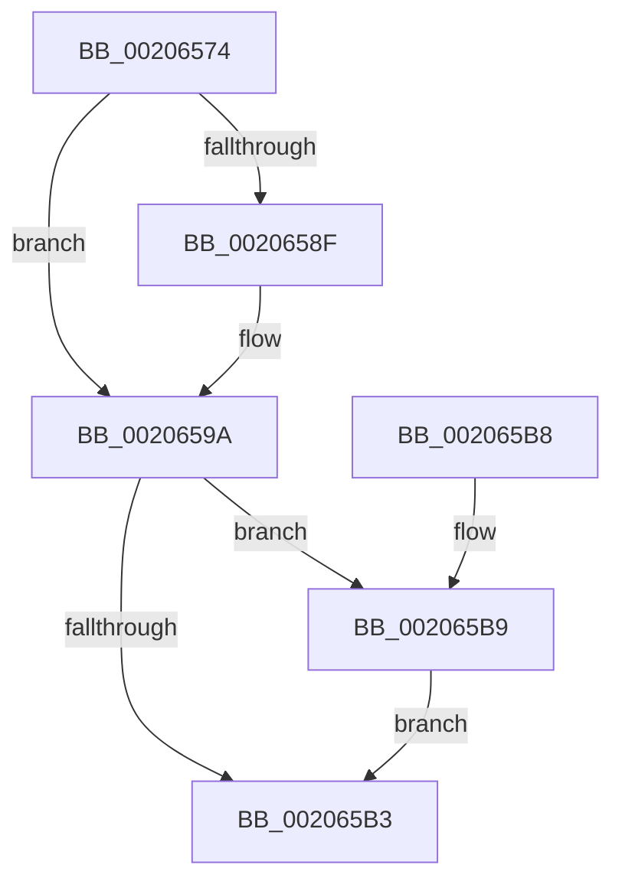

# SmKmStoreDereference

- RVA: `0x00206574`–`0x002065C0` (길이 `76` bytes)
- VA: `0x0000000140206574`
- 실행 섹션: `.text`
- PDB 이름 있음: `예`; PDB Function 태그: `아니요`
- unwind 정보 RVA: `0x0005CEE8`
- 디코드: `23`개 명령, `76/76` bytes 표시
- 미해석 바이트: `0` (있으면 어셈블리에 `.byte`로 보존)

> 이 문서는 커널 이미지의 기계어와 PDB 기호를 분석해 생성했습니다. 4번과 5번은 함수 원형과 자료형을 바이너리 사용 방식에서 추정한 C 해석이며 원본 소스 복구 결과는 아닙니다.

## 1. Dependencies

- 직접 호출 지점: **1**; 고유 호출 대상: **1**
- 직접 호출자로 확인된 함수: **21**
- RIP 상대 이미지 참조: **0**

### Outgoing calls
- `0x002065B9` → [ExfReleaseRundownProtection](../34/ExfReleaseRundownProtection_function_00349EB0.md) (function, `0x00349EB0`)

### Direct callers
- [sub_00205FB8](Unknown_function_00205FB8.md) at `0x00205FC9`
- [SMKM_STORE_MGR&lt;SM_TRAITS&gt;::SmpPageEvict](../24/SMKM_STORE_MGR_SM_TRAITS_SmpPageEvict_function_0024A5F4.md) at `0x0024A780`
- [SmPageWrite](../34/SmPageWrite_function_0034B864.md) at `0x0034B9BF`
- [SmPageWrite](../34/SmPageWrite_function_0034B864.md) at `0x0034BA36`
- [SMKM_STORE_MGR&lt;SM_TRAITS&gt;::SmPageWrite](../34/SMKM_STORE_MGR_SM_TRAITS_SmPageWrite_function_0034BA54.md) at `0x0034BC99`
- [SMKM_STORE_MGR&lt;SM_TRAITS&gt;::SmUpdateMemoryConditions](../34/SMKM_STORE_MGR_SM_TRAITS_SmUpdateMemoryConditions_function_0034BD60.md) at `0x0034BDD6`
- [SMKM_STORE_MGR&lt;SM_TRAITS&gt;::SmHighMemPriorityWatchdogWorker](../34/SMKM_STORE_MGR_SM_TRAITS_SmHighMemPriorityWatchdogWorker_function_0034C080.md) at `0x0034C191`
- [SMKM_STORE_MGR&lt;SM_TRAITS&gt;::SmPageRead](../34/SMKM_STORE_MGR_SM_TRAITS_SmPageRead_function_0034C1D0.md) at `0x0034C45C`
- [SMKM_STORE_MGR&lt;SM_TRAITS&gt;::SmStoreRequest](../4A/SMKM_STORE_MGR_SM_TRAITS_SmStoreRequest_function_004A2160.md) at `0x004A21AC`
- [ST_STORE&lt;SM_TRAITS&gt;::StDmDeviceError](../60/ST_STORE_SM_TRAITS_StDmDeviceError_function_0060D2C4.md) at `0x0060D405`
- [SmKmStoreTerminateWorker](../60/SmKmStoreTerminateWorker_function_0060FB30.md) at `0x0060FD69`
- [SmKmStoreTerminateWorker](../60/SmKmStoreTerminateWorker_function_0060FB30.md) at `0x0060FE4E`
- [SMKM_STORE_MGR&lt;SM_TRAITS&gt;::SmStoreContentsRundown](../61/SMKM_STORE_MGR_SM_TRAITS_SmStoreContentsRundown_function_00610ADC.md) at `0x00610BAA`
- [SmpDeviceIoCompletion](../61/SmpDeviceIoCompletion_function_00610CC0.md) at `0x00610D6A`
- [SmpIoCompletionApc](../61/SmpIoCompletionApc_function_00610D90.md) at `0x00610E00`
- [SmGetStoreOwnerProcessId](../61/SmGetStoreOwnerProcessId_function_00610E4C.md) at `0x00610F6F`
- [SmIssueIo](../61/SmIssueIo_function_00610F90.md) at `0x006110F8`
- [SmPartitionCleanup](../../page/7A/SmPartitionCleanup_function_007A5C14.md) at `0x007A5C2C`
- [SmProcessListRequestExtended](../../page/7A/SmProcessListRequestExtended_function_007A6A28.md) at `0x007A6AFA`
- [SmProcessListRequestExtended](../../page/7A/SmProcessListRequestExtended_function_007A6A28.md) at `0x007A6B1D`
- [SmEtwEnableCallback](../../page/7A/SmEtwEnableCallback_function_007AA080.md) at `0x007AA16A`
- [SmpKeyedStoreCreate](../../page/A5/SmpKeyedStoreCreate_function_00A50B64.md) at `0x00A50CA0`
- [SmProcessCreateRequest](../../page/A5/SmProcessCreateRequest_function_00A50DD0.md) at `0x00A51285`
- [SmProcessDeleteNotification](../../page/A6/SmProcessDeleteNotification_function_00A686F4.md) at `0x00A68769`

### Static image references
- 디코드된 RIP-relative 메모리 참조가 없습니다.

## 2. Other-region calls and transfers

- 다른 실행 섹션으로 향하는 call: **0**
- 별도 외부 분기/꼬리 이동을 확인하지 못했습니다.

## 3. Assembly (complete function range)

```asm
00206574  48 83 EC 28                     sub rsp, 0x28
00206578  81 E2 FF 03 00 00               and edx, 0x3ff
0020657E  8B C2                           mov eax, edx
00206580  48 C1 E8 05                     shr rax, 5
00206584  4C 8B 04 C1                     mov r8, qword ptr [rcx + rax*8]
00206588  33 C9                           xor ecx, ecx
0020658A  4D 85 C0                        test r8, r8
0020658D  74 0B                           je 0x14020659a
0020658F  83 E2 1F                        and edx, 0x1f
00206592  48 8D 04 92                     lea rax, [rdx + rdx*4]
00206596  49 8D 0C C0                     lea rcx, [r8 + rax*8]
0020659A  48 83 C1 08                     add rcx, 8
0020659E  0F 0D 09                        prefetchw byte ptr [rcx]
002065A1  48 8B 01                        mov rax, qword ptr [rcx]
002065A4  48 83 E0 FE                     and rax, 0xfffffffffffffffe
002065A8  48 8D 50 FE                     lea rdx, [rax - 2]
002065AC  F0 48 0F B1 11                  lock cmpxchg qword ptr [rcx], rdx
002065B1  75 06                           jne 0x1402065b9
002065B3  48 83 C4 28                     add rsp, 0x28
002065B7  C3                              ret
002065B8  CC                              int3
002065B9  E8 F2 38 14 00                  call 0x140349eb0
002065BE  EB F3                           jmp 0x1402065b3
```

## 4. C-style interpretation (structured pseudocode)

```c
__int64 __fastcall SmKmStoreDereference(__int64 a1, int a2)
{
    __int64 result;
    __int64 v_rsp;

    v_rsp = (v_rsp) - (40);
    a2 = (unsigned int)((a2) & (0x3FFULL));
    result = ((unsigned int)(a2)) >> (5);
    a1 = 0;
    if (*(unsigned __int64 *)(a1 + result * 8) != 0) {
        a2 = (unsigned int)((a2) & (31));
        result = a2 + a2 * 4;
        a1 = *(unsigned __int64 *)(a1 + result * 8) + result * 8;
    }
    a1 = (a1) + (8);
    result = (*(unsigned __int64 *)(a1)) & (-2);
    if (condition_is_not_equal) goto loc_002065B9;
loc_002065B3:
    v_rsp = (v_rsp) + (40);
    return result;
loc_002065B9:
    result = ExfReleaseRundownProtection(a1, result - 2, *(unsigned __int64 *)(a1 + result * 8), a4);
    goto loc_002065B3;
}
```

## 5. (Beta) C Style

```c
int64_t SmKmStoreDereference(void *Arg1, void *Arg2)
{
    uint8_t *arg1 = (uint8_t *)Arg1;
    uint8_t *arg2 = (uint8_t *)Arg2;

    int64_t result;
    int64_t local_rsp;

    local_rsp = (local_rsp) - (40);
    Arg2 = (uint32_t)((Arg2) & (0x3FFULL));
    result = ((uint32_t)(Arg2)) >> (5);
    Arg1 = 0;
    if (*(uint64_t *)(arg1 + result * 8) != 0) {
        Arg2 = (uint32_t)((Arg2) & (31));
        result = Arg2 + Arg2 * 4;
        Arg1 = *(uint64_t *)(arg1 + result * 8) + result * 8;
    }
    Arg1 = (Arg1) + (8);
    result = (*(uint64_t *)(arg1)) & (-2);
    if (condition_is_not_equal) goto loc_002065B9;
loc_002065B3:
    local_rsp = (local_rsp) + (40);
    return result;
loc_002065B9:
    result = ExfReleaseRundownProtection(Arg1, result - 2, *(uint64_t *)(arg1 + result * 8), a4);
    goto loc_002065B3;
}
```

### 관측된 메모리 오프셋

구조체 형식이 확인되지 않은 접근은 인자 기준의 오프셋으로만 기록했습니다.

| 기준 인자 | 오프셋 표현 | 폭 (bit) | 접근 |
|---|---:|---:|---|
| `Arg1` | `+ 0x0 + rax*8` | `64` | `R` |
| `Arg2` | `+ 0x0 + rdx*4` | `64` | `R` |

## 6. Execution-region graph

[열기: 2D/3D 그래프와 함수 탐색 컨트롤 패널](../../../control-panel.html?section=text&rva=0x00206574&view=graph)

- 2D 그래프는 위에서 아래로 흐르고, 3D 그래프는 빈 공간을 드래그해 회전합니다. Shift+드래그는 이동, 휠은 확대·축소, 함수 노드 선택은 대상 보고서 이동입니다.

### Static fallback


