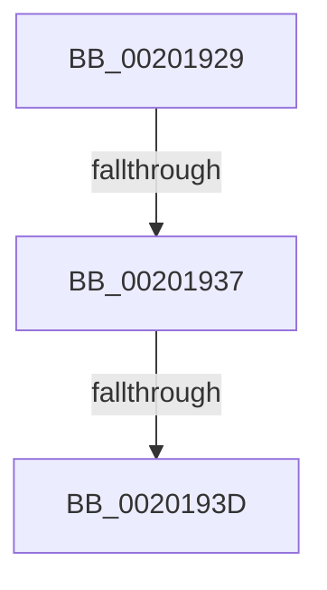

# sub_00201929

- RVA: `0x00201929`–`0x00201968` (길이 `63` bytes)
- VA: `0x0000000140201929`
- 실행 섹션: `.text`
- PDB 이름 있음: `아니요`; PDB Function 태그: `아니요`
- unwind 정보 RVA: `0x0005C7C0`
- 디코드: `18`개 명령, `63/63` bytes 표시
- 미해석 바이트: `0` (있으면 어셈블리에 `.byte`로 보존)

> 이 문서는 커널 이미지의 기계어와 PDB 기호를 분석해 생성했습니다. 4번과 5번은 함수 원형과 자료형을 바이너리 사용 방식에서 추정한 C 해석이며 원본 소스 복구 결과는 아닙니다.

## 1. Dependencies

- 직접 호출 지점: **2**; 고유 호출 대상: **2**
- 직접 호출자로 확인된 함수: **0**
- RIP 상대 이미지 참조: **0**

### Outgoing calls
- `0x0020193D` → [KiAdvanceReadyQueueEnumeratorToNextList](KiAdvanceReadyQueueEnumeratorToNextList_function_00201C50.md) (function, `0x00201C50`)
- `0x0020194E` → [KiRemoveThreadFromScbQueue](KiRemoveThreadFromScbQueue_function_00201B64.md) (function, `0x00201B64`)

### Direct callers
- 이 함수 시작 RVA로 연결되는 직접 call은 확인되지 않았습니다. 간접 호출은 완전히 역산할 수 없습니다.

### Static image references
- 디코드된 RIP-relative 메모리 참조가 없습니다.

## 2. Other-region calls and transfers

- 다른 실행 섹션으로 향하는 call: **0**
- call이 아닌 외부 분기/꼬리 이동: **2**
  - `0x00201935` → [sub_00201969](Unknown_function_00201969.md) (`tail-transfer`)
  - `0x0020193B` → [sub_00201969](Unknown_function_00201969.md) (`tail-transfer`)

## 3. Assembly (complete function range)

```asm
00201929  48 89 6C 24 30                  mov qword ptr [rsp + 0x30], rbp
0020192E  48 8B 69 10                     mov rbp, qword ptr [rcx + 0x10]
00201932  49 39 00                        cmp qword ptr [r8], rax
00201935  75 32                           jne 0x140201969
00201937  49 39 40 08                     cmp qword ptr [r8 + 8], rax
0020193B  75 2C                           jne 0x140201969
0020193D  E8 0E 03 00 00                  call 0x140201c50
00201942  44 8B CE                        mov r9d, esi
00201945  4C 8B C7                        mov r8, rdi
00201948  48 8B D5                        mov rdx, rbp
0020194B  48 8B CB                        mov rcx, rbx
0020194E  E8 11 02 00 00                  call 0x140201b64
00201953  48 8B 6C 24 30                  mov rbp, qword ptr [rsp + 0x30]
00201958  48 8B 5C 24 38                  mov rbx, qword ptr [rsp + 0x38]
0020195D  48 8B 74 24 40                  mov rsi, qword ptr [rsp + 0x40]
00201962  48 83 C4 20                     add rsp, 0x20
00201966  5F                              pop rdi
00201967  C3                              ret
```

## 4. C-style interpretation (structured pseudocode)

```c
__int64 __fastcall sub_00201929(__int64 a1, __int64 a2, __int64 a3, __int64 a4, __int64 a5, __int64 a6, __int64 a7, __int64 a8)
{
    __int64 result;
    __int64 v_rsp;
    unsigned __int64 v_stack_p30;

    v_stack_p30 = v_rbp;
    result = KiAdvanceReadyQueueEnumeratorToNextList(a1, a2, a3, a4);
    result = KiRemoveThreadFromScbQueue(v_rbx, *(unsigned __int64 *)(a1 + 16), v_rdi, (unsigned int)((unsigned int)(v_rsi)));
    v_rsp = (v_rsp) + (32);
    return result;
}
```

## 5. (Beta) C Style

```c
int64_t sub_00201929(void *Arg1, int64_t Arg2, void *Arg3, int64_t Arg4, uint64_t Arg5, int64_t Arg6, int64_t Arg7, int64_t Arg8)
{
    uint8_t *arg1 = (uint8_t *)Arg1;
    uint8_t *arg3 = (uint8_t *)Arg3;

    int64_t result;
    int64_t local_rsp;
    uint64_t v_stack_p30;

    v_stack_p30 = local_rbp;
    result = KiAdvanceReadyQueueEnumeratorToNextList(Arg1, Arg2, Arg3, Arg4);
    result = KiRemoveThreadFromScbQueue(local_rbx, *(uint64_t *)(arg1 + 0x10), local_rdi, (uint32_t)((uint32_t)(local_rsi)));
    local_rsp = (local_rsp) + (32);
    return result;
}
```

### 관측된 메모리 오프셋

구조체 형식이 확인되지 않은 접근은 인자 기준의 오프셋으로만 기록했습니다.

| 기준 인자 | 오프셋 표현 | 폭 (bit) | 접근 |
|---|---:|---:|---|
| `Arg1` | `+ 0x10` | `64` | `R` |
| `Arg3` | `+ 0x0` | `64` | `R` |
| `Arg3` | `+ 0x8` | `64` | `R` |

## 6. Execution-region graph

[열기: 2D/3D 그래프와 함수 탐색 컨트롤 패널](../../../control-panel.html?section=text&rva=0x00201929&view=graph)

- 2D 그래프는 위에서 아래로 흐르고, 3D 그래프는 빈 공간을 드래그해 회전합니다. Shift+드래그는 이동, 휠은 확대·축소, 함수 노드 선택은 대상 보고서 이동입니다.

### Static fallback


