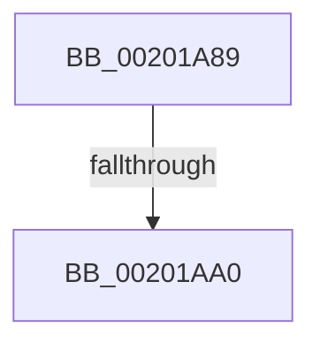

# sub_00201A89

- RVA: `0x00201A89`–`0x00201AB8` (길이 `47` bytes)
- VA: `0x0000000140201A89`
- 실행 섹션: `.text`
- PDB 이름 있음: `아니요`; PDB Function 태그: `아니요`
- unwind 정보 RVA: `0x0005C83C`
- 디코드: `9`개 명령, `47/47` bytes 표시
- 미해석 바이트: `0` (있으면 어셈블리에 `.byte`로 보존)

> 이 문서는 커널 이미지의 기계어와 PDB 기호를 분석해 생성했습니다. 4번과 5번은 함수 원형과 자료형을 바이너리 사용 방식에서 추정한 C 해석이며 원본 소스 복구 결과는 아닙니다.

## 1. Dependencies

- 직접 호출 지점: **0**; 고유 호출 대상: **0**
- 직접 호출자로 확인된 함수: **0**
- RIP 상대 이미지 참조: **0**

### Outgoing calls
- 직접 디코드된 call 명령이 없습니다.

### Direct callers
- 이 함수 시작 RVA로 연결되는 직접 call은 확인되지 않았습니다. 간접 호출은 완전히 역산할 수 없습니다.

### Static image references
- 디코드된 RIP-relative 메모리 참조가 없습니다.

## 2. Other-region calls and transfers

- 다른 실행 섹션으로 향하는 call: **0**
- call이 아닌 외부 분기/꼬리 이동: **2**
  - `0x00201A9A` → [sub_00201B22](Unknown_function_00201B22.md) (`tail-transfer`)
  - `0x00201AB6` → [sub_00201AB8 + 0x57](Unknown_function_00201AB8.md) (`tail-transfer`)

## 3. Assembly (complete function range)

```asm
00201A89  48 89 6C 24 38                  mov qword ptr [rsp + 0x38], rbp
00201A8E  33 ED                           xor ebp, ebp
00201A90  F0 48 0F BA AF 00 03 00 00 00   lock bts qword ptr [rdi + 0x300], 0
00201A9A  0F 82 82 00 00 00               jb 0x140201b22
00201AA0  48 8B 87 08 03 00 00            mov rax, qword ptr [rdi + 0x308]
00201AA7  41 B1 01                        mov r9b, 1
00201AAA  48 8B 6C 24 38                  mov rbp, qword ptr [rsp + 0x38]
00201AAF  48 39 86 00 07 00 00            cmp qword ptr [rsi + 0x700], rax
00201AB6  75 57                           jne 0x140201b0f
```

## 4. C-style interpretation (structured pseudocode)

```c
__int64 __fastcall sub_00201A89(__int64 a1, __int64 a2, __int64 a3, __int64 a4, __int64 a5, __int64 a6, __int64 a7)
{
    __int64 v_rbp;
    unsigned __int64 v_stack_p38;

    v_stack_p38 = v_rbp;
    v_rbp = 0;
}
```

## 5. (Beta) C Style

```c
int64_t sub_00201A89(int64_t Arg1, int64_t Arg2, int64_t Arg3, int64_t Arg4, uint64_t Arg5, uint64_t Arg6, int64_t Arg7)
{
    int64_t local_rbp;
    uint64_t v_stack_p38;

    v_stack_p38 = local_rbp;
    local_rbp = 0;
}
```

## 6. Execution-region graph

[열기: 2D/3D 그래프와 함수 탐색 컨트롤 패널](../../../control-panel.html?section=text&rva=0x00201A89&view=graph)

- 2D 그래프는 위에서 아래로 흐르고, 3D 그래프는 빈 공간을 드래그해 회전합니다. Shift+드래그는 이동, 휠은 확대·축소, 함수 노드 선택은 대상 보고서 이동입니다.

### Static fallback


