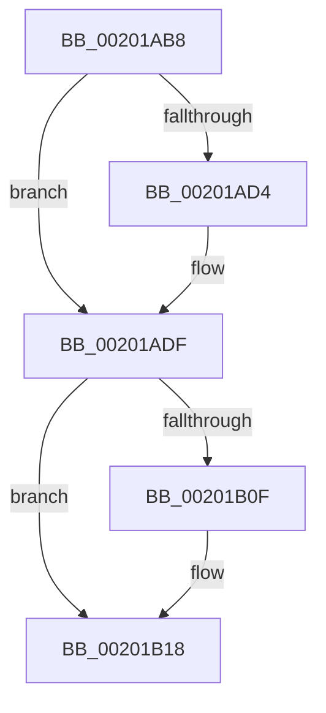

# sub_00201AB8

- RVA: `0x00201AB8`–`0x00201B22` (길이 `106` bytes)
- VA: `0x0000000140201AB8`
- 실행 섹션: `.text`
- PDB 이름 있음: `아니요`; PDB Function 태그: `아니요`
- unwind 정보 RVA: `0x0005C850`
- 디코드: `18`개 명령, `106/106` bytes 표시
- 미해석 바이트: `0` (있으면 어셈블리에 `.byte`로 보존)

> 이 문서는 커널 이미지의 기계어와 PDB 기호를 분석해 생성했습니다. 4번과 5번은 함수 원형과 자료형을 바이너리 사용 방식에서 추정한 C 해석이며 원본 소스 복구 결과는 아닙니다.

## 1. Dependencies

- 직접 호출 지점: **0**; 고유 호출 대상: **0**
- 직접 호출자로 확인된 함수: **0**
- RIP 상대 이미지 참조: **0**

### Outgoing calls
- 직접 디코드된 call 명령이 없습니다.

### Direct callers
- 이 함수 시작 RVA로 연결되는 직접 call은 확인되지 않았습니다. 간접 호출은 완전히 역산할 수 없습니다.

### Static image references
- 디코드된 RIP-relative 메모리 참조가 없습니다.

## 2. Other-region calls and transfers

- 다른 실행 섹션으로 향하는 call: **0**
- call이 아닌 외부 분기/꼬리 이동: **1**
  - `0x00201B1D` → [KiUpdateSoftParkElectionStatisticsOnRemoval + 0x23](KiUpdateSoftParkElectionStatisticsOnRemoval_function_00201A50.md) (`tail-transfer`)

## 3. Assembly (complete function range)

```asm
00201AB8  FF 8F 10 03 00 00               dec dword ptr [rdi + 0x310]
00201ABE  8B 86 FC 06 00 00               mov eax, dword ptr [rsi + 0x6fc]
00201AC4  48 29 87 18 03 00 00            sub qword ptr [rdi + 0x318], rax
00201ACB  83 BF 10 03 00 00 00            cmp dword ptr [rdi + 0x310], 0
00201AD2  75 0B                           jne 0x140201adf
00201AD4  48 C7 87 E0 06 00 00 00 00 00 00  mov qword ptr [rdi + 0x6e0], 0
00201ADF  0F B6 8E 24 07 00 00            movzx ecx, byte ptr [rsi + 0x724]
00201AE6  0F B6 86 26 07 00 00            movzx eax, byte ptr [rsi + 0x726]
00201AED  48 8D 14 48                     lea rdx, [rax + rcx*2]
00201AF1  0F B6 86 25 07 00 00            movzx eax, byte ptr [rsi + 0x725]
00201AF8  48 8D 0C D0                     lea rcx, [rax + rdx*8]
00201AFC  8B 86 FC 06 00 00               mov eax, dword ptr [rsi + 0x6fc]
00201B02  48 29 84 CF 60 03 00 00         sub qword ptr [rdi + rcx*8 + 0x360], rax
00201B0A  45 84 C9                        test r9b, r9b
00201B0D  74 09                           je 0x140201b18
00201B0F  F0 48 83 A7 00 03 00 00 00      lock and qword ptr [rdi + 0x300], 0
00201B18  48 8B 5C 24 30                  mov rbx, qword ptr [rsp + 0x30]
00201B1D  E9 51 FF FF FF                  jmp 0x140201a73
```

## 4. C-style interpretation (structured pseudocode)

```c
__int64 __fastcall sub_00201AB8(__int64 a1, __int64 a2, __int64 a3, unsigned __int8 a4, __int64 a5, __int64 a6)
{
    if ((*(unsigned int *)(v_rdi + 784)) == 0) {
        *(unsigned __int64 *)(v_rdi + 1760) = 0;
    }
    if (a4 != 0) {
    }
}
```

## 5. (Beta) C Style

```c
int64_t sub_00201AB8(int64_t Arg1, int64_t Arg2, int64_t Arg3, uint8_t Arg4, uint64_t Arg5, int64_t Arg6)
{
    if ((*(uint32_t *)(local_rdi + 0x310)) == 0) {
        *(uint64_t *)(local_rdi + 0x6E0) = 0;
    }
    if (Arg4 != 0) {
    }
}
```

## 6. Execution-region graph

[열기: 2D/3D 그래프와 함수 탐색 컨트롤 패널](../../../control-panel.html?section=text&rva=0x00201AB8&view=graph)

- 2D 그래프는 위에서 아래로 흐르고, 3D 그래프는 빈 공간을 드래그해 회전합니다. Shift+드래그는 이동, 휠은 확대·축소, 함수 노드 선택은 대상 보고서 이동입니다.

### Static fallback


