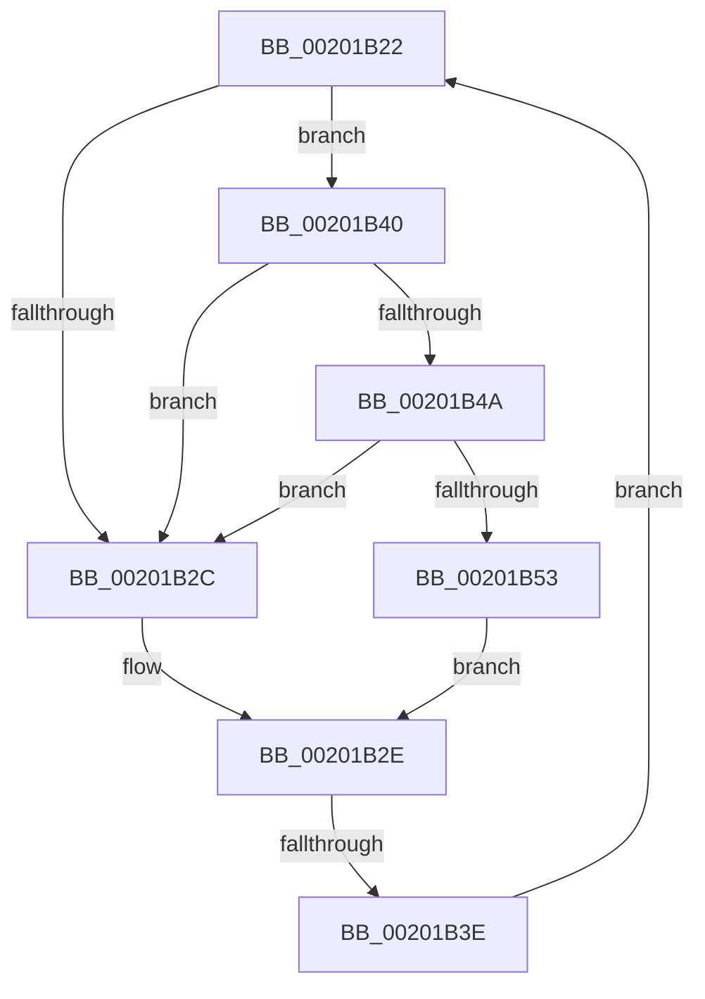

# sub_00201B22

- RVA: `0x00201B22`–`0x00201B5C` (길이 `58` bytes)
- VA: `0x0000000140201B22`
- 실행 섹션: `.text`
- PDB 이름 있음: `아니요`; PDB Function 태그: `아니요`
- unwind 정보 RVA: `0x0005C860`
- 디코드: `17`개 명령, `58/58` bytes 표시
- 미해석 바이트: `0` (있으면 어셈블리에 `.byte`로 보존)

> 이 문서는 커널 이미지의 기계어와 PDB 기호를 분석해 생성했습니다. 4번과 5번은 함수 원형과 자료형을 바이너리 사용 방식에서 추정한 C 해석이며 원본 소스 복구 결과는 아닙니다.

## 1. Dependencies

- 직접 호출 지점: **2**; 고유 호출 대상: **2**
- 직접 호출자로 확인된 함수: **0**
- RIP 상대 이미지 참조: **2**

### Outgoing calls
- `0x00201B4A` → [KiCheckVpBackingLongSpinWaitHypercall](../30/KiCheckVpBackingLongSpinWaitHypercall_function_0030F490.md) (function, `0x0030F490`)
- `0x00201B55` → [HvlNotifyLongSpinWait](../30/HvlNotifyLongSpinWait_function_0030F460.md) (function, `0x0030F460`)

### Direct callers
- 이 함수 시작 RVA로 연결되는 직접 call은 확인되지 않았습니다. 간접 호출은 완전히 역산할 수 없습니다.

### Static image references
- `0x00201B24` → RVA `0x00FC52AC` (`ALMOSTRO`; reference)
- `0x00201B40` → RVA `0x00FC6AB8` (`ALMOSTRO`; read)

## 2. Other-region calls and transfers

- 다른 실행 섹션으로 향하는 call: **0**
- call이 아닌 외부 분기/꼬리 이동: **1**
  - `0x00201B38` → [sub_00201A89 + 0x7](Unknown_function_00201A89.md) (`tail-transfer`)

## 3. Assembly (complete function range)

```asm
00201B22  FF C5                           inc ebp
00201B24  85 2D 82 37 DC 00               test dword ptr [rip + 0xdc3782], ebp
00201B2A  74 14                           je 0x140201b40
00201B2C  F3 90                           pause
00201B2E  48 8B 87 00 03 00 00            mov rax, qword ptr [rdi + 0x300]
00201B35  48 85 C0                        test rax, rax
00201B38  0F 84 52 FF FF FF               je 0x140201a90
00201B3E  EB E2                           jmp 0x140201b22
00201B40  8B 05 72 4F DC 00               mov eax, dword ptr [rip + 0xdc4f72]
00201B46  A8 40                           test al, 0x40
00201B48  74 E2                           je 0x140201b2c
00201B4A  E8 41 D9 10 00                  call 0x14030f490
00201B4F  84 C0                           test al, al
00201B51  74 D9                           je 0x140201b2c
00201B53  8B CD                           mov ecx, ebp
00201B55  E8 06 D9 10 00                  call 0x14030f460
00201B5A  EB D2                           jmp 0x140201b2e
```

## 4. C-style interpretation (structured pseudocode)

```c
__int64 __fastcall sub_00201B22(void)
{
    __int64 result;
    __int64 v_rbp;

    v_rbp = (unsigned int)((v_rbp) + 1);
    if (((*(unsigned int *)(v_rip + 14432130)) & ((unsigned int)(v_rbp))) == 0) goto loc_00201B40;
loc_00201B2C:
loc_00201B2E:
    goto loc_00201B22;
loc_00201B40:
    if ((((unsigned __int8)((unsigned int)(*(unsigned int *)(v_rip + 14438258)))) & (64)) == 0) goto loc_00201B2C;
    result = KiCheckVpBackingLongSpinWaitHypercall(a1, a2, a3, a4);
    if ((unsigned __int8)(result) == 0) goto loc_00201B2C;
    result = HvlNotifyLongSpinWait((unsigned int)((unsigned int)(v_rbp)), a2, a3, a4);
    goto loc_00201B2E;
}
```

## 5. (Beta) C Style

```c
void sub_00201B22(void)
{
    int64_t result;
    int64_t local_rbp;

    local_rbp = (uint32_t)((local_rbp) + 1);
    if (((*(uint32_t *)(v_rip + 0xDC3782)) & ((uint32_t)(local_rbp))) == 0) goto loc_00201B40;
loc_00201B2C:
loc_00201B2E:
    goto loc_00201B22;
loc_00201B40:
    if ((((uint8_t)((uint32_t)(*(uint32_t *)(v_rip + 0xDC4F72)))) & (64)) == 0) goto loc_00201B2C;
    result = KiCheckVpBackingLongSpinWaitHypercall(a1, a2, a3, a4);
    if ((uint8_t)(result) == 0) goto loc_00201B2C;
    result = HvlNotifyLongSpinWait((uint32_t)((uint32_t)(local_rbp)), a2, a3, a4);
    goto loc_00201B2E;
}
```

## 6. Execution-region graph

[열기: 2D/3D 그래프와 함수 탐색 컨트롤 패널](../../../control-panel.html?section=text&rva=0x00201B22&view=graph)

- 2D 그래프는 위에서 아래로 흐르고, 3D 그래프는 빈 공간을 드래그해 회전합니다. Shift+드래그는 이동, 휠은 확대·축소, 함수 노드 선택은 대상 보고서 이동입니다.

### Static fallback


