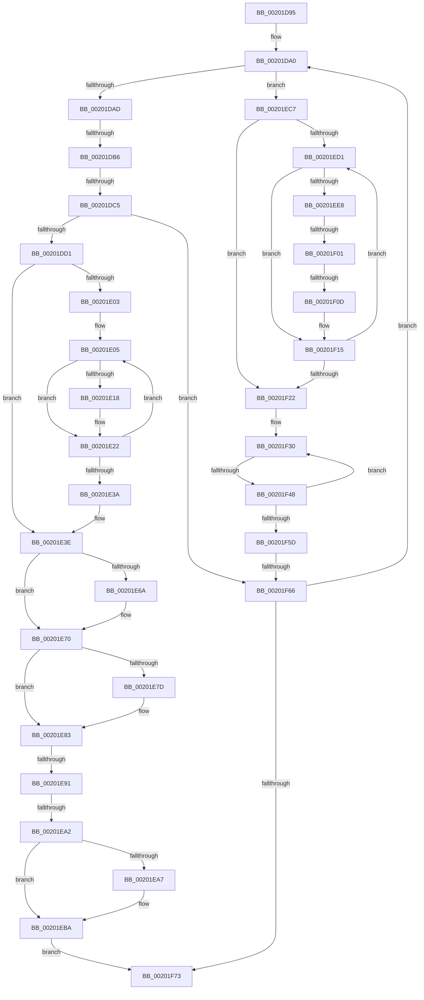

# sub_00201D95

- RVA: `0x00201D95`–`0x00201F78` (길이 `483` bytes)
- VA: `0x0000000140201D95`
- 실행 섹션: `.text`
- PDB 이름 있음: `아니요`; PDB Function 태그: `아니요`
- unwind 정보 RVA: `0x0005C8A8`
- 디코드: `136`개 명령, `483/483` bytes 표시
- 미해석 바이트: `0` (있으면 어셈블리에 `.byte`로 보존)

> 이 문서는 커널 이미지의 기계어와 PDB 기호를 분석해 생성했습니다. 4번과 5번은 함수 원형과 자료형을 바이너리 사용 방식에서 추정한 C 해석이며 원본 소스 복구 결과는 아닙니다.

## 1. Dependencies

- 직접 호출 지점: **0**; 고유 호출 대상: **0**
- 직접 호출자로 확인된 함수: **0**
- RIP 상대 이미지 참조: **0**

### Outgoing calls
- 직접 디코드된 call 명령이 없습니다.

### Direct callers
- 이 함수 시작 RVA로 연결되는 직접 call은 확인되지 않았습니다. 간접 호출은 완전히 역산할 수 없습니다.

### Static image references
- 디코드된 RIP-relative 메모리 참조가 없습니다.

## 2. Other-region calls and transfers

- 다른 실행 섹션으로 향하는 call: **0**
- call이 아닌 외부 분기/꼬리 이동: **8**
  - `0x00201DB0` → [sub_00201F99 + 0x16](Unknown_function_00201F99.md) (`tail-transfer`)
  - `0x00201DBF` → [sub_00201F99 + 0x108](Unknown_function_00201F99.md) (`tail-transfer`)
  - `0x00201E8B` → [sub_00201F99 + 0x1F6](Unknown_function_00201F99.md) (`tail-transfer`)
  - `0x00201E9C` → [sub_00201F99 + 0x14E](Unknown_function_00201F99.md) (`tail-transfer`)
  - `0x00201EFB` → [sub_00201F99](Unknown_function_00201F99.md) (`tail-transfer`)
  - `0x00201F07` → [sub_00201F99 + 0x164](Unknown_function_00201F99.md) (`tail-transfer`)
  - `0x00201F42` → [sub_00201F99 + 0x177](Unknown_function_00201F99.md) (`tail-transfer`)
  - `0x00201F60` → [sub_00201F99 + 0x18B](Unknown_function_00201F99.md) (`tail-transfer`)

## 3. Assembly (complete function range)

```asm
00201D95  48 89 7C 24 38                  mov qword ptr [rsp + 0x38], rdi
00201D9A  66 0F 1F 44 00 00               nop word ptr [rax + rax]
00201DA0  40 0F B6 CE                     movzx ecx, sil
00201DA4  83 F9 02                        cmp ecx, 2
00201DA7  0F 84 1A 01 00 00               je 0x140201ec7
00201DAD  83 E9 01                        sub ecx, 1
00201DB0  0F 85 F9 01 00 00               jne 0x140201faf
00201DB6  8B 0B                           mov ecx, dword ptr [rbx]
00201DB8  8B C5                           mov eax, ebp
00201DBA  89 6B 04                        mov dword ptr [rbx + 4], ebp
00201DBD  85 C9                           test ecx, ecx
00201DBF  0F 85 DC 02 00 00               jne 0x1402020a1
00201DC5  83 E0 FE                        and eax, 0xfffffffe
00201DC8  89 43 04                        mov dword ptr [rbx + 4], eax
00201DCB  0F 84 95 01 00 00               je 0x140201f66
00201DD1  44 0F B6 43 09                  movzx r8d, byte ptr [rbx + 9]
00201DD6  41 BA 01 00 00 00               mov r10d, 1
00201DDC  44 0F BD C8                     bsr r9d, eax
00201DE0  44 88 43 0A                     mov byte ptr [rbx + 0xa], r8b
00201DE4  4B 8D 14 40                     lea rdx, [r8 + r8*2]
00201DE8  48 03 D2                        add rdx, rdx
00201DEB  44 88 4B 08                     mov byte ptr [rbx + 8], r9b
00201DEF  41 0F B6 C9                     movzx ecx, r9b
00201DF3  41 D3 E2                        shl r10d, cl
00201DF6  8B 4C D3 5C                     mov ecx, dword ptr [rbx + rdx*8 + 0x5c]
00201DFA  0B 4C D3 58                     or ecx, dword ptr [rbx + rdx*8 + 0x58]
00201DFE  41 85 CA                        test r10d, ecx
00201E01  75 3B                           jne 0x140201e3e
00201E03  8B 3B                           mov edi, dword ptr [rbx]
00201E05  41 FE C0                        inc r8b
00201E08  41 0F B6 C0                     movzx eax, r8b
00201E0C  45 0F B6 D8                     movzx r11d, r8b
00201E10  44 88 43 0A                     mov byte ptr [rbx + 0xa], r8b
00201E14  3B C7                           cmp eax, edi
00201E16  72 0A                           jb 0x140201e22
00201E18  45 32 C0                        xor r8b, r8b
00201E1B  40 88 6B 0A                     mov byte ptr [rbx + 0xa], bpl
00201E1F  45 32 DB                        xor r11b, r11b
00201E22  41 0F B6 C0                     movzx eax, r8b
00201E26  48 8D 0C 40                     lea rcx, [rax + rax*2]
00201E2A  48 03 C9                        add rcx, rcx
00201E2D  8B 54 CB 5C                     mov edx, dword ptr [rbx + rcx*8 + 0x5c]
00201E31  0B 54 CB 58                     or edx, dword ptr [rbx + rcx*8 + 0x58]
00201E35  41 85 D2                        test r10d, edx
00201E38  74 CB                           je 0x140201e05
00201E3A  45 0F B6 C3                     movzx r8d, r11b
00201E3E  41 0F B6 C0                     movzx eax, r8b
00201E42  32 D2                           xor dl, dl
00201E44  48 FF C0                        inc rax
00201E47  41 0F B6 C9                     movzx ecx, r9b
00201E4B  4C 8D 04 40                     lea r8, [rax + rax*2]
00201E4F  49 C1 E0 04                     shl r8, 4
00201E53  4C 03 C3                        add r8, rbx
00201E56  4D 8B 18                        mov r11, qword ptr [r8]
00201E59  4D 8B 50 08                     mov r10, qword ptr [r8 + 8]
00201E5D  40 88 6B 0B                     mov byte ptr [rbx + 0xb], bpl
00201E61  41 8B 40 28                     mov eax, dword ptr [r8 + 0x28]
00201E65  0F A3 C8                        bt eax, ecx
00201E68  73 06                           jae 0x140201e70
00201E6A  C6 43 0B 01                     mov byte ptr [rbx + 0xb], 1
00201E6E  B2 01                           mov dl, 1
00201E70  41 8B 40 2C                     mov eax, dword ptr [r8 + 0x2c]
00201E74  41 0F B6 C9                     movzx ecx, r9b
00201E78  0F A3 C8                        bt eax, ecx
00201E7B  73 06                           jae 0x140201e83
00201E7D  80 CA 02                        or dl, 2
00201E80  88 53 0B                        mov byte ptr [rbx + 0xb], dl
00201E83  0F B6 CA                        movzx ecx, dl
00201E86  8D 41 FF                        lea eax, [rcx - 1]
00201E89  85 C1                           test ecx, eax
00201E8B  0F 85 FE 02 00 00               jne 0x14020218f
00201E91  0F BC C1                        bsf eax, ecx
00201E94  88 43 0C                        mov byte ptr [rbx + 0xc], al
00201E97  0F B6 C8                        movzx ecx, al
00201E9A  84 C0                           test al, al
00201E9C  0F 84 45 02 00 00               je 0x1402020e7
00201EA2  83 F9 01                        cmp ecx, 1
00201EA5  75 13                           jne 0x140201eba
00201EA7  0F B6 43 08                     movzx eax, byte ptr [rbx + 8]
00201EAB  48 83 C0 04                     add rax, 4
00201EAF  48 C1 E0 04                     shl rax, 4
00201EB3  49 03 C2                        add rax, r10
00201EB6  48 89 43 20                     mov qword ptr [rbx + 0x20], rax
00201EBA  48 8B 43 20                     mov rax, qword ptr [rbx + 0x20]
00201EBE  48 89 43 28                     mov qword ptr [rbx + 0x28], rax
00201EC2  E9 AC 00 00 00                  jmp 0x140201f73
00201EC7  44 8B 03                        mov r8d, dword ptr [rbx]
00201ECA  32 D2                           xor dl, dl
00201ECC  45 85 C0                        test r8d, r8d
00201ECF  74 51                           je 0x140201f22
00201ED1  0F B6 C2                        movzx eax, dl
00201ED4  48 FF C0                        inc rax
00201ED7  48 8D 04 40                     lea rax, [rax + rax*2]
00201EDB  48 03 C0                        add rax, rax
00201EDE  44 8B 4C C3 20                  mov r9d, dword ptr [rbx + rax*8 + 0x20]
00201EE3  45 85 C9                        test r9d, r9d
00201EE6  74 2D                           je 0x140201f15
00201EE8  48 8B 0C C3                     mov rcx, qword ptr [rbx + rax*8]
00201EEC  48 81 C1 30 84 00 00            add rcx, 0x8430
00201EF3  4C 8B 41 08                     mov r8, qword ptr [rcx + 8]
00201EF7  41 F6 C0 01                     test r8b, 1
00201EFB  0F 85 98 00 00 00               jne 0x140201f99
00201F01  49 8B C8                        mov rcx, r8
00201F04  48 85 C9                        test rcx, rcx
00201F07  0F 85 F0 01 00 00               jne 0x1402020fd
00201F0D  48 8B CD                        mov rcx, rbp
00201F10  48 89 4C C3 10                  mov qword ptr [rbx + rax*8 + 0x10], rcx
00201F15  44 8B 03                        mov r8d, dword ptr [rbx]
00201F18  FE C2                           inc dl
00201F1A  0F B6 C2                        movzx eax, dl
00201F1D  41 3B C0                        cmp eax, r8d
00201F20  72 AF                           jb 0x140201ed1
00201F22  0F B6 53 09                     movzx edx, byte ptr [rbx + 9]
00201F26  40 32 FF                        xor dil, dil
00201F29  44 0F B6 D2                     movzx r10d, dl
00201F2D  4C 8B DD                        mov r11, rbp
00201F30  0F B6 C2                        movzx eax, dl
00201F33  48 8D 0C 40                     lea rcx, [rax + rax*2]
00201F37  48 03 C9                        add rcx, rcx
00201F3A  4C 8B 4C CB 40                  mov r9, qword ptr [rbx + rcx*8 + 0x40]
00201F3F  4D 85 C9                        test r9, r9
00201F42  0F 85 C8 01 00 00               jne 0x140202110
00201F48  FE C2                           inc dl
00201F4A  8B CD                           mov ecx, ebp
00201F4C  0F B6 C2                        movzx eax, dl
00201F4F  41 3B C0                        cmp eax, r8d
00201F52  0F 42 C8                        cmovb ecx, eax
00201F55  0F B6 D1                        movzx edx, cl
00201F58  41 3A CA                        cmp cl, r10b
00201F5B  75 D3                           jne 0x140201f30
00201F5D  4D 85 DB                        test r11, r11
00201F60  0F 85 BE 01 00 00               jne 0x140202124
00201F66  40 FE C6                        inc sil
00201F69  40 80 FE 04                     cmp sil, 4
00201F6D  0F 82 2D FE FF FF               jb 0x140201da0
00201F73  48 8B 7C 24 38                  mov rdi, qword ptr [rsp + 0x38]
```

## 4. C-style interpretation (structured pseudocode)

```c
__int64 __fastcall sub_00201D95(__int64 a1, __int64 a2, __int64 a3, __int64 a4, __int64 a5, __int64 a6, __int64 a7)
{
    __int64 result;
    __int64 v_r10;
    __int64 v_r11;
    __int64 v_rdi;
    __int64 v_rsi;
    unsigned __int64 v_stack_p38;

    v_stack_p38 = v_rdi;
loc_00201DA0:
    if (((unsigned int)((unsigned __int8)(v_rsi))) == 2) goto loc_00201EC7;
    a1 = (unsigned int)(((unsigned __int8)(v_rsi)) - (1));
    *(unsigned int *)(v_rbx + 4) = (unsigned int)(v_rbp);
    result = (unsigned int)(((unsigned int)((unsigned int)(v_rbp))) & (0xFFFFFFFEULL));
    *(unsigned int *)(v_rbx + 4) = (unsigned int)(result);
    if (condition_is_equal) goto loc_00201F66;
    *(unsigned __int8 *)(v_rbx + 10) = (unsigned __int8)(*(unsigned __int8 *)(v_rbx + 9));
    a2 = (*(unsigned __int8 *)(v_rbx + 9) + *(unsigned __int8 *)(v_rbx + 9) * 2) + (*(unsigned __int8 *)(v_rbx + 9) + *(unsigned __int8 *)(v_rbx + 9) * 2);
    *(unsigned __int8 *)(v_rbx + 8) = (unsigned __int8)(a4);
    v_r10 = (unsigned int)((1) << ((unsigned __int8)((unsigned __int8)(a4))));
    a1 = (unsigned int)(((unsigned int)(*(unsigned int *)(v_rbx + a2 * 8 + 92))) | (*(unsigned int *)(v_rbx + a2 * 8 + 88)));
    if ((((unsigned int)(v_r10)) & ((unsigned int)(a1))) != 0) goto loc_00201E3E;
loc_00201E05:
    a3 = (unsigned __int8)((*(unsigned __int8 *)(v_rbx + 9)) + 1);
    *(unsigned __int8 *)(v_rbx + 10) = (unsigned __int8)(a3);
    v_r11 = (unsigned __int8)(a3);
    if (((unsigned int)((unsigned __int8)(a3))) >= ((unsigned int)((unsigned int)(*(unsigned int *)(v_rbx))))) {
        a3 = 0;
        *(unsigned __int8 *)(v_rbx + 10) = (unsigned __int8)(v_rbp);
        v_r11 = 0;
    }
    a1 = (0 + 0 * 2) + (0 + 0 * 2);
    a2 = (unsigned int)(((unsigned int)(*(unsigned int *)(v_rbx + a1 * 8 + 92))) | (*(unsigned int *)(v_rbx + a1 * 8 + 88)));
    if ((((unsigned int)(v_r10)) & ((unsigned int)(a2))) == 0) goto loc_00201E05;
loc_00201E3E:
    a2 = 0;
    result = (0) + 1;
    a3 = (result + result * 2) << (4);
    a3 = (a3) + (v_rbx);
    *(unsigned __int8 *)(v_rbx + 11) = (unsigned __int8)(v_rbp);
    if (!(condition_is_above_or_equal)) {
        *(unsigned __int8 *)(v_rbx + 11) = 1;
        a2 = 1;
    }
    if (!(condition_is_above_or_equal)) {
        a2 = (unsigned __int8)((a2) | (2));
        *(unsigned __int8 *)(v_rbx + 11) = (unsigned __int8)(a2);
    }
    *(unsigned __int8 *)(v_rbx + 12) = (unsigned __int8)((unsigned __int8)(a2) - 1);
    result = (unsigned __int8)(a2) - 1;
    if (((unsigned int)((unsigned __int8)((unsigned __int8)(a2) - 1))) == 1) {
        result = *(unsigned __int8 *)(v_rbx + 8);
        result = (result) + (4);
        result = (result) << (4);
        result = (result) + (*(unsigned __int64 *)(a3 + 8));
        *(unsigned __int64 *)(v_rbx + 32) = result;
    }
    *(unsigned __int64 *)(v_rbx + 40) = *(unsigned __int64 *)(v_rbx + 32);
    goto loc_00201F73;
loc_00201EC7:
    a2 = 0;
    if ((unsigned int)((unsigned int)(*(unsigned int *)(v_rbx))) == 0) goto loc_00201F22;
loc_00201ED1:
    result = (0) + 1;
    result = (result + result * 2) + (result + result * 2);
    if ((unsigned int)((unsigned int)(*(unsigned int *)(v_rbx + result * 8 + 32))) == 0) goto loc_00201F15;
    a1 = (*(unsigned __int64 *)(v_rbx + result * 8)) + (0x8430ULL);
    *(unsigned __int64 *)(v_rbx + result * 8 + 16) = v_rbp;
loc_00201F15:
    a2 = (unsigned __int8)((a2) + 1);
    if (((unsigned int)((unsigned __int8)(a2))) < ((unsigned int)((unsigned int)(*(unsigned int *)(v_rbx))))) goto loc_00201ED1;
loc_00201F22:
    v_rdi = 0;
loc_00201F30:
    a1 = ((unsigned __int8)(*(unsigned __int8 *)(v_rbx + 9)) + (unsigned __int8)(*(unsigned __int8 *)(v_rbx + 9)) * 2) + ((unsigned __int8)(*(unsigned __int8 *)(v_rbx + 9)) + (unsigned __int8)(*(unsigned __int8 *)(v_rbx + 9)) * 2);
    a2 = (unsigned __int8)((*(unsigned __int8 *)(v_rbx + 9)) + 1);
    a1 = (unsigned int)((unsigned int)(v_rbp));
    if (((unsigned int)((unsigned __int8)(a2))) < ((unsigned int)((unsigned int)(*(unsigned int *)(v_rbx))))) { a1 = (unsigned int)((unsigned __int8)(a2)); }
    if (((unsigned __int8)(a1)) != ((unsigned __int8)((unsigned __int8)(*(unsigned __int8 *)(v_rbx + 9))))) goto loc_00201F30;
loc_00201F66:
    v_rsi = (unsigned __int8)((v_rsi) + 1);
    if (((unsigned __int8)(v_rsi)) < 4) goto loc_00201DA0;
loc_00201F73:
    return (unsigned __int8)(a2);
}
```

## 5. (Beta) C Style

```c
int64_t sub_00201D95(int64_t Arg1, int64_t Arg2, int64_t Arg3, int64_t Arg4, uint64_t Arg5, uint64_t Arg6, int64_t Arg7)
{
    int64_t result;
    int64_t local_r10;
    int64_t local_r11;
    int64_t local_rdi;
    int64_t local_rsi;
    uint64_t v_stack_p38;

    v_stack_p38 = local_rdi;
loc_00201DA0:
    if (((uint32_t)((uint8_t)(local_rsi))) == 2) goto loc_00201EC7;
    Arg1 = (uint32_t)(((uint8_t)(local_rsi)) - (1));
    *(uint32_t *)(local_rbx + 0x4) = (uint32_t)(local_rbp);
    result = (uint32_t)(((uint32_t)((uint32_t)(local_rbp))) & (0xFFFFFFFEULL));
    *(uint32_t *)(local_rbx + 0x4) = (uint32_t)(result);
    if (condition_is_equal) goto loc_00201F66;
    *(uint8_t *)(local_rbx + 0xA) = (uint8_t)(*(uint8_t *)(local_rbx + 0x9));
    Arg2 = (*(uint8_t *)(local_rbx + 0x9) + *(uint8_t *)(local_rbx + 0x9) * 2) + (*(uint8_t *)(local_rbx + 0x9) + *(uint8_t *)(local_rbx + 0x9) * 2);
    *(uint8_t *)(local_rbx + 0x8) = (uint8_t)(Arg4);
    local_r10 = (uint32_t)((1) << ((uint8_t)((uint8_t)(Arg4))));
    Arg1 = (uint32_t)(((uint32_t)(*(uint32_t *)(local_rbx + Arg2 * 8 + 0x5C))) | (*(uint32_t *)(local_rbx + Arg2 * 8 + 0x58)));
    if ((((uint32_t)(local_r10)) & ((uint32_t)(Arg1))) != 0) goto loc_00201E3E;
loc_00201E05:
    Arg3 = (uint8_t)((*(uint8_t *)(local_rbx + 0x9)) + 1);
    *(uint8_t *)(local_rbx + 0xA) = (uint8_t)(Arg3);
    local_r11 = (uint8_t)(Arg3);
    if (((uint32_t)((uint8_t)(Arg3))) >= ((uint32_t)((uint32_t)(*(uint32_t *)(local_rbx))))) {
        Arg3 = 0;
        *(uint8_t *)(local_rbx + 0xA) = (uint8_t)(local_rbp);
        local_r11 = 0;
    }
    Arg1 = (0 + 0 * 2) + (0 + 0 * 2);
    Arg2 = (uint32_t)(((uint32_t)(*(uint32_t *)(local_rbx + Arg1 * 8 + 0x5C))) | (*(uint32_t *)(local_rbx + Arg1 * 8 + 0x58)));
    if ((((uint32_t)(local_r10)) & ((uint32_t)(Arg2))) == 0) goto loc_00201E05;
loc_00201E3E:
    Arg2 = 0;
    result = (0) + 1;
    Arg3 = (result + result * 2) << (4);
    Arg3 = (Arg3) + (local_rbx);
    *(uint8_t *)(local_rbx + 0xB) = (uint8_t)(local_rbp);
    if (!(condition_is_above_or_equal)) {
        *(uint8_t *)(local_rbx + 0xB) = 1;
        Arg2 = 1;
    }
    if (!(condition_is_above_or_equal)) {
        Arg2 = (uint8_t)((Arg2) | (2));
        *(uint8_t *)(local_rbx + 0xB) = (uint8_t)(Arg2);
    }
    *(uint8_t *)(local_rbx + 0xC) = (uint8_t)((uint8_t)(Arg2) - 1);
    result = (uint8_t)(Arg2) - 1;
    if (((uint32_t)((uint8_t)((uint8_t)(Arg2) - 1))) == 1) {
        result = *(uint8_t *)(local_rbx + 0x8);
        result = (result) + (4);
        result = (result) << (4);
        result = (result) + (*(uint64_t *)(Arg3 + 0x8));
        *(uint64_t *)(local_rbx + 0x20) = result;
    }
    *(uint64_t *)(local_rbx + 0x28) = *(uint64_t *)(local_rbx + 0x20);
    goto loc_00201F73;
loc_00201EC7:
    Arg2 = 0;
    if ((uint32_t)((uint32_t)(*(uint32_t *)(local_rbx))) == 0) goto loc_00201F22;
loc_00201ED1:
    result = (0) + 1;
    result = (result + result * 2) + (result + result * 2);
    if ((uint32_t)((uint32_t)(*(uint32_t *)(local_rbx + result * 8 + 0x20))) == 0) goto loc_00201F15;
    Arg1 = (*(uint64_t *)(local_rbx + result * 8)) + (0x8430ULL);
    *(uint64_t *)(local_rbx + result * 8 + 0x10) = local_rbp;
loc_00201F15:
    Arg2 = (uint8_t)((Arg2) + 1);
    if (((uint32_t)((uint8_t)(Arg2))) < ((uint32_t)((uint32_t)(*(uint32_t *)(local_rbx))))) goto loc_00201ED1;
loc_00201F22:
    local_rdi = 0;
loc_00201F30:
    Arg1 = ((uint8_t)(*(uint8_t *)(local_rbx + 0x9)) + (uint8_t)(*(uint8_t *)(local_rbx + 0x9)) * 2) + ((uint8_t)(*(uint8_t *)(local_rbx + 0x9)) + (uint8_t)(*(uint8_t *)(local_rbx + 0x9)) * 2);
    Arg2 = (uint8_t)((*(uint8_t *)(local_rbx + 0x9)) + 1);
    Arg1 = (uint32_t)((uint32_t)(local_rbp));
    if (((uint32_t)((uint8_t)(Arg2))) < ((uint32_t)((uint32_t)(*(uint32_t *)(local_rbx))))) { Arg1 = (uint32_t)((uint8_t)(Arg2)); }
    if (((uint8_t)(Arg1)) != ((uint8_t)((uint8_t)(*(uint8_t *)(local_rbx + 0x9))))) goto loc_00201F30;
loc_00201F66:
    local_rsi = (uint8_t)((local_rsi) + 1);
    if (((uint8_t)(local_rsi)) < 4) goto loc_00201DA0;
loc_00201F73:
    return (uint8_t)(Arg2);
}
```

## 6. Execution-region graph

[열기: 2D/3D 그래프와 함수 탐색 컨트롤 패널](../../../control-panel.html?section=text&rva=0x00201D95&view=graph)

- 2D 그래프는 위에서 아래로 흐르고, 3D 그래프는 빈 공간을 드래그해 회전합니다. Shift+드래그는 이동, 휠은 확대·축소, 함수 노드 선택은 대상 보고서 이동입니다.

### Static fallback


