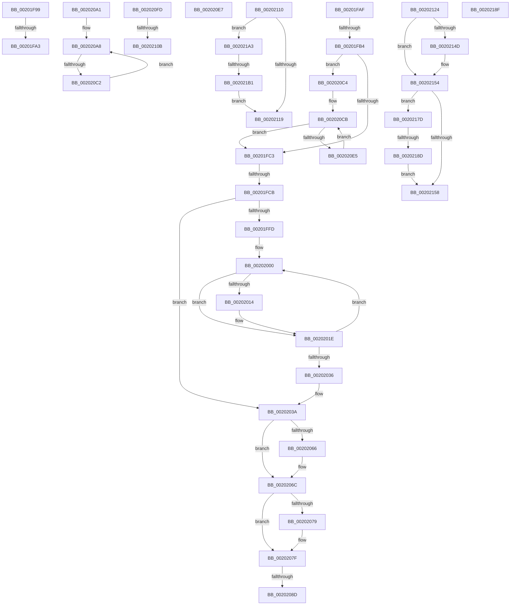

# sub_00201F99

- RVA: `0x00201F99`–`0x002021B6` (길이 `541` bytes)
- VA: `0x0000000140201F99`
- 실행 섹션: `.text`
- PDB 이름 있음: `아니요`; PDB Function 태그: `아니요`
- unwind 정보 RVA: `0x0005C8D0`
- 디코드: `147`개 명령, `541/541` bytes 표시
- 미해석 바이트: `0` (있으면 어셈블리에 `.byte`로 보존)

> 이 문서는 커널 이미지의 기계어와 PDB 기호를 분석해 생성했습니다. 4번과 5번은 함수 원형과 자료형을 바이너리 사용 방식에서 추정한 C 해석이며 원본 소스 복구 결과는 아닙니다.

## 1. Dependencies

- 직접 호출 지점: **1**; 고유 호출 대상: **1**
- 직접 호출자로 확인된 함수: **0**
- RIP 상대 이미지 참조: **0**

### Outgoing calls
- `0x00202180` → [KiAdvanceReadyQueueEnumeratorToNextScb](KiAdvanceReadyQueueEnumeratorToNextScb_function_0020227C.md) (function, `0x0020227C`)

### Direct callers
- 이 함수 시작 RVA로 연결되는 직접 call은 확인되지 않았습니다. 간접 호출은 완전히 역산할 수 없습니다.

### Static image references
- 디코드된 RIP-relative 메모리 참조가 없습니다.

## 2. Other-region calls and transfers

- 다른 실행 섹션으로 향하는 call: **0**
- call이 아닌 외부 분기/꼬리 이동: **15**
  - `0x00201F9D` → [sub_00201D95 + 0x178](Unknown_function_00201D95.md) (`tail-transfer`)
  - `0x00201FAA` → [sub_00201D95 + 0x16F](Unknown_function_00201D95.md) (`tail-transfer`)
  - `0x00201FB2` → [sub_00201D95 + 0x1D1](Unknown_function_00201D95.md) (`tail-transfer`)
  - `0x00201FC9` → [sub_00201D95 + 0x1D1](Unknown_function_00201D95.md) (`tail-transfer`)
  - `0x00202087` → [sub_00201D95 + 0xFC](Unknown_function_00201D95.md) (`tail-transfer`)
  - `0x0020209C` → [sub_00201D95 + 0xFF](Unknown_function_00201D95.md) (`tail-transfer`)
  - `0x002020BC` → [sub_00201D95 + 0x30](Unknown_function_00201D95.md) (`tail-transfer`)
  - `0x002020F8` → [sub_00201D95 + 0x121](Unknown_function_00201D95.md) (`tail-transfer`)
  - `0x00202105` → [sub_00201D95 + 0x178](Unknown_function_00201D95.md) (`tail-transfer`)
  - `0x0020210B` → [sub_00201D95 + 0x17B](Unknown_function_00201D95.md) (`tail-transfer`)
  - `0x0020211F` → [sub_00201D95 + 0x1B3](Unknown_function_00201D95.md) (`tail-transfer`)
  - `0x00202178` → [sub_00201D95 + 0x1DE](Unknown_function_00201D95.md) (`tail-transfer`)
  - `0x00202187` → [sub_00201D95 + 0x1D1](Unknown_function_00201D95.md) (`tail-transfer`)
  - `0x0020219E` → [sub_00201D95 + 0xFF](Unknown_function_00201D95.md) (`tail-transfer`)
  - `0x002021AB` → [sub_00201D95 + 0x1B3](Unknown_function_00201D95.md) (`tail-transfer`)

## 3. Assembly (complete function range)

```asm
00201F99  49 83 F8 01                     cmp r8, 1
00201F9D  0F 84 6A FF FF FF               je 0x140201f0d
00201FA3  48 83 C9 01                     or rcx, 1
00201FA7  49 33 C8                        xor rcx, r8
00201FAA  E9 55 FF FF FF                  jmp 0x140201f04
00201FAF  83 F9 02                        cmp ecx, 2
00201FB2  75 B2                           jne 0x140201f66
00201FB4  8B 0B                           mov ecx, dword ptr [rbx]
00201FB6  8B C5                           mov eax, ebp
00201FB8  89 6B 04                        mov dword ptr [rbx + 4], ebp
00201FBB  85 C9                           test ecx, ecx
00201FBD  0F 85 01 01 00 00               jne 0x1402020c4
00201FC3  83 E0 01                        and eax, 1
00201FC6  89 43 04                        mov dword ptr [rbx + 4], eax
00201FC9  74 9B                           je 0x140201f66
00201FCB  44 0F B6 43 09                  movzx r8d, byte ptr [rbx + 9]
00201FD0  41 BA 01 00 00 00               mov r10d, 1
00201FD6  44 0F BD C8                     bsr r9d, eax
00201FDA  44 88 43 0A                     mov byte ptr [rbx + 0xa], r8b
00201FDE  4B 8D 14 40                     lea rdx, [r8 + r8*2]
00201FE2  48 03 D2                        add rdx, rdx
00201FE5  44 88 4B 08                     mov byte ptr [rbx + 8], r9b
00201FE9  41 0F B6 C9                     movzx ecx, r9b
00201FED  41 D3 E2                        shl r10d, cl
00201FF0  8B 4C D3 5C                     mov ecx, dword ptr [rbx + rdx*8 + 0x5c]
00201FF4  0B 4C D3 58                     or ecx, dword ptr [rbx + rdx*8 + 0x58]
00201FF8  41 85 CA                        test r10d, ecx
00201FFB  75 3D                           jne 0x14020203a
00201FFD  44 8B 1B                        mov r11d, dword ptr [rbx]
00202000  41 FE C0                        inc r8b
00202003  41 0F B6 C0                     movzx eax, r8b
00202007  41 0F B6 F8                     movzx edi, r8b
0020200B  44 88 43 0A                     mov byte ptr [rbx + 0xa], r8b
0020200F  41 3B C3                        cmp eax, r11d
00202012  72 0A                           jb 0x14020201e
00202014  45 32 C0                        xor r8b, r8b
00202017  40 88 6B 0A                     mov byte ptr [rbx + 0xa], bpl
0020201B  40 32 FF                        xor dil, dil
0020201E  41 0F B6 C0                     movzx eax, r8b
00202022  48 8D 0C 40                     lea rcx, [rax + rax*2]
00202026  48 03 C9                        add rcx, rcx
00202029  8B 54 CB 5C                     mov edx, dword ptr [rbx + rcx*8 + 0x5c]
0020202D  0B 54 CB 58                     or edx, dword ptr [rbx + rcx*8 + 0x58]
00202031  41 85 D2                        test r10d, edx
00202034  74 CA                           je 0x140202000
00202036  44 0F B6 C7                     movzx r8d, dil
0020203A  41 0F B6 C0                     movzx eax, r8b
0020203E  32 D2                           xor dl, dl
00202040  48 FF C0                        inc rax
00202043  41 0F B6 C9                     movzx ecx, r9b
00202047  4C 8D 04 40                     lea r8, [rax + rax*2]
0020204B  49 C1 E0 04                     shl r8, 4
0020204F  4C 03 C3                        add r8, rbx
00202052  4D 8B 18                        mov r11, qword ptr [r8]
00202055  4D 8B 50 08                     mov r10, qword ptr [r8 + 8]
00202059  40 88 6B 0B                     mov byte ptr [rbx + 0xb], bpl
0020205D  41 8B 40 28                     mov eax, dword ptr [r8 + 0x28]
00202061  0F A3 C8                        bt eax, ecx
00202064  73 06                           jae 0x14020206c
00202066  C6 43 0B 01                     mov byte ptr [rbx + 0xb], 1
0020206A  B2 01                           mov dl, 1
0020206C  41 8B 40 2C                     mov eax, dword ptr [r8 + 0x2c]
00202070  41 0F B6 C9                     movzx ecx, r9b
00202074  0F A3 C8                        bt eax, ecx
00202077  73 06                           jae 0x14020207f
00202079  80 CA 02                        or dl, 2
0020207C  88 53 0B                        mov byte ptr [rbx + 0xb], dl
0020207F  0F B6 CA                        movzx ecx, dl
00202082  8D 41 FF                        lea eax, [rcx - 1]
00202085  85 C1                           test ecx, eax
00202087  0F 84 04 FE FF FF               je 0x140201e91
0020208D  41 0F B6 C1                     movzx eax, r9b
00202091  41 0F A3 83 DC 83 00 00         bt dword ptr [r11 + 0x83dc], eax
00202099  0F 93 C0                        setae al
0020209C  E9 F3 FD FF FF                  jmp 0x140201e94
002020A1  48 8D 53 5C                     lea rdx, [rbx + 0x5c]
002020A5  4C 8B C1                        mov r8, rcx
002020A8  0B 42 FC                        or eax, dword ptr [rdx - 4]
002020AB  48 8D 52 30                     lea rdx, [rdx + 0x30]
002020AF  89 43 04                        mov dword ptr [rbx + 4], eax
002020B2  0B 42 D0                        or eax, dword ptr [rdx - 0x30]
002020B5  89 43 04                        mov dword ptr [rbx + 4], eax
002020B8  49 83 E8 01                     sub r8, 1
002020BC  0F 84 03 FD FF FF               je 0x140201dc5
002020C2  EB E4                           jmp 0x1402020a8
002020C4  48 8D 53 5C                     lea rdx, [rbx + 0x5c]
002020C8  4C 8B C1                        mov r8, rcx
002020CB  0B 42 FC                        or eax, dword ptr [rdx - 4]
002020CE  48 8D 52 30                     lea rdx, [rdx + 0x30]
002020D2  89 43 04                        mov dword ptr [rbx + 4], eax
002020D5  0B 42 D0                        or eax, dword ptr [rdx - 0x30]
002020D8  89 43 04                        mov dword ptr [rbx + 4], eax
002020DB  49 83 E8 01                     sub r8, 1
002020DF  0F 84 DE FE FF FF               je 0x140201fc3
002020E5  EB E4                           jmp 0x1402020cb
002020E7  0F B6 43 08                     movzx eax, byte ptr [rbx + 8]
002020EB  48 05 44 08 00 00               add rax, 0x844
002020F1  48 C1 E0 04                     shl rax, 4
002020F5  49 03 C3                        add rax, r11
002020F8  E9 B9 FD FF FF                  jmp 0x140201eb6
002020FD  48 83 C1 A8                     add rcx, -0x58
00202101  44 39 49 7C                     cmp dword ptr [rcx + 0x7c], r9d
00202105  0F 87 02 FE FF FF               ja 0x140201f0d
0020210B  E9 00 FE FF FF                  jmp 0x140201f10
00202110  4D 85 DB                        test r11, r11
00202113  0F 85 8A 00 00 00               jne 0x1402021a3
00202119  0F B6 FA                        movzx edi, dl
0020211C  4D 8B D9                        mov r11, r9
0020211F  E9 24 FE FF FF                  jmp 0x140201f48
00202124  40 88 7B 0A                     mov byte ptr [rbx + 0xa], dil
00202128  4C 89 5B 18                     mov qword ptr [rbx + 0x18], r11
0020212C  4C 89 5B 10                     mov qword ptr [rbx + 0x10], r11
00202130  41 0F B7 53 78                  movzx edx, word ptr [r11 + 0x78]
00202135  40 0F B6 C7                     movzx eax, dil
00202139  89 53 04                        mov dword ptr [rbx + 4], edx
0020213C  48 8D 0C 40                     lea rcx, [rax + rax*2]
00202140  48 03 C9                        add rcx, rcx
00202143  8B 44 CB 50                     mov eax, dword ptr [rbx + rcx*8 + 0x50]
00202147  41 39 43 7C                     cmp dword ptr [r11 + 0x7c], eax
0020214B  75 07                           jne 0x140202154
0020214D  23 54 CB 54                     and edx, dword ptr [rbx + rcx*8 + 0x54]
00202151  89 53 04                        mov dword ptr [rbx + 4], edx
00202154  85 D2                           test edx, edx
00202156  74 25                           je 0x14020217d
00202158  8B 43 04                        mov eax, dword ptr [rbx + 4]
0020215B  0F BD C8                        bsr ecx, eax
0020215E  88 4B 08                        mov byte ptr [rbx + 8], cl
00202161  0F B6 C9                        movzx ecx, cl
00202164  48 83 C1 09                     add rcx, 9
00202168  48 C1 E1 04                     shl rcx, 4
0020216C  48 03 4B 10                     add rcx, qword ptr [rbx + 0x10]
00202170  48 89 4B 20                     mov qword ptr [rbx + 0x20], rcx
00202174  48 89 4B 28                     mov qword ptr [rbx + 0x28], rcx
00202178  E9 F6 FD FF FF                  jmp 0x140201f73
0020217D  48 8B CB                        mov rcx, rbx
00202180  E8 F7 00 00 00                  call 0x14020227c
00202185  85 C0                           test eax, eax
00202187  0F 88 D9 FD FF FF               js 0x140201f66
0020218D  EB C9                           jmp 0x140202158
0020218F  41 0F B6 C1                     movzx eax, r9b
00202193  41 0F A3 83 DC 83 00 00         bt dword ptr [r11 + 0x83dc], eax
0020219B  0F 93 C0                        setae al
0020219E  E9 F1 FC FF FF                  jmp 0x140201e94
002021A3  41 8B 41 7C                     mov eax, dword ptr [r9 + 0x7c]
002021A7  41 39 43 7C                     cmp dword ptr [r11 + 0x7c], eax
002021AB  0F 83 97 FD FF FF               jae 0x140201f48
002021B1  E9 63 FF FF FF                  jmp 0x140202119
```

## 4. C-style interpretation (structured pseudocode)

```c
__int64 __fastcall sub_00201F99(__int64 a1, __int64 a2, __int64 a3)
{
    a1 = (a1) | (1);
    a1 = (a1) ^ (a3);
}
```

## 5. (Beta) C Style

```c
int64_t sub_00201F99(int64_t Arg1, int64_t Arg2, int64_t Arg3)
{
    Arg1 = (Arg1) | (1);
    Arg1 = (Arg1) ^ (Arg3);
}
```

## 6. Execution-region graph

[열기: 2D/3D 그래프와 함수 탐색 컨트롤 패널](../../../control-panel.html?section=text&rva=0x00201F99&view=graph)

- 2D 그래프는 위에서 아래로 흐르고, 3D 그래프는 빈 공간을 드래그해 회전합니다. Shift+드래그는 이동, 휠은 확대·축소, 함수 노드 선택은 대상 보고서 이동입니다.

### Static fallback


