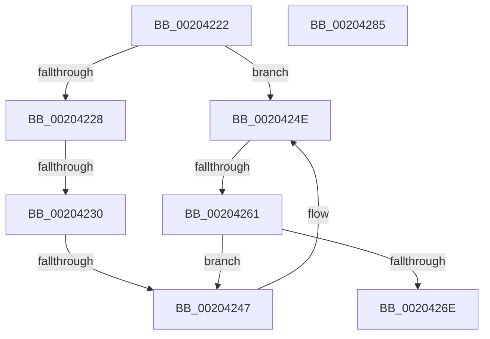

# sub_00204222

- RVA: `0x00204222`–`0x00204286` (길이 `100` bytes)
- VA: `0x0000000140204222`
- 실행 섹션: `.text`
- PDB 이름 있음: `아니요`; PDB Function 태그: `아니요`
- unwind 정보 RVA: `0x0005CB2C`
- 디코드: `31`개 명령, `100/100` bytes 표시
- 미해석 바이트: `0` (있으면 어셈블리에 `.byte`로 보존)

> 이 문서는 커널 이미지의 기계어와 PDB 기호를 분석해 생성했습니다. 4번과 5번은 함수 원형과 자료형을 바이너리 사용 방식에서 추정한 C 해석이며 원본 소스 복구 결과는 아닙니다.

## 1. Dependencies

- 직접 호출 지점: **0**; 고유 호출 대상: **0**
- 직접 호출자로 확인된 함수: **0**
- RIP 상대 이미지 참조: **0**

### Outgoing calls
- 직접 디코드된 call 명령이 없습니다.

### Direct callers
- 이 함수 시작 RVA로 연결되는 직접 call은 확인되지 않았습니다. 간접 호출은 완전히 역산할 수 없습니다.

### Static image references
- 디코드된 RIP-relative 메모리 참조가 없습니다.

## 2. Other-region calls and transfers

- 다른 실행 섹션으로 향하는 call: **0**
- call이 아닌 외부 분기/꼬리 이동: **3**
  - `0x0020422A` → [sub_00204290 + 0x2A](Unknown_function_00204290.md) (`tail-transfer`)
  - `0x00204245` → [sub_00204290 + 0x12](Unknown_function_00204290.md) (`tail-transfer`)
  - `0x0020425F` → [sub_00204290](Unknown_function_00204290.md) (`tail-transfer`)

## 3. Assembly (complete function range)

```asm
00204222  48 89 1C 24                     mov qword ptr [rsp], rbx
00204226  74 26                           je 0x14020424e
00204228  84 C0                           test al, al
0020422A  0F 85 8A 00 00 00               jne 0x1402042ba
00204230  48 8D 51 10                     lea rdx, [rcx + 0x10]
00204234  48 8B C8                        mov rcx, rax
00204237  48 C1 E1 04                     shl rcx, 4
0020423B  49 03 C8                        add rcx, r8
0020423E  48 8B 41 08                     mov rax, qword ptr [rcx + 8]
00204242  48 39 08                        cmp qword ptr [rax], rcx
00204245  74 5B                           je 0x1402042a2
00204247  B9 03 00 00 00                  mov ecx, 3
0020424C  CD 29                           int 0x29
0020424E  48 8B D0                        mov rdx, rax
00204251  48 C1 E2 04                     shl rdx, 4
00204255  49 03 D0                        add rdx, r8
00204258  48 8B 42 08                     mov rax, qword ptr [rdx + 8]
0020425C  48 3B C2                        cmp rax, rdx
0020425F  75 2F                           jne 0x140204290
00204261  48 8D 51 10                     lea rdx, [rcx + 0x10]
00204265  48 8B 08                        mov rcx, qword ptr [rax]
00204268  48 39 41 08                     cmp qword ptr [rcx + 8], rax
0020426C  75 D9                           jne 0x140204247
0020426E  48 89 0A                        mov qword ptr [rdx], rcx
00204271  48 89 42 08                     mov qword ptr [rdx + 8], rax
00204275  48 89 51 08                     mov qword ptr [rcx + 8], rdx
00204279  48 89 10                        mov qword ptr [rax], rdx
0020427C  48 8B 1C 24                     mov rbx, qword ptr [rsp]
00204280  48 83 C4 08                     add rsp, 8
00204284  C3                              ret
00204285  CC                              int3
```

## 4. C-style interpretation (structured pseudocode)

```c
__int64 __fastcall sub_00204222(__int64 a1, __int64 a2, __int64 a3)
{
    __int64 v_rsp;
    unsigned __int64 v_stack_p0;

    v_stack_p0 = v_rbx;
    if (condition_is_equal) goto loc_0020424E;
    a1 = (result) << (4);
    a1 = (a1) + (a3);
loc_00204247:
loc_0020424E:
    a2 = (*(unsigned __int64 *)(a1 + 8)) << (4);
    a2 = (a2) + (a3);
    if ((*(unsigned __int64 *)(*(unsigned __int64 *)(*(unsigned __int64 *)(a2 + 8)) + 8)) != (*(unsigned __int64 *)(a2 + 8))) goto loc_00204247;
    *(unsigned __int64 *)(3 + 16) = *(unsigned __int64 *)(*(unsigned __int64 *)(a2 + 8));
    *(unsigned __int64 *)(3 + 16 + 8) = *(unsigned __int64 *)(a2 + 8);
    *(unsigned __int64 *)(*(unsigned __int64 *)(*(unsigned __int64 *)(a2 + 8)) + 8) = 3 + 16;
    *(unsigned __int64 *)(*(unsigned __int64 *)(a2 + 8)) = 3 + 16;
    v_rsp = (v_rsp) + (8);
    return *(unsigned __int64 *)(a2 + 8);
}
```

## 5. (Beta) C Style

```c
int64_t sub_00204222(void *Arg1, int64_t Arg2, int64_t Arg3)
{
    uint8_t *arg1 = (uint8_t *)Arg1;

    int64_t local_rsp;
    uint64_t v_stack_p0;

    v_stack_p0 = local_rbx;
    if (condition_is_equal) goto loc_0020424E;
    Arg1 = (result) << (4);
    Arg1 = (Arg1) + (Arg3);
loc_00204247:
loc_0020424E:
    Arg2 = (*(uint64_t *)(arg1 + 0x8)) << (4);
    Arg2 = (Arg2) + (Arg3);
    if ((*(uint64_t *)(*(uint64_t *)(*(uint64_t *)(Arg2 + 0x8)) + 0x8)) != (*(uint64_t *)(Arg2 + 0x8))) goto loc_00204247;
    *(uint64_t *)(3 + 0x10) = *(uint64_t *)(*(uint64_t *)(Arg2 + 0x8));
    *(uint64_t *)(3 + 0x10 + 0x8) = *(uint64_t *)(Arg2 + 0x8);
    *(uint64_t *)(*(uint64_t *)(*(uint64_t *)(Arg2 + 0x8)) + 0x8) = 3 + 16;
    *(uint64_t *)(*(uint64_t *)(Arg2 + 0x8)) = 3 + 16;
    local_rsp = (local_rsp) + (8);
    return *(uint64_t *)(Arg2 + 0x8);
}
```

### 관측된 메모리 오프셋

구조체 형식이 확인되지 않은 접근은 인자 기준의 오프셋으로만 기록했습니다.

| 기준 인자 | 오프셋 표현 | 폭 (bit) | 접근 |
|---|---:|---:|---|
| `Arg1` | `+ 0x10` | `64` | `R` |

## 6. Execution-region graph

[열기: 2D/3D 그래프와 함수 탐색 컨트롤 패널](../../../control-panel.html?section=text&rva=0x00204222&view=graph)

- 2D 그래프는 위에서 아래로 흐르고, 3D 그래프는 빈 공간을 드래그해 회전합니다. Shift+드래그는 이동, 휠은 확대·축소, 함수 노드 선택은 대상 보고서 이동입니다.

### Static fallback


