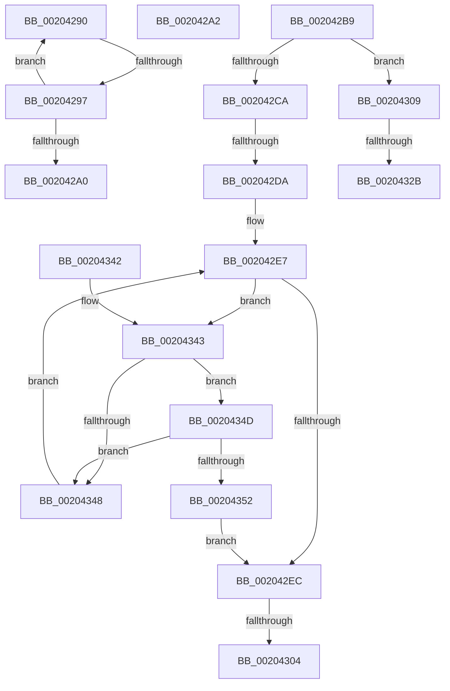

# sub_00204290

- RVA: `0x00204290`–`0x00204358` (길이 `200` bytes)
- VA: `0x0000000140204290`
- 실행 섹션: `.text`
- PDB 이름 있음: `아니요`; PDB Function 태그: `아니요`
- unwind 정보 RVA: `0x0005CB54`
- 디코드: `57`개 명령, `200/200` bytes 표시
- 미해석 바이트: `0` (있으면 어셈블리에 `.byte`로 보존)

> 이 문서는 커널 이미지의 기계어와 PDB 기호를 분석해 생성했습니다. 4번과 5번은 함수 원형과 자료형을 바이너리 사용 방식에서 추정한 C 해석이며 원본 소스 복구 결과는 아닙니다.

## 1. Dependencies

- 직접 호출 지점: **0**; 고유 호출 대상: **0**
- 직접 호출자로 확인된 함수: **0**
- RIP 상대 이미지 참조: **2**

### Outgoing calls
- 직접 디코드된 call 명령이 없습니다.

### Direct callers
- 이 함수 시작 RVA로 연결되는 직접 call은 확인되지 않았습니다. 간접 호출은 완전히 역산할 수 없습니다.

### Static image references
- `0x002042BE` → RVA `0x00905D40` (`KiSchedulerApcTerminate`; read)
- `0x002042CA` → RVA `0x00AADF90` (`KeSpecialUserApcKernelRoutine`; read)

## 2. Other-region calls and transfers

- 다른 실행 섹션으로 향하는 call: **0**
- call이 아닌 외부 분기/꼬리 이동: **6**
  - `0x00204295` → [sub_00204222 + 0x3F](Unknown_function_00204222.md) (`tail-transfer`)
  - `0x002042A0` → [sub_00204222 + 0x3F](Unknown_function_00204222.md) (`tail-transfer`)
  - `0x002042D4` → [sub_00204222 + 0xE](Unknown_function_00204222.md) (`tail-transfer`)
  - `0x002042FE` → [sub_00204222 + 0x25](Unknown_function_00204222.md) (`tail-transfer`)
  - `0x00204304` → [sub_00204222 + 0x4C](Unknown_function_00204222.md) (`tail-transfer`)
  - `0x00204325` → [sub_00204222 + 0x25](Unknown_function_00204222.md) (`tail-transfer`)

## 3. Assembly (complete function range)

```asm
00204290  48 83 78 20 00                  cmp qword ptr [rax + 0x20], 0
00204295  74 CA                           je 0x140204261
00204297  48 8B 40 08                     mov rax, qword ptr [rax + 8]
0020429B  48 3B C2                        cmp rax, rdx
0020429E  75 F0                           jne 0x140204290
002042A0  EB BF                           jmp 0x140204261
002042A2  48 89 0A                        mov qword ptr [rdx], rcx
002042A5  48 89 42 08                     mov qword ptr [rdx + 8], rax
002042A9  48 89 10                        mov qword ptr [rax], rdx
002042AC  48 89 51 08                     mov qword ptr [rcx + 8], rdx
002042B0  48 8B 1C 24                     mov rbx, qword ptr [rsp]
002042B4  48 83 C4 08                     add rsp, 8
002042B8  C3                              ret
002042B9  CC                              int3
002042BA  4C 8B 51 20                     mov r10, qword ptr [rcx + 0x20]
002042BE  48 8D 1D 7B 1A 70 00            lea rbx, [rip + 0x701a7b]
002042C5  4C 3B D3                        cmp r10, rbx
002042C8  74 3F                           je 0x140204309
002042CA  4C 8D 1D BF 9C 8A 00            lea r11, [rip + 0x8a9cbf]
002042D1  4D 3B D3                        cmp r10, r11
002042D4  0F 85 56 FF FF FF               jne 0x140204230
002042DA  4C 8B C8                        mov r9, rax
002042DD  49 C1 E1 04                     shl r9, 4
002042E1  4D 03 C8                        add r9, r8
002042E4  49 8B 01                        mov rax, qword ptr [r9]
002042E7  49 3B C1                        cmp rax, r9
002042EA  75 57                           jne 0x140204343
002042EC  80 8A C2 00 00 00 01            or byte ptr [rdx + 0xc2], 1
002042F3  48 8D 51 10                     lea rdx, [rcx + 0x10]
002042F7  48 8B 08                        mov rcx, qword ptr [rax]
002042FA  48 39 41 08                     cmp qword ptr [rcx + 8], rax
002042FE  0F 85 43 FF FF FF               jne 0x140204247
00204304  E9 65 FF FF FF                  jmp 0x14020426e
00204309  80 8A C2 00 00 00 02            or byte ptr [rdx + 0xc2], 2
00204310  48 8D 51 10                     lea rdx, [rcx + 0x10]
00204314  48 8B C8                        mov rcx, rax
00204317  48 C1 E1 04                     shl rcx, 4
0020431B  49 03 C8                        add rcx, r8
0020431E  48 8B 01                        mov rax, qword ptr [rcx]
00204321  48 39 48 08                     cmp qword ptr [rax + 8], rcx
00204325  0F 85 1C FF FF FF               jne 0x140204247
0020432B  48 8B 1C 24                     mov rbx, qword ptr [rsp]
0020432F  48 89 02                        mov qword ptr [rdx], rax
00204332  48 89 4A 08                     mov qword ptr [rdx + 8], rcx
00204336  48 89 50 08                     mov qword ptr [rax + 8], rdx
0020433A  48 89 11                        mov qword ptr [rcx], rdx
0020433D  48 83 C4 08                     add rsp, 8
00204341  C3                              ret
00204342  CC                              int3
00204343  4D 3B D3                        cmp r10, r11
00204346  75 05                           jne 0x14020434d
00204348  48 8B 00                        mov rax, qword ptr [rax]
0020434B  EB 9A                           jmp 0x1402042e7
0020434D  4C 3B D3                        cmp r10, rbx
00204350  74 F6                           je 0x140204348
00204352  48 8B 40 08                     mov rax, qword ptr [rax + 8]
00204356  EB 94                           jmp 0x1402042ec
```

## 4. C-style interpretation (structured pseudocode)

```c
__int64 __fastcall sub_00204290(__int64 a1, __int64 a2, __int64 a3)
{
    unsigned __int64 v_stack_p0;
    unsigned __int64 v_stack_p8;

    if ((*(unsigned __int64 *)(result + 8)) != a2) goto loc_00204290;
}
```

## 5. (Beta) C Style

```c
int64_t sub_00204290(int64_t Arg1, int64_t Arg2, int64_t Arg3)
{
    uint64_t v_stack_p0;
    uint64_t v_stack_p8;

    if ((*(uint64_t *)(result + 0x8)) != Arg2) goto loc_00204290;
}
```

## 6. Execution-region graph

[열기: 2D/3D 그래프와 함수 탐색 컨트롤 패널](../../../control-panel.html?section=text&rva=0x00204290&view=graph)

- 2D 그래프는 위에서 아래로 흐르고, 3D 그래프는 빈 공간을 드래그해 회전합니다. Shift+드래그는 이동, 휠은 확대·축소, 함수 노드 선택은 대상 보고서 이동입니다.

### Static fallback


