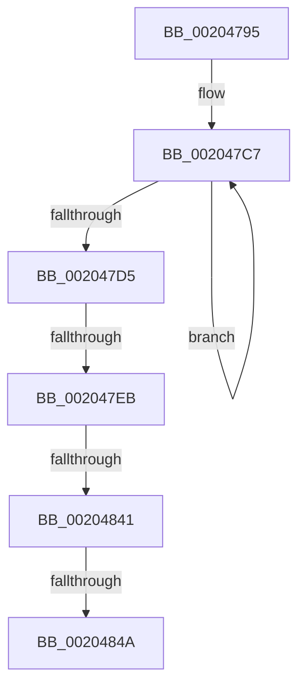

# sub_00204795

- RVA: `0x00204795`–`0x00204878` (길이 `227` bytes)
- VA: `0x0000000140204795`
- 실행 섹션: `.text`
- PDB 이름 있음: `아니요`; PDB Function 태그: `아니요`
- unwind 정보 RVA: `0x0005CBC8`
- 디코드: `49`개 명령, `227/227` bytes 표시
- 미해석 바이트: `0` (있으면 어셈블리에 `.byte`로 보존)

> 이 문서는 커널 이미지의 기계어와 PDB 기호를 분석해 생성했습니다. 4번과 5번은 함수 원형과 자료형을 바이너리 사용 방식에서 추정한 C 해석이며 원본 소스 복구 결과는 아닙니다.

## 1. Dependencies

- 직접 호출 지점: **2**; 고유 호출 대상: **2**
- 직접 호출자로 확인된 함수: **0**
- RIP 상대 이미지 참조: **2**

### Outgoing calls
- `0x00204822` → [KeAcquireSpinLockRaiseToDpc](KeAcquireSpinLockRaiseToDpc_function_00208470.md) (function, `0x00208470`)
- `0x00204851` → [KxReleaseSpinLock](KxReleaseSpinLock_function_00206670.md) (function, `0x00206670`)

### Direct callers
- 이 함수 시작 RVA로 연결되는 직접 call은 확인되지 않았습니다. 간접 호출은 완전히 역산할 수 없습니다.

### Static image references
- `0x002047D8` → RVA `0x00E03710` (`.data`; read)
- `0x00204856` → RVA `0x00FC6D20` (`ALMOSTRO`; read)

## 2. Other-region calls and transfers

- 다른 실행 섹션으로 향하는 call: **0**
- call이 아닌 외부 분기/꼬리 이동: **4**
  - `0x002047E5` → [sub_00204895 + 0x2B](Unknown_function_00204895.md) (`tail-transfer`)
  - `0x0020483F` → [sub_00204895](Unknown_function_00204895.md) (`tail-transfer`)
  - `0x00204844` → [sub_00204895 + 0xA0](Unknown_function_00204895.md) (`tail-transfer`)
  - `0x00204876` → [sub_00204878 + 0xD](Unknown_function_00204878.md) (`tail-transfer`)

## 3. Assembly (complete function range)

```asm
00204795  48 89 5C 24 50                  mov qword ptr [rsp + 0x50], rbx
0020479A  49 B9 B0 03 00 00 80 F7 FF FF   movabs r9, 0xfffff780000003b0
002047A4  48 89 6C 24 58                  mov qword ptr [rsp + 0x58], rbp
002047A9  49 BA 08 00 00 00 80 F7 FF FF   movabs r10, 0xfffff78000000008
002047B3  48 89 74 24 60                  mov qword ptr [rsp + 0x60], rsi
002047B8  4C 89 64 24 68                  mov qword ptr [rsp + 0x68], r12
002047BD  4C 89 74 24 38                  mov qword ptr [rsp + 0x38], r14
002047C2  4C 89 7C 24 30                  mov qword ptr [rsp + 0x30], r15
002047C7  4D 8B 01                        mov r8, qword ptr [r9]
002047CA  49 8B 1A                        mov rbx, qword ptr [r10]
002047CD  49 8B 01                        mov rax, qword ptr [r9]
002047D0  4C 3B C0                        cmp r8, rax
002047D3  75 F2                           jne 0x1402047c7
002047D5  49 2B D8                        sub rbx, r8
002047D8  4C 8D 25 31 EF BF 00            lea r12, [rip + 0xbfef31]
002047DF  4C 63 C1                        movsxd r8, ecx
002047E2  48 85 D2                        test rdx, rdx
002047E5  0F 84 D5 00 00 00               je 0x1402048c0
002047EB  4B 8D 04 40                     lea rax, [r8 + r8*2]
002047EF  48 C1 E0 06                     shl rax, 6
002047F3  42 8B 84 20 B4 00 00 00         mov eax, dword ptr [rax + r12 + 0xb4]
002047FB  48 69 C0 80 96 98 00            imul rax, rax, 0x989680
00204802  48 03 C3                        add rax, rbx
00204805  48 8B 1A                        mov rbx, qword ptr [rdx]
00204808  48 3B D8                        cmp rbx, rax
0020480B  48 0F 43 D8                     cmovae rbx, rax
0020480F  4F 8D 34 40                     lea r14, [r8 + r8*2]
00204813  49 C1 E6 06                     shl r14, 6
00204817  4B 8D 2C 26                     lea rbp, [r14 + r12]
0020481B  48 8D 8D 98 00 00 00            lea rcx, [rbp + 0x98]
00204822  E8 49 3C 00 00                  call 0x140208470
00204827  0F B6 F0                        movzx esi, al
0020482A  4F 8D 3C 26                     lea r15, [r14 + r12]
0020482E  49 8B 8F A8 00 00 00            mov rcx, qword ptr [r15 + 0xa8]
00204835  48 8B C1                        mov rax, rcx
00204838  83 E0 07                        and eax, 7
0020483B  48 83 F8 01                     cmp rax, 1
0020483F  75 54                           jne 0x140204895
00204841  40 84 FF                        test dil, dil
00204844  0F 85 EB 00 00 00               jne 0x140204935
0020484A  48 8D 8D 98 00 00 00            lea rcx, [rbp + 0x98]
00204851  E8 1A 1E 00 00                  call 0x140206670
00204856  83 3D C3 24 DC 00 00            cmp dword ptr [rip + 0xdc24c3], 0
0020485D  4C 8B 7C 24 30                  mov r15, qword ptr [rsp + 0x30]
00204862  4C 8B 74 24 38                  mov r14, qword ptr [rsp + 0x38]
00204867  4C 8B 64 24 68                  mov r12, qword ptr [rsp + 0x68]
0020486C  48 8B 6C 24 58                  mov rbp, qword ptr [rsp + 0x58]
00204871  48 8B 5C 24 50                  mov rbx, qword ptr [rsp + 0x50]
00204876  74 0D                           je 0x140204885
```

## 4. C-style interpretation (structured pseudocode)

```c
__int64 __fastcall sub_00204795(int a1, __int64 a2, __int64 a3, __int64 a4, __int64 a5, __int64 a6, __int64 a7, __int64 a8, __int64 a9, __int64 a10, __int64 a11, __int64 a12, __int64 a13)
{
    __int64 result;
    __int64 v_r14;
    __int64 v_rbx;
    unsigned __int64 v_stack_p30;
    unsigned __int64 v_stack_p38;
    unsigned __int64 v_stack_p50;
    unsigned __int64 v_stack_p58;
    unsigned __int64 v_stack_p60;
    unsigned __int64 v_stack_p68;

    v_stack_p50 = v_rbx;
    v_stack_p58 = v_rbp;
    v_stack_p60 = v_rsi;
    v_stack_p68 = v_r12;
    v_stack_p38 = v_r14;
    v_stack_p30 = v_r15;
loc_002047C7:
    if ((*(unsigned __int64 *)(a4)) != (*(unsigned __int64 *)(a4))) goto loc_002047C7;
    v_rbx = (*(unsigned __int64 *)(v_r10)) - (*(unsigned __int64 *)(a4));
    result = ((int)(a1) + (int)(a1) * 2) << (6);
    result = ((unsigned int)(*(unsigned int *)(result + v_rip + 12578609 * 1 + 180))) * ((unsigned int)(*(unsigned int *)(result + v_rip + 12578609 * 1 + 180)));
    result = (result) + (v_rbx);
    v_rbx = *(unsigned __int64 *)(a2);
    if ((*(unsigned __int64 *)(a2)) >= result) { v_rbx = result; }
    v_r14 = ((int)(a1) + (int)(a1) * 2) << (6);
    result = KeAcquireSpinLockRaiseToDpc(v_r14 + v_rip + 12578609 * 1 + 152, a2, (int)(a1), a4);
    result = (unsigned int)((*(unsigned __int64 *)(v_r14 + v_rip + 12578609 * 1 + 168)) & (7));
    result = KxReleaseSpinLock(v_r14 + v_rip + 12578609 * 1 + 152, a2, (int)(a1), a4);
}
```

## 5. (Beta) C Style

```c
int64_t sub_00204795(void *Arg1, int64_t Arg2, int64_t Arg3, int64_t Arg4, uint64_t Arg5, int64_t Arg6, int64_t Arg7, uint64_t Arg8, uint64_t Arg9, int64_t Arg10, int64_t Arg11, uint64_t Arg12, int64_t Arg13)
{
    uint8_t *arg1 = (uint8_t *)Arg1;

    int64_t result;
    int64_t local_r14;
    int64_t local_rbx;
    uint64_t v_stack_p30;
    uint64_t v_stack_p38;
    uint64_t v_stack_p50;
    uint64_t v_stack_p58;
    uint64_t v_stack_p60;
    uint64_t v_stack_p68;

    v_stack_p50 = local_rbx;
    v_stack_p58 = local_rbp;
    v_stack_p60 = local_rsi;
    v_stack_p68 = local_r12;
    v_stack_p38 = local_r14;
    v_stack_p30 = local_r15;
loc_002047C7:
    if ((*(uint64_t *)(Arg4)) != (*(uint64_t *)(Arg4))) goto loc_002047C7;
    local_rbx = (*(uint64_t *)(local_r10)) - (*(uint64_t *)(Arg4));
    result = ((int32_t)(Arg1) + (int32_t)(Arg1) * 2) << (6);
    result = ((uint32_t)(*(uint32_t *)(result + v_rip + 0xBFEF31 * 1 + 0xB4))) * ((uint32_t)(*(uint32_t *)(result + v_rip + 0xBFEF31 * 1 + 0xB4)));
    result = (result) + (local_rbx);
    local_rbx = *(uint64_t *)(Arg2);
    if ((*(uint64_t *)(Arg2)) >= result) { local_rbx = result; }
    local_r14 = ((int32_t)(Arg1) + (int32_t)(Arg1) * 2) << (6);
    result = KeAcquireSpinLockRaiseToDpc(local_r14 + v_rip + 12578609 * 1 + 152, Arg2, (int32_t)(Arg1), Arg4);
    result = (uint32_t)((*(uint64_t *)(local_r14 + v_rip + 0xBFEF31 * 1 + 0xA8)) & (7));
    result = KxReleaseSpinLock(local_r14 + v_rip + 12578609 * 1 + 152, Arg2, (int32_t)(Arg1), Arg4);
}
```

### 관측된 메모리 오프셋

구조체 형식이 확인되지 않은 접근은 인자 기준의 오프셋으로만 기록했습니다.

| 기준 인자 | 오프셋 표현 | 폭 (bit) | 접근 |
|---|---:|---:|---|
| `Arg1` | `+ 0x0 + r8*2` | `64` | `R` |

## 6. Execution-region graph

[열기: 2D/3D 그래프와 함수 탐색 컨트롤 패널](../../../control-panel.html?section=text&rva=0x00204795&view=graph)

- 2D 그래프는 위에서 아래로 흐르고, 3D 그래프는 빈 공간을 드래그해 회전합니다. Shift+드래그는 이동, 휠은 확대·축소, 함수 노드 선택은 대상 보고서 이동입니다.

### Static fallback


