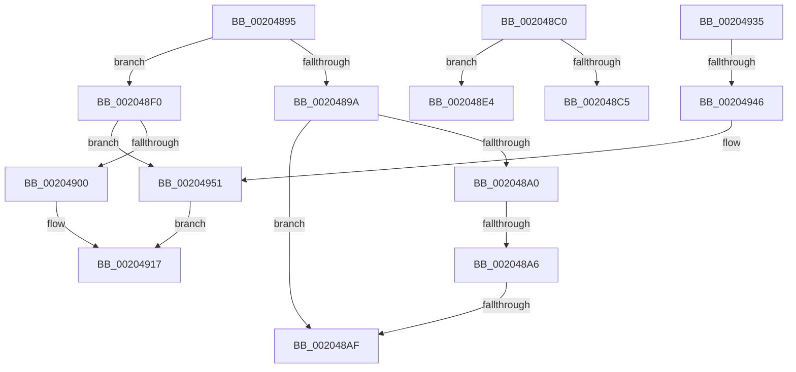

# sub_00204895

- RVA: `0x00204895`–`0x00204960` (길이 `203` bytes)
- VA: `0x0000000140204895`
- 실행 섹션: `.text`
- PDB 이름 있음: `아니요`; PDB Function 태그: `아니요`
- unwind 정보 RVA: `0x0005CC18`
- 디코드: `44`개 명령, `203/203` bytes 표시
- 미해석 바이트: `0` (있으면 어셈블리에 `.byte`로 보존)

> 이 문서는 커널 이미지의 기계어와 PDB 기호를 분석해 생성했습니다. 4번과 5번은 함수 원형과 자료형을 바이너리 사용 방식에서 추정한 C 해석이며 원본 소스 복구 결과는 아닙니다.

## 1. Dependencies

- 직접 호출 지점: **2**; 고유 호출 대상: **2**
- 직접 호출자로 확인된 함수: **0**
- RIP 상대 이미지 참조: **0**

### Outgoing calls
- `0x0020492B` → [KeSetCoalescableTimer](../22/KeSetCoalescableTimer_function_0022FFD0.md) (function, `0x0022FFD0`)
- `0x00204939` → [KeCancelTimer](../23/KeCancelTimer_function_002327E0.md) (function, `0x002327E0`)

### Direct callers
- 이 함수 시작 RVA로 연결되는 직접 call은 확인되지 않았습니다. 간접 호출은 완전히 역산할 수 없습니다.

### Static image references
- 디코드된 RIP-relative 메모리 참조가 없습니다.

## 2. Other-region calls and transfers

- 다른 실행 섹션으로 향하는 call: **0**
- call이 아닌 외부 분기/꼬리 이동: **7**
  - `0x002048A4` → [sub_00204795 + 0xB5](Unknown_function_00204795.md) (`tail-transfer`)
  - `0x002048AD` → [sub_00204795 + 0xB5](Unknown_function_00204795.md) (`tail-transfer`)
  - `0x002048BE` → [sub_00204795 + 0xB5](Unknown_function_00204795.md) (`tail-transfer`)
  - `0x002048DF` → [sub_00204795 + 0x7A](Unknown_function_00204795.md) (`tail-transfer`)
  - `0x002048EB` → [sub_00204795 + 0x7A](Unknown_function_00204795.md) (`tail-transfer`)
  - `0x00204930` → [sub_00204795 + 0xB5](Unknown_function_00204795.md) (`tail-transfer`)
  - `0x00204940` → [sub_00204795 + 0xB5](Unknown_function_00204795.md) (`tail-transfer`)

## 3. Assembly (complete function range)

```asm
00204895  48 85 C0                        test rax, rax
00204898  74 56                           je 0x1402048f0
0020489A  48 83 E8 02                     sub rax, 2
0020489E  74 0F                           je 0x1402048af
002048A0  48 83 F8 01                     cmp rax, 1
002048A4  75 A4                           jne 0x14020484a
002048A6  48 83 E1 F8                     and rcx, 0xfffffffffffffff8
002048AA  48 3B D9                        cmp rbx, rcx
002048AD  73 9B                           jae 0x14020484a
002048AF  48 83 E3 FB                     and rbx, 0xfffffffffffffffb
002048B3  48 83 CB 03                     or rbx, 3
002048B7  49 89 9F A8 00 00 00            mov qword ptr [r15 + 0xa8], rbx
002048BE  EB 8A                           jmp 0x14020484a
002048C0  40 84 FF                        test dil, dil
002048C3  75 1F                           jne 0x1402048e4
002048C5  4B 8D 04 40                     lea rax, [r8 + r8*2]
002048C9  48 C1 E0 06                     shl rax, 6
002048CD  42 8B 84 20 B4 00 00 00         mov eax, dword ptr [rax + r12 + 0xb4]
002048D5  48 69 C8 80 96 98 00            imul rcx, rax, 0x989680
002048DC  48 03 D9                        add rbx, rcx
002048DF  E9 2B FF FF FF                  jmp 0x14020480f
002048E4  48 81 C3 00 2D 31 01            add rbx, 0x1312d00
002048EB  E9 1F FF FF FF                  jmp 0x14020480f
002048F0  49 C7 87 A8 00 00 00 01 00 00 00  mov qword ptr [r15 + 0xa8], 1
002048FB  40 84 FF                        test dil, dil
002048FE  75 51                           jne 0x140204951
00204900  4B 63 84 26 B4 00 00 00         movsxd rax, dword ptr [r14 + r12 + 0xb4]
00204908  47 8B 8C 26 B8 00 00 00         mov r9d, dword ptr [r14 + r12 + 0xb8]
00204910  48 69 D0 80 69 67 FF            imul rdx, rax, -0x989680
00204917  49 8D 44 24 40                  lea rax, [r12 + 0x40]
0020491C  45 33 C0                        xor r8d, r8d
0020491F  49 03 C6                        add rax, r14
00204922  4B 8D 0C 26                     lea rcx, [r14 + r12]
00204926  48 89 44 24 20                  mov qword ptr [rsp + 0x20], rax
0020492B  E8 A0 B6 02 00                  call 0x14022ffd0
00204930  E9 15 FF FF FF                  jmp 0x14020484a
00204935  4B 8D 0C 26                     lea rcx, [r14 + r12]
00204939  E8 A2 DE 02 00                  call 0x1402327e0
0020493E  84 C0                           test al, al
00204940  0F 84 04 FF FF FF               je 0x14020484a
00204946  49 C7 87 A8 00 00 00 01 00 00 00  mov qword ptr [r15 + 0xa8], 1
00204951  48 C7 C2 00 D3 CE FE            mov rdx, 0xfffffffffeced300
00204958  41 B9 E8 03 00 00               mov r9d, 0x3e8
0020495E  EB B7                           jmp 0x140204917
```

## 4. C-style interpretation (structured pseudocode)

```c
__int64 __fastcall sub_00204895(__int64 a1, __int64 a2, __int64 a3)
{
    __int64 result;
    __int64 v_rbx;
    unsigned __int64 v_stack_p20;

    if (result == 0) goto loc_002048F0;
    result = (result) - (2);
    if (condition_is_equal) goto loc_002048AF;
    a1 = (a1) & (-8);
loc_002048AF:
    v_rbx = (v_rbx) & (-5);
    v_rbx = (v_rbx) | (3);
    *(unsigned __int64 *)(v_r15 + 168) = v_rbx;
loc_002048F0:
    *(unsigned __int64 *)(v_r15 + 168) = 1;
    if ((unsigned __int8)(v_rdi) != 0) goto loc_00204951;
    a2 = (a2) * ((int)(*(unsigned int *)(v_r14 + v_r12 * 1 + 180)));
loc_00204917:
    a3 = 0;
    result = (v_r12 + 64) + (v_r14);
    v_stack_p20 = result;
    result = KeSetCoalescableTimer(v_r14 + v_r12 * 1, a2, a3, (unsigned int)(*(unsigned int *)(v_r14 + v_r12 * 1 + 184)));
loc_00204951:
    goto loc_00204917;
}
```

## 5. (Beta) C Style

```c
int64_t sub_00204895(int64_t Arg1, int64_t Arg2, int64_t Arg3)
{
    int64_t result;
    int64_t local_rbx;
    uint64_t v_stack_p20;

    if (result == 0) goto loc_002048F0;
    result = (result) - (2);
    if (condition_is_equal) goto loc_002048AF;
    Arg1 = (Arg1) & (-8);
loc_002048AF:
    local_rbx = (local_rbx) & (-5);
    local_rbx = (local_rbx) | (3);
    *(uint64_t *)(local_r15 + 0xA8) = local_rbx;
loc_002048F0:
    *(uint64_t *)(local_r15 + 0xA8) = 1;
    if ((uint8_t)(local_rdi) != 0) goto loc_00204951;
    Arg2 = (Arg2) * ((int32_t)(*(uint32_t *)(local_r14 + local_r12 * 1 + 0xB4)));
loc_00204917:
    Arg3 = 0;
    result = (local_r12 + 64) + (local_r14);
    v_stack_p20 = result;
    result = KeSetCoalescableTimer(local_r14 + local_r12 * 1, Arg2, Arg3, (uint32_t)(*(uint32_t *)(local_r14 + local_r12 * 1 + 0xB8)));
loc_00204951:
    goto loc_00204917;
}
```

## 6. Execution-region graph

[열기: 2D/3D 그래프와 함수 탐색 컨트롤 패널](../../../control-panel.html?section=text&rva=0x00204895&view=graph)

- 2D 그래프는 위에서 아래로 흐르고, 3D 그래프는 빈 공간을 드래그해 회전합니다. Shift+드래그는 이동, 휠은 확대·축소, 함수 노드 선택은 대상 보고서 이동입니다.

### Static fallback


