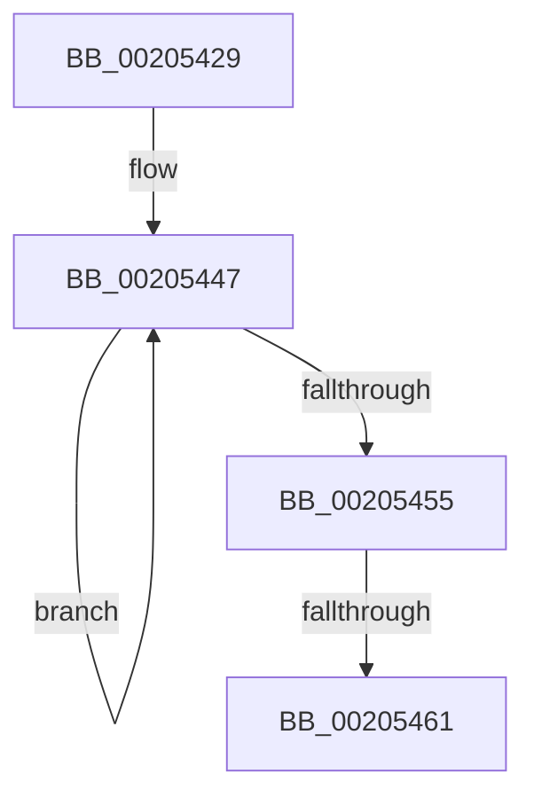

# sub_00205429

- RVA: `0x00205429`–`0x0020546A` (길이 `65` bytes)
- VA: `0x0000000140205429`
- 실행 섹션: `.text`
- PDB 이름 있음: `아니요`; PDB Function 태그: `아니요`
- unwind 정보 RVA: `0x0005CCD0`
- 디코드: `14`개 명령, `65/65` bytes 표시
- 미해석 바이트: `0` (있으면 어셈블리에 `.byte`로 보존)

> 이 문서는 커널 이미지의 기계어와 PDB 기호를 분석해 생성했습니다. 4번과 5번은 함수 원형과 자료형을 바이너리 사용 방식에서 추정한 C 해석이며 원본 소스 복구 결과는 아닙니다.

## 1. Dependencies

- 직접 호출 지점: **0**; 고유 호출 대상: **0**
- 직접 호출자로 확인된 함수: **0**
- RIP 상대 이미지 참조: **0**

### Outgoing calls
- 직접 디코드된 call 명령이 없습니다.

### Direct callers
- 이 함수 시작 RVA로 연결되는 직접 call은 확인되지 않았습니다. 간접 호출은 완전히 역산할 수 없습니다.

### Static image references
- 디코드된 RIP-relative 메모리 참조가 없습니다.

## 2. Other-region calls and transfers

- 다른 실행 섹션으로 향하는 call: **0**
- call이 아닌 외부 분기/꼬리 이동: **2**
  - `0x0020545B` → [sub_00205558](Unknown_function_00205558.md) (`tail-transfer`)
  - `0x00205464` → [sub_002054D8 + 0x3D](Unknown_function_002054D8.md) (`tail-transfer`)

## 3. Assembly (complete function range)

```asm
00205429  48 89 5C 24 30                  mov qword ptr [rsp + 0x30], rbx
0020542E  49 B8 B0 03 00 00 80 F7 FF FF   movabs r8, 0xfffff780000003b0
00205438  48 89 7C 24 20                  mov qword ptr [rsp + 0x20], rdi
0020543D  48 BF 08 00 00 00 80 F7 FF FF   movabs rdi, 0xfffff78000000008
00205447  49 8B 10                        mov rdx, qword ptr [r8]
0020544A  48 8B 1F                        mov rbx, qword ptr [rdi]
0020544D  49 8B 00                        mov rax, qword ptr [r8]
00205450  48 3B D0                        cmp rdx, rax
00205453  75 F2                           jne 0x140205447
00205455  48 2B DA                        sub rbx, rdx
00205458  49 39 19                        cmp qword ptr [r9], rbx
0020545B  0F 86 F7 00 00 00               jbe 0x140205558
00205461  48 85 C9                        test rcx, rcx
00205464  0F 84 AB 00 00 00               je 0x140205515
```

## 4. C-style interpretation (structured pseudocode)

```c
__int64 __fastcall sub_00205429(__int64 a1, __int64 a2, __int64 a3, __int64 a4)
{
    __int64 v_rbx;
    unsigned __int64 v_stack_p20;
    unsigned __int64 v_stack_p30;

    v_stack_p30 = v_rbx;
    v_stack_p20 = v_rdi;
loc_00205447:
    if ((*(unsigned __int64 *)(a3)) != (*(unsigned __int64 *)(a3))) goto loc_00205447;
    v_rbx = (*(unsigned __int64 *)(v_rdi)) - (*(unsigned __int64 *)(a3));
}
```

## 5. (Beta) C Style

```c
int64_t sub_00205429(int64_t Arg1, int64_t Arg2, int64_t Arg3, void *Arg4)
{
    uint8_t *arg4 = (uint8_t *)Arg4;

    int64_t local_rbx;
    uint64_t v_stack_p20;
    uint64_t v_stack_p30;

    v_stack_p30 = local_rbx;
    v_stack_p20 = local_rdi;
loc_00205447:
    if ((*(uint64_t *)(Arg3)) != (*(uint64_t *)(Arg3))) goto loc_00205447;
    local_rbx = (*(uint64_t *)(local_rdi)) - (*(uint64_t *)(Arg3));
}
```

### 관측된 메모리 오프셋

구조체 형식이 확인되지 않은 접근은 인자 기준의 오프셋으로만 기록했습니다.

| 기준 인자 | 오프셋 표현 | 폭 (bit) | 접근 |
|---|---:|---:|---|
| `Arg4` | `+ 0x0` | `64` | `R` |

## 6. Execution-region graph

[열기: 2D/3D 그래프와 함수 탐색 컨트롤 패널](../../../control-panel.html?section=text&rva=0x00205429&view=graph)

- 2D 그래프는 위에서 아래로 흐르고, 3D 그래프는 빈 공간을 드래그해 회전합니다. Shift+드래그는 이동, 휠은 확대·축소, 함수 노드 선택은 대상 보고서 이동입니다.

### Static fallback


