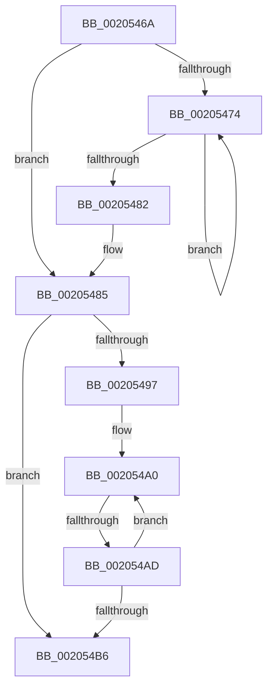

# sub_0020546A

- RVA: `0x0020546A`–`0x002054D8` (길이 `110` bytes)
- VA: `0x000000014020546A`
- 실행 섹션: `.text`
- PDB 이름 있음: `아니요`; PDB Function 태그: `아니요`
- unwind 정보 RVA: `0x0005CCE8`
- 디코드: `32`개 명령, `110/110` bytes 표시
- 미해석 바이트: `0` (있으면 어셈블리에 `.byte`로 보존)

> 이 문서는 커널 이미지의 기계어와 PDB 기호를 분석해 생성했습니다. 4번과 5번은 함수 원형과 자료형을 바이너리 사용 방식에서 추정한 C 해석이며 원본 소스 복구 결과는 아닙니다.

## 1. Dependencies

- 직접 호출 지점: **0**; 고유 호출 대상: **0**
- 직접 호출자로 확인된 함수: **0**
- RIP 상대 이미지 참조: **0**

### Outgoing calls
- 직접 디코드된 call 명령이 없습니다.

### Direct callers
- 이 함수 시작 RVA로 연결되는 직접 call은 확인되지 않았습니다. 간접 호출은 완전히 역산할 수 없습니다.

### Static image references
- 디코드된 RIP-relative 메모리 참조가 없습니다.

## 2. Other-region calls and transfers

- 다른 실행 섹션으로 향하는 call: **0**
- call이 아닌 외부 분기/꼬리 이동: **2**
  - `0x002054AB` → [sub_00205525](Unknown_function_00205525.md) (`tail-transfer`)
  - `0x002054D6` → [sub_002054D8 + 0x25](Unknown_function_002054D8.md) (`tail-transfer`)

## 3. Assembly (complete function range)

```asm
0020546A  48 89 74 24 38                  mov qword ptr [rsp + 0x38], rsi
0020546F  48 85 DB                        test rbx, rbx
00205472  75 11                           jne 0x140205485
00205474  49 8B 08                        mov rcx, qword ptr [r8]
00205477  48 8B 1F                        mov rbx, qword ptr [rdi]
0020547A  49 8B 00                        mov rax, qword ptr [r8]
0020547D  48 3B C8                        cmp rcx, rax
00205480  75 F2                           jne 0x140205474
00205482  48 2B D9                        sub rbx, rcx
00205485  48 C7 C1 FF FF FF FF            mov rcx, 0xffffffffffffffff
0020548C  49 8B C2                        mov rax, r10
0020548F  48 8B F1                        mov rsi, rcx
00205492  4D 3B D1                        cmp r10, r9
00205495  73 1F                           jae 0x1402054b6
00205497  66 0F 1F 84 00 00 00 00 00      nop word ptr [rax + rax]
002054A0  4C 8B 40 08                     mov r8, qword ptr [rax + 8]
002054A4  48 8B F9                        mov rdi, rcx
002054A7  49 83 F8 FF                     cmp r8, -1
002054AB  75 78                           jne 0x140205525
002054AD  48 83 C0 18                     add rax, 0x18
002054B1  49 3B C1                        cmp rax, r9
002054B4  72 EA                           jb 0x1402054a0
002054B6  48 3B CB                        cmp rcx, rbx
002054B9  48 8B D3                        mov rdx, rbx
002054BC  48 0F 43 D1                     cmovae rdx, rcx
002054C0  48 3B F3                        cmp rsi, rbx
002054C3  48 8B CB                        mov rcx, rbx
002054C6  48 0F 43 CE                     cmovae rcx, rsi
002054CA  48 8B 74 24 38                  mov rsi, qword ptr [rsp + 0x38]
002054CF  49 89 09                        mov qword ptr [r9], rcx
002054D2  48 83 F9 FF                     cmp rcx, -1
002054D6  74 25                           je 0x1402054fd
```

## 4. C-style interpretation (structured pseudocode)

```c
__int64 __fastcall sub_0020546A(__int64 a1, __int64 a2, __int64 a3, __int64 a4, __int64 a5, __int64 a6, __int64 a7)
{
    __int64 result;
    __int64 v_rbx;
    unsigned __int64 v_stack_p38;

    v_stack_p38 = v_rsi;
    if (v_rbx != 0) goto loc_00205485;
loc_00205474:
    if ((*(unsigned __int64 *)(a3)) != (*(unsigned __int64 *)(a3))) goto loc_00205474;
    v_rbx = (*(unsigned __int64 *)(v_rdi)) - (*(unsigned __int64 *)(a3));
loc_00205485:
    if (v_r10 >= a4) goto loc_002054B6;
loc_002054A0:
    result = (v_r10) + (24);
    if (result < a4) goto loc_002054A0;
loc_002054B6:
    a2 = v_rbx;
    if (-1 >= v_rbx) { a2 = -1; }
    a1 = v_rbx;
    if (-1 >= v_rbx) { a1 = -1; }
    *(unsigned __int64 *)(a4) = a1;
}
```

## 5. (Beta) C Style

```c
int64_t sub_0020546A(int64_t Arg1, int64_t Arg2, void *Arg3, void *Arg4, uint64_t Arg5, uint64_t Arg6, int64_t Arg7)
{
    uint8_t *arg3 = (uint8_t *)Arg3;
    uint8_t *arg4 = (uint8_t *)Arg4;

    int64_t result;
    int64_t local_rbx;
    uint64_t v_stack_p38;

    v_stack_p38 = local_rsi;
    if (local_rbx != 0) goto loc_00205485;
loc_00205474:
    if ((*(uint64_t *)(arg3)) != (*(uint64_t *)(arg3))) goto loc_00205474;
    local_rbx = (*(uint64_t *)(local_rdi)) - (*(uint64_t *)(arg3));
loc_00205485:
    if (local_r10 >= Arg4) goto loc_002054B6;
loc_002054A0:
    result = (local_r10) + (24);
    if (result < Arg4) goto loc_002054A0;
loc_002054B6:
    Arg2 = local_rbx;
    if (-1 >= local_rbx) { Arg2 = -1; }
    Arg1 = local_rbx;
    if (-1 >= local_rbx) { Arg1 = -1; }
    *(uint64_t *)(arg4) = Arg1;
}
```

### 관측된 메모리 오프셋

구조체 형식이 확인되지 않은 접근은 인자 기준의 오프셋으로만 기록했습니다.

| 기준 인자 | 오프셋 표현 | 폭 (bit) | 접근 |
|---|---:|---:|---|
| `Arg3` | `+ 0x0` | `64` | `R` |
| `Arg4` | `+ 0x0` | `64` | `W` |

## 6. Execution-region graph

[열기: 2D/3D 그래프와 함수 탐색 컨트롤 패널](../../../control-panel.html?section=text&rva=0x0020546A&view=graph)

- 2D 그래프는 위에서 아래로 흐르고, 3D 그래프는 빈 공간을 드래그해 회전합니다. Shift+드래그는 이동, 휠은 확대·축소, 함수 노드 선택은 대상 보고서 이동입니다.

### Static fallback


