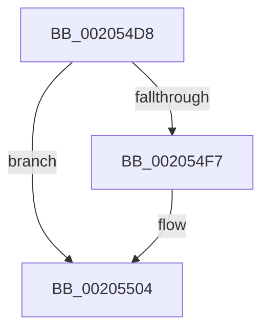

# sub_002054D8

- RVA: `0x002054D8`–`0x0020551F` (길이 `71` bytes)
- VA: `0x00000001402054D8`
- 실행 섹션: `.text`
- PDB 이름 있음: `아니요`; PDB Function 태그: `아니요`
- unwind 정보 RVA: `0x0005CCFC`
- 디코드: `16`개 명령, `71/71` bytes 표시
- 미해석 바이트: `0` (있으면 어셈블리에 `.byte`로 보존)

> 이 문서는 커널 이미지의 기계어와 PDB 기호를 분석해 생성했습니다. 4번과 5번은 함수 원형과 자료형을 바이너리 사용 방식에서 추정한 C 해석이며 원본 소스 복구 결과는 아닙니다.

## 1. Dependencies

- 직접 호출 지점: **0**; 고유 호출 대상: **0**
- 직접 호출자로 확인된 함수: **0**
- RIP 상대 이미지 참조: **0**

### Outgoing calls
- 직접 디코드된 call 명령이 없습니다.

### Direct callers
- 이 함수 시작 RVA로 연결되는 직접 call은 확인되지 않았습니다. 간접 호출은 완전히 역산할 수 없습니다.

### Static image references
- 디코드된 RIP-relative 메모리 참조가 없습니다.

## 2. Other-region calls and transfers

- 다른 실행 섹션으로 향하는 call: **0**
- 별도 외부 분기/꼬리 이동을 확인하지 못했습니다.

## 3. Assembly (complete function range)

```asm
002054D8  48 8B C2                        mov rax, rdx
002054DB  4C 8B D9                        mov r11, rcx
002054DE  48 2B C3                        sub rax, rbx
002054E1  4C 2B DB                        sub r11, rbx
002054E4  48 3B CA                        cmp rcx, rdx
002054E7  4C 0F 43 D8                     cmovae r11, rax
002054EB  4D 89 9A B0 00 00 00            mov qword ptr [r10 + 0xb0], r11
002054F2  4D 85 DB                        test r11, r11
002054F5  75 0D                           jne 0x140205504
002054F7  41 BB 01 00 00 00               mov r11d, 1
002054FD  4D 89 9A B0 00 00 00            mov qword ptr [r10 + 0xb0], r11
00205504  49 8B 82 B0 E6 FF FF            mov rax, qword ptr [r10 - 0x1950]
0020550B  49 F7 DB                        neg r11
0020550E  4C 89 98 10 1D 00 00            mov qword ptr [rax + 0x1d10], r11
00205515  48 8B 5C 24 30                  mov rbx, qword ptr [rsp + 0x30]
0020551A  48 8B 7C 24 20                  mov rdi, qword ptr [rsp + 0x20]
```

## 4. C-style interpretation (structured pseudocode)

```c
__int64 __fastcall sub_002054D8(__int64 a1, __int64 a2, __int64 a3, __int64 a4, __int64 a5, __int64 a6)
{
    __int64 result;
    __int64 v_r11;
    unsigned __int64 v_stack_p20;

    result = (a2) - (v_rbx);
    v_r11 = (a1) - (v_rbx);
    if (a1 >= a2) { v_r11 = result; }
    *(unsigned __int64 *)(v_r10 + 176) = v_r11;
    if (v_r11 == 0) {
        v_r11 = 1;
        *(unsigned __int64 *)(v_r10 + 176) = v_r11;
    }
    v_r11 = -(v_r11);
    *(unsigned __int64 *)(*(unsigned __int64 *)(v_r10 - 6480) + 7440) = v_r11;
    return *(unsigned __int64 *)(v_r10 - 6480);
}
```

## 5. (Beta) C Style

```c
int64_t sub_002054D8(int64_t Arg1, int64_t Arg2, int64_t Arg3, int64_t Arg4, uint64_t Arg5, int64_t Arg6)
{
    int64_t result;
    int64_t local_r11;
    uint64_t v_stack_p20;

    result = (Arg2) - (local_rbx);
    local_r11 = (Arg1) - (local_rbx);
    if (Arg1 >= Arg2) { local_r11 = result; }
    *(uint64_t *)(local_r10 + 0xB0) = local_r11;
    if (local_r11 == 0) {
        local_r11 = 1;
        *(uint64_t *)(local_r10 + 0xB0) = local_r11;
    }
    local_r11 = -(local_r11);
    *(uint64_t *)(*(uint64_t *)(local_r10 - 0x1950) + 0x1D10) = local_r11;
    return *(uint64_t *)(local_r10 - 0x1950);
}
```

## 6. Execution-region graph

[열기: 2D/3D 그래프와 함수 탐색 컨트롤 패널](../../../control-panel.html?section=text&rva=0x002054D8&view=graph)

- 2D 그래프는 위에서 아래로 흐르고, 3D 그래프는 빈 공간을 드래그해 회전합니다. Shift+드래그는 이동, 휠은 확대·축소, 함수 노드 선택은 대상 보고서 이동입니다.

### Static fallback


