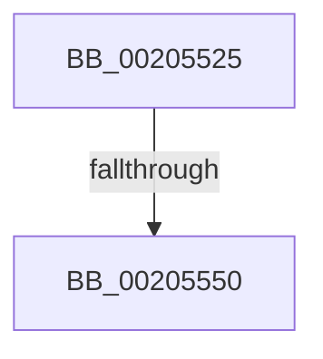

# sub_00205525

- RVA: `0x00205525`–`0x00205558` (길이 `51` bytes)
- VA: `0x0000000140205525`
- 실행 섹션: `.text`
- PDB 이름 있음: `아니요`; PDB Function 태그: `아니요`
- unwind 정보 RVA: `0x0005CD20`
- 디코드: `13`개 명령, `51/51` bytes 표시
- 미해석 바이트: `0` (있으면 어셈블리에 `.byte`로 보존)

> 이 문서는 커널 이미지의 기계어와 PDB 기호를 분석해 생성했습니다. 4번과 5번은 함수 원형과 자료형을 바이너리 사용 방식에서 추정한 C 해석이며 원본 소스 복구 결과는 아닙니다.

## 1. Dependencies

- 직접 호출 지점: **0**; 고유 호출 대상: **0**
- 직접 호출자로 확인된 함수: **0**
- RIP 상대 이미지 참조: **0**

### Outgoing calls
- 직접 디코드된 call 명령이 없습니다.

### Direct callers
- 이 함수 시작 RVA로 연결되는 직접 call은 확인되지 않았습니다. 간접 호출은 완전히 역산할 수 없습니다.

### Static image references
- 디코드된 RIP-relative 메모리 참조가 없습니다.

## 2. Other-region calls and transfers

- 다른 실행 섹션으로 향하는 call: **0**
- call이 아닌 외부 분기/꼬리 이동: **2**
  - `0x0020554A` → [sub_0020546A + 0x43](Unknown_function_0020546A.md) (`tail-transfer`)
  - `0x00205553` → [sub_0020546A + 0x43](Unknown_function_0020546A.md) (`tail-transfer`)

## 3. Assembly (complete function range)

```asm
00205525  48 8B 50 10                     mov rdx, qword ptr [rax + 0x10]
00205529  48 8B CB                        mov rcx, rbx
0020552C  49 2B 8A B8 00 00 00            sub rcx, qword ptr [r10 + 0xb8]
00205533  48 3B D1                        cmp rdx, rcx
00205536  48 0F 42 D1                     cmovb rdx, rcx
0020553A  48 8B 08                        mov rcx, qword ptr [rax]
0020553D  48 03 CA                        add rcx, rdx
00205540  48 3B CF                        cmp rcx, rdi
00205543  48 0F 43 CF                     cmovae rcx, rdi
00205547  4C 3B C6                        cmp r8, rsi
0020554A  0F 83 5D FF FF FF               jae 0x1402054ad
00205550  49 8B F0                        mov rsi, r8
00205553  E9 55 FF FF FF                  jmp 0x1402054ad
```

## 4. C-style interpretation (structured pseudocode)

```c
void __fastcall sub_00205525(__int64 a1, __int64 a2, __int64 a3)
{
    a1 = (v_rbx) - (*(unsigned __int64 *)(v_r10 + 184));
    a2 = *(unsigned __int64 *)(result + 16);
    if ((*(unsigned __int64 *)(result + 16)) < a1) { a2 = a1; }
    a1 = (*(unsigned __int64 *)(result)) + (a2);
    if (a1 >= v_rdi) { a1 = v_rdi; }
}
```

## 5. (Beta) C Style

```c
void sub_00205525(int64_t Arg1, int64_t Arg2, int64_t Arg3)
{
    Arg1 = (local_rbx) - (*(uint64_t *)(local_r10 + 0xB8));
    Arg2 = *(uint64_t *)(result + 0x10);
    if ((*(uint64_t *)(result + 0x10)) < Arg1) { Arg2 = Arg1; }
    Arg1 = (*(uint64_t *)(result)) + (Arg2);
    if (Arg1 >= local_rdi) { Arg1 = local_rdi; }
}
```

## 6. Execution-region graph

[열기: 2D/3D 그래프와 함수 탐색 컨트롤 패널](../../../control-panel.html?section=text&rva=0x00205525&view=graph)

- 2D 그래프는 위에서 아래로 흐르고, 3D 그래프는 빈 공간을 드래그해 회전합니다. Shift+드래그는 이동, 휠은 확대·축소, 함수 노드 선택은 대상 보고서 이동입니다.

### Static fallback


