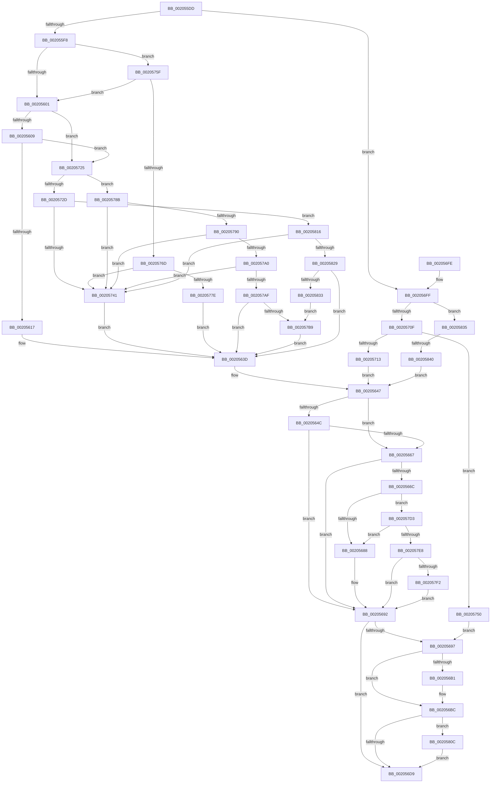

# sub_002055DD

- RVA: `0x002055DD`–`0x00205849` (길이 `620` bytes)
- VA: `0x00000001402055DD`
- 실행 섹션: `.text`
- PDB 이름 있음: `아니요`; PDB Function 태그: `아니요`
- unwind 정보 RVA: `0x0005CD68`
- 디코드: `157`개 명령, `620/620` bytes 표시
- 미해석 바이트: `0` (있으면 어셈블리에 `.byte`로 보존)

> 이 문서는 커널 이미지의 기계어와 PDB 기호를 분석해 생성했습니다. 4번과 5번은 함수 원형과 자료형을 바이너리 사용 방식에서 추정한 C 해석이며 원본 소스 복구 결과는 아닙니다.

## 1. Dependencies

- 직접 호출 지점: **13**; 고유 호출 대상: **6**
- 직접 호출자로 확인된 함수: **0**
- RIP 상대 이미지 참조: **0**

### Outgoing calls
- `0x00205638` → [ExpInterlockedPushEntrySList](../6B/ExpInterlockedPushEntrySList_function_006BA5B0.md) (function, `0x006BA5B0`)
- `0x0020565E` → [SMKM_STORE_MGR<SM_TRAITS>::SmIoCtxWorkItemComplete](SMKM_STORE_MGR_SM_TRAITS_SmIoCtxWorkItemComplete_function_00205850.md) (function, `0x00205850`)
- `0x0020568D` → [ExFreePoolWithTag](../../poolcode/B8/ExFreePoolWithTag_function_00B82870.md) (function, `0x00B82870`)
- `0x0020571B` → [ExFreePoolWithTag](../../poolcode/B8/ExFreePoolWithTag_function_00B82870.md) (function, `0x00B82870`)
- `0x00205746` → [ExFreePoolWithTag](../../poolcode/B8/ExFreePoolWithTag_function_00B82870.md) (function, `0x00B82870`)
- `0x00205755` → [ExFreePoolWithTag](../../poolcode/B8/ExFreePoolWithTag_function_00B82870.md) (function, `0x00B82870`)
- `0x00205781` → [ExpInterlockedPushEntrySList](../6B/ExpInterlockedPushEntrySList_function_006BA5B0.md) (function, `0x006BA5B0`)
- `0x002057A6` → [SmpFpReleaseResource](../4F/SmpFpReleaseResource_function_004FAC90.md) (function, `0x004FAC90`)
- `0x002057C9` → [KeSetEvent](../33/KeSetEvent_function_0033F310.md) (function, `0x0033F310`)
- `0x002057DB` → [SmpFpReleaseResource](../4F/SmpFpReleaseResource_function_004FAC90.md) (function, `0x004FAC90`)
- `0x00205802` → [KeSetEvent](../33/KeSetEvent_function_0033F310.md) (function, `0x0033F310`)
- `0x0020580C` → [ExfReleaseRundownProtection](../34/ExfReleaseRundownProtection_function_00349EB0.md) (function, `0x00349EB0`)
- `0x0020581C` → [SmpFpReleaseResource](../4F/SmpFpReleaseResource_function_004FAC90.md) (function, `0x004FAC90`)

### Direct callers
- 이 함수 시작 RVA로 연결되는 직접 call은 확인되지 않았습니다. 간접 호출은 완전히 역산할 수 없습니다.

### Static image references
- 디코드된 RIP-relative 메모리 참조가 없습니다.

## 2. Other-region calls and transfers

- 다른 실행 섹션으로 향하는 call: **4**
  - `0x0020568D` → [ExFreePoolWithTag](../../poolcode/B8/ExFreePoolWithTag_function_00B82870.md) (`.text` → `POOLCODE`)
  - `0x0020571B` → [ExFreePoolWithTag](../../poolcode/B8/ExFreePoolWithTag_function_00B82870.md) (`.text` → `POOLCODE`)
  - `0x00205746` → [ExFreePoolWithTag](../../poolcode/B8/ExFreePoolWithTag_function_00B82870.md) (`.text` → `POOLCODE`)
  - `0x00205755` → [ExFreePoolWithTag](../../poolcode/B8/ExFreePoolWithTag_function_00B82870.md) (`.text` → `POOLCODE`)
- call이 아닌 외부 분기/꼬리 이동: **1**
  - `0x0020583A` → [sub_006D653A](../6D/Unknown_function_006D653A.md) (`tail-transfer`)

## 3. Assembly (complete function range)

```asm
002055DD  48 89 BC 24 80 00 00 00         mov qword ptr [rsp + 0x80], rdi
002055E5  33 FF                           xor edi, edi
002055E7  4C 89 AC 24 88 00 00 00         mov qword ptr [rsp + 0x88], r13
002055EF  83 FE 04                        cmp esi, 4
002055F2  0F 83 07 01 00 00               jae 0x1402056ff
002055F8  83 FE 02                        cmp esi, 2
002055FB  0F 84 5E 01 00 00               je 0x14020575f
00205601  85 F6                           test esi, esi
00205603  0F 85 1C 01 00 00               jne 0x140205725
00205609  41 F7 40 08 00 00 00 40         test dword ptr [r8 + 8], 0x40000000
00205611  0F 84 0E 01 00 00               je 0x140205725
00205617  49 8B 40 10                     mov rax, qword ptr [r8 + 0x10]
0020561B  48 8B D3                        mov rdx, rbx
0020561E  48 8B 08                        mov rcx, qword ptr [rax]
00205621  48 89 4C 24 30                  mov qword ptr [rsp + 0x30], rcx
00205626  41 8B 48 0C                     mov ecx, dword ptr [r8 + 0xc]
0020562A  83 E1 3F                        and ecx, 0x3f
0020562D  48 C1 E1 04                     shl rcx, 4
00205631  49 03 8F 10 05 00 00            add rcx, qword ptr [r15 + 0x510]
00205638  E8 73 4F 4B 00                  call 0x1406ba5b0
0020563D  41 3B F4                        cmp esi, r12d
00205640  44 8B EF                        mov r13d, edi
00205643  41 0F 94 C5                     sete r13b
00205647  4D 85 F6                        test r14, r14
0020564A  74 1B                           je 0x140205667
0020564C  45 8B 0E                        mov r9d, dword ptr [r14]
0020564F  48 8D 4C 24 20                  lea rcx, [rsp + 0x20]
00205654  48 8B 95 90 1D 00 00            mov rdx, qword ptr [rbp + 0x1d90]
0020565B  4C 8B C5                        mov r8, rbp
0020565E  E8 ED 01 00 00                  call 0x140205850
00205663  85 C0                           test eax, eax
00205665  74 2B                           je 0x140205692
00205667  45 85 ED                        test r13d, r13d
0020566A  74 26                           je 0x140205692
0020566C  48 8B B4 24 90 00 00 00         mov rsi, qword ptr [rsp + 0x90]
00205674  49 8D 9F 30 06 00 00            lea rbx, [r15 + 0x630]
0020567B  48 8B 43 70                     mov rax, qword ptr [rbx + 0x70]
0020567F  48 3B C6                        cmp rax, rsi
00205682  0F 84 4B 01 00 00               je 0x1402057d3
00205688  33 D2                           xor edx, edx
0020568A  48 8B CE                        mov rcx, rsi
0020568D  E8 DE D1 97 00                  call 0x140b82870
00205692  45 85 E4                        test r12d, r12d
00205695  74 42                           je 0x1402056d9
00205697  8B 85 90 1A 00 00               mov eax, dword ptr [rbp + 0x1a90]
0020569D  25 FF 03 00 00                  and eax, 0x3ff
002056A2  8B C8                           mov ecx, eax
002056A4  48 C1 E9 05                     shr rcx, 5
002056A8  49 8B 14 CF                     mov rdx, qword ptr [r15 + rcx*8]
002056AC  48 85 D2                        test rdx, rdx
002056AF  74 0B                           je 0x1402056bc
002056B1  83 E0 1F                        and eax, 0x1f
002056B4  48 8D 0C 80                     lea rcx, [rax + rax*4]
002056B8  48 8D 3C CA                     lea rdi, [rdx + rcx*8]
002056BC  48 8D 4F 08                     lea rcx, [rdi + 8]
002056C0  0F 0D 09                        prefetchw byte ptr [rcx]
002056C3  48 8B 01                        mov rax, qword ptr [rcx]
002056C6  48 83 E0 FE                     and rax, 0xfffffffffffffffe
002056CA  48 8D 50 FE                     lea rdx, [rax - 2]
002056CE  F0 48 0F B1 11                  lock cmpxchg qword ptr [rcx], rdx
002056D3  0F 85 33 01 00 00               jne 0x14020580c
002056D9  4C 8B AC 24 88 00 00 00         mov r13, qword ptr [rsp + 0x88]
002056E1  48 8B BC 24 80 00 00 00         mov rdi, qword ptr [rsp + 0x80]
002056E9  48 8B 9C 24 98 00 00 00         mov rbx, qword ptr [rsp + 0x98]
002056F1  48 83 C4 50                     add rsp, 0x50
002056F5  41 5F                           pop r15
002056F7  41 5E                           pop r14
002056F9  41 5C                           pop r12
002056FB  5E                              pop rsi
002056FC  5D                              pop rbp
002056FD  C3                              ret
002056FE  CC                              int3
002056FF  41 8B 40 08                     mov eax, dword ptr [r8 + 8]
00205703  83 E0 07                        and eax, 7
00205706  83 FE 05                        cmp esi, 5
00205709  0F 85 26 01 00 00               jne 0x140205835
0020570F  85 C0                           test eax, eax
00205711  74 3D                           je 0x140205750
00205713  33 D2                           xor edx, edx
00205715  48 8B CB                        mov rcx, rbx
00205718  44 8B EF                        mov r13d, edi
0020571B  E8 50 D1 97 00                  call 0x140b82870
00205720  E9 22 FF FF FF                  jmp 0x140205647
00205725  83 E1 07                        and ecx, 7
00205728  41 2B CC                        sub ecx, r12d
0020572B  75 5E                           jne 0x14020578b
0020572D  4D 8D AF 30 06 00 00            lea r13, [r15 + 0x630]
00205734  49 8B 45 70                     mov rax, qword ptr [r13 + 0x70]
00205738  48 3B C2                        cmp rax, rdx
0020573B  0F 84 D5 00 00 00               je 0x140205816
00205741  33 D2                           xor edx, edx
00205743  48 8B CB                        mov rcx, rbx
00205746  E8 25 D1 97 00                  call 0x140b82870
0020574B  E9 ED FE FF FF                  jmp 0x14020563d
00205750  33 D2                           xor edx, edx
00205752  48 8B CB                        mov rcx, rbx
00205755  E8 16 D1 97 00                  call 0x140b82870
0020575A  E9 38 FF FF FF                  jmp 0x140205697
0020575F  41 F7 40 08 00 00 00 04         test dword ptr [r8 + 8], 0x4000000
00205767  0F 84 94 FE FF FF               je 0x140205601
0020576D  49 8D 8F E0 04 00 00            lea rcx, [r15 + 0x4e0]
00205774  B8 00 10 00 00                  mov eax, 0x1000
00205779  66 39 01                        cmp word ptr [rcx], ax
0020577C  73 C3                           jae 0x140205741
0020577E  48 8B D3                        mov rdx, rbx
00205781  E8 2A 4E 4B 00                  call 0x1406ba5b0
00205786  E9 B2 FE FF FF                  jmp 0x14020563d
0020578B  41 3B CC                        cmp ecx, r12d
0020578E  75 B1                           jne 0x140205741
00205790  4D 8D AF A8 06 00 00            lea r13, [r15 + 0x6a8]
00205797  49 8B 45 70                     mov rax, qword ptr [r13 + 0x70]
0020579B  48 3B C2                        cmp rax, rdx
0020579E  75 A1                           jne 0x140205741
002057A0  41 8B D4                        mov edx, r12d
002057A3  49 8B CD                        mov rcx, r13
002057A6  E8 E5 54 2F 00                  call 0x1404fac90
002057AB  85 C0                           test eax, eax
002057AD  74 92                           je 0x140205741
002057AF  41 38 7D 5E                     cmp byte ptr [r13 + 0x5e], dil
002057B3  0F 85 84 FE FF FF               jne 0x14020563d
002057B9  48 8B C7                        mov rax, rdi
002057BC  49 8D 4D 08                     lea rcx, [r13 + 8]
002057C0  49 87 45 70                     xchg qword ptr [r13 + 0x70], rax
002057C4  45 33 C0                        xor r8d, r8d
002057C7  33 D2                           xor edx, edx
002057C9  E8 42 9B 13 00                  call 0x14033f310
002057CE  E9 6A FE FF FF                  jmp 0x14020563d
002057D3  4C 8B C6                        mov r8, rsi
002057D6  33 D2                           xor edx, edx
002057D8  48 8B CB                        mov rcx, rbx
002057DB  E8 B0 54 2F 00                  call 0x1404fac90
002057E0  85 C0                           test eax, eax
002057E2  0F 84 A0 FE FF FF               je 0x140205688
002057E8  80 7B 5E 00                     cmp byte ptr [rbx + 0x5e], 0
002057EC  0F 85 A0 FE FF FF               jne 0x140205692
002057F2  48 8B C7                        mov rax, rdi
002057F5  48 8D 4B 08                     lea rcx, [rbx + 8]
002057F9  48 87 43 70                     xchg qword ptr [rbx + 0x70], rax
002057FD  45 33 C0                        xor r8d, r8d
00205800  33 D2                           xor edx, edx
00205802  E8 09 9B 13 00                  call 0x14033f310
00205807  E9 86 FE FF FF                  jmp 0x140205692
0020580C  E8 9F 46 14 00                  call 0x140349eb0
00205811  E9 C3 FE FF FF                  jmp 0x1402056d9
00205816  41 8B D4                        mov edx, r12d
00205819  49 8B CD                        mov rcx, r13
0020581C  E8 6F 54 2F 00                  call 0x1404fac90
00205821  85 C0                           test eax, eax
00205823  0F 84 18 FF FF FF               je 0x140205741
00205829  41 38 7D 5E                     cmp byte ptr [r13 + 0x5e], dil
0020582D  0F 85 0A FE FF FF               jne 0x14020563d
00205833  EB 84                           jmp 0x1402057b9
00205835  44 8B EF                        mov r13d, edi
00205838  85 C0                           test eax, eax
0020583A  0F 85 FA 0C 4D 00               jne 0x1406d653a
00205840  49 89 78 20                     mov qword ptr [r8 + 0x20], rdi
00205844  E9 FE FD FF FF                  jmp 0x140205647
```

## 4. C-style interpretation (structured pseudocode)

```c
__int64 __fastcall sub_002055DD(__int64 a1, __int64 a2, __int64 a3, __int64 a4, __int64 a5, __int64 a6, __int64 a7, __int64 a8, __int64 a9, __int64 a10, __int64 a11, __int64 a12, __int64 a13, __int64 a14, __int64 a15, __int64 a16, __int64 a17, __int64 a18, __int64 a19)
{
    __int64 result;
    __int64 v_r13;
    __int64 v_rdi;
    __int64 v_rsp;
    unsigned __int64 v_stack_p20;
    unsigned __int64 v_stack_p30;
    unsigned __int64 v_stack_p80;
    unsigned __int64 v_stack_p88;

    v_stack_p80 = v_rdi;
    v_rdi = 0;
    v_stack_p88 = v_r13;
    if (((unsigned int)(v_rsi)) >= 4) goto loc_002056FF;
    if (((unsigned int)(v_rsi)) == 2) goto loc_0020575F;
loc_00205601:
    if ((unsigned int)(v_rsi) != 0) goto loc_00205725;
    if (((*(unsigned int *)(a3 + 8)) & (0x40000000ULL)) == 0) goto loc_00205725;
    v_stack_p30 = *(unsigned __int64 *)(*(unsigned __int64 *)(a3 + 16));
    a1 = (unsigned int)(((unsigned int)(*(unsigned int *)(a3 + 12))) & (63));
    a1 = (a1) << (4);
    a1 = (a1) + (*(unsigned __int64 *)(v_r15 + 1296));
    result = ExpInterlockedPushEntrySList(a1, v_rbx, a3, a4);
loc_0020563D:
    v_r13 = (((unsigned int)(v_rsi)) == ((unsigned int)(v_r12))) ? 1 : 0;
loc_00205647:
    if (v_r14 == 0) goto loc_00205667;
    result = SMKM_STORE_MGR_SM_TRAITS___SmIoCtxWorkItemComplete(v_stack_p20, *(unsigned __int64 *)(v_rbp + 7568), v_rbp, (unsigned int)(*(unsigned int *)(v_r14)));
    if ((unsigned int)(result) == 0) goto loc_00205692;
loc_00205667:
    if ((unsigned int)(v_r13) == 0) goto loc_00205692;
    if ((*(unsigned __int64 *)(v_r15 + 1584 + 112)) == a18) goto loc_002057D3;
loc_00205688:
    a2 = 0;
    result = ExFreePoolWithTag(a18, a2, v_rbp, (unsigned int)(*(unsigned int *)(v_r14)));
loc_00205692:
    if ((unsigned int)(v_r12) == 0) goto loc_002056D9;
loc_00205697:
    result = (unsigned int)(((unsigned int)(*(unsigned int *)(v_rbp + 6800))) & (0x3FFULL));
    a1 = ((unsigned int)((unsigned int)(result))) >> (5);
    if (*(unsigned __int64 *)(v_r15 + a1 * 8) != 0) {
        result = (unsigned int)((result) & (31));
        a1 = result + result * 4;
        v_rdi = *(unsigned __int64 *)(v_r15 + a1 * 8) + a1 * 8;
    }
    result = (*(unsigned __int64 *)(v_rdi + 8)) & (-2);
    if (condition_is_not_equal) goto loc_0020580C;
loc_002056D9:
    v_rsp = (v_rsp) + (80);
    return result;
loc_002056FF:
    result = (unsigned int)(((unsigned int)(*(unsigned int *)(v_rbp + 8))) & (7));
    if (((unsigned int)(a18)) != 5) goto loc_00205835;
    if ((unsigned int)(result) == 0) goto loc_00205750;
    a2 = 0;
    result = ExFreePoolWithTag(a19, a2, v_rbp, (unsigned int)(*(unsigned int *)(v_r14)));
    goto loc_00205647;
loc_00205725:
    a1 = (unsigned int)((a19) & (7));
    a1 = (unsigned int)((a1) - ((unsigned int)(v_r12)));
    if (condition_is_not_equal) goto loc_0020578B;
    if ((*(unsigned __int64 *)(v_r15 + 1584 + 112)) == 0) goto loc_00205816;
loc_00205741:
    a2 = 0;
    result = ExFreePoolWithTag(a19, a2, v_rbp, (unsigned int)(*(unsigned int *)(v_r14)));
    goto loc_0020563D;
loc_00205750:
    a2 = 0;
    result = ExFreePoolWithTag(a19, a2, v_rbp, (unsigned int)(*(unsigned int *)(v_r14)));
    goto loc_00205697;
loc_0020575F:
    if (((*(unsigned int *)(v_rbp + 8)) & (0x4000000ULL)) == 0) goto loc_00205601;
    if ((*(unsigned __int16 *)(v_r15 + 1248)) >= ((unsigned __int16)((unsigned int)(0x1000ULL)))) goto loc_00205741;
    result = ExpInterlockedPushEntrySList(v_r15 + 1248, a19, v_rbp, (unsigned int)(*(unsigned int *)(v_r14)));
    goto loc_0020563D;
loc_0020578B:
    if (((unsigned int)(v_r15 + 1248)) != ((unsigned int)(v_r12))) goto loc_00205741;
    if ((*(unsigned __int64 *)(v_r15 + 1704 + 112)) != a19) goto loc_00205741;
    result = SmpFpReleaseResource(v_r15 + 1704, (unsigned int)((unsigned int)(v_r12)), v_rbp, (unsigned int)(*(unsigned int *)(v_r14)));
    if ((unsigned int)(result) == 0) goto loc_00205741;
    if ((*(unsigned __int8 *)(v_r15 + 1704 + 94)) != ((unsigned __int8)(a16))) goto loc_0020563D;
loc_002057B9:
    a3 = 0;
    a2 = 0;
    result = KeSetEvent(v_r15 + 1704 + 8, a2, a3, (unsigned int)(*(unsigned int *)(v_r14)));
    goto loc_0020563D;
loc_002057D3:
    a2 = 0;
    result = SmpFpReleaseResource(a19, a2, a18, (unsigned int)(*(unsigned int *)(v_r14)));
    if ((unsigned int)(result) == 0) goto loc_00205688;
    if ((*(unsigned __int8 *)(a19 + 94)) != 0) goto loc_00205692;
    a3 = 0;
    a2 = 0;
    result = KeSetEvent(a19 + 8, a2, a3, (unsigned int)(*(unsigned int *)(v_r14)));
    goto loc_00205692;
loc_0020580C:
    result = ExfReleaseRundownProtection(a19 + 8, a2, a3, (unsigned int)(*(unsigned int *)(v_r14)));
    goto loc_002056D9;
loc_00205816:
    result = SmpFpReleaseResource(v_r15 + 1704, (unsigned int)((unsigned int)(v_r12)), a3, (unsigned int)(*(unsigned int *)(v_r14)));
    if ((unsigned int)(result) == 0) goto loc_00205741;
    if ((*(unsigned __int8 *)(v_r15 + 1704 + 94)) != ((unsigned __int8)(a16))) goto loc_0020563D;
    goto loc_002057B9;
loc_00205835:
    *(unsigned __int64 *)(a3 + 32) = a16;
    goto loc_00205647;
}
```

## 5. (Beta) C Style

```c
int64_t sub_002055DD(int64_t Arg1, int64_t Arg2, void *Arg3, int64_t Arg4, uint64_t Arg5, uint64_t Arg6, uint64_t Arg7, uint64_t Arg8, uint64_t Arg9, uint64_t Arg10, uint64_t Arg11, uint64_t Arg12, uint64_t Arg13, uint64_t Arg14, uint64_t Arg15, int64_t Arg16, int64_t Arg17, int64_t Arg18, int64_t Arg19)
{
    uint8_t *arg3 = (uint8_t *)Arg3;

    int64_t result;
    int64_t local_r13;
    int64_t local_rdi;
    int64_t local_rsp;
    uint64_t v_stack_p20;
    uint64_t v_stack_p30;
    uint64_t v_stack_p80;
    uint64_t v_stack_p88;

    v_stack_p80 = local_rdi;
    local_rdi = 0;
    v_stack_p88 = local_r13;
    if (((uint32_t)(local_rsi)) >= 4) goto loc_002056FF;
    if (((uint32_t)(local_rsi)) == 2) goto loc_0020575F;
loc_00205601:
    if ((uint32_t)(local_rsi) != 0) goto loc_00205725;
    if (((*(uint32_t *)(arg3 + 0x8)) & (0x40000000ULL)) == 0) goto loc_00205725;
    v_stack_p30 = *(uint64_t *)(*(uint64_t *)(arg3 + 0x10));
    Arg1 = (uint32_t)(((uint32_t)(*(uint32_t *)(arg3 + 0xC))) & (63));
    Arg1 = (Arg1) << (4);
    Arg1 = (Arg1) + (*(uint64_t *)(local_r15 + 0x510));
    result = ExpInterlockedPushEntrySList(Arg1, local_rbx, Arg3, Arg4);
loc_0020563D:
    local_r13 = (((uint32_t)(local_rsi)) == ((uint32_t)(local_r12))) ? 1 : 0;
loc_00205647:
    if (local_r14 == 0) goto loc_00205667;
    result = SMKM_STORE_MGR_SM_TRAITS___SmIoCtxWorkItemComplete(v_stack_p20, *(uint64_t *)(local_rbp + 0x1D90), local_rbp, (uint32_t)(*(uint32_t *)(local_r14)));
    if ((uint32_t)(result) == 0) goto loc_00205692;
loc_00205667:
    if ((uint32_t)(local_r13) == 0) goto loc_00205692;
    if ((*(uint64_t *)(local_r15 + 0x630 + 0x70)) == Arg18) goto loc_002057D3;
loc_00205688:
    Arg2 = 0;
    result = ExFreePoolWithTag(Arg18, Arg2, local_rbp, (uint32_t)(*(uint32_t *)(local_r14)));
loc_00205692:
    if ((uint32_t)(local_r12) == 0) goto loc_002056D9;
loc_00205697:
    result = (uint32_t)(((uint32_t)(*(uint32_t *)(local_rbp + 0x1A90))) & (0x3FFULL));
    Arg1 = ((uint32_t)((uint32_t)(result))) >> (5);
    if (*(uint64_t *)(local_r15 + Arg1 * 8) != 0) {
        result = (uint32_t)((result) & (31));
        Arg1 = result + result * 4;
        local_rdi = *(uint64_t *)(local_r15 + Arg1 * 8) + Arg1 * 8;
    }
    result = (*(uint64_t *)(local_rdi + 0x8)) & (-2);
    if (condition_is_not_equal) goto loc_0020580C;
loc_002056D9:
    local_rsp = (local_rsp) + (80);
    return result;
loc_002056FF:
    result = (uint32_t)(((uint32_t)(*(uint32_t *)(local_rbp + 0x8))) & (7));
    if (((uint32_t)(Arg18)) != 5) goto loc_00205835;
    if ((uint32_t)(result) == 0) goto loc_00205750;
    Arg2 = 0;
    result = ExFreePoolWithTag(Arg19, Arg2, local_rbp, (uint32_t)(*(uint32_t *)(local_r14)));
    goto loc_00205647;
loc_00205725:
    Arg1 = (uint32_t)((Arg19) & (7));
    Arg1 = (uint32_t)((Arg1) - ((uint32_t)(local_r12)));
    if (condition_is_not_equal) goto loc_0020578B;
    if ((*(uint64_t *)(local_r15 + 0x630 + 0x70)) == 0) goto loc_00205816;
loc_00205741:
    Arg2 = 0;
    result = ExFreePoolWithTag(Arg19, Arg2, local_rbp, (uint32_t)(*(uint32_t *)(local_r14)));
    goto loc_0020563D;
loc_00205750:
    Arg2 = 0;
    result = ExFreePoolWithTag(Arg19, Arg2, local_rbp, (uint32_t)(*(uint32_t *)(local_r14)));
    goto loc_00205697;
loc_0020575F:
    if (((*(uint32_t *)(local_rbp + 0x8)) & (0x4000000ULL)) == 0) goto loc_00205601;
    if ((*(uint16_t *)(local_r15 + 0x4E0)) >= ((uint16_t)((uint32_t)(0x1000ULL)))) goto loc_00205741;
    result = ExpInterlockedPushEntrySList(local_r15 + 1248, Arg19, local_rbp, (uint32_t)(*(uint32_t *)(local_r14)));
    goto loc_0020563D;
loc_0020578B:
    if (((uint32_t)(local_r15 + 1248)) != ((uint32_t)(local_r12))) goto loc_00205741;
    if ((*(uint64_t *)(local_r15 + 0x6A8 + 0x70)) != Arg19) goto loc_00205741;
    result = SmpFpReleaseResource(local_r15 + 1704, (uint32_t)((uint32_t)(local_r12)), local_rbp, (uint32_t)(*(uint32_t *)(local_r14)));
    if ((uint32_t)(result) == 0) goto loc_00205741;
    if ((*(uint8_t *)(local_r15 + 0x6A8 + 0x5E)) != ((uint8_t)(Arg16))) goto loc_0020563D;
loc_002057B9:
    Arg3 = 0;
    Arg2 = 0;
    result = KeSetEvent(local_r15 + 1704 + 8, Arg2, Arg3, (uint32_t)(*(uint32_t *)(local_r14)));
    goto loc_0020563D;
loc_002057D3:
    Arg2 = 0;
    result = SmpFpReleaseResource(Arg19, Arg2, Arg18, (uint32_t)(*(uint32_t *)(local_r14)));
    if ((uint32_t)(result) == 0) goto loc_00205688;
    if ((*(uint8_t *)(Arg19 + 0x5E)) != 0) goto loc_00205692;
    Arg3 = 0;
    Arg2 = 0;
    result = KeSetEvent(Arg19 + 8, Arg2, Arg3, (uint32_t)(*(uint32_t *)(local_r14)));
    goto loc_00205692;
loc_0020580C:
    result = ExfReleaseRundownProtection(Arg19 + 8, Arg2, Arg3, (uint32_t)(*(uint32_t *)(local_r14)));
    goto loc_002056D9;
loc_00205816:
    result = SmpFpReleaseResource(local_r15 + 1704, (uint32_t)((uint32_t)(local_r12)), Arg3, (uint32_t)(*(uint32_t *)(local_r14)));
    if ((uint32_t)(result) == 0) goto loc_00205741;
    if ((*(uint8_t *)(local_r15 + 0x6A8 + 0x5E)) != ((uint8_t)(Arg16))) goto loc_0020563D;
    goto loc_002057B9;
loc_00205835:
    *(uint64_t *)(arg3 + 0x20) = Arg16;
    goto loc_00205647;
}
```

### 관측된 메모리 오프셋

구조체 형식이 확인되지 않은 접근은 인자 기준의 오프셋으로만 기록했습니다.

| 기준 인자 | 오프셋 표현 | 폭 (bit) | 접근 |
|---|---:|---:|---|
| `Arg3` | `+ 0x8` | `32` | `R` |
| `Arg3` | `+ 0xC` | `32` | `R` |
| `Arg3` | `+ 0x10` | `64` | `R` |
| `Arg3` | `+ 0x20` | `64` | `W` |

## 6. Execution-region graph

[열기: 2D/3D 그래프와 함수 탐색 컨트롤 패널](../../../control-panel.html?section=text&rva=0x002055DD&view=graph)

- 2D 그래프는 위에서 아래로 흐르고, 3D 그래프는 빈 공간을 드래그해 회전합니다. Shift+드래그는 이동, 휠은 확대·축소, 함수 노드 선택은 대상 보고서 이동입니다.

### Static fallback


