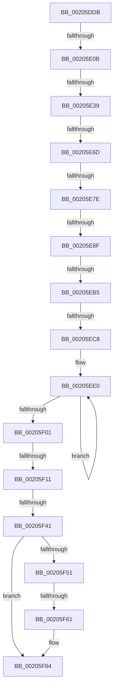

# sub_00205DDB

- RVA: `0x00205DDB`–`0x00205F94` (길이 `441` bytes)
- VA: `0x0000000140205DDB`
- 실행 섹션: `.text`
- PDB 이름 있음: `아니요`; PDB Function 태그: `아니요`
- unwind 정보 RVA: `0x0005CDFC`
- 디코드: `101`개 명령, `441/441` bytes 표시
- 미해석 바이트: `0` (있으면 어셈블리에 `.byte`로 보존)

> 이 문서는 커널 이미지의 기계어와 PDB 기호를 분석해 생성했습니다. 4번과 5번은 함수 원형과 자료형을 바이너리 사용 방식에서 추정한 C 해석이며 원본 소스 복구 결과는 아닙니다.

## 1. Dependencies

- 직접 호출 지점: **2**; 고유 호출 대상: **2**
- 직접 호출자로 확인된 함수: **0**
- RIP 상대 이미지 참조: **0**

### Outgoing calls
- `0x00205E28` → [ST_STORE<SM_TRAITS>::StLazyWorkMgrResetIdle](ST_STORE_SM_TRAITS_StLazyWorkMgrResetIdle_function_00205400.md) (function, `0x00205400`)
- `0x00205EF3` → [ST_STORE<SM_TRAITS>::StDmpSinglePageAdd](ST_STORE_SM_TRAITS_StDmpSinglePageAdd_function_0020502C.md) (function, `0x0020502C`)

### Direct callers
- 이 함수 시작 RVA로 연결되는 직접 call은 확인되지 않았습니다. 간접 호출은 완전히 역산할 수 없습니다.

### Static image references
- 디코드된 RIP-relative 메모리 참조가 없습니다.

## 2. Other-region calls and transfers

- 다른 실행 섹션으로 향하는 call: **0**
- call이 아닌 외부 분기/꼬리 이동: **11**
  - `0x00205E05` → [sub_00205FE2](Unknown_function_00205FE2.md) (`tail-transfer`)
  - `0x00205E33` → [sub_00205FE2 + 0x22](Unknown_function_00205FE2.md) (`tail-transfer`)
  - `0x00205E67` → [sub_00205FE2 + 0x46](Unknown_function_00205FE2.md) (`tail-transfer`)
  - `0x00205E78` → [sub_0020634E](Unknown_function_0020634E.md) (`tail-transfer`)
  - `0x00205E89` → [sub_00205FE2 + 0x3E](Unknown_function_00205FE2.md) (`tail-transfer`)
  - `0x00205EAF` → [sub_00205FE2 + 0x196](Unknown_function_00205FE2.md) (`tail-transfer`)
  - `0x00205EC2` → [sub_0020634E + 0x1E4](Unknown_function_0020634E.md) (`tail-transfer`)
  - `0x00205F0B` → [sub_002061A0](Unknown_function_002061A0.md) (`tail-transfer`)
  - `0x00205F3B` → [sub_00205FE2 + 0x174](Unknown_function_00205FE2.md) (`tail-transfer`)
  - `0x00205F5B` → [sub_00205FE2 + 0x77](Unknown_function_00205FE2.md) (`tail-transfer`)
  - `0x00205F8E` → [sub_00206312](Unknown_function_00206312.md) (`tail-transfer`)

## 3. Assembly (complete function range)

```asm
00205DDB  48 89 7C 24 78                  mov qword ptr [rsp + 0x78], rdi
00205DE0  48 8B FA                        mov rdi, rdx
00205DE3  4C 89 64 24 70                  mov qword ptr [rsp + 0x70], r12
00205DE8  48 8B F1                        mov rsi, rcx
00205DEB  4C 89 6C 24 68                  mov qword ptr [rsp + 0x68], r13
00205DF0  BD FF FF FF FF                  mov ebp, 0xffffffff
00205DF5  4C 89 74 24 60                  mov qword ptr [rsp + 0x60], r14
00205DFA  4C 8B F2                        mov r14, rdx
00205DFD  4C 89 7C 24 58                  mov qword ptr [rsp + 0x58], r15
00205E02  F6 C2 01                        test dl, 1
00205E05  0F 85 D7 01 00 00               jne 0x140205fe2
00205E0B  8B 1A                           mov ebx, dword ptr [rdx]
00205E0D  45 33 FF                        xor r15d, r15d
00205E10  83 E3 07                        and ebx, 7
00205E13  44 89 BC 24 A0 00 00 00         mov dword ptr [rsp + 0xa0], r15d
00205E1B  48 81 C1 68 19 00 00            add rcx, 0x1968
00205E22  45 8B E7                        mov r12d, r15d
00205E25  45 8B EF                        mov r13d, r15d
00205E28  E8 D3 F5 FF FF                  call 0x140205400
00205E2D  8B CB                           mov ecx, ebx
00205E2F  8B C3                           mov eax, ebx
00205E31  85 DB                           test ebx, ebx
00205E33  0F 85 CB 01 00 00               jne 0x140206004
00205E39  48 8B 5F 10                     mov rbx, qword ptr [rdi + 0x10]
00205E3D  4C 8D 4E 50                     lea r9, [rsi + 0x50]
00205E41  0F 10 4F 08                     movups xmm1, xmmword ptr [rdi + 8]
00205E45  41 BB 01 00 00 00               mov r11d, 1
00205E4B  F2 0F 10 47 18                  movsd xmm0, qword ptr [rdi + 0x18]
00205E50  F6 43 0A 05                     test byte ptr [rbx + 0xa], 5
00205E54  0F 11 4C 24 30                  movups xmmword ptr [rsp + 0x30], xmm1
00205E59  4C 89 9C 24 B8 00 00 00         mov qword ptr [rsp + 0xb8], r11
00205E61  F2 0F 11 44 24 40               movsd qword ptr [rsp + 0x40], xmm0
00205E67  0F 84 BB 01 00 00               je 0x140206028
00205E6D  4C 8B 43 18                     mov r8, qword ptr [rbx + 0x18]
00205E71  8B 4C 24 30                     mov ecx, dword ptr [rsp + 0x30]
00205E75  4D 85 C0                        test r8, r8
00205E78  0F 84 D0 04 00 00               je 0x14020634e
00205E7E  8B 43 28                        mov eax, dword ptr [rbx + 0x28]
00205E81  8B D1                           mov edx, ecx
00205E83  C1 EA 1E                        shr edx, 0x1e
00205E86  83 E2 01                        and edx, 1
00205E89  0F 85 91 01 00 00               jne 0x140206020
00205E8F  44 8B F0                        mov r14d, eax
00205E92  41 C1 EE 0C                     shr r14d, 0xc
00205E96  85 D2                           test edx, edx
00205E98  45 8B D7                        mov r10d, r15d
00205E9B  44 0F 45 D0                     cmovne r10d, eax
00205E9F  41 F6 81 EA 08 00 00 01         test byte ptr [r9 + 0x8ea], 1
00205EA7  44 89 94 24 B0 00 00 00         mov dword ptr [rsp + 0xb0], r10d
00205EAF  0F 85 C3 02 00 00               jne 0x140206178
00205EB5  4C 89 44 24 38                  mov qword ptr [rsp + 0x38], r8
00205EBA  4C 8D 66 50                     lea r12, [rsi + 0x50]
00205EBE  0F BA E1 1E                     bt ecx, 0x1e
00205EC2  0F 83 6A 06 00 00               jae 0x140206532
00205EC8  41 8B 8C 24 38 03 00 00         mov ecx, dword ptr [r12 + 0x338]
00205ED0  83 C1 0F                        add ecx, 0xf
00205ED3  41 03 CA                        add ecx, r10d
00205ED6  C1 E9 04                        shr ecx, 4
00205ED9  89 8C 24 A8 00 00 00            mov dword ptr [rsp + 0xa8], ecx
00205EE0  4C 8D 8C 24 A8 00 00 00         lea r9, [rsp + 0xa8]
00205EE8  4C 8B C7                        mov r8, rdi
00205EEB  48 8D 54 24 30                  lea rdx, [rsp + 0x30]
00205EF0  49 8B CC                        mov rcx, r12
00205EF3  E8 34 F1 FF FF                  call 0x14020502c
00205EF8  8B D8                           mov ebx, eax
00205EFA  3D 2D 02 00 C0                  cmp eax, 0xc000022d
00205EFF  74 DF                           je 0x140205ee0
00205F01  44 8B A4 24 A0 00 00 00         mov r12d, dword ptr [rsp + 0xa0]
00205F09  85 C0                           test eax, eax
00205F0B  0F 85 8F 02 00 00               jne 0x1402061a0
00205F11  8B 44 24 30                     mov eax, dword ptr [rsp + 0x30]
00205F15  8B C8                           mov ecx, eax
00205F17  25 07 00 00 C0                  and eax, 0xc0000007
00205F1C  83 E1 F8                        and ecx, 0xfffffff8
00205F1F  83 C1 08                        add ecx, 8
00205F22  81 E1 F8 FF FF 3F               and ecx, 0x3ffffff8
00205F28  0B C8                           or ecx, eax
00205F2A  8B C1                           mov eax, ecx
00205F2C  89 4C 24 30                     mov dword ptr [rsp + 0x30], ecx
00205F30  C1 E8 03                        shr eax, 3
00205F33  25 FF FF FF 07                  and eax, 0x7ffffff
00205F38  41 3B C6                        cmp eax, r14d
00205F3B  0F 82 15 02 00 00               jb 0x140206156
00205F41  44 8B C1                        mov r8d, ecx
00205F44  41 C1 E8 03                     shr r8d, 3
00205F48  41 81 E0 FF FF FF 07            and r8d, 0x7ffffff
00205F4F  76 13                           jbe 0x140205f64
00205F51  48 8B 86 E0 08 00 00            mov rax, qword ptr [rsi + 0x8e0]
00205F58  48 85 C0                        test rax, rax
00205F5B  0F 85 F8 00 00 00               jne 0x140206059
00205F61  41 8B DF                        mov ebx, r15d
00205F64  8B 47 08                        mov eax, dword ptr [rdi + 8]
00205F67  81 E1 F8 FF FF 3F               and ecx, 0x3ffffff8
00205F6D  25 07 00 00 C0                  and eax, 0xc0000007
00205F72  0B C8                           or ecx, eax
00205F74  89 4F 08                        mov dword ptr [rdi + 8], ecx
00205F77  48 83 BE 78 1A 00 00 00         cmp qword ptr [rsi + 0x1a78], 0
00205F7F  4C 8B 7C 24 58                  mov r15, qword ptr [rsp + 0x58]
00205F84  4C 8B 74 24 60                  mov r14, qword ptr [rsp + 0x60]
00205F89  48 8B 7C 24 78                  mov rdi, qword ptr [rsp + 0x78]
00205F8E  0F 85 7E 03 00 00               jne 0x140206312
```

## 4. C-style interpretation (structured pseudocode)

```c
__int64 __fastcall sub_00205DDB(__int64 a1, __int64 a2, __int64 a3, __int64 a4, __int64 a5, unsigned int a6, __int64 a7, __int64 a8, __int64 a9, __int64 a10, __int64 a11, __int64 a12, __int64 a13, __int64 a14, __int64 a15, __int64 a16, __int64 a17, __int64 a18, __int64 a19, unsigned int a20, __int64 a21)
{
    __int64 result;
    __int64 v_r10;
    __int64 v_r14;
    __int64 v_r15;
    __int64 v_rbx;
    unsigned int v_stack_p30;
    unsigned __int64 v_stack_p38;
    unsigned __int64 v_stack_p40;
    unsigned __int64 v_stack_p58;
    unsigned __int64 v_stack_p60;
    unsigned __int64 v_stack_p68;
    unsigned __int64 v_stack_p70;
    unsigned __int64 v_stack_p78;
    unsigned int v_stack_pA0;
    unsigned int v_stack_pA8;
    unsigned int v_stack_pB0;
    unsigned __int64 v_stack_pB8;

    v_stack_p78 = v_rdi;
    v_stack_p70 = v_r12;
    v_stack_p68 = v_r13;
    v_stack_p60 = v_r14;
    v_stack_p58 = v_r15;
    v_r15 = 0;
    v_rbx = (unsigned int)(((unsigned int)(*(unsigned int *)(a2))) & (7));
    v_stack_pA0 = 0;
    a1 = (a1) + (0x1968ULL);
    result = ST_STORE_SM_TRAITS___StLazyWorkMgrResetIdle(a1, a2, a3, a4);
    a6 = v_xmm1;
    v_stack_pB8 = 1;
    v_stack_p40 = v_xmm0;
    a2 = (unsigned int)(((unsigned int)((unsigned int)((unsigned int)(a6)))) >> (30));
    a2 = (unsigned int)((a2) & (1));
    v_r14 = (unsigned int)(((unsigned int)((unsigned int)((unsigned int)(*(unsigned int *)(*(unsigned __int64 *)(a2 + 16) + 40))))) >> (12));
    v_r10 = 0;
    if ((unsigned int)(a2) != 0) { v_r10 = (unsigned int)((unsigned int)(*(unsigned int *)(*(unsigned __int64 *)(a2 + 16) + 40))); }
    v_stack_pB0 = (unsigned int)(v_r10);
    v_stack_p38 = *(unsigned __int64 *)(*(unsigned __int64 *)(a2 + 16) + 24);
    a1 = (unsigned int)(((unsigned int)(*(unsigned int *)(a1 + 80 + 824))) + (15));
    a1 = (unsigned int)((a1) + ((unsigned int)(v_r10)));
    a1 = (unsigned int)((a1) >> (4));
    v_stack_pA8 = (unsigned int)(a1);
loc_00205EE0:
    result = ST_STORE_SM_TRAITS___StDmpSinglePageAdd(a1 + 80, a6, a2, a21);
    if (((unsigned int)(result)) == 0xC000022DULL) goto loc_00205EE0;
    result = (unsigned int)(((unsigned int)(a6)) & (0xC0000007ULL));
    a1 = (unsigned int)(((unsigned int)((unsigned int)((unsigned int)(a6)))) & (0xFFFFFFF8ULL));
    a1 = (unsigned int)((a1) + (8));
    a1 = (unsigned int)((a1) & (0x3FFFFFF8ULL));
    a1 = (unsigned int)((a1) | ((unsigned int)(result)));
    v_stack_p30 = (unsigned int)(a1);
    result = (unsigned int)(((unsigned int)((unsigned int)(a1))) >> (3));
    result = (unsigned int)((result) & (0x7FFFFFFULL));
    a3 = (unsigned int)(((unsigned int)((unsigned int)(a1))) >> (3));
    a3 = (unsigned int)((a3) & (0x7FFFFFFULL));
    if (condition_is_below_or_equal) goto loc_00205F64;
loc_00205F64:
    a1 = (unsigned int)((a1) & (0x3FFFFFF8ULL));
    result = (unsigned int)(((unsigned int)(*(unsigned int *)(a2 + 8))) & (0xC0000007ULL));
    a1 = (unsigned int)((a1) | ((unsigned int)(result)));
    *(unsigned int *)(a2 + 8) = (unsigned int)(a1);
}
```

## 5. (Beta) C Style

```c
int64_t sub_00205DDB(void *Arg1, void *Arg2, int64_t Arg3, int64_t Arg4, uint64_t Arg5, uint32_t Arg6, uint64_t Arg7, uint64_t Arg8, uint64_t Arg9, uint64_t Arg10, int64_t Arg11, int64_t Arg12, uint64_t Arg13, uint64_t Arg14, int64_t Arg15, uint64_t Arg16, uint64_t Arg17, uint64_t Arg18, uint64_t Arg19, uint32_t Arg20, int64_t Arg21)
{
    uint8_t *arg1 = (uint8_t *)Arg1;
    uint8_t *arg2 = (uint8_t *)Arg2;

    int64_t result;
    int64_t local_r10;
    int64_t local_r14;
    int64_t local_r15;
    int64_t local_rbx;
    uint32_t v_stack_p30;
    uint64_t v_stack_p38;
    uint64_t v_stack_p40;
    uint64_t v_stack_p58;
    uint64_t v_stack_p60;
    uint64_t v_stack_p68;
    uint64_t v_stack_p70;
    uint64_t v_stack_p78;
    uint32_t v_stack_pA0;
    uint32_t v_stack_pA8;
    uint32_t v_stack_pB0;
    uint64_t v_stack_pB8;

    v_stack_p78 = local_rdi;
    v_stack_p70 = local_r12;
    v_stack_p68 = local_r13;
    v_stack_p60 = local_r14;
    v_stack_p58 = local_r15;
    local_r15 = 0;
    local_rbx = (uint32_t)(((uint32_t)(*(uint32_t *)(arg2))) & (7));
    v_stack_pA0 = 0;
    Arg1 = (Arg1) + (0x1968ULL);
    result = ST_STORE_SM_TRAITS___StLazyWorkMgrResetIdle(Arg1, Arg2, Arg3, Arg4);
    Arg6 = v_xmm1;
    v_stack_pB8 = 1;
    v_stack_p40 = v_xmm0;
    Arg2 = (uint32_t)(((uint32_t)((uint32_t)((uint32_t)(Arg6)))) >> (30));
    Arg2 = (uint32_t)((Arg2) & (1));
    local_r14 = (uint32_t)(((uint32_t)((uint32_t)((uint32_t)(*(uint32_t *)(*(uint64_t *)(arg2 + 0x10) + 0x28))))) >> (12));
    local_r10 = 0;
    if ((uint32_t)(Arg2) != 0) { local_r10 = (uint32_t)((uint32_t)(*(uint32_t *)(*(uint64_t *)(arg2 + 0x10) + 0x28))); }
    v_stack_pB0 = (uint32_t)(local_r10);
    v_stack_p38 = *(uint64_t *)(*(uint64_t *)(arg2 + 0x10) + 0x18);
    Arg1 = (uint32_t)(((uint32_t)(*(uint32_t *)(arg1 + 0x50 + 0x338))) + (15));
    Arg1 = (uint32_t)((Arg1) + ((uint32_t)(local_r10)));
    Arg1 = (uint32_t)((Arg1) >> (4));
    v_stack_pA8 = (uint32_t)(Arg1);
loc_00205EE0:
    result = ST_STORE_SM_TRAITS___StDmpSinglePageAdd(Arg1 + 80, Arg6, Arg2, Arg21);
    if (((uint32_t)(result)) == 0xC000022DULL) goto loc_00205EE0;
    result = (uint32_t)(((uint32_t)(Arg6)) & (0xC0000007ULL));
    Arg1 = (uint32_t)(((uint32_t)((uint32_t)((uint32_t)(Arg6)))) & (0xFFFFFFF8ULL));
    Arg1 = (uint32_t)((Arg1) + (8));
    Arg1 = (uint32_t)((Arg1) & (0x3FFFFFF8ULL));
    Arg1 = (uint32_t)((Arg1) | ((uint32_t)(result)));
    v_stack_p30 = (uint32_t)(Arg1);
    result = (uint32_t)(((uint32_t)((uint32_t)(Arg1))) >> (3));
    result = (uint32_t)((result) & (0x7FFFFFFULL));
    Arg3 = (uint32_t)(((uint32_t)((uint32_t)(Arg1))) >> (3));
    Arg3 = (uint32_t)((Arg3) & (0x7FFFFFFULL));
    if (condition_is_below_or_equal) goto loc_00205F64;
loc_00205F64:
    Arg1 = (uint32_t)((Arg1) & (0x3FFFFFF8ULL));
    result = (uint32_t)(((uint32_t)(*(uint32_t *)(arg2 + 0x8))) & (0xC0000007ULL));
    Arg1 = (uint32_t)((Arg1) | ((uint32_t)(result)));
    *(uint32_t *)(arg2 + 0x8) = (uint32_t)(Arg1);
}
```

### 관측된 메모리 오프셋

구조체 형식이 확인되지 않은 접근은 인자 기준의 오프셋으로만 기록했습니다.

| 기준 인자 | 오프셋 표현 | 폭 (bit) | 접근 |
|---|---:|---:|---|
| `Arg1` | `+ 0x50` | `64` | `R` |
| `Arg1` | `+ 0x338` | `32` | `R` |
| `Arg1` | `+ 0x8E0` | `64` | `R` |
| `Arg1` | `+ 0x8EA` | `8` | `R` |
| `Arg1` | `+ 0x1A78` | `64` | `R` |
| `Arg2` | `+ 0x8` | `32` | `R` |
| `Arg2` | `+ 0x8` | `32` | `W` |
| `Arg2` | `+ 0x8` | `128` | `R` |
| `Arg2` | `+ 0x10` | `64` | `R` |
| `Arg2` | `+ 0x18` | `64` | `R` |

## 6. Execution-region graph

[열기: 2D/3D 그래프와 함수 탐색 컨트롤 패널](../../../control-panel.html?section=text&rva=0x00205DDB&view=graph)

- 2D 그래프는 위에서 아래로 흐르고, 3D 그래프는 빈 공간을 드래그해 회전합니다. Shift+드래그는 이동, 휠은 확대·축소, 함수 노드 선택은 대상 보고서 이동입니다.

### Static fallback


