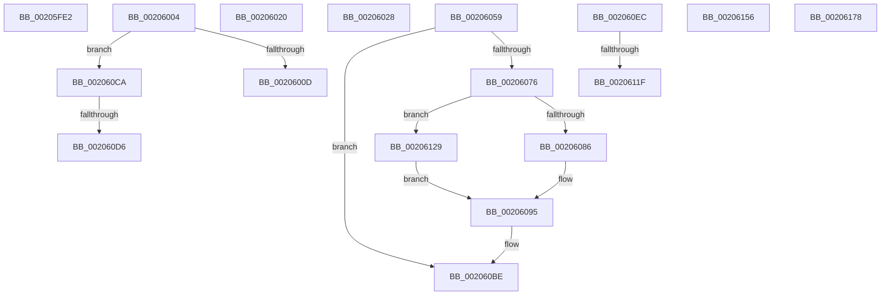

# sub_00205FE2

- RVA: `0x00205FE2`–`0x00206190` (길이 `430` bytes)
- VA: `0x0000000140205FE2`
- 실행 섹션: `.text`
- PDB 이름 있음: `아니요`; PDB Function 태그: `아니요`
- unwind 정보 RVA: `0x0005CE4C`
- 디코드: `99`개 명령, `430/430` bytes 표시
- 미해석 바이트: `0` (있으면 어셈블리에 `.byte`로 보존)

> 이 문서는 커널 이미지의 기계어와 PDB 기호를 분석해 생성했습니다. 4번과 5번은 함수 원형과 자료형을 바이너리 사용 방식에서 추정한 C 해석이며 원본 소스 복구 결과는 아닙니다.

## 1. Dependencies

- 직접 호출 지점: **3**; 고유 호출 대상: **3**
- 직접 호출자로 확인된 함수: **0**
- RIP 상대 이미지 참조: **1**

### Outgoing calls
- `0x00206014` → [ST_STORE<SM_TRAITS>::StDmPageRemove](ST_STORE_SM_TRAITS_StDmPageRemove_function_002049A0.md) (function, `0x002049A0`)
- `0x00206040` → [MmMapLockedPagesSpecifyCache](../31/MmMapLockedPagesSpecifyCache_function_00318800.md) (function, `0x00318800`)
- `0x00206111` → [SmKmStoreReference](../34/SmKmStoreReference_function_0034BFB0.md) (function, `0x0034BFB0`)

### Direct callers
- 이 함수 시작 RVA로 연결되는 직접 call은 확인되지 않았습니다. 간접 호출은 완전히 역산할 수 없습니다.

### Static image references
- `0x002060D9` → RVA `0x00000000` (`image boundary/outside`; read)

## 2. Other-region calls and transfers

- 다른 실행 섹션으로 향하는 call: **0**
- call이 아닌 외부 분기/꼬리 이동: **10**
  - `0x00205FFF` → [sub_00205DDB + 0x52](Unknown_function_00205DDB.md) (`tail-transfer`)
  - `0x0020601B` → [sub_00205DDB + 0x19C](Unknown_function_00205DDB.md) (`tail-transfer`)
  - `0x00206023` → [sub_00205DDB + 0xBB](Unknown_function_00205DDB.md) (`tail-transfer`)
  - `0x00206054` → [sub_00205DDB + 0x96](Unknown_function_00205DDB.md) (`tail-transfer`)
  - `0x002060C5` → [sub_00205DDB + 0x186](Unknown_function_00205DDB.md) (`tail-transfer`)
  - `0x002060D0` → [sub_002061A0 + 0x168](Unknown_function_002061A0.md) (`tail-transfer`)
  - `0x00206119` → [sub_0020634E + 0xA](Unknown_function_0020634E.md) (`tail-transfer`)
  - `0x00206124` → [sub_00205DDB + 0x19C](Unknown_function_00205DDB.md) (`tail-transfer`)
  - `0x00206173` → [sub_00205DDB + 0xDF](Unknown_function_00205DDB.md) (`tail-transfer`)
  - `0x0020618B` → [sub_00205DDB + 0x189](Unknown_function_00205DDB.md) (`tail-transfer`)

## 3. Assembly (complete function range)

```asm
00205FE2  48 83 E7 FE                     and rdi, 0xfffffffffffffffe
00205FE6  4C 8B F7                        mov r14, rdi
00205FE9  8B 1F                           mov ebx, dword ptr [rdi]
00205FEB  83 E3 07                        and ebx, 7
00205FEE  45 33 FF                        xor r15d, r15d
00205FF1  45 8B E7                        mov r12d, r15d
00205FF4  44 89 BC 24 A0 00 00 00         mov dword ptr [rsp + 0xa0], r15d
00205FFC  45 8B EF                        mov r13d, r15d
00205FFF  E9 29 FE FF FF                  jmp 0x140205e2d
00206004  83 F8 01                        cmp eax, 1
00206007  0F 85 BD 00 00 00               jne 0x1402060ca
0020600D  48 8D 4E 50                     lea rcx, [rsi + 0x50]
00206011  48 8B D7                        mov rdx, rdi
00206014  E8 87 E9 FF FF                  call 0x1402049a0
00206019  8B D8                           mov ebx, eax
0020601B  E9 57 FF FF FF                  jmp 0x140205f77
00206020  45 8B F3                        mov r14d, r11d
00206023  E9 6E FE FF FF                  jmp 0x140205e96
00206028  C7 44 24 28 10 00 00 40         mov dword ptr [rsp + 0x28], 0x40000010
00206030  45 33 C9                        xor r9d, r9d
00206033  45 8B C3                        mov r8d, r11d
00206036  44 89 7C 24 20                  mov dword ptr [rsp + 0x20], r15d
0020603B  33 D2                           xor edx, edx
0020603D  48 8B CB                        mov rcx, rbx
00206040  E8 BB 27 11 00                  call 0x140318800
00206045  4C 8B 9C 24 B8 00 00 00         mov r11, qword ptr [rsp + 0xb8]
0020604D  4C 8D 4E 50                     lea r9, [rsi + 0x50]
00206051  4C 8B C0                        mov r8, rax
00206054  E9 18 FE FF FF                  jmp 0x140205e71
00206059  4C 8D 48 18                     lea r9, [rax + 0x18]
0020605D  49 BE 08 00 00 00 80 F7 FF FF   movabs r14, 0xfffff78000000008
00206067  49 8B 01                        mov rax, qword ptr [r9]
0020606A  49 8B 0E                        mov rcx, qword ptr [r14]
0020606D  4D 8B 51 10                     mov r10, qword ptr [r9 + 0x10]
00206071  49 3B CA                        cmp rcx, r10
00206074  72 48                           jb 0x1402060be
00206076  49 2B CA                        sub rcx, r10
00206079  48 81 F9 00 46 C3 23            cmp rcx, 0x23c34600
00206080  0F 83 A3 00 00 00               jae 0x140206129
00206086  4C 8B B4 24 B8 00 00 00         mov r14, qword ptr [rsp + 0xb8]
0020608E  49 8D 82 00 46 C3 23            lea rax, [r10 + 0x23c34600]
00206095  49 89 41 10                     mov qword ptr [r9 + 0x10], rax
00206099  0F 57 C0                        xorps xmm0, xmm0
0020609C  45 01 71 08                     add dword ptr [r9 + 8], r14d
002060A0  41 8B 41 08                     mov eax, dword ptr [r9 + 8]
002060A4  83 E0 3F                        and eax, 0x3f
002060A7  33 C9                           xor ecx, ecx
002060A9  48 8D 04 80                     lea rax, [rax + rax*4]
002060AD  48 8D 40 06                     lea rax, [rax + 6]
002060B1  49 8D 04 81                     lea rax, [r9 + rax*4]
002060B5  0F 11 00                        movups xmmword ptr [rax], xmm0
002060B8  89 48 10                        mov dword ptr [rax + 0x10], ecx
002060BB  49 89 01                        mov qword ptr [r9], rax
002060BE  44 01 00                        add dword ptr [rax], r8d
002060C1  8B 4C 24 30                     mov ecx, dword ptr [rsp + 0x30]
002060C5  E9 97 FE FF FF                  jmp 0x140205f61
002060CA  83 C1 FE                        add ecx, -2
002060CD  83 F9 05                        cmp ecx, 5
002060D0  0F 87 32 02 00 00               ja 0x140206308
002060D6  48 63 C1                        movsxd rax, ecx
002060D9  48 8D 0D 20 9F DF FF            lea rcx, [rip - 0x2060e0]
002060E0  8B 84 81 3C 65 20 00            mov eax, dword ptr [rcx + rax*4 + 0x20653c]
002060E7  48 03 C1                        add rax, rcx
002060EA  FF E0                           jmp rax
002060EC  CC                              int3
002060ED  CC                              int3
002060EE  CC                              int3
002060EF  CC                              int3
002060F0  48 8B 56 18                     mov rdx, qword ptr [rsi + 0x18]
002060F4  4D 8B EE                        mov r13, r14
002060F7  83 7F 08 01                     cmp dword ptr [rdi + 8], 1
002060FB  BD 03 01 00 00                  mov ebp, 0x103
00206100  4D 0F 44 EF                     cmove r13, r15
00206104  48 8B 8A 90 1D 00 00            mov rcx, qword ptr [rdx + 0x1d90]
0020610B  8B 92 90 1A 00 00               mov edx, dword ptr [rdx + 0x1a90]
00206111  E8 9A 5E 14 00                  call 0x14034bfb0
00206116  48 85 C0                        test rax, rax
00206119  0F 85 39 02 00 00               jne 0x140206358
0020611F  BB 89 01 00 C0                  mov ebx, 0xc0000189
00206124  E9 4E FE FF FF                  jmp 0x140205f77
00206129  48 81 C1 FF 45 C3 23            add rcx, 0x23c345ff
00206130  48 B8 A7 BE D7 05 C2 9E 10 E5   movabs rax, 0xe5109ec205d7bea7
0020613A  48 F7 E1                        mul rcx
0020613D  4C 8B F2                        mov r14, rdx
00206140  49 C1 EE 1D                     shr r14, 0x1d
00206144  41 8B C6                        mov eax, r14d
00206147  48 69 C0 00 46 C3 23            imul rax, rax, 0x23c34600
0020614E  49 03 C2                        add rax, r10
00206151  E9 3F FF FF FF                  jmp 0x140206095
00206156  FF 44 24 40                     inc dword ptr [rsp + 0x40]
0020615A  48 81 44 24 38 00 10 00 00      add qword ptr [rsp + 0x38], 0x1000
00206163  44 8B 94 24 B0 00 00 00         mov r10d, dword ptr [rsp + 0xb0]
0020616B  4C 8B 9C 24 B8 00 00 00         mov r11, qword ptr [rsp + 0xb8]
00206173  E9 42 FD FF FF                  jmp 0x140205eba
00206178  81 E1 07 00 00 C0               and ecx, 0xc0000007
0020617E  42 8D 04 F5 00 00 00 00         lea eax, [r14*8]
00206186  0B C8                           or ecx, eax
00206188  41 8B DF                        mov ebx, r15d
0020618B  E9 D4 FD FF FF                  jmp 0x140205f64
```

## 4. C-style interpretation (structured pseudocode)

```c
__int64 __fastcall sub_00205FE2(__int64 a1, __int64 a2, __int64 a3, int a4)
{
    __int64 v_r15;
    __int64 v_rbx;
    __int64 v_rdi;
    unsigned int v_stack_p20;
    unsigned int v_stack_p28;
    unsigned int v_stack_p30;
    unsigned __int64 v_stack_p38;
    unsigned int v_stack_p40;
    unsigned int v_stack_pA0;
    unsigned int v_stack_pB0;
    unsigned __int64 v_stack_pB8;

    v_rdi = (v_rdi) & (-2);
    v_rbx = (unsigned int)(((unsigned int)(*(unsigned int *)(v_rdi))) & (7));
    v_r15 = 0;
    v_stack_pA0 = 0;
}
```

## 5. (Beta) C Style

```c
int64_t sub_00205FE2(int64_t Arg1, int64_t Arg2, int64_t Arg3, int32_t Arg4)
{
    int64_t local_r15;
    int64_t local_rbx;
    int64_t local_rdi;
    uint32_t v_stack_p20;
    uint32_t v_stack_p28;
    uint32_t v_stack_p30;
    uint64_t v_stack_p38;
    uint32_t v_stack_p40;
    uint32_t v_stack_pA0;
    uint32_t v_stack_pB0;
    uint64_t v_stack_pB8;

    local_rdi = (local_rdi) & (-2);
    local_rbx = (uint32_t)(((uint32_t)(*(uint32_t *)(local_rdi))) & (7));
    local_r15 = 0;
    v_stack_pA0 = 0;
}
```

## 6. Execution-region graph

[열기: 2D/3D 그래프와 함수 탐색 컨트롤 패널](../../../control-panel.html?section=text&rva=0x00205FE2&view=graph)

- 2D 그래프는 위에서 아래로 흐르고, 3D 그래프는 빈 공간을 드래그해 회전합니다. Shift+드래그는 이동, 휠은 확대·축소, 함수 노드 선택은 대상 보고서 이동입니다.

### Static fallback


