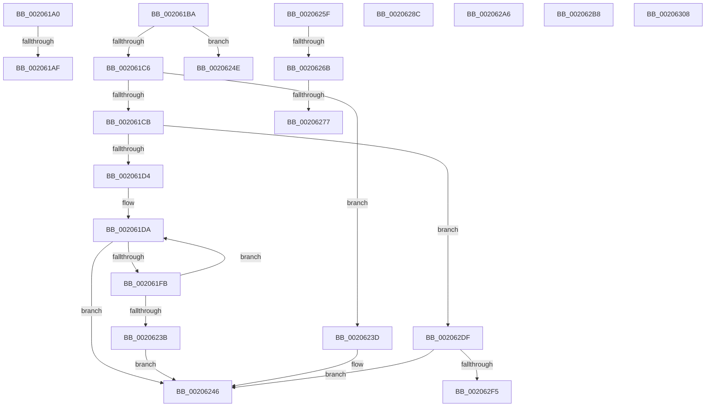

# sub_002061A0

- RVA: `0x002061A0`–`0x00206312` (길이 `370` bytes)
- VA: `0x00000001402061A0`
- 실행 섹션: `.text`
- PDB 이름 있음: `아니요`; PDB Function 태그: `아니요`
- unwind 정보 RVA: `0x0005CE88`
- 디코드: `91`개 명령, `370/370` bytes 표시
- 미해석 바이트: `0` (있으면 어셈블리에 `.byte`로 보존)

> 이 문서는 커널 이미지의 기계어와 PDB 기호를 분석해 생성했습니다. 4번과 5번은 함수 원형과 자료형을 바이너리 사용 방식에서 추정한 C 해석이며 원본 소스 복구 결과는 아닙니다.

## 1. Dependencies

- 직접 호출 지점: **10**; 고유 호출 대상: **9**
- 직접 호출자로 확인된 함수: **0**
- RIP 상대 이미지 참조: **0**

### Outgoing calls
- `0x002061F1` → [ST_STORE<SM_TRAITS>::StDmCheckForCompaction](../41/ST_STORE_SM_TRAITS_StDmCheckForCompaction_function_0041147C.md) (function, `0x0041147C`)
- `0x0020621B` → [ST_STORE<SM_TRAITS>::StCompactionPerformInMem](../41/ST_STORE_SM_TRAITS_StCompactionPerformInMem_function_004111D8.md) (function, `0x004111D8`)
- `0x00206241` → [ST_STORE<SM_TRAITS>::StDmInvalidateCurrentRegions](../3B/ST_STORE_SM_TRAITS_StDmInvalidateCurrentRegions_function_003B092C.md) (function, `0x003B092C`)
- `0x00206252` → [ST_STORE<SM_TRAITS>::StDmEtaRefresh](../4D/ST_STORE_SM_TRAITS_StDmEtaRefresh_function_004D71BC.md) (function, `0x004D71BC`)
- `0x0020627D` → [ST_STORE<SM_TRAITS>::StAddRemoveRegions](../4B/ST_STORE_SM_TRAITS_StAddRemoveRegions_function_004B53CC.md) (function, `0x004B53CC`)
- `0x0020629A` → [ST_STORE<SM_TRAITS>::StDmPageRetrieve](../41/ST_STORE_SM_TRAITS_StDmPageRetrieve_function_0041FE20.md) (function, `0x0041FE20`)
- `0x002062AC` → [ST_STORE<SM_TRAITS>::StGetStats](../4F/ST_STORE_SM_TRAITS_StGetStats_function_004FA058.md) (function, `0x004FA058`)
- `0x002062D0` → [ST_STORE<SM_TRAITS>::StDmDeviceIoCompletion](../4B/ST_STORE_SM_TRAITS_StDmDeviceIoCompletion_function_004BBB70.md) (function, `0x004BBB70`)
- `0x002062E8` → [ST_STORE<SM_TRAITS>::StDmCheckForCompaction](../41/ST_STORE_SM_TRAITS_StDmCheckForCompaction_function_0041147C.md) (function, `0x0041147C`)
- `0x002062FB` → [ST_STORE<SM_TRAITS>::StQueueCompaction](../41/ST_STORE_SM_TRAITS_StQueueCompaction_function_00411790.md) (function, `0x00411790`)

### Direct callers
- 이 함수 시작 RVA로 연결되는 직접 call은 확인되지 않았습니다. 간접 호출은 완전히 역산할 수 없습니다.

### Static image references
- 디코드된 RIP-relative 메모리 참조가 없습니다.

## 2. Other-region calls and transfers

- 다른 실행 섹션으로 향하는 call: **0**
- call이 아닌 외부 분기/꼬리 이동: **12**
  - `0x002061A9` → [sub_00205DDB + 0x166](Unknown_function_00205DDB.md) (`tail-transfer`)
  - `0x002061B5` → [sub_00205DDB + 0x189](Unknown_function_00205DDB.md) (`tail-transfer`)
  - `0x00206249` → [sub_00205DDB + 0x19C](Unknown_function_00205DDB.md) (`tail-transfer`)
  - `0x0020625A` → [sub_00205DDB + 0x19C](Unknown_function_00205DDB.md) (`tail-transfer`)
  - `0x00206265` → [sub_0020634E + 0x1D2](Unknown_function_0020634E.md) (`tail-transfer`)
  - `0x00206271` → [sub_0020634E + 0x56](Unknown_function_0020634E.md) (`tail-transfer`)
  - `0x00206287` → [sub_00205DDB + 0x19C](Unknown_function_00205DDB.md) (`tail-transfer`)
  - `0x002062A1` → [sub_00205DDB + 0x19C](Unknown_function_00205DDB.md) (`tail-transfer`)
  - `0x002062B3` → [sub_00205DDB + 0x19C](Unknown_function_00205DDB.md) (`tail-transfer`)
  - `0x002062DA` → [sub_00205DDB + 0x19C](Unknown_function_00205DDB.md) (`tail-transfer`)
  - `0x00206303` → [sub_00205DDB + 0x19C](Unknown_function_00205DDB.md) (`tail-transfer`)
  - `0x0020630D` → [sub_00205DDB + 0x19C](Unknown_function_00205DDB.md) (`tail-transfer`)

## 3. Assembly (complete function range)

```asm
002061A0  8B 4C 24 30                     mov ecx, dword ptr [rsp + 0x30]
002061A4  3D 06 00 00 C0                  cmp eax, 0xc0000006
002061A9  0F 85 92 FD FF FF               jne 0x140205f41
002061AF  81 E1 07 00 00 C0               and ecx, 0xc0000007
002061B5  E9 AA FD FF FF                  jmp 0x140205f64
002061BA  8B 47 08                        mov eax, dword ptr [rdi + 8]
002061BD  83 E0 07                        and eax, 7
002061C0  0F 84 88 00 00 00               je 0x14020624e
002061C6  83 F8 01                        cmp eax, 1
002061C9  74 72                           je 0x14020623d
002061CB  83 F8 03                        cmp eax, 3
002061CE  0F 84 0B 01 00 00               je 0x1402062df
002061D4  41 BE 01 00 00 00               mov r14d, 1
002061DA  4C 8D 84 24 A0 00 00 00         lea r8, [rsp + 0xa0]
002061E2  44 89 BC 24 A0 00 00 00         mov dword ptr [rsp + 0xa0], r15d
002061EA  41 8B D6                        mov edx, r14d
002061ED  48 8D 4E 50                     lea rcx, [rsi + 0x50]
002061F1  E8 86 B2 20 00                  call 0x14041147c
002061F6  83 F8 02                        cmp eax, 2
002061F9  75 4B                           jne 0x140206246
002061FB  0F B6 9E 38 09 00 00            movzx ebx, byte ptr [rsi + 0x938]
00206202  48 8D 4E 50                     lea rcx, [rsi + 0x50]
00206206  44 8B 84 24 A0 00 00 00         mov r8d, dword ptr [rsp + 0xa0]
0020620E  0F B6 C3                        movzx eax, bl
00206211  0C 03                           or al, 3
00206213  33 D2                           xor edx, edx
00206215  88 86 38 09 00 00               mov byte ptr [rsi + 0x938], al
0020621B  E8 B8 AF 20 00                  call 0x1404111d8
00206220  0F B6 8E 38 09 00 00            movzx ecx, byte ptr [rsi + 0x938]
00206227  0F B6 D1                        movzx edx, cl
0020622A  32 D3                           xor dl, bl
0020622C  80 E2 03                        and dl, 3
0020622F  32 D1                           xor dl, cl
00206231  88 96 38 09 00 00               mov byte ptr [rsi + 0x938], dl
00206237  85 C0                           test eax, eax
00206239  79 9F                           jns 0x1402061da
0020623B  EB 09                           jmp 0x140206246
0020623D  48 8D 4E 50                     lea rcx, [rsi + 0x50]
00206241  E8 E6 A6 1A 00                  call 0x1403b092c
00206246  41 8B DF                        mov ebx, r15d
00206249  E9 29 FD FF FF                  jmp 0x140205f77
0020624E  48 8D 4E 50                     lea rcx, [rsi + 0x50]
00206252  E8 65 0F 2D 00                  call 0x1404d71bc
00206257  41 8B DF                        mov ebx, r15d
0020625A  E9 18 FD FF FF                  jmp 0x140205f77
0020625F  8B 47 08                        mov eax, dword ptr [rdi + 8]
00206262  83 E0 07                        and eax, 7
00206265  0F 84 B5 02 00 00               je 0x140206520
0020626B  83 C0 FC                        add eax, -4
0020626E  83 F8 01                        cmp eax, 1
00206271  0F 87 2D 01 00 00               ja 0x1402063a4
00206277  48 8B D7                        mov rdx, rdi
0020627A  48 8B CE                        mov rcx, rsi
0020627D  E8 4A F1 2A 00                  call 0x1404b53cc
00206282  8B D8                           mov ebx, eax
00206284  41 8B EF                        mov ebp, r15d
00206287  E9 EB FC FF FF                  jmp 0x140205f77
0020628C  48 8D 96 E0 03 00 00            lea rdx, [rsi + 0x3e0]
00206293  4C 8B C7                        mov r8, rdi
00206296  48 8D 4E 50                     lea rcx, [rsi + 0x50]
0020629A  E8 81 9B 21 00                  call 0x14041fe20
0020629F  8B D8                           mov ebx, eax
002062A1  E9 D1 FC FF FF                  jmp 0x140205f77
002062A6  48 8B D7                        mov rdx, rdi
002062A9  48 8B CE                        mov rcx, rsi
002062AC  E8 A7 3D 2F 00                  call 0x1404fa058
002062B1  8B D8                           mov ebx, eax
002062B3  E9 BF FC FF FF                  jmp 0x140205f77
002062B8  8B 47 1C                        mov eax, dword ptr [rdi + 0x1c]
002062BB  B9 60 09 00 00                  mov ecx, 0x960
002062C0  A8 02                           test al, 2
002062C2  48 8B D7                        mov rdx, rdi
002062C5  B8 50 00 00 00                  mov eax, 0x50
002062CA  0F 44 C8                        cmove ecx, eax
002062CD  48 03 CE                        add rcx, rsi
002062D0  E8 9B 58 2B 00                  call 0x1404bbb70
002062D5  BB 03 01 00 00                  mov ebx, 0x103
002062DA  E9 98 FC FF FF                  jmp 0x140205f77
002062DF  45 33 C0                        xor r8d, r8d
002062E2  48 8D 4E 50                     lea rcx, [rsi + 0x50]
002062E6  33 D2                           xor edx, edx
002062E8  E8 8F B1 20 00                  call 0x14041147c
002062ED  85 C0                           test eax, eax
002062EF  0F 84 51 FF FF FF               je 0x140206246
002062F5  8B D0                           mov edx, eax
002062F7  48 8D 4E 50                     lea rcx, [rsi + 0x50]
002062FB  E8 90 B4 20 00                  call 0x140411790
00206300  41 8B DF                        mov ebx, r15d
00206303  E9 6F FC FF FF                  jmp 0x140205f77
00206308  BB 02 00 00 C0                  mov ebx, 0xc0000002
0020630D  E9 65 FC FF FF                  jmp 0x140205f77
```

## 4. C-style interpretation (structured pseudocode)

```c
__int64 __fastcall sub_002061A0(__int64 a1, __int64 a2, __int64 a3, __int64 a4, __int64 a5, unsigned int a6)
{
    unsigned __int64 v_stack_pA0;

    a1 = (unsigned int)(((unsigned int)(a6)) & (0xC0000007ULL));
}
```

## 5. (Beta) C Style

```c
int64_t sub_002061A0(int64_t Arg1, int64_t Arg2, int64_t Arg3, int64_t Arg4, uint64_t Arg5, uint32_t Arg6)
{
    uint64_t v_stack_pA0;

    Arg1 = (uint32_t)(((uint32_t)(Arg6)) & (0xC0000007ULL));
}
```

## 6. Execution-region graph

[열기: 2D/3D 그래프와 함수 탐색 컨트롤 패널](../../../control-panel.html?section=text&rva=0x002061A0&view=graph)

- 2D 그래프는 위에서 아래로 흐르고, 3D 그래프는 빈 공간을 드래그해 회전합니다. Shift+드래그는 이동, 휠은 확대·축소, 함수 노드 선택은 대상 보고서 이동입니다.

### Static fallback


