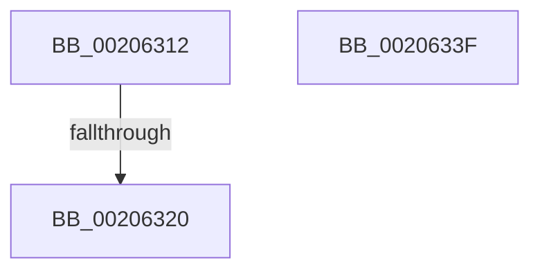

# sub_00206312

- RVA: `0x00206312`–`0x0020634E` (길이 `60` bytes)
- VA: `0x0000000140206312`
- 실행 섹션: `.text`
- PDB 이름 있음: `아니요`; PDB Function 태그: `아니요`
- unwind 정보 RVA: `0x0005CEAC`
- 디코드: `14`개 명령, `60/60` bytes 표시
- 미해석 바이트: `0` (있으면 어셈블리에 `.byte`로 보존)

> 이 문서는 커널 이미지의 기계어와 PDB 기호를 분석해 생성했습니다. 4번과 5번은 함수 원형과 자료형을 바이너리 사용 방식에서 추정한 C 해석이며 원본 소스 복구 결과는 아닙니다.

## 1. Dependencies

- 직접 호출 지점: **2**; 고유 호출 대상: **1**
- 직접 호출자로 확인된 함수: **0**
- RIP 상대 이미지 참조: **0**

### Outgoing calls
- `0x00206335` → [ST_STORE<SM_TRAITS>::StEmptyStore](../4F/ST_STORE_SM_TRAITS_StEmptyStore_function_004FB4B0.md) (function, `0x004FB4B0`)
- `0x00206344` → [ST_STORE<SM_TRAITS>::StEmptyStore](../4F/ST_STORE_SM_TRAITS_StEmptyStore_function_004FB4B0.md) (function, `0x004FB4B0`)

### Direct callers
- 이 함수 시작 RVA로 연결되는 직접 call은 확인되지 않았습니다. 간접 호출은 완전히 역산할 수 없습니다.

### Static image references
- 디코드된 RIP-relative 메모리 참조가 없습니다.

## 2. Other-region calls and transfers

- 다른 실행 섹션으로 향하는 call: **0**
- call이 아닌 외부 분기/꼬리 이동: **3**
  - `0x0020631A` → [sub_00205F94](Unknown_function_00205F94.md) (`tail-transfer`)
  - `0x0020633A` → [sub_00205F94](Unknown_function_00205F94.md) (`tail-transfer`)
  - `0x00206349` → [sub_00205F94 + 0xC](Unknown_function_00205F94.md) (`tail-transfer`)

## 3. Assembly (complete function range)

```asm
00206312  8B 86 80 1A 00 00               mov eax, dword ptr [rsi + 0x1a80]
00206318  A8 02                           test al, 2
0020631A  0F 85 74 FC FF FF               jne 0x140205f94
00206320  80 8E 3A 09 00 00 01            or byte ptr [rsi + 0x93a], 1
00206327  83 C8 02                        or eax, 2
0020632A  33 D2                           xor edx, edx
0020632C  89 86 80 1A 00 00               mov dword ptr [rsi + 0x1a80], eax
00206332  48 8B CE                        mov rcx, rsi
00206335  E8 76 51 2F 00                  call 0x1404fb4b0
0020633A  E9 55 FC FF FF                  jmp 0x140205f94
0020633F  33 D2                           xor edx, edx
00206341  48 8B CE                        mov rcx, rsi
00206344  E8 67 51 2F 00                  call 0x1404fb4b0
00206349  E9 52 FC FF FF                  jmp 0x140205fa0
```

## 4. C-style interpretation (structured pseudocode)

```c
__int64 __fastcall sub_00206312(__int64 a1, int a2)
{
    __int64 result;

    result = (unsigned int)(((unsigned int)(*(unsigned int *)(v_rsi + 6784))) | (2));
    a2 = 0;
    *(unsigned int *)(v_rsi + 6784) = (unsigned int)(result);
    result = ST_STORE_SM_TRAITS___StEmptyStore(v_rsi, a2, a3, a4);
}
```

## 5. (Beta) C Style

```c
int64_t sub_00206312(int64_t Arg1, int32_t Arg2)
{
    int64_t result;

    result = (uint32_t)(((uint32_t)(*(uint32_t *)(local_rsi + 0x1A80))) | (2));
    Arg2 = 0;
    *(uint32_t *)(local_rsi + 0x1A80) = (uint32_t)(result);
    result = ST_STORE_SM_TRAITS___StEmptyStore(local_rsi, Arg2, a3, a4);
}
```

## 6. Execution-region graph

[열기: 2D/3D 그래프와 함수 탐색 컨트롤 패널](../../../control-panel.html?section=text&rva=0x00206312&view=graph)

- 2D 그래프는 위에서 아래로 흐르고, 3D 그래프는 빈 공간을 드래그해 회전합니다. Shift+드래그는 이동, 휠은 확대·축소, 함수 노드 선택은 대상 보고서 이동입니다.

### Static fallback


