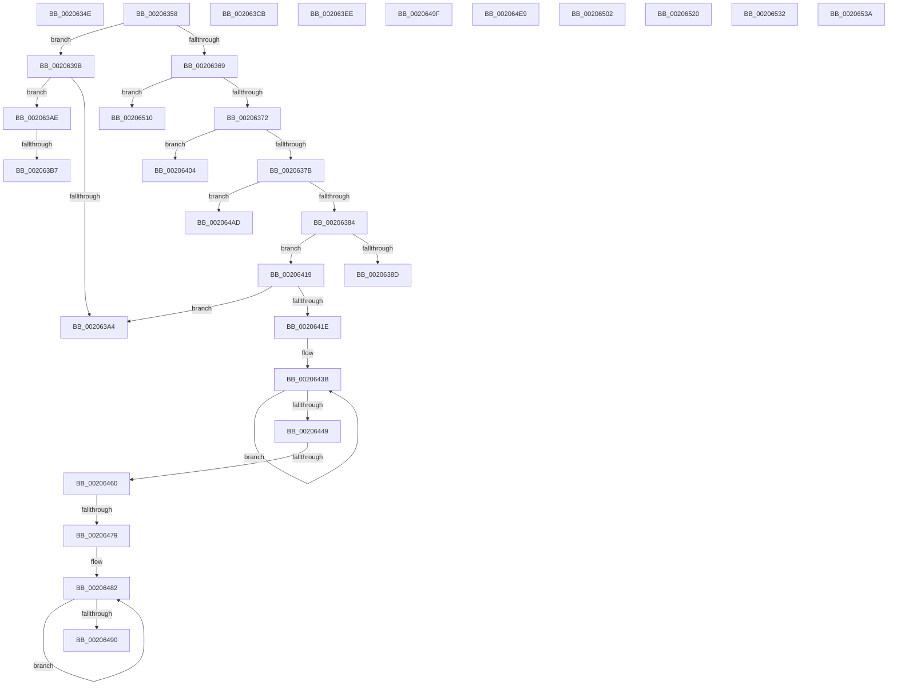

# sub_0020634E

- RVA: `0x0020634E`–`0x0020656C` (길이 `542` bytes)
- VA: `0x000000014020634E`
- 실행 섹션: `.text`
- PDB 이름 있음: `아니요`; PDB Function 태그: `아니요`
- unwind 정보 RVA: `0x0005CEC4`
- 디코드: `139`개 명령, `542/542` bytes 표시
- 미해석 바이트: `2` (있으면 어셈블리에 `.byte`로 보존)

> 이 문서는 커널 이미지의 기계어와 PDB 기호를 분석해 생성했습니다. 4번과 5번은 함수 원형과 자료형을 바이너리 사용 방식에서 추정한 C 해석이며 원본 소스 복구 결과는 아닙니다.

## 1. Dependencies

- 직접 호출 지점: **11**; 고유 호출 대상: **11**
- 직접 호출자로 확인된 함수: **0**
- RIP 상대 이미지 참조: **1**

### Outgoing calls
- `0x002063E2` → [ST_STORE<SM_TRAITS>::StCompactionWorker](../41/ST_STORE_SM_TRAITS_StCompactionWorker_function_00411118.md) (function, `0x00411118`)
- `0x002063FA` → [SmHpChunkHeapProtect](../3A/SmHpChunkHeapProtect_function_003AFD8C.md) (function, `0x003AFD8C`)
- `0x0020640A` → [ST_STORE<SM_TRAITS>::StMetaRegionsUpdate](../4C/ST_STORE_SM_TRAITS_StMetaRegionsUpdate_function_004C1DFC.md) (function, `0x004C1DFC`)
- `0x0020646B` → [ST_STORE<SM_TRAITS>::StDmCheckForCompaction](../41/ST_STORE_SM_TRAITS_StDmCheckForCompaction_function_0041147C.md) (function, `0x0041147C`)
- `0x0020647D` → [ST_STORE<SM_TRAITS>::StCompactionPerformEmergency](../4E/ST_STORE_SM_TRAITS_StCompactionPerformEmergency_function_004EB170.md) (function, `0x004EB170`)
- `0x002064A3` → [ST_STORE<SM_TRAITS>::StDmInvalidateCurrentRegions](../3B/ST_STORE_SM_TRAITS_StDmInvalidateCurrentRegions_function_003B092C.md) (function, `0x003B092C`)
- `0x002064DC` → [ST_STORE<SM_TRAITS>::StLazyWorkMgrQueueWork](../41/ST_STORE_SM_TRAITS_StLazyWorkMgrQueueWork_function_00411800.md) (function, `0x00411800`)
- `0x002064F6` → [ST_STORE<SM_TRAITS>::StDmLazyRegionsWorker](../49/ST_STORE_SM_TRAITS_StDmLazyRegionsWorker_function_0049FE78.md) (function, `0x0049FE78`)
- `0x00206506` → [ST_STORE<SM_TRAITS>::StDmCombineLazyCleanup](../41/ST_STORE_SM_TRAITS_StDmCombineLazyCleanup_function_00410B50.md) (function, `0x00410B50`)
- `0x00206514` → [ST_STORE<SM_TRAITS>::StDmEtaRefresh](../4D/ST_STORE_SM_TRAITS_StDmEtaRefresh_function_004D71BC.md) (function, `0x004D71BC`)
- `0x00206525` → [ST_STORE<SM_TRAITS>::StEmptyStore](../4F/ST_STORE_SM_TRAITS_StEmptyStore_function_004FB4B0.md) (function, `0x004FB4B0`)

### Direct callers
- 이 함수 시작 RVA로 연결되는 직접 call은 확인되지 않았습니다. 간접 호출은 완전히 역산할 수 없습니다.

### Static image references
- `0x002063B7` → RVA `0x00000000` (`image boundary/outside`; read)

## 2. Other-region calls and transfers

- 다른 실행 섹션으로 향하는 call: **0**
- call이 아닌 외부 분기/꼬리 이동: **17**
  - `0x00206353` → [sub_00205DDB + 0x189](Unknown_function_00205DDB.md) (`tail-transfer`)
  - `0x00206396` → [sub_00205DDB + 0x19C](Unknown_function_00205DDB.md) (`tail-transfer`)
  - `0x002063A9` → [sub_00205DDB + 0x19C](Unknown_function_00205DDB.md) (`tail-transfer`)
  - `0x002063B1` → [sub_00205DDB + 0x19C](Unknown_function_00205DDB.md) (`tail-transfer`)
  - `0x002063E9` → [sub_00205DDB + 0x19C](Unknown_function_00205DDB.md) (`tail-transfer`)
  - `0x002063FF` → [sub_00205DDB + 0x19C](Unknown_function_00205DDB.md) (`tail-transfer`)
  - `0x00206414` → [sub_00205DDB + 0x19C](Unknown_function_00205DDB.md) (`tail-transfer`)
  - `0x0020645A` → [sub_00205DDB + 0x19C](Unknown_function_00205DDB.md) (`tail-transfer`)
  - `0x00206473` → [sub_00205DDB + 0x19C](Unknown_function_00205DDB.md) (`tail-transfer`)
  - `0x0020649A` → [sub_00205DDB + 0x19C](Unknown_function_00205DDB.md) (`tail-transfer`)
  - `0x002064A8` → [sub_00205DDB + 0x19C](Unknown_function_00205DDB.md) (`tail-transfer`)
  - `0x002064E4` → [sub_00205DDB + 0x19C](Unknown_function_00205DDB.md) (`tail-transfer`)
  - `0x002064FD` → [sub_00205DDB + 0x19C](Unknown_function_00205DDB.md) (`tail-transfer`)
  - `0x0020650B` → [sub_00205DDB + 0x19C](Unknown_function_00205DDB.md) (`tail-transfer`)
  - `0x0020651B` → [sub_00205DDB + 0x19C](Unknown_function_00205DDB.md) (`tail-transfer`)
  - `0x0020652D` → [sub_00205DDB + 0x19C](Unknown_function_00205DDB.md) (`tail-transfer`)
  - `0x00206535` → [sub_00205DDB + 0xFE](Unknown_function_00205DDB.md) (`tail-transfer`)

## 3. Assembly (complete function range)

```asm
0020634E  BB 9A 00 00 C0                  mov ebx, 0xc000009a
00206353  E9 0C FC FF FF                  jmp 0x140205f64
00206358  8B 47 08                        mov eax, dword ptr [rdi + 8]
0020635B  41 BC 01 00 00 00               mov r12d, 1
00206361  41 8B DF                        mov ebx, r15d
00206364  41 3B C4                        cmp eax, r12d
00206367  74 32                           je 0x14020639b
00206369  83 F8 02                        cmp eax, 2
0020636C  0F 84 9E 01 00 00               je 0x140206510
00206372  83 F8 03                        cmp eax, 3
00206375  0F 84 89 00 00 00               je 0x140206404
0020637B  83 F8 04                        cmp eax, 4
0020637E  0F 84 29 01 00 00               je 0x1402064ad
00206384  83 F8 05                        cmp eax, 5
00206387  0F 85 8C 00 00 00               jne 0x140206419
0020638D  66 F0 83 67 0C FE               lock and word ptr [rdi + 0xc], 0xfffe
00206393  4D 8B EF                        mov r13, r15
00206396  E9 DC FB FF FF                  jmp 0x140205f77
0020639B  48 63 57 10                     movsxd rdx, dword ptr [rdi + 0x10]
0020639F  83 FA 06                        cmp edx, 6
002063A2  75 0A                           jne 0x1402063ae
002063A4  BB 0D 00 00 C0                  mov ebx, 0xc000000d
002063A9  E9 C9 FB FF FF                  jmp 0x140205f77
002063AE  83 FA 05                        cmp edx, 5
002063B1  0F 87 C0 FB FF FF               ja 0x140205f77
002063B7  4C 8D 05 42 9C DF FF            lea r8, [rip - 0x2063be]
002063BE  41 8B 8C 90 54 65 20 00         mov ecx, dword ptr [r8 + rdx*4 + 0x206554]
002063C6  49 03 C8                        add rcx, r8
002063C9  FF E1                           jmp rcx
002063CB  CC                              int3
002063CC  CC                              int3
002063CD  CC                              int3
002063CE  CC                              int3
002063CF  85 D2                           test edx, edx
002063D1  B9 60 09 00 00                  mov ecx, 0x960
002063D6  B8 50 00 00 00                  mov eax, 0x50
002063DB  0F 45 C1                        cmovne eax, ecx
002063DE  48 8D 0C 06                     lea rcx, [rsi + rax]
002063E2  E8 31 AD 20 00                  call 0x140411118
002063E7  8B D8                           mov ebx, eax
002063E9  E9 89 FB FF FF                  jmp 0x140205f77
002063EE  48 8D 8E 10 01 00 00            lea rcx, [rsi + 0x110]
002063F5  45 33 C0                        xor r8d, r8d
002063F8  33 D2                           xor edx, edx
002063FA  E8 8D 99 1A 00                  call 0x1403afd8c
002063FF  E9 73 FB FF FF                  jmp 0x140205f77
00206404  48 8B D7                        mov rdx, rdi
00206407  48 8B CE                        mov rcx, rsi
0020640A  E8 ED B9 2B 00                  call 0x1404c1dfc
0020640F  8B D8                           mov ebx, eax
00206411  4D 8B EF                        mov r13, r15
00206414  E9 5E FB FF FF                  jmp 0x140205f77
00206419  83 F8 06                        cmp eax, 6
0020641C  75 86                           jne 0x1402063a4
0020641E  66 F0 83 67 0C FE               lock and word ptr [rdi + 0xc], 0xfffe
00206424  4D 8B EF                        mov r13, r15
00206427  49 BE 08 00 00 00 80 F7 FF FF   movabs r14, 0xfffff78000000008
00206431  49 BF B0 03 00 00 80 F7 FF FF   movabs r15, 0xfffff780000003b0
0020643B  49 8B 17                        mov rdx, qword ptr [r15]
0020643E  49 8B 0E                        mov rcx, qword ptr [r14]
00206441  49 8B 07                        mov rax, qword ptr [r15]
00206444  48 3B D0                        cmp rdx, rax
00206447  75 F2                           jne 0x14020643b
00206449  48 2B 8E 70 1A 00 00            sub rcx, qword ptr [rsi + 0x1a70]
00206450  48 2B CA                        sub rcx, rdx
00206453  48 81 F9 80 96 98 00            cmp rcx, 0x989680
0020645A  0F 82 17 FB FF FF               jb 0x140205f77
00206460  45 33 C0                        xor r8d, r8d
00206463  48 8D 4E 50                     lea rcx, [rsi + 0x50]
00206467  41 8D 50 02                     lea edx, [r8 + 2]
0020646B  E8 0C B0 20 00                  call 0x14041147c
00206470  83 F8 02                        cmp eax, 2
00206473  0F 85 FE FA FF FF               jne 0x140205f77
00206479  48 8D 4E 50                     lea rcx, [rsi + 0x50]
0020647D  E8 EE 4C 2E 00                  call 0x1404eb170
00206482  49 8B 17                        mov rdx, qword ptr [r15]
00206485  49 8B 0E                        mov rcx, qword ptr [r14]
00206488  49 8B 07                        mov rax, qword ptr [r15]
0020648B  48 3B D0                        cmp rdx, rax
0020648E  75 F2                           jne 0x140206482
00206490  48 2B CA                        sub rcx, rdx
00206493  48 89 8E 70 1A 00 00            mov qword ptr [rsi + 0x1a70], rcx
0020649A  E9 D8 FA FF FF                  jmp 0x140205f77
0020649F  48 8D 4E 50                     lea rcx, [rsi + 0x50]
002064A3  E8 84 A4 1A 00                  call 0x1403b092c
002064A8  E9 CA FA FF FF                  jmp 0x140205f77
002064AD  0F B7 47 0E                     movzx eax, word ptr [rdi + 0xe]
002064B1  BA D0 07 00 00                  mov edx, 0x7d0
002064B6  66 41 85 C4                     test r12w, ax
002064BA  44 8B CA                        mov r9d, edx
002064BD  B9 30 75 00 00                  mov ecx, 0x7530
002064C2  41 B8 C8 00 00 00               mov r8d, 0xc8
002064C8  44 0F 44 C9                     cmove r9d, ecx
002064CC  44 0F 44 C2                     cmove r8d, edx
002064D0  48 8B 8E 40 09 00 00            mov rcx, qword ptr [rsi + 0x940]
002064D7  BA 02 00 00 00                  mov edx, 2
002064DC  E8 1F B3 20 00                  call 0x140411800
002064E1  4D 8B EF                        mov r13, r15
002064E4  E9 8E FA FF FF                  jmp 0x140205f77
002064E9  4C 8D 86 B0 03 00 00            lea r8, [rsi + 0x3b0]
002064F0  33 D2                           xor edx, edx
002064F2  48 8D 4E 50                     lea rcx, [rsi + 0x50]
002064F6  E8 7D 99 29 00                  call 0x14049fe78
002064FB  8B D8                           mov ebx, eax
002064FD  E9 75 FA FF FF                  jmp 0x140205f77
00206502  48 8D 4E 50                     lea rcx, [rsi + 0x50]
00206506  E8 45 A6 20 00                  call 0x140410b50
0020650B  E9 67 FA FF FF                  jmp 0x140205f77
00206510  48 8D 4E 50                     lea rcx, [rsi + 0x50]
00206514  E8 A3 0C 2D 00                  call 0x1404d71bc
00206519  8B D8                           mov ebx, eax
0020651B  E9 57 FA FF FF                  jmp 0x140205f77
00206520  33 D2                           xor edx, edx
00206522  48 8B CE                        mov rcx, rsi
00206525  E8 86 4F 2F 00                  call 0x1404fb4b0
0020652A  41 8B DF                        mov ebx, r15d
0020652D  E9 45 FA FF FF                  jmp 0x140205f77
00206532  41 8B CB                        mov ecx, r11d
00206535  E9 9F F9 FF FF                  jmp 0x140205ed9
0020653A  66 90                           nop
0020653C  8C 62 20                        mov word ptr [rdx + 0x20], fs
0020653F  00 A6 62 20 00 5F               add byte ptr [rsi + 0x5f002062], ah
00206545  62                              .byte 0x62
00206546  20 00                           and byte ptr [rax], al
00206548  BA 61 20 00 F0                  mov edx, 0xf0002061
0020654D  60                              .byte 0x60
0020654E  20 00                           and byte ptr [rax], al
00206550  B8 62 20 00 CF                  mov eax, 0xcf002062
00206555  63 20                           movsxd esp, dword ptr [rax]
00206557  00 CF                           add bh, cl
00206559  63 20                           movsxd esp, dword ptr [rax]
0020655B  00 E9                           add cl, ch
0020655D  64 20 00                        and byte ptr fs:[rax], al
00206560  9F                              lahf
00206561  64 20 00                        and byte ptr fs:[rax], al
00206564  EE                              out dx, al
00206565  63 20                           movsxd esp, dword ptr [rax]
00206567  00 02                           add byte ptr [rdx], al
00206569  65 20 00                        and byte ptr gs:[rax], al
```

## 4. C-style interpretation (structured pseudocode)

```c
__int64 __fastcall sub_0020634E(void)
{
}
```

## 5. (Beta) C Style

```c
void sub_0020634E(void)
{
}
```

## 6. Execution-region graph

[열기: 2D/3D 그래프와 함수 탐색 컨트롤 패널](../../../control-panel.html?section=text&rva=0x0020634E&view=graph)

- 2D 그래프는 위에서 아래로 흐르고, 3D 그래프는 빈 공간을 드래그해 회전합니다. Shift+드래그는 이동, 휠은 확대·축소, 함수 노드 선택은 대상 보고서 이동입니다.

### Static fallback


