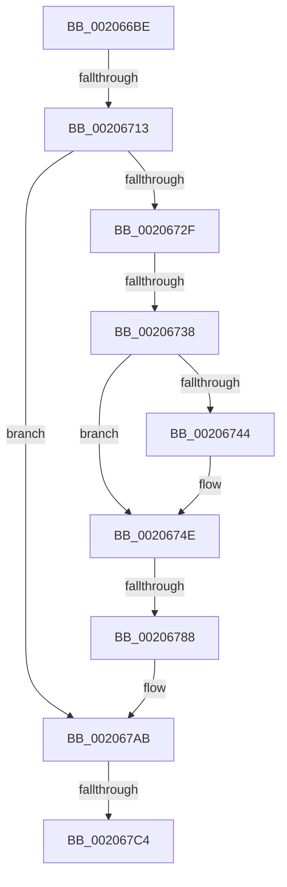

# sub_002066BE

- RVA: `0x002066BE`–`0x002067E0` (길이 `290` bytes)
- VA: `0x00000001402066BE`
- 실행 섹션: `.text`
- PDB 이름 있음: `아니요`; PDB Function 태그: `아니요`
- unwind 정보 RVA: `0x0005CF24`
- 디코드: `64`개 명령, `290/290` bytes 표시
- 미해석 바이트: `0` (있으면 어셈블리에 `.byte`로 보존)

> 이 문서는 커널 이미지의 기계어와 PDB 기호를 분석해 생성했습니다. 4번과 5번은 함수 원형과 자료형을 바이너리 사용 방식에서 추정한 C 해석이며 원본 소스 복구 결과는 아닙니다.

## 1. Dependencies

- 직접 호출 지점: **5**; 고유 호출 대상: **5**
- 직접 호출자로 확인된 함수: **0**
- RIP 상대 이미지 참조: **2**

### Outgoing calls
- `0x0020671D` → [KeSetActualBasePriorityThread](../3C/KeSetActualBasePriorityThread_function_003C4370.md) (function, `0x003C4370`)
- `0x0020673B` → [PsGetPagePriorityThread](../3C/PsGetPagePriorityThread_function_003C3E80.md) (function, `0x003C3E80`)
- `0x00206749` → [PsSetPagePriorityThread](../3C/PsSetPagePriorityThread_function_003C4138.md) (function, `0x003C4138`)
- `0x0020677B` → [MiChargeResident](../28/MiChargeResident_function_0028A0F0.md) (function, `0x0028A0F0`)
- `0x002067B7` → [KeSetEvent](../33/KeSetEvent_function_0033F310.md) (function, `0x0033F310`)

### Direct callers
- 이 함수 시작 RVA로 연결되는 직접 call은 확인되지 않았습니다. 간접 호출은 완전히 역산할 수 없습니다.

### Static image references
- `0x002066CD` → RVA `0x00038018` (`.rdata`; read)
- `0x00206770` → RVA `0x00E30088` (`.data`; read)

## 2. Other-region calls and transfers

- 다른 실행 섹션으로 향하는 call: **0**
- call이 아닌 외부 분기/꼬리 이동: **5**
  - `0x0020670D` → [sub_00206856](Unknown_function_00206856.md) (`tail-transfer`)
  - `0x00206732` → [sub_00206D7B](Unknown_function_00206D7B.md) (`tail-transfer`)
  - `0x00206782` → [sub_00206D2B](Unknown_function_00206D2B.md) (`tail-transfer`)
  - `0x002067BE` → [sub_00206856 + 0x8](Unknown_function_00206856.md) (`tail-transfer`)
  - `0x002067DE` → [sub_002067E0 + 0x52](Unknown_function_002067E0.md) (`tail-transfer`)

## 3. Assembly (complete function range)

```asm
002066BE  48 89 68 18                     mov qword ptr [rax + 0x18], rbp
002066C2  48 89 70 F0                     mov qword ptr [rax - 0x10], rsi
002066C6  48 8B F1                        mov rsi, rcx
002066C9  48 89 78 E8                     mov qword ptr [rax - 0x18], rdi
002066CD  48 8D 0D 44 19 E3 FF            lea rcx, [rip - 0x1ce6bc]
002066D4  4C 89 68 D8                     mov qword ptr [rax - 0x28], r13
002066D8  45 33 ED                        xor r13d, r13d
002066DB  48 C7 40 10 00 00 00 00         mov qword ptr [rax + 0x10], 0
002066E3  65 48 8B 04 25 88 01 00 00      mov rax, qword ptr gs:[0x188]
002066EC  F0 0F BA A8 A0 05 00 00 04      lock bts dword ptr [rax + 0x5a0], 4
002066F5  65 48 8B 3C 25 88 01 00 00      mov rdi, qword ptr gs:[0x188]
002066FE  0F B6 83 96 1A 00 00            movzx eax, byte ptr [rbx + 0x1a96]
00206705  8B 93 98 1D 00 00               mov edx, dword ptr [rbx + 0x1d98]
0020670B  3C 04                           cmp al, 4
0020670D  0F 85 43 01 00 00               jne 0x140206856
00206713  8B C2                           mov eax, edx
00206715  3B C2                           cmp eax, edx
00206717  48 8B CF                        mov rcx, rdi
0020671A  0F 4D D0                        cmovge edx, eax
0020671D  E8 4E DC 1B 00                  call 0x1403c4370
00206722  33 C9                           xor ecx, ecx
00206724  33 ED                           xor ebp, ebp
00206726  F6 83 95 1A 00 00 04            test byte ptr [rbx + 0x1a95], 4
0020672D  74 7C                           je 0x1402067ab
0020672F  48 85 FF                        test rdi, rdi
00206732  0F 84 43 06 00 00               je 0x140206d7b
00206738  48 8B CF                        mov rcx, rdi
0020673B  E8 40 D7 1B 00                  call 0x1403c3e80
00206740  85 C0                           test eax, eax
00206742  74 0A                           je 0x14020674e
00206744  33 D2                           xor edx, edx
00206746  48 8B CF                        mov rcx, rdi
00206749  E8 EA D9 1B 00                  call 0x1403c4138
0020674E  65 48 8B 2C 25 88 01 00 00      mov rbp, qword ptr gs:[0x188]
00206757  BA 1A 00 00 00                  mov edx, 0x1a
0020675C  41 B8 00 04 00 00               mov r8d, 0x400
00206762  48 8B 85 B8 00 00 00            mov rax, qword ptr [rbp + 0xb8]
00206769  0F B7 88 AE 04 00 00            movzx ecx, word ptr [rax + 0x4ae]
00206770  48 8B 05 11 99 C2 00            mov rax, qword ptr [rip + 0xc29911]
00206777  48 8B 0C C8                     mov rcx, qword ptr [rax + rcx*8]
0020677B  E8 70 39 08 00                  call 0x14028a0f0
00206780  85 C0                           test eax, eax
00206782  0F 84 A3 05 00 00               je 0x140206d2b
00206788  66 FF 8D E6 01 00 00            dec word ptr [rbp + 0x1e6]
0020678F  90                              nop
00206790  80 8D A8 05 00 00 04            or byte ptr [rbp + 0x5a8], 4
00206797  83 8F A4 05 00 00 02            or dword ptr [rdi + 0x5a4], 2
0020679E  41 8B CD                        mov ecx, r13d
002067A1  41 8B ED                        mov ebp, r13d
002067A4  41 F7 D5                        not r13d
002067A7  41 C1 ED 1F                     shr r13d, 0x1f
002067AB  89 4E 20                        mov dword ptr [rsi + 0x20], ecx
002067AE  45 33 C0                        xor r8d, r8d
002067B1  48 8D 4E 08                     lea rcx, [rsi + 8]
002067B5  33 D2                           xor edx, edx
002067B7  E8 54 8B 13 00                  call 0x14033f310
002067BC  85 ED                           test ebp, ebp
002067BE  0F 89 9A 00 00 00               jns 0x14020685e
002067C4  48 8B 7C 24 70                  mov rdi, qword ptr [rsp + 0x70]
002067C9  45 85 ED                        test r13d, r13d
002067CC  4C 8B 6C 24 60                  mov r13, qword ptr [rsp + 0x60]
002067D1  48 8B 74 24 78                  mov rsi, qword ptr [rsp + 0x78]
002067D6  48 8B AC 24 A0 00 00 00         mov rbp, qword ptr [rsp + 0xa0]
002067DE  74 52                           je 0x140206832
```

## 4. C-style interpretation (structured pseudocode)

```c
__int64 __fastcall sub_002066BE(__int64 a1, __int64 a2, __int64 a3, __int64 a4, __int64 a5, __int64 a6, __int64 a7, __int64 a8, __int64 a9, __int64 a10, __int64 a11, __int64 a12, __int64 a13, __int64 a14, __int64 a15, __int64 a16, __int64 a17, __int64 a18, __int64 a19, __int64 a20)
{
    __int64 result;
    __int64 v_r13;
    __int64 v_rbp;

    *(unsigned __int64 *)(result + 24) = v_rbp;
    *(unsigned __int64 *)(result - 16) = v_rsi;
    *(unsigned __int64 *)(result - 24) = v_rdi;
    *(unsigned __int64 *)(result - 40) = v_r13;
    v_r13 = 0;
    *(unsigned __int64 *)(result + 16) = 0;
    a2 = (unsigned int)(*(unsigned int *)(v_rbx + 7576));
    if (((unsigned int)((unsigned int)((unsigned int)((unsigned int)(*(unsigned int *)(v_rbx + 7576)))))) >= ((unsigned int)((unsigned int)(*(unsigned int *)(v_rbx + 7576))))) { a2 = (unsigned int)((unsigned int)((unsigned int)((unsigned int)(*(unsigned int *)(v_rbx + 7576))))); }
    result = KeSetActualBasePriorityThread(*(unsigned __int64 *)(gs_base + (0 + 392)), a2, a3, a4);
    a1 = 0;
    v_rbp = 0;
    if (((*(unsigned __int8 *)(v_rbx + 6805)) & (4)) == 0) goto loc_002067AB;
    result = PsGetPagePriorityThread(*(unsigned __int64 *)(gs_base + (0 + 392)), a2, a3, a4);
    if ((unsigned int)(result) != 0) {
        a2 = 0;
        a1 = *(unsigned __int64 *)(gs_base + (0 + 392));
        result = PsSetPagePriorityThread(a1, a2, a3, a4);
    }
    result = MiChargeResident(*(unsigned __int64 *)(*(unsigned __int64 *)(v_rip + 12753169) + *(unsigned __int16 *)(*(unsigned __int64 *)(*(unsigned __int64 *)(gs_base + (0 + 392)) + 184) + 1198) * 8), 26, (unsigned int)(0x400ULL), a4);
    v_r13 = (unsigned int)(~(v_r13));
    v_r13 = (unsigned int)((v_r13) >> (31));
loc_002067AB:
    *(unsigned int *)(a1 + 32) = 0;
    a3 = 0;
    a2 = 0;
    result = KeSetEvent(a1 + 8, a2, a3, a4);
}
```

## 5. (Beta) C Style

```c
int64_t sub_002066BE(void *Arg1, int64_t Arg2, int64_t Arg3, int64_t Arg4, uint64_t Arg5, uint64_t Arg6, uint64_t Arg7, uint64_t Arg8, uint64_t Arg9, uint64_t Arg10, uint64_t Arg11, int64_t Arg12, uint64_t Arg13, int64_t Arg14, int64_t Arg15, uint64_t Arg16, uint64_t Arg17, uint64_t Arg18, uint64_t Arg19, int64_t Arg20)
{
    uint8_t *arg1 = (uint8_t *)Arg1;

    int64_t result;
    int64_t local_r13;
    int64_t local_rbp;

    *(uint64_t *)(result + 0x18) = local_rbp;
    *(uint64_t *)(result - 0x10) = local_rsi;
    *(uint64_t *)(result - 0x18) = local_rdi;
    *(uint64_t *)(result - 0x28) = local_r13;
    local_r13 = 0;
    *(uint64_t *)(result + 0x10) = 0;
    Arg2 = (uint32_t)(*(uint32_t *)(local_rbx + 0x1D98));
    if (((uint32_t)((uint32_t)((uint32_t)((uint32_t)(*(uint32_t *)(local_rbx + 0x1D98)))))) >= ((uint32_t)((uint32_t)(*(uint32_t *)(local_rbx + 0x1D98))))) { Arg2 = (uint32_t)((uint32_t)((uint32_t)((uint32_t)(*(uint32_t *)(local_rbx + 0x1D98))))); }
    result = KeSetActualBasePriorityThread(*(uint64_t *)(gs_base + (0 + 0x188)), Arg2, Arg3, Arg4);
    Arg1 = 0;
    local_rbp = 0;
    if (((*(uint8_t *)(local_rbx + 0x1A95)) & (4)) == 0) goto loc_002067AB;
    result = PsGetPagePriorityThread(*(uint64_t *)(gs_base + (0 + 0x188)), Arg2, Arg3, Arg4);
    if ((uint32_t)(result) != 0) {
        Arg2 = 0;
        Arg1 = *(uint64_t *)(gs_base + (0 + 0x188));
        result = PsSetPagePriorityThread(Arg1, Arg2, Arg3, Arg4);
    }
    result = MiChargeResident(*(uint64_t *)(*(uint64_t *)(v_rip + 0xC29911) + *(uint16_t *)(*(uint64_t *)(*(uint64_t *)(gs_base + (0 + 0x188)) + 0xB8) + 0x4AE) * 8), 26, (uint32_t)(0x400ULL), Arg4);
    local_r13 = (uint32_t)(~(local_r13));
    local_r13 = (uint32_t)((local_r13) >> (31));
loc_002067AB:
    *(uint32_t *)(arg1 + 0x20) = 0;
    Arg3 = 0;
    Arg2 = 0;
    result = KeSetEvent(Arg1 + 8, Arg2, Arg3, Arg4);
}
```

### 관측된 메모리 오프셋

구조체 형식이 확인되지 않은 접근은 인자 기준의 오프셋으로만 기록했습니다.

| 기준 인자 | 오프셋 표현 | 폭 (bit) | 접근 |
|---|---:|---:|---|
| `Arg1` | `+ 0x8` | `64` | `R` |
| `Arg1` | `+ 0x20` | `32` | `W` |

## 6. Execution-region graph

[열기: 2D/3D 그래프와 함수 탐색 컨트롤 패널](../../../control-panel.html?section=text&rva=0x002066BE&view=graph)

- 2D 그래프는 위에서 아래로 흐르고, 3D 그래프는 빈 공간을 드래그해 회전합니다. Shift+드래그는 이동, 휠은 확대·축소, 함수 노드 선택은 대상 보고서 이동입니다.

### Static fallback


