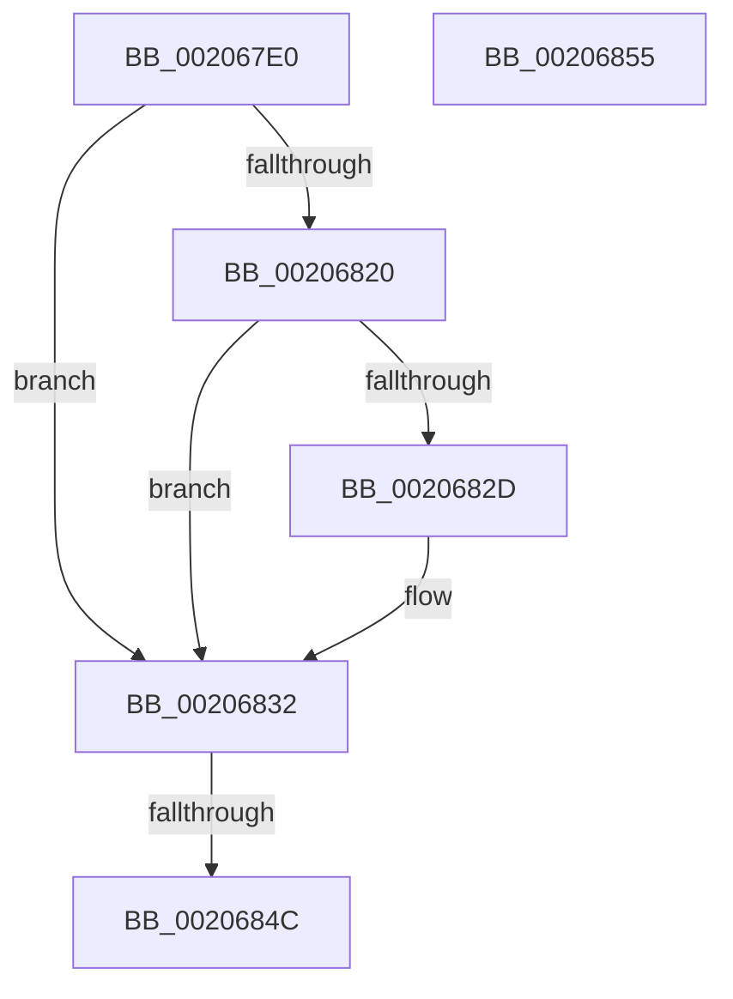

# sub_002067E0

- RVA: `0x002067E0`–`0x00206856` (길이 `118` bytes)
- VA: `0x00000001402067E0`
- 실행 섹션: `.text`
- PDB 이름 있음: `아니요`; PDB Function 태그: `아니요`
- unwind 정보 RVA: `0x0005CF44`
- 디코드: `24`개 명령, `118/118` bytes 표시
- 미해석 바이트: `0` (있으면 어셈블리에 `.byte`로 보존)

> 이 문서는 커널 이미지의 기계어와 PDB 기호를 분석해 생성했습니다. 4번과 5번은 함수 원형과 자료형을 바이너리 사용 방식에서 추정한 C 해석이며 원본 소스 복구 결과는 아닙니다.

## 1. Dependencies

- 직접 호출 지점: **2**; 고유 호출 대상: **2**
- 직접 호출자로 확인된 함수: **0**
- RIP 상대 이미지 참조: **1**

### Outgoing calls
- `0x00206807` → [MiReturnResident](../28/MiReturnResident_function_00286890.md) (function, `0x00286890`)
- `0x0020682D` → [KiCheckForKernelApcDelivery](../2E/KiCheckForKernelApcDelivery_function_002E2C80.md) (function, `0x002E2C80`)

### Direct callers
- 이 함수 시작 RVA로 연결되는 직접 call은 확인되지 않았습니다. 간접 호출은 완전히 역산할 수 없습니다.

### Static image references
- `0x002067FC` → RVA `0x00E30088` (`.data`; read)

## 2. Other-region calls and transfers

- 다른 실행 섹션으로 향하는 call: **0**
- call이 아닌 외부 분기/꼬리 이동: **1**
  - `0x00206846` → [sub_00206D40](Unknown_function_00206D40.md) (`tail-transfer`)

## 3. Assembly (complete function range)

```asm
002067E0  65 4C 8B 1C 25 88 01 00 00      mov r11, qword ptr gs:[0x188]
002067E9  BA 1A 00 00 00                  mov edx, 0x1a
002067EE  49 8B 83 B8 00 00 00            mov rax, qword ptr [r11 + 0xb8]
002067F5  0F B7 88 AE 04 00 00            movzx ecx, word ptr [rax + 0x4ae]
002067FC  48 8B 05 85 98 C2 00            mov rax, qword ptr [rip + 0xc29885]
00206803  48 8B 0C C8                     mov rcx, qword ptr [rax + rcx*8]
00206807  E8 84 00 08 00                  call 0x140286890
0020680C  41 80 A3 A8 05 00 00 FB         and byte ptr [r11 + 0x5a8], 0xfb
00206814  90                              nop
00206815  66 41 83 83 E6 01 00 00 01      add word ptr [r11 + 0x1e6], 1
0020681E  75 12                           jne 0x140206832
00206820  49 8D 83 98 00 00 00            lea rax, [r11 + 0x98]
00206827  90                              nop
00206828  48 39 00                        cmp qword ptr [rax], rax
0020682B  74 05                           je 0x140206832
0020682D  E8 4E C4 0D 00                  call 0x1402e2c80
00206832  8B 83 A8 1D 00 00               mov eax, dword ptr [rbx + 0x1da8]
00206838  48 C7 84 24 98 00 00 00 10 B6 FD FF  mov qword ptr [rsp + 0x98], 0xfffffffffffdb610
00206844  85 C0                           test eax, eax
00206846  0F 85 F4 04 00 00               jne 0x140206d40
0020684C  48 81 C4 80 00 00 00            add rsp, 0x80
00206853  5B                              pop rbx
00206854  C3                              ret
00206855  CC                              int3
```

## 4. C-style interpretation (structured pseudocode)

```c
__int64 __fastcall sub_002067E0(void)
{
    __int64 result;
    __int64 v_rsp;
    unsigned __int64 v_stack_p98;

    result = MiReturnResident(*(unsigned __int64 *)(*(unsigned __int64 *)(v_rip + 12753029) + *(unsigned __int16 *)(*(unsigned __int64 *)(*(unsigned __int64 *)(gs_base + (0 + 392)) + 184) + 1198) * 8), 26, a3, a4);
    if (condition_is_not_equal) goto loc_00206832;
    result = *(unsigned __int64 *)(gs_base + (0 + 392)) + 152;
    if ((*(unsigned __int64 *)(*(unsigned __int64 *)(gs_base + (0 + 392)) + 152)) != (*(unsigned __int64 *)(gs_base + (0 + 392)) + 152)) {
        result = KiCheckForKernelApcDelivery(*(unsigned __int64 *)(*(unsigned __int64 *)(v_rip + 12753029) + *(unsigned __int16 *)(*(unsigned __int64 *)(*(unsigned __int64 *)(gs_base + (0 + 392)) + 184) + 1198) * 8), 26, a3, a4);
    }
    v_stack_p98 = 0xFFFFFFFFFFFDB610ULL;
    v_rsp = (v_rsp) + (128);
    return (unsigned int)(*(unsigned int *)(v_rbx + 7592));
}
```

## 5. (Beta) C Style

```c
void sub_002067E0(void)
{
    int64_t result;
    int64_t local_rsp;
    uint64_t v_stack_p98;

    result = MiReturnResident(*(uint64_t *)(*(uint64_t *)(v_rip + 0xC29885) + *(uint16_t *)(*(uint64_t *)(*(uint64_t *)(gs_base + (0 + 0x188)) + 0xB8) + 0x4AE) * 8), 26, a3, a4);
    if (condition_is_not_equal) goto loc_00206832;
    result = *(uint64_t *)(gs_base + (0 + 0x188)) + 152;
    if ((*(uint64_t *)(*(uint64_t *)(gs_base + (0 + 0x188)) + 0x98)) != (*(uint64_t *)(gs_base + (0 + 0x188)) + 152)) {
        result = KiCheckForKernelApcDelivery(*(uint64_t *)(*(uint64_t *)(v_rip + 0xC29885) + *(uint16_t *)(*(uint64_t *)(*(uint64_t *)(gs_base + (0 + 0x188)) + 0xB8) + 0x4AE) * 8), 26, a3, a4);
    }
    v_stack_p98 = 0xFFFFFFFFFFFDB610ULL;
    local_rsp = (local_rsp) + (128);
    return (uint32_t)(*(uint32_t *)(local_rbx + 0x1DA8));
}
```

## 6. Execution-region graph

[열기: 2D/3D 그래프와 함수 탐색 컨트롤 패널](../../../control-panel.html?section=text&rva=0x002067E0&view=graph)

- 2D 그래프는 위에서 아래로 흐르고, 3D 그래프는 빈 공간을 드래그해 회전합니다. Shift+드래그는 이동, 휠은 확대·축소, 함수 노드 선택은 대상 보고서 이동입니다.

### Static fallback


