# sub_00206865

- RVA: `0x00206865`–`0x00206D2B` (길이 `1,222` bytes)
- VA: `0x0000000140206865`
- 실행 섹션: `.text`
- PDB 이름 있음: `아니요`; PDB Function 태그: `아니요`
- unwind 정보 RVA: `0x0005CF78`
- 디코드: `267`개 명령, `1,222/1,222` bytes 표시
- 미해석 바이트: `0` (있으면 어셈블리에 `.byte`로 보존)

> 이 문서는 커널 이미지의 기계어와 PDB 기호를 분석해 생성했습니다. 4번과 5번은 함수 원형과 자료형을 바이너리 사용 방식에서 추정한 C 해석이며 원본 소스 복구 결과는 아닙니다.

## 1. Dependencies

- 직접 호출 지점: **22**; 고유 호출 대상: **17**
- 직접 호출자로 확인된 함수: **0**
- RIP 상대 이미지 참조: **2**

### Outgoing calls
- `0x002068D2` → [KeWaitForMultipleObjects](KeWaitForMultipleObjects_function_0020D110.md) (function, `0x0020D110`)
- `0x002068F6` → [KeResetEvent](../24/KeResetEvent_function_00248350.md) (function, `0x00248350`)
- `0x00206919` → [KeAcquireSpinLockRaiseToDpc](KeAcquireSpinLockRaiseToDpc_function_00208470.md) (function, `0x00208470`)
- `0x00206979` → [KxReleaseSpinLock](KxReleaseSpinLock_function_00206670.md) (function, `0x00206670`)
- `0x0020698F` → [KiLowerIrqlProcessIrqlFlags](../4F/KiLowerIrqlProcessIrqlFlags_function_004F5698.md) (function, `0x004F5698`)
- `0x002069A4` → [SMKM_STORE<SM_TRAITS>::SmStAcquireStoreLockExclusive](SMKM_STORE_SM_TRAITS_SmStAcquireStoreLockExclusive_function_00206630.md) (function, `0x00206630`)
- `0x002069C6` → [ST_STORE<SM_TRAITS>::StWorkItemProcess](ST_STORE_SM_TRAITS_StWorkItemProcess_function_00205DD0.md) (function, `0x00205DD0`)
- `0x00206A07` → [KeAbPostRelease](../2E/KeAbPostRelease_function_002E1600.md) (function, `0x002E1600`)
- `0x00206A45` → [SMKM_STORE_MGR<SM_TRAITS>::SmWorkItemFree](SMKM_STORE_MGR_SM_TRAITS_SmWorkItemFree_function_00205570.md) (function, `0x00205570`)
- `0x00206A73` → [ExFreePoolWithTag](../../poolcode/B8/ExFreePoolWithTag_function_00B82870.md) (function, `0x00B82870`)
- `0x00206AA6` → [KeAbPostRelease](../2E/KeAbPostRelease_function_002E1600.md) (function, `0x002E1600`)
- `0x00206AD3` → [KiCheckForKernelApcDelivery](../2E/KiCheckForKernelApcDelivery_function_002E2C80.md) (function, `0x002E2C80`)
- `0x00206BDF` → [KeQueryPriorityThread](../38/KeQueryPriorityThread_function_0038F4F0.md) (function, `0x0038F4F0`)
- `0x00206BF9` → [KeSetActualBasePriorityThread](../3C/KeSetActualBasePriorityThread_function_003C4370.md) (function, `0x003C4370`)
- `0x00206C24` → [KeQueryPriorityThread](../38/KeQueryPriorityThread_function_0038F4F0.md) (function, `0x0038F4F0`)
- `0x00206C4D` → [KeSetActualBasePriorityThread](../3C/KeSetActualBasePriorityThread_function_003C4370.md) (function, `0x003C4370`)
- `0x00206C8E` → [SMKM_STORE<SM_TRAITS>::SmStAcquireStoreLockExclusive](SMKM_STORE_SM_TRAITS_SmStAcquireStoreLockExclusive_function_00206630.md) (function, `0x00206630`)
- `0x00206C96` → [ST_STORE<SM_TRAITS>::StDrainReadContextList](../3B/ST_STORE_SM_TRAITS_StDrainReadContextList_function_003B08B0.md) (function, `0x003B08B0`)
- `0x00206CC1` → [ST_STORE<SM_TRAITS>::StLazyWorkMgrRunExpiredWork](../41/ST_STORE_SM_TRAITS_StLazyWorkMgrRunExpiredWork_function_004157B8.md) (function, `0x004157B8`)
- `0x00206CC9` → [SMKM_STORE<SM_TRAITS>::SmStReleaseStoreLockExclusive](../2D/SMKM_STORE_SM_TRAITS_SmStReleaseStoreLockExclusive_function_002DFE68.md) (function, `0x002DFE68`)
- `0x00206CE3` → [ExfTryToWakePushLock](../26/ExfTryToWakePushLock_function_00265DD0.md) (function, `0x00265DD0`)
- `0x00206CF4` → [ExfTryToWakePushLock](../26/ExfTryToWakePushLock_function_00265DD0.md) (function, `0x00265DD0`)

### Direct callers
- 이 함수 시작 RVA로 연결되는 직접 call은 확인되지 않았습니다. 간접 호출은 완전히 역산할 수 없습니다.

### Static image references
- `0x00206902` → RVA `0x00038018` (`.rdata`; read)
- `0x0020697E` → RVA `0x00FC6D20` (`ALMOSTRO`; read)

## 2. Other-region calls and transfers

- 다른 실행 섹션으로 향하는 call: **1**
  - `0x00206A73` → [ExFreePoolWithTag](../../poolcode/B8/ExFreePoolWithTag_function_00B82870.md) (`.text` → `POOLCODE`)
- call이 아닌 외부 분기/꼬리 이동: **3**
  - `0x002069BA` → [sub_00206D61](Unknown_function_00206D61.md) (`tail-transfer`)
  - `0x00206A2A` → [sub_00206D89](Unknown_function_00206D89.md) (`tail-transfer`)
  - `0x00206D26` → [sub_002066BE + 0x106](Unknown_function_002066BE.md) (`tail-transfer`)

## 3. Assembly (complete function range)

```asm
00206865  4C 89 64 24 68                  mov qword ptr [rsp + 0x68], r12
0020686A  48 89 44 24 40                  mov qword ptr [rsp + 0x40], rax
0020686F  48 8D 83 28 1B 00 00            lea rax, [rbx + 0x1b28]
00206876  4C 89 74 24 58                  mov qword ptr [rsp + 0x58], r14
0020687B  48 89 44 24 48                  mov qword ptr [rsp + 0x48], rax
00206880  4C 89 7C 24 50                  mov qword ptr [rsp + 0x50], r15
00206885  48 BE 08 00 00 00 80 F7 FF FF   movabs rsi, 0xfffff78000000008
0020688F  4C 8D A3 10 1D 00 00            lea r12, [rbx + 0x1d10]
00206896  48 BF B0 03 00 00 80 F7 FF FF   movabs rdi, 0xfffff780000003b0
002068A0  33 C0                           xor eax, eax
002068A2  48 C7 44 24 38 00 00 00 00      mov qword ptr [rsp + 0x38], 0
002068AB  49 39 04 24                     cmp qword ptr [r12], rax
002068AF  48 8D 54 24 40                  lea rdx, [rsp + 0x40]
002068B4  49 0F 45 C4                     cmovne rax, r12
002068B8  45 33 C9                        xor r9d, r9d
002068BB  48 89 44 24 30                  mov qword ptr [rsp + 0x30], rax
002068C0  C6 44 24 28 00                  mov byte ptr [rsp + 0x28], 0
002068C5  C6 44 24 20 00                  mov byte ptr [rsp + 0x20], 0
002068CA  45 8D 41 01                     lea r8d, [r9 + 1]
002068CE  41 8D 49 02                     lea ecx, [r9 + 2]
002068D2  E8 39 68 00 00                  call 0x14020d110
002068D7  89 84 24 90 00 00 00            mov dword ptr [rsp + 0x90], eax
002068DE  8B C8                           mov ecx, eax
002068E0  83 F8 02                        cmp eax, 2
002068E3  0F 8D 97 03 00 00               jge 0x140206c80
002068E9  85 C9                           test ecx, ecx
002068EB  0F 85 1D 04 00 00               jne 0x140206d0e
002068F1  48 8B 4C 24 40                  mov rcx, qword ptr [rsp + 0x40]
002068F6  E8 55 1A 04 00                  call 0x140248350
002068FB  4C 8D B3 F0 1A 00 00            lea r14, [rbx + 0x1af0]
00206902  4C 8D 25 0F 17 E3 FF            lea r12, [rip - 0x1ce8f1]
00206909  0F 1F 80 00 00 00 00            nop dword ptr [rax]
00206910  48 8D 8B C8 1A 00 00            lea rcx, [rbx + 0x1ac8]
00206917  33 ED                           xor ebp, ebp
00206919  E8 52 1B 00 00                  call 0x140208470
0020691E  49 8B 56 08                     mov rdx, qword ptr [r14 + 8]
00206922  0F B6 F0                        movzx esi, al
00206925  49 3B D6                        cmp rdx, r14
00206928  0F 84 BB 01 00 00               je 0x140206ae9
0020692E  49 8B 3E                        mov rdi, qword ptr [r14]
00206931  48 8B 07                        mov rax, qword ptr [rdi]
00206934  48 83 E0 F8                     and rax, 0xfffffffffffffff8
00206938  49 89 06                        mov qword ptr [r14], rax
0020693B  48 3B FA                        cmp rdi, rdx
0020693E  0F 84 99 01 00 00               je 0x140206add
00206944  48 8B 0A                        mov rcx, qword ptr [rdx]
00206947  48 8B C1                        mov rax, rcx
0020694A  83 E1 07                        and ecx, 7
0020694D  48 C1 E8 03                     shr rax, 3
00206951  48 8D 04 C5 F8 FF FF FF         lea rax, [rax*8 - 8]
00206959  48 0B C1                        or rax, rcx
0020695C  48 89 02                        mov qword ptr [rdx], rax
0020695F  8B 83 04 1B 00 00               mov eax, dword ptr [rbx + 0x1b04]
00206965  BD 01 00 00 00                  mov ebp, 1
0020696A  FF C8                           dec eax
0020696C  89 83 04 1B 00 00               mov dword ptr [rbx + 0x1b04], eax
00206972  48 8D 8B C8 1A 00 00            lea rcx, [rbx + 0x1ac8]
00206979  E8 F2 FC FF FF                  call 0x140206670
0020697E  83 3D 9B 03 DC 00 00            cmp dword ptr [rip + 0xdc039b], 0
00206985  74 0D                           je 0x140206994
00206987  44 0F 20 C1                     mov rcx, cr8
0020698B  40 0F B6 D6                     movzx edx, sil
0020698F  E8 04 ED 2E 00                  call 0x1404f5698
00206994  44 0F 22 C6                     mov cr8, rsi
00206998  48 85 FF                        test rdi, rdi
0020699B  0F 84 E4 FE FF FF               je 0x140206885
002069A1  48 8B CB                        mov rcx, rbx
002069A4  E8 87 FC FF FF                  call 0x140206630
002069A9  0F B6 83 95 1A 00 00            movzx eax, byte ptr [rbx + 0x1a95]
002069B0  A8 01                           test al, 1
002069B2  0F 85 97 00 00 00               jne 0x140206a4f
002069B8  A8 02                           test al, 2
002069BA  0F 85 A1 03 00 00               jne 0x140206d61
002069C0  48 8B D7                        mov rdx, rdi
002069C3  48 8B CB                        mov rcx, rbx
002069C6  E8 05 F4 FF FF                  call 0x140205dd0
002069CB  89 84 24 90 00 00 00            mov dword ptr [rsp + 0x90], eax
002069D2  3D 03 01 00 00                  cmp eax, 0x103
002069D7  0F 84 9B 00 00 00               je 0x140206a78
002069DD  F6 83 95 1A 00 00 04            test byte ptr [rbx + 0x1a95], 4
002069E4  74 4A                           je 0x140206a30
002069E6  48 C7 C0 FF FF FF FF            mov rax, 0xffffffffffffffff
002069ED  F0 48 0F C1 83 98 1A 00 00      lock xadd qword ptr [rbx + 0x1a98], rax
002069F6  24 06                           and al, 6
002069F8  3C 02                           cmp al, 2
002069FA  0F 84 ED 02 00 00               je 0x140206ced
00206A00  48 8D 8B 98 1A 00 00            lea rcx, [rbx + 0x1a98]
00206A07  E8 F4 AB 0D 00                  call 0x1402e1600
00206A0C  65 48 8B 04 25 88 01 00 00      mov rax, qword ptr gs:[0x188]
00206A15  90                              nop
00206A16  66 83 80 E6 01 00 00 01         add word ptr [rax + 0x1e6], 1
00206A1E  75 10                           jne 0x140206a30
00206A20  48 05 98 00 00 00               add rax, 0x98
00206A26  90                              nop
00206A27  48 39 00                        cmp qword ptr [rax], rax
00206A2A  0F 85 59 03 00 00               jne 0x140206d89
00206A30  48 8B 8B 90 1D 00 00            mov rcx, qword ptr [rbx + 0x1d90]
00206A37  4C 8D 8C 24 90 00 00 00         lea r9, [rsp + 0x90]
00206A3F  4C 8B C7                        mov r8, rdi
00206A42  48 8B D3                        mov rdx, rbx
00206A45  E8 26 EB FF FF                  call 0x140205570
00206A4A  E9 C1 FE FF FF                  jmp 0x140206910
00206A4F  85 ED                           test ebp, ebp
00206A51  0F 85 61 FF FF FF               jne 0x1402069b8
00206A57  8B 47 08                        mov eax, dword ptr [rdi + 8]
00206A5A  C7 84 24 90 00 00 00 FE 02 00 C0  mov dword ptr [rsp + 0x90], 0xc00002fe
00206A65  83 F8 02                        cmp eax, 2
00206A68  0F 85 FD 01 00 00               jne 0x140206c6b
00206A6E  33 D2                           xor edx, edx
00206A70  48 8B CF                        mov rcx, rdi
00206A73  E8 F8 BD 97 00                  call 0x140b82870
00206A78  F6 83 95 1A 00 00 04            test byte ptr [rbx + 0x1a95], 4
00206A7F  0F 84 8B FE FF FF               je 0x140206910
00206A85  48 C7 C0 FF FF FF FF            mov rax, 0xffffffffffffffff
00206A8C  F0 48 0F C1 83 98 1A 00 00      lock xadd qword ptr [rbx + 0x1a98], rax
00206A95  24 06                           and al, 6
00206A97  3C 02                           cmp al, 2
00206A99  0F 84 3D 02 00 00               je 0x140206cdc
00206A9F  48 8D 8B 98 1A 00 00            lea rcx, [rbx + 0x1a98]
00206AA6  E8 55 AB 0D 00                  call 0x1402e1600
00206AAB  65 48 8B 04 25 88 01 00 00      mov rax, qword ptr gs:[0x188]
00206AB4  90                              nop
00206AB5  66 83 80 E6 01 00 00 01         add word ptr [rax + 0x1e6], 1
00206ABD  0F 85 4D FE FF FF               jne 0x140206910
00206AC3  48 05 98 00 00 00               add rax, 0x98
00206AC9  90                              nop
00206ACA  48 39 00                        cmp qword ptr [rax], rax
00206ACD  0F 84 3D FE FF FF               je 0x140206910
00206AD3  E8 A8 C1 0D 00                  call 0x1402e2c80
00206AD8  E9 33 FE FF FF                  jmp 0x140206910
00206ADD  4D 89 76 08                     mov qword ptr [r14 + 8], r14
00206AE1  49 89 2E                        mov qword ptr [r14], rbp
00206AE4  E9 76 FE FF FF                  jmp 0x14020695f
00206AE9  48 8D 8B D0 1A 00 00            lea rcx, [rbx + 0x1ad0]
00206AF0  48 8B 51 08                     mov rdx, qword ptr [rcx + 8]
00206AF4  48 3B D1                        cmp rdx, rcx
00206AF7  74 5A                           je 0x140206b53
00206AF9  48 8B 39                        mov rdi, qword ptr [rcx]
00206AFC  48 8B 07                        mov rax, qword ptr [rdi]
00206AFF  48 83 E0 F8                     and rax, 0xfffffffffffffff8
00206B03  48 89 01                        mov qword ptr [rcx], rax
00206B06  48 3B FA                        cmp rdi, rdx
00206B09  74 2E                           je 0x140206b39
00206B0B  48 8B 0A                        mov rcx, qword ptr [rdx]
00206B0E  48 8B C1                        mov rax, rcx
00206B11  83 E1 07                        and ecx, 7
00206B14  48 C1 E8 03                     shr rax, 3
00206B18  48 8D 04 C5 F8 FF FF FF         lea rax, [rax*8 - 8]
00206B20  48 0B C1                        or rax, rcx
00206B23  48 89 02                        mov qword ptr [rdx], rax
00206B26  8B 83 00 1B 00 00               mov eax, dword ptr [rbx + 0x1b00]
00206B2C  FF C8                           dec eax
00206B2E  89 83 00 1B 00 00               mov dword ptr [rbx + 0x1b00], eax
00206B34  E9 39 FE FF FF                  jmp 0x140206972
00206B39  48 89 49 08                     mov qword ptr [rcx + 8], rcx
00206B3D  48 89 29                        mov qword ptr [rcx], rbp
00206B40  8B 83 00 1B 00 00               mov eax, dword ptr [rbx + 0x1b00]
00206B46  FF C8                           dec eax
00206B48  89 83 00 1B 00 00               mov dword ptr [rbx + 0x1b00], eax
00206B4E  E9 1F FE FF FF                  jmp 0x140206972
00206B53  8B 8B 08 1B 00 00               mov ecx, dword ptr [rbx + 0x1b08]
00206B59  85 C9                           test ecx, ecx
00206B5B  0F 84 AB 00 00 00               je 0x140206c0c
00206B61  48 8D 8B E0 1A 00 00            lea rcx, [rbx + 0x1ae0]
00206B68  48 8B 51 08                     mov rdx, qword ptr [rcx + 8]
00206B6C  48 3B D1                        cmp rdx, rcx
00206B6F  0F 84 E2 00 00 00               je 0x140206c57
00206B75  48 8B 39                        mov rdi, qword ptr [rcx]
00206B78  48 8B 07                        mov rax, qword ptr [rdi]
00206B7B  48 83 E0 F8                     and rax, 0xfffffffffffffff8
00206B7F  48 89 01                        mov qword ptr [rcx], rax
00206B82  48 3B FA                        cmp rdi, rdx
00206B85  74 7C                           je 0x140206c03
00206B87  48 8B 0A                        mov rcx, qword ptr [rdx]
00206B8A  48 8B C1                        mov rax, rcx
00206B8D  83 E1 07                        and ecx, 7
00206B90  48 C1 E8 03                     shr rax, 3
00206B94  48 8D 04 C5 F8 FF FF FF         lea rax, [rax*8 - 8]
00206B9C  48 0B C1                        or rax, rcx
00206B9F  48 89 02                        mov qword ptr [rdx], rax
00206BA2  8B 83 04 1B 00 00               mov eax, dword ptr [rbx + 0x1b04]
00206BA8  FF C8                           dec eax
00206BAA  89 83 04 1B 00 00               mov dword ptr [rbx + 0x1b04], eax
00206BB0  8B 83 04 1B 00 00               mov eax, dword ptr [rbx + 0x1b04]
00206BB6  85 C0                           test eax, eax
00206BB8  0F 85 B4 FD FF FF               jne 0x140206972
00206BBE  8B 07                           mov eax, dword ptr [rdi]
00206BC0  83 E0 07                        and eax, 7
00206BC3  3C 06                           cmp al, 6
00206BC5  0F 85 A7 FD FF FF               jne 0x140206972
00206BCB  40 38 AB 96 1A 00 00            cmp byte ptr [rbx + 0x1a96], bpl
00206BD2  0F 86 9A FD FF FF               jbe 0x140206972
00206BD8  48 8B 8B 58 1B 00 00            mov rcx, qword ptr [rbx + 0x1b58]
00206BDF  E8 0C 89 18 00                  call 0x14038f4f0
00206BE4  83 F8 04                        cmp eax, 4
00206BE7  0F 8E 85 FD FF FF               jle 0x140206972
00206BED  48 8B 8B 58 1B 00 00            mov rcx, qword ptr [rbx + 0x1b58]
00206BF4  BA 04 00 00 00                  mov edx, 4
00206BF9  E8 72 D7 1B 00                  call 0x1403c4370
00206BFE  E9 6F FD FF FF                  jmp 0x140206972
00206C03  48 89 49 08                     mov qword ptr [rcx + 8], rcx
00206C07  48 89 29                        mov qword ptr [rcx], rbp
00206C0A  EB 96                           jmp 0x140206ba2
00206C0C  0F B6 83 96 1A 00 00            movzx eax, byte ptr [rbx + 0x1a96]
00206C13  8B BB 98 1D 00 00               mov edi, dword ptr [rbx + 0x1d98]
00206C19  3C 04                           cmp al, 4
00206C1B  75 41                           jne 0x140206c5e
00206C1D  48 8B 8B 58 1B 00 00            mov rcx, qword ptr [rbx + 0x1b58]
00206C24  E8 C7 88 18 00                  call 0x14038f4f0
00206C29  3B C7                           cmp eax, edi
00206C2B  0F 8E 30 FF FF FF               jle 0x140206b61
00206C31  0F B6 83 96 1A 00 00            movzx eax, byte ptr [rbx + 0x1a96]
00206C38  8B 93 98 1D 00 00               mov edx, dword ptr [rbx + 0x1d98]
00206C3E  3C 04                           cmp al, 4
00206C40  0F 85 B8 00 00 00               jne 0x140206cfe
00206C46  48 8B 8B 58 1B 00 00            mov rcx, qword ptr [rbx + 0x1b58]
00206C4D  E8 1E D7 1B 00                  call 0x1403c4370
00206C52  E9 0A FF FF FF                  jmp 0x140206b61
00206C57  33 FF                           xor edi, edi
00206C59  E9 14 FD FF FF                  jmp 0x140206972
00206C5E  41 8B 0C 84                     mov ecx, dword ptr [r12 + rax*4]
00206C62  3B CF                           cmp ecx, edi
00206C64  0F 4C CF                        cmovl ecx, edi
00206C67  8B F9                           mov edi, ecx
00206C69  EB B2                           jmp 0x140206c1d
00206C6B  83 F8 03                        cmp eax, 3
00206C6E  0F 85 04 FE FF FF               jne 0x140206a78
00206C74  83 A3 80 1A 00 00 FE            and dword ptr [rbx + 0x1a80], 0xfffffffe
00206C7B  E9 F8 FD FF FF                  jmp 0x140206a78
00206C80  3D 02 01 00 00                  cmp eax, 0x102
00206C85  0F 85 15 FC FF FF               jne 0x1402068a0
00206C8B  48 8B CB                        mov rcx, rbx
00206C8E  E8 9D F9 FF FF                  call 0x140206630
00206C93  48 8B CB                        mov rcx, rbx
00206C96  E8 15 9C 1A 00                  call 0x1403b08b0
00206C9B  48 8B 83 18 1A 00 00            mov rax, qword ptr [rbx + 0x1a18]
00206CA2  48 8D 8B 68 19 00 00            lea rcx, [rbx + 0x1968]
00206CA9  48 01 81 B8 00 00 00            add qword ptr [rcx + 0xb8], rax
00206CB0  4C 8B 07                        mov r8, qword ptr [rdi]
00206CB3  48 8B 16                        mov rdx, qword ptr [rsi]
00206CB6  48 8B 07                        mov rax, qword ptr [rdi]
00206CB9  4C 3B C0                        cmp r8, rax
00206CBC  75 F2                           jne 0x140206cb0
00206CBE  49 2B D0                        sub rdx, r8
00206CC1  E8 F2 EA 20 00                  call 0x1404157b8
00206CC6  48 8B CB                        mov rcx, rbx
00206CC9  E8 9A 91 0D 00                  call 0x1402dfe68
00206CCE  33 C9                           xor ecx, ecx
00206CD0  89 8C 24 90 00 00 00            mov dword ptr [rsp + 0x90], ecx
00206CD7  E9 0D FC FF FF                  jmp 0x1402068e9
00206CDC  48 8D 8B 98 1A 00 00            lea rcx, [rbx + 0x1a98]
00206CE3  E8 E8 F0 05 00                  call 0x140265dd0
00206CE8  E9 B2 FD FF FF                  jmp 0x140206a9f
00206CED  48 8D 8B 98 1A 00 00            lea rcx, [rbx + 0x1a98]
00206CF4  E8 D7 F0 05 00                  call 0x140265dd0
00206CF9  E9 02 FD FF FF                  jmp 0x140206a00
00206CFE  41 8B 0C 84                     mov ecx, dword ptr [r12 + rax*4]
00206D02  3B CA                           cmp ecx, edx
00206D04  0F 4C CA                        cmovl ecx, edx
00206D07  8B D1                           mov edx, ecx
00206D09  E9 38 FF FF FF                  jmp 0x140206c46
00206D0E  83 F9 01                        cmp ecx, 1
00206D11  0F 85 89 FB FF FF               jne 0x1402068a0
00206D17  4C 8B 74 24 58                  mov r14, qword ptr [rsp + 0x58]
00206D1C  4C 8B 64 24 68                  mov r12, qword ptr [rsp + 0x68]
00206D21  4C 8B 7C 24 50                  mov r15, qword ptr [rsp + 0x50]
00206D26  E9 99 FA FF FF                  jmp 0x1402067c4
```

## 4. C-style interpretation (structured pseudocode)

```c
__int64 __fastcall sub_00206865(__int64 a1, __int64 a2, __int64 a3, int a4, __int64 a5, __int64 a6, __int64 a7, __int64 a8, __int64 a9, __int64 a10, __int64 a11, __int64 a12, __int64 a13, __int64 a14, __int64 a15, __int64 a16, __int64 a17, __int64 a18)
{
    __int64 result;
    __int64 v_rbp;
    __int64 v_rdi;
    unsigned __int8 v_stack_p20;
    unsigned __int8 v_stack_p28;
    unsigned __int64 v_stack_p30;
    unsigned __int64 v_stack_p38;
    unsigned __int64 v_stack_p40;
    unsigned __int64 v_stack_p48;
    unsigned __int64 v_stack_p50;
    unsigned __int64 v_stack_p58;
    unsigned __int64 v_stack_p68;
    unsigned int v_stack_p90;

    v_stack_p68 = v_r12;
    v_stack_p40 = result;
    v_stack_p58 = v_r14;
    v_stack_p48 = v_rbx + 6952;
    v_stack_p50 = v_r15;
loc_00206885:
loc_002068A0:
    result = 0;
    v_stack_p38 = 0;
    if ((*(unsigned __int64 *)(v_rbx + 7440)) != 0) { result = v_rbx + 7440; }
    a4 = 0;
    v_stack_p30 = result;
    v_stack_p28 = 0;
    v_stack_p20 = 0;
    result = KeWaitForMultipleObjects(a4 + 2, a8, a4 + 1, a4);
    v_stack_p90 = (unsigned int)(result);
    if (((unsigned int)(result)) >= 2) goto loc_00206C80;
loc_002068E9:
    if ((unsigned int)((unsigned int)((unsigned int)(result))) != 0) goto loc_00206D0E;
    result = KeResetEvent(a8, a8, a4 + 1, a4);
loc_00206910:
    v_rbp = 0;
    result = KeAcquireSpinLockRaiseToDpc(v_rbx + 6856, a8, a4 + 1, a4);
    if ((*(unsigned __int64 *)(v_rbx + 6896 + 8)) == (v_rbx + 6896)) goto loc_00206AE9;
    result = (*(unsigned __int64 *)(*(unsigned __int64 *)(v_rbx + 6896))) & (-8);
    *(unsigned __int64 *)(v_rbx + 6896) = result;
    if ((*(unsigned __int64 *)(v_rbx + 6896)) == (*(unsigned __int64 *)(v_rbx + 6896 + 8))) goto loc_00206ADD;
    a1 = (unsigned int)((*(unsigned __int64 *)(*(unsigned __int64 *)(v_rbx + 6896 + 8))) & (7));
    result = (*(unsigned __int64 *)(*(unsigned __int64 *)(v_rbx + 6896 + 8))) >> (3);
    result = (result * 8 - 8) | (a1);
    *(unsigned __int64 *)(*(unsigned __int64 *)(v_rbx + 6896 + 8)) = result;
loc_0020695F:
    result = (unsigned int)(((unsigned int)(*(unsigned int *)(v_rbx + 6916))) - 1);
    *(unsigned int *)(v_rbx + 6916) = (unsigned int)(result);
loc_00206972:
    result = KxReleaseSpinLock(v_rbx + 6856, *(unsigned __int64 *)(v_rbx + 6896 + 8), a4 + 1, a4);
    if ((*(unsigned int *)(v_rip + 14418843)) != 0) {
        a1 = v_cr8;
        a2 = (unsigned __int8)((unsigned __int8)(result));
        result = KiLowerIrqlProcessIrqlFlags(a1, a2, a4 + 1, a4);
    }
    if (*(unsigned __int64 *)(v_rbx + 6896) == 0) goto loc_00206885;
    result = SMKM_STORE_SM_TRAITS___SmStAcquireStoreLockExclusive(v_rbx, a2, a4 + 1, a4);
    if ((((unsigned __int8)(*(unsigned __int8 *)(v_rbx + 6805))) & (1)) != 0) goto loc_00206A4F;
loc_002069B8:
    result = ST_STORE_SM_TRAITS___StWorkItemProcess(v_rbx, *(unsigned __int64 *)(v_rbx + 6896), a4 + 1, a4);
    v_stack_p90 = (unsigned int)(result);
    if (((unsigned int)(result)) == 259) goto loc_00206A78;
    if (((*(unsigned __int8 *)(v_rbx + 6805)) & (4)) == 0) goto loc_00206A30;
    result = (unsigned __int8)((-1) & (6));
    if (((unsigned __int8)(result)) == 2) goto loc_00206CED;
loc_00206A00:
    result = KeAbPostRelease(v_rbx + 6808, *(unsigned __int64 *)(v_rbx + 6896), a4 + 1, a4);
    if (((unsigned __int8)(result)) != 2) goto loc_00206A30;
    result = (*(unsigned __int64 *)(gs_base + (0 + 392))) + (152);
loc_00206A30:
    result = SMKM_STORE_MGR_SM_TRAITS___SmWorkItemFree(*(unsigned __int64 *)(v_rbx + 7568), v_rbx, *(unsigned __int64 *)(v_rbx + 6896), a18);
    goto loc_00206910;
loc_00206A4F:
    if (1 != 0) goto loc_002069B8;
    v_stack_p90 = 0xC00002FEULL;
    if (((unsigned int)((unsigned int)(*(unsigned int *)(*(unsigned __int64 *)(v_rbx + 6896) + 8)))) != 2) goto loc_00206C6B;
    a2 = 0;
    result = ExFreePoolWithTag(*(unsigned __int64 *)(v_rbx + 6896), a2, *(unsigned __int64 *)(v_rbx + 6896), a18);
loc_00206A78:
    if (((*(unsigned __int8 *)(v_rbx + 6805)) & (4)) == 0) goto loc_00206910;
    result = (unsigned __int8)((-1) & (6));
    if (((unsigned __int8)(result)) == 2) goto loc_00206CDC;
loc_00206A9F:
    result = KeAbPostRelease(v_rbx + 6808, a2, *(unsigned __int64 *)(v_rbx + 6896), a18);
    if (((unsigned __int8)(result)) != 2) goto loc_00206910;
    result = (*(unsigned __int64 *)(gs_base + (0 + 392))) + (152);
    if ((*(unsigned __int64 *)(result)) == result) goto loc_00206910;
    result = KiCheckForKernelApcDelivery(v_rbx + 6808, a2, *(unsigned __int64 *)(v_rbx + 6896), a18);
    goto loc_00206910;
loc_00206ADD:
    *(unsigned __int64 *)(v_rbx + 6896 + 8) = v_rbx + 6896;
    *(unsigned __int64 *)(v_rbx + 6896) = 1;
    goto loc_0020695F;
loc_00206AE9:
    if ((*(unsigned __int64 *)(v_rbx + 6864 + 8)) == (v_rbx + 6864)) goto loc_00206B53;
    result = (*(unsigned __int64 *)(*(unsigned __int64 *)(v_rbx + 6864))) & (-8);
    *(unsigned __int64 *)(v_rbx + 6864) = result;
    if ((*(unsigned __int64 *)(v_rbx + 6864)) == (*(unsigned __int64 *)(v_rbx + 6864 + 8))) goto loc_00206B39;
    a1 = (unsigned int)((*(unsigned __int64 *)(*(unsigned __int64 *)(v_rbx + 6864 + 8))) & (7));
    result = (*(unsigned __int64 *)(*(unsigned __int64 *)(v_rbx + 6864 + 8))) >> (3);
    result = (result * 8 - 8) | (a1);
    *(unsigned __int64 *)(*(unsigned __int64 *)(v_rbx + 6864 + 8)) = result;
    result = (unsigned int)(((unsigned int)(*(unsigned int *)(v_rbx + 6912))) - 1);
    *(unsigned int *)(v_rbx + 6912) = (unsigned int)(result);
    goto loc_00206972;
loc_00206B39:
    *(unsigned __int64 *)(a1 + 8) = a1;
    *(unsigned __int64 *)(a1) = 1;
    result = (unsigned int)(((unsigned int)(*(unsigned int *)(v_rbx + 6912))) - 1);
    *(unsigned int *)(v_rbx + 6912) = (unsigned int)(result);
    goto loc_00206972;
loc_00206B53:
    if ((unsigned int)((unsigned int)(*(unsigned int *)(v_rbx + 6920))) == 0) goto loc_00206C0C;
loc_00206B61:
    if ((*(unsigned __int64 *)(v_rbx + 6880 + 8)) == (v_rbx + 6880)) goto loc_00206C57;
    result = (*(unsigned __int64 *)(*(unsigned __int64 *)(v_rbx + 6880))) & (-8);
    *(unsigned __int64 *)(v_rbx + 6880) = result;
    if ((*(unsigned __int64 *)(v_rbx + 6880)) == (*(unsigned __int64 *)(v_rbx + 6880 + 8))) goto loc_00206C03;
    a1 = (unsigned int)((*(unsigned __int64 *)(*(unsigned __int64 *)(v_rbx + 6880 + 8))) & (7));
    result = (*(unsigned __int64 *)(*(unsigned __int64 *)(v_rbx + 6880 + 8))) >> (3);
    result = (result * 8 - 8) | (a1);
    *(unsigned __int64 *)(*(unsigned __int64 *)(v_rbx + 6880 + 8)) = result;
loc_00206BA2:
    result = (unsigned int)(((unsigned int)(*(unsigned int *)(v_rbx + 6916))) - 1);
    *(unsigned int *)(v_rbx + 6916) = (unsigned int)(result);
    if ((unsigned int)((unsigned int)(*(unsigned int *)(v_rbx + 6916))) != 0) goto loc_00206972;
    result = (unsigned int)(((unsigned int)(*(unsigned int *)(*(unsigned __int64 *)(v_rbx + 6880)))) & (7));
    if (((unsigned __int8)(result)) != 6) goto loc_00206972;
    if ((*(unsigned __int8 *)(v_rbx + 6806)) <= 1) goto loc_00206972;
    result = KeQueryPriorityThread(*(unsigned __int64 *)(v_rbx + 7000), *(unsigned __int64 *)(v_rbx + 6880 + 8), *(unsigned __int64 *)(v_rbx + 6896), a18);
    if (((unsigned int)(result)) <= 4) goto loc_00206972;
    result = KeSetActualBasePriorityThread(*(unsigned __int64 *)(v_rbx + 7000), 4, *(unsigned __int64 *)(v_rbx + 6896), a18);
    goto loc_00206972;
loc_00206C03:
    *(unsigned __int64 *)(*(unsigned __int64 *)(v_rbx + 7000) + 8) = *(unsigned __int64 *)(v_rbx + 7000);
    *(unsigned __int64 *)(*(unsigned __int64 *)(v_rbx + 7000)) = 1;
    goto loc_00206BA2;
loc_00206C0C:
    if (((unsigned __int8)(*(unsigned __int8 *)(v_rbx + 6806))) != 4) goto loc_00206C5E;
loc_00206C1D:
    result = KeQueryPriorityThread(*(unsigned __int64 *)(v_rbx + 7000), 4, *(unsigned __int64 *)(v_rbx + 6896), a18);
    if (((unsigned int)(result)) <= ((unsigned int)((unsigned int)(*(unsigned int *)(v_rbx + 7576))))) goto loc_00206B61;
    if (((unsigned __int8)(*(unsigned __int8 *)(v_rbx + 6806))) != 4) goto loc_00206CFE;
loc_00206C46:
    result = KeSetActualBasePriorityThread(*(unsigned __int64 *)(v_rbx + 7000), (unsigned int)(*(unsigned int *)(v_rbx + 7576)), *(unsigned __int64 *)(v_rbx + 6896), a18);
    goto loc_00206B61;
loc_00206C57:
    v_rdi = 0;
    goto loc_00206972;
loc_00206C5E:
    a1 = (unsigned int)(*(unsigned int *)(v_rip - 1894641 + result * 4));
    if (((unsigned int)((unsigned int)(*(unsigned int *)(v_rip - 1894641 + result * 4)))) < 0) { a1 = 0; }
    goto loc_00206C1D;
loc_00206C6B:
    if (((unsigned int)(result)) != 3) goto loc_00206A78;
    goto loc_00206A78;
loc_00206C80:
    if (((unsigned int)(result)) != 258) goto loc_002068A0;
    result = SMKM_STORE_SM_TRAITS___SmStAcquireStoreLockExclusive(v_rbx, (unsigned int)(*(unsigned int *)(v_rbx + 7576)), *(unsigned __int64 *)(v_rbx + 6896), a18);
    result = ST_STORE_SM_TRAITS___StDrainReadContextList(v_rbx, (unsigned int)(*(unsigned int *)(v_rbx + 7576)), *(unsigned __int64 *)(v_rbx + 6896), a18);
loc_00206CB0:
    if ((*(unsigned __int64 *)((unsigned int)((unsigned int)(a1)))) != (*(unsigned __int64 *)((unsigned int)((unsigned int)(a1))))) goto loc_00206CB0;
    a2 = (*(unsigned __int64 *)((unsigned __int8)(result))) - (*(unsigned __int64 *)((unsigned int)((unsigned int)(a1))));
    result = ST_STORE_SM_TRAITS___StLazyWorkMgrRunExpiredWork(v_rbx + 6504, a2, *(unsigned __int64 *)((unsigned int)((unsigned int)(a1))), a18);
    result = SMKM_STORE_SM_TRAITS___SmStReleaseStoreLockExclusive(v_rbx, a2, *(unsigned __int64 *)((unsigned int)((unsigned int)(a1))), a18);
    a1 = 0;
    v_stack_p90 = 0;
    goto loc_002068E9;
loc_00206CDC:
    result = ExfTryToWakePushLock(v_rbx + 6808, a2, *(unsigned __int64 *)((unsigned int)((unsigned int)(a1))), a18);
    goto loc_00206A9F;
loc_00206CED:
    result = ExfTryToWakePushLock(v_rbx + 6808, a2, *(unsigned __int64 *)((unsigned int)((unsigned int)(a1))), a18);
    goto loc_00206A00;
loc_00206CFE:
    a1 = (unsigned int)(*(unsigned int *)(v_rip - 1894641 + result * 4));
    if (((unsigned int)((unsigned int)(*(unsigned int *)(v_rip - 1894641 + result * 4)))) < ((unsigned int)(a2))) { a1 = (unsigned int)(a2); }
    goto loc_00206C46;
loc_00206D0E:
    if (((unsigned int)(a1)) != 1) goto loc_002068A0;
}
```

## 5. (Beta) C Style

```c
int64_t sub_00206865(int64_t Arg1, int64_t Arg2, int64_t Arg3, int32_t Arg4, uint64_t Arg5, uint64_t Arg6, uint64_t Arg7, int64_t Arg8, uint64_t Arg9, int64_t Arg10, int64_t Arg11, uint64_t Arg12, int64_t Arg13, uint64_t Arg14, uint64_t Arg15, uint64_t Arg16, uint64_t Arg17, int64_t Arg18)
{
    int64_t result;
    int64_t local_rbp;
    int64_t local_rdi;
    uint8_t v_stack_p20;
    uint8_t v_stack_p28;
    uint64_t v_stack_p30;
    uint64_t v_stack_p38;
    uint64_t v_stack_p40;
    uint64_t v_stack_p48;
    uint64_t v_stack_p50;
    uint64_t v_stack_p58;
    uint64_t v_stack_p68;
    uint32_t v_stack_p90;

    v_stack_p68 = local_r12;
    v_stack_p40 = result;
    v_stack_p58 = local_r14;
    v_stack_p48 = local_rbx + 6952;
    v_stack_p50 = local_r15;
loc_00206885:
loc_002068A0:
    result = 0;
    v_stack_p38 = 0;
    if ((*(uint64_t *)(local_rbx + 0x1D10)) != 0) { result = local_rbx + 7440; }
    Arg4 = 0;
    v_stack_p30 = result;
    v_stack_p28 = 0;
    v_stack_p20 = 0;
    result = KeWaitForMultipleObjects(Arg4 + 2, Arg8, Arg4 + 1, Arg4);
    v_stack_p90 = (uint32_t)(result);
    if (((uint32_t)(result)) >= 2) goto loc_00206C80;
loc_002068E9:
    if ((uint32_t)((uint32_t)((uint32_t)(result))) != 0) goto loc_00206D0E;
    result = KeResetEvent(Arg8, Arg8, Arg4 + 1, Arg4);
loc_00206910:
    local_rbp = 0;
    result = KeAcquireSpinLockRaiseToDpc(local_rbx + 6856, Arg8, Arg4 + 1, Arg4);
    if ((*(uint64_t *)(local_rbx + 0x1AF0 + 0x8)) == (local_rbx + 6896)) goto loc_00206AE9;
    result = (*(uint64_t *)(*(uint64_t *)(local_rbx + 0x1AF0))) & (-8);
    *(uint64_t *)(local_rbx + 0x1AF0) = result;
    if ((*(uint64_t *)(local_rbx + 0x1AF0)) == (*(uint64_t *)(local_rbx + 0x1AF0 + 0x8))) goto loc_00206ADD;
    Arg1 = (uint32_t)((*(uint64_t *)(*(uint64_t *)(local_rbx + 0x1AF0 + 0x8))) & (7));
    result = (*(uint64_t *)(*(uint64_t *)(local_rbx + 0x1AF0 + 0x8))) >> (3);
    result = (result * 8 - 8) | (Arg1);
    *(uint64_t *)(*(uint64_t *)(local_rbx + 0x1AF0 + 0x8)) = result;
loc_0020695F:
    result = (uint32_t)(((uint32_t)(*(uint32_t *)(local_rbx + 0x1B04))) - 1);
    *(uint32_t *)(local_rbx + 0x1B04) = (uint32_t)(result);
loc_00206972:
    result = KxReleaseSpinLock(local_rbx + 6856, *(uint64_t *)(local_rbx + 0x1AF0 + 0x8), Arg4 + 1, Arg4);
    if ((*(uint32_t *)(v_rip + 0xDC039B)) != 0) {
        Arg1 = v_cr8;
        Arg2 = (uint8_t)((uint8_t)(result));
        result = KiLowerIrqlProcessIrqlFlags(Arg1, Arg2, Arg4 + 1, Arg4);
    }
    if (*(uint64_t *)(local_rbx + 0x1AF0) == 0) goto loc_00206885;
    result = SMKM_STORE_SM_TRAITS___SmStAcquireStoreLockExclusive(local_rbx, Arg2, Arg4 + 1, Arg4);
    if ((((uint8_t)(*(uint8_t *)(local_rbx + 0x1A95))) & (1)) != 0) goto loc_00206A4F;
loc_002069B8:
    result = ST_STORE_SM_TRAITS___StWorkItemProcess(local_rbx, *(uint64_t *)(local_rbx + 0x1AF0), Arg4 + 1, Arg4);
    v_stack_p90 = (uint32_t)(result);
    if (((uint32_t)(result)) == 259) goto loc_00206A78;
    if (((*(uint8_t *)(local_rbx + 0x1A95)) & (4)) == 0) goto loc_00206A30;
    result = (uint8_t)((-1) & (6));
    if (((uint8_t)(result)) == 2) goto loc_00206CED;
loc_00206A00:
    result = KeAbPostRelease(local_rbx + 6808, *(uint64_t *)(local_rbx + 0x1AF0), Arg4 + 1, Arg4);
    if (((uint8_t)(result)) != 2) goto loc_00206A30;
    result = (*(uint64_t *)(gs_base + (0 + 0x188))) + (152);
loc_00206A30:
    result = SMKM_STORE_MGR_SM_TRAITS___SmWorkItemFree(*(uint64_t *)(local_rbx + 0x1D90), local_rbx, *(uint64_t *)(local_rbx + 0x1AF0), Arg18);
    goto loc_00206910;
loc_00206A4F:
    if (1 != 0) goto loc_002069B8;
    v_stack_p90 = 0xC00002FEULL;
    if (((uint32_t)((uint32_t)(*(uint32_t *)(*(uint64_t *)(local_rbx + 0x1AF0) + 0x8)))) != 2) goto loc_00206C6B;
    Arg2 = 0;
    result = ExFreePoolWithTag(*(uint64_t *)(local_rbx + 0x1AF0), Arg2, *(uint64_t *)(local_rbx + 0x1AF0), Arg18);
loc_00206A78:
    if (((*(uint8_t *)(local_rbx + 0x1A95)) & (4)) == 0) goto loc_00206910;
    result = (uint8_t)((-1) & (6));
    if (((uint8_t)(result)) == 2) goto loc_00206CDC;
loc_00206A9F:
    result = KeAbPostRelease(local_rbx + 6808, Arg2, *(uint64_t *)(local_rbx + 0x1AF0), Arg18);
    if (((uint8_t)(result)) != 2) goto loc_00206910;
    result = (*(uint64_t *)(gs_base + (0 + 0x188))) + (152);
    if ((*(uint64_t *)(result)) == result) goto loc_00206910;
    result = KiCheckForKernelApcDelivery(local_rbx + 6808, Arg2, *(uint64_t *)(local_rbx + 0x1AF0), Arg18);
    goto loc_00206910;
loc_00206ADD:
    *(uint64_t *)(local_rbx + 0x1AF0 + 0x8) = local_rbx + 6896;
    *(uint64_t *)(local_rbx + 0x1AF0) = 1;
    goto loc_0020695F;
loc_00206AE9:
    if ((*(uint64_t *)(local_rbx + 0x1AD0 + 0x8)) == (local_rbx + 6864)) goto loc_00206B53;
    result = (*(uint64_t *)(*(uint64_t *)(local_rbx + 0x1AD0))) & (-8);
    *(uint64_t *)(local_rbx + 0x1AD0) = result;
    if ((*(uint64_t *)(local_rbx + 0x1AD0)) == (*(uint64_t *)(local_rbx + 0x1AD0 + 0x8))) goto loc_00206B39;
    Arg1 = (uint32_t)((*(uint64_t *)(*(uint64_t *)(local_rbx + 0x1AD0 + 0x8))) & (7));
    result = (*(uint64_t *)(*(uint64_t *)(local_rbx + 0x1AD0 + 0x8))) >> (3);
    result = (result * 8 - 8) | (Arg1);
    *(uint64_t *)(*(uint64_t *)(local_rbx + 0x1AD0 + 0x8)) = result;
    result = (uint32_t)(((uint32_t)(*(uint32_t *)(local_rbx + 0x1B00))) - 1);
    *(uint32_t *)(local_rbx + 0x1B00) = (uint32_t)(result);
    goto loc_00206972;
loc_00206B39:
    *(uint64_t *)(Arg1 + 0x8) = Arg1;
    *(uint64_t *)(Arg1) = 1;
    result = (uint32_t)(((uint32_t)(*(uint32_t *)(local_rbx + 0x1B00))) - 1);
    *(uint32_t *)(local_rbx + 0x1B00) = (uint32_t)(result);
    goto loc_00206972;
loc_00206B53:
    if ((uint32_t)((uint32_t)(*(uint32_t *)(local_rbx + 0x1B08))) == 0) goto loc_00206C0C;
loc_00206B61:
    if ((*(uint64_t *)(local_rbx + 0x1AE0 + 0x8)) == (local_rbx + 6880)) goto loc_00206C57;
    result = (*(uint64_t *)(*(uint64_t *)(local_rbx + 0x1AE0))) & (-8);
    *(uint64_t *)(local_rbx + 0x1AE0) = result;
    if ((*(uint64_t *)(local_rbx + 0x1AE0)) == (*(uint64_t *)(local_rbx + 0x1AE0 + 0x8))) goto loc_00206C03;
    Arg1 = (uint32_t)((*(uint64_t *)(*(uint64_t *)(local_rbx + 0x1AE0 + 0x8))) & (7));
    result = (*(uint64_t *)(*(uint64_t *)(local_rbx + 0x1AE0 + 0x8))) >> (3);
    result = (result * 8 - 8) | (Arg1);
    *(uint64_t *)(*(uint64_t *)(local_rbx + 0x1AE0 + 0x8)) = result;
loc_00206BA2:
    result = (uint32_t)(((uint32_t)(*(uint32_t *)(local_rbx + 0x1B04))) - 1);
    *(uint32_t *)(local_rbx + 0x1B04) = (uint32_t)(result);
    if ((uint32_t)((uint32_t)(*(uint32_t *)(local_rbx + 0x1B04))) != 0) goto loc_00206972;
    result = (uint32_t)(((uint32_t)(*(uint32_t *)(*(uint64_t *)(local_rbx + 0x1AE0)))) & (7));
    if (((uint8_t)(result)) != 6) goto loc_00206972;
    if ((*(uint8_t *)(local_rbx + 0x1A96)) <= 1) goto loc_00206972;
    result = KeQueryPriorityThread(*(uint64_t *)(local_rbx + 0x1B58), *(uint64_t *)(local_rbx + 0x1AE0 + 0x8), *(uint64_t *)(local_rbx + 0x1AF0), Arg18);
    if (((uint32_t)(result)) <= 4) goto loc_00206972;
    result = KeSetActualBasePriorityThread(*(uint64_t *)(local_rbx + 0x1B58), 4, *(uint64_t *)(local_rbx + 0x1AF0), Arg18);
    goto loc_00206972;
loc_00206C03:
    *(uint64_t *)(*(uint64_t *)(local_rbx + 0x1B58) + 0x8) = *(uint64_t *)(local_rbx + 0x1B58);
    *(uint64_t *)(*(uint64_t *)(local_rbx + 0x1B58)) = 1;
    goto loc_00206BA2;
loc_00206C0C:
    if (((uint8_t)(*(uint8_t *)(local_rbx + 0x1A96))) != 4) goto loc_00206C5E;
loc_00206C1D:
    result = KeQueryPriorityThread(*(uint64_t *)(local_rbx + 0x1B58), 4, *(uint64_t *)(local_rbx + 0x1AF0), Arg18);
    if (((uint32_t)(result)) <= ((uint32_t)((uint32_t)(*(uint32_t *)(local_rbx + 0x1D98))))) goto loc_00206B61;
    if (((uint8_t)(*(uint8_t *)(local_rbx + 0x1A96))) != 4) goto loc_00206CFE;
loc_00206C46:
    result = KeSetActualBasePriorityThread(*(uint64_t *)(local_rbx + 0x1B58), (uint32_t)(*(uint32_t *)(local_rbx + 0x1D98)), *(uint64_t *)(local_rbx + 0x1AF0), Arg18);
    goto loc_00206B61;
loc_00206C57:
    local_rdi = 0;
    goto loc_00206972;
loc_00206C5E:
    Arg1 = (uint32_t)(*(uint32_t *)(v_rip - 0x1CE8F1 + result * 4));
    if (((uint32_t)((uint32_t)(*(uint32_t *)(v_rip - 0x1CE8F1 + result * 4)))) < 0) { Arg1 = 0; }
    goto loc_00206C1D;
loc_00206C6B:
    if (((uint32_t)(result)) != 3) goto loc_00206A78;
    goto loc_00206A78;
loc_00206C80:
    if (((uint32_t)(result)) != 258) goto loc_002068A0;
    result = SMKM_STORE_SM_TRAITS___SmStAcquireStoreLockExclusive(local_rbx, (uint32_t)(*(uint32_t *)(local_rbx + 0x1D98)), *(uint64_t *)(local_rbx + 0x1AF0), Arg18);
    result = ST_STORE_SM_TRAITS___StDrainReadContextList(local_rbx, (uint32_t)(*(uint32_t *)(local_rbx + 0x1D98)), *(uint64_t *)(local_rbx + 0x1AF0), Arg18);
loc_00206CB0:
    if ((*(uint64_t *)((uint32_t)((uint32_t)(Arg1)))) != (*(uint64_t *)((uint32_t)((uint32_t)(Arg1))))) goto loc_00206CB0;
    Arg2 = (*(uint64_t *)((uint8_t)(result))) - (*(uint64_t *)((uint32_t)((uint32_t)(Arg1))));
    result = ST_STORE_SM_TRAITS___StLazyWorkMgrRunExpiredWork(local_rbx + 6504, Arg2, *(uint64_t *)((uint32_t)((uint32_t)(Arg1))), Arg18);
    result = SMKM_STORE_SM_TRAITS___SmStReleaseStoreLockExclusive(local_rbx, Arg2, *(uint64_t *)((uint32_t)((uint32_t)(Arg1))), Arg18);
    Arg1 = 0;
    v_stack_p90 = 0;
    goto loc_002068E9;
loc_00206CDC:
    result = ExfTryToWakePushLock(local_rbx + 6808, Arg2, *(uint64_t *)((uint32_t)((uint32_t)(Arg1))), Arg18);
    goto loc_00206A9F;
loc_00206CED:
    result = ExfTryToWakePushLock(local_rbx + 6808, Arg2, *(uint64_t *)((uint32_t)((uint32_t)(Arg1))), Arg18);
    goto loc_00206A00;
loc_00206CFE:
    Arg1 = (uint32_t)(*(uint32_t *)(v_rip - 0x1CE8F1 + result * 4));
    if (((uint32_t)((uint32_t)(*(uint32_t *)(v_rip - 0x1CE8F1 + result * 4)))) < ((uint32_t)(Arg2))) { Arg1 = (uint32_t)(Arg2); }
    goto loc_00206C46;
loc_00206D0E:
    if (((uint32_t)(Arg1)) != 1) goto loc_002068A0;
}
```

## 6. Execution-region graph

[열기: 2D/3D 그래프와 함수 탐색 컨트롤 패널](../../../control-panel.html?section=text&rva=0x00206865&view=graph)

- 2D 그래프는 위에서 아래로 흐르고, 3D 그래프는 빈 공간을 드래그해 회전합니다. Shift+드래그는 이동, 휠은 확대·축소, 함수 노드 선택은 대상 보고서 이동입니다.

### Static fallback

```mermaid
flowchart TD
  bb_00206865[BB_00206865]
  bb_00206885[BB_00206885]
  bb_002068A0[BB_002068A0]
  bb_002068E9[BB_002068E9]
  bb_002068F1[BB_002068F1]
  bb_00206910[BB_00206910]
  bb_0020692E[BB_0020692E]
  bb_00206944[BB_00206944]
  bb_0020695F[BB_0020695F]
  bb_00206972[BB_00206972]
  bb_00206987[BB_00206987]
  bb_00206994[BB_00206994]
  bb_002069A1[BB_002069A1]
  bb_002069B8[BB_002069B8]
  bb_002069C0[BB_002069C0]
  bb_002069DD[BB_002069DD]
  bb_002069E6[BB_002069E6]
  bb_00206A00[BB_00206A00]
  bb_00206A20[BB_00206A20]
  bb_00206A30[BB_00206A30]
  bb_00206A4F[BB_00206A4F]
  bb_00206A57[BB_00206A57]
  bb_00206A6E[BB_00206A6E]
  bb_00206A78[BB_00206A78]
  bb_00206A85[BB_00206A85]
  bb_00206A9F[BB_00206A9F]
  bb_00206AC3[BB_00206AC3]
  bb_00206AD3[BB_00206AD3]
  bb_00206ADD[BB_00206ADD]
  bb_00206AE9[BB_00206AE9]
  bb_00206AF9[BB_00206AF9]
  bb_00206B0B[BB_00206B0B]
  bb_00206B39[BB_00206B39]
  bb_00206B53[BB_00206B53]
  bb_00206B61[BB_00206B61]
  bb_00206B75[BB_00206B75]
  bb_00206B87[BB_00206B87]
  bb_00206BA2[BB_00206BA2]
  bb_00206BBE[BB_00206BBE]
  bb_00206BCB[BB_00206BCB]
  bb_00206BD8[BB_00206BD8]
  bb_00206BED[BB_00206BED]
  bb_00206C03[BB_00206C03]
  bb_00206C0C[BB_00206C0C]
  bb_00206C1D[BB_00206C1D]
  bb_00206C31[BB_00206C31]
  bb_00206C46[BB_00206C46]
  bb_00206C57[BB_00206C57]
  bb_00206C5E[BB_00206C5E]
  bb_00206C6B[BB_00206C6B]
  bb_00206C74[BB_00206C74]
  bb_00206C80[BB_00206C80]
  bb_00206C8B[BB_00206C8B]
  bb_00206CB0[BB_00206CB0]
  bb_00206CBE[BB_00206CBE]
  bb_00206CDC[BB_00206CDC]
  bb_00206CED[BB_00206CED]
  bb_00206CFE[BB_00206CFE]
  bb_00206D0E[BB_00206D0E]
  bb_00206D17[BB_00206D17]
  bb_00206865 -->|flow| bb_00206885
  bb_00206885 -->|flow| bb_002068A0
  bb_002068A0 -->|branch| bb_00206C80
  bb_002068A0 -->|fallthrough| bb_002068E9
  bb_002068E9 -->|branch| bb_00206D0E
  bb_002068E9 -->|fallthrough| bb_002068F1
  bb_002068F1 -->|flow| bb_00206910
  bb_00206910 -->|branch| bb_00206AE9
  bb_00206910 -->|fallthrough| bb_0020692E
  bb_0020692E -->|branch| bb_00206ADD
  bb_0020692E -->|fallthrough| bb_00206944
  bb_00206944 -->|flow| bb_0020695F
  bb_0020695F -->|flow| bb_00206972
  bb_00206972 -->|branch| bb_00206994
  bb_00206972 -->|fallthrough| bb_00206987
  bb_00206987 -->|flow| bb_00206994
  bb_00206994 -->|branch| bb_00206885
  bb_00206994 -->|fallthrough| bb_002069A1
  bb_002069A1 -->|branch| bb_00206A4F
  bb_002069A1 -->|fallthrough| bb_002069B8
  bb_002069B8 -->|fallthrough| bb_002069C0
  bb_002069C0 -->|branch| bb_00206A78
  bb_002069C0 -->|fallthrough| bb_002069DD
  bb_002069DD -->|branch| bb_00206A30
  bb_002069DD -->|fallthrough| bb_002069E6
  bb_002069E6 -->|branch| bb_00206CED
  bb_002069E6 -->|fallthrough| bb_00206A00
  bb_00206A00 -->|branch| bb_00206A30
  bb_00206A00 -->|fallthrough| bb_00206A20
  bb_00206A20 -->|fallthrough| bb_00206A30
  bb_00206A30 -->|branch| bb_00206910
  bb_00206A4F -->|branch| bb_002069B8
  bb_00206A4F -->|fallthrough| bb_00206A57
  bb_00206A57 -->|branch| bb_00206C6B
  bb_00206A57 -->|fallthrough| bb_00206A6E
  bb_00206A6E -->|flow| bb_00206A78
  bb_00206A78 -->|branch| bb_00206910
  bb_00206A78 -->|fallthrough| bb_00206A85
  bb_00206A85 -->|branch| bb_00206CDC
  bb_00206A85 -->|fallthrough| bb_00206A9F
  bb_00206A9F -->|branch| bb_00206910
  bb_00206A9F -->|fallthrough| bb_00206AC3
  bb_00206AC3 -->|branch| bb_00206910
  bb_00206AC3 -->|fallthrough| bb_00206AD3
  bb_00206AD3 -->|branch| bb_00206910
  bb_00206ADD -->|branch| bb_0020695F
  bb_00206AE9 -->|branch| bb_00206B53
  bb_00206AE9 -->|fallthrough| bb_00206AF9
  bb_00206AF9 -->|branch| bb_00206B39
  bb_00206AF9 -->|fallthrough| bb_00206B0B
  bb_00206B0B -->|branch| bb_00206972
  bb_00206B39 -->|branch| bb_00206972
  bb_00206B53 -->|branch| bb_00206C0C
  bb_00206B53 -->|fallthrough| bb_00206B61
  bb_00206B61 -->|branch| bb_00206C57
  bb_00206B61 -->|fallthrough| bb_00206B75
  bb_00206B75 -->|branch| bb_00206C03
  bb_00206B75 -->|fallthrough| bb_00206B87
  bb_00206B87 -->|flow| bb_00206BA2
  bb_00206BA2 -->|branch| bb_00206972
  bb_00206BA2 -->|fallthrough| bb_00206BBE
  bb_00206BBE -->|branch| bb_00206972
  bb_00206BBE -->|fallthrough| bb_00206BCB
  bb_00206BCB -->|branch| bb_00206972
  bb_00206BCB -->|fallthrough| bb_00206BD8
  bb_00206BD8 -->|branch| bb_00206972
  bb_00206BD8 -->|fallthrough| bb_00206BED
  bb_00206BED -->|branch| bb_00206972
  bb_00206C03 -->|branch| bb_00206BA2
  bb_00206C0C -->|branch| bb_00206C5E
  bb_00206C0C -->|fallthrough| bb_00206C1D
  bb_00206C1D -->|branch| bb_00206B61
  bb_00206C1D -->|fallthrough| bb_00206C31
  bb_00206C31 -->|branch| bb_00206CFE
  bb_00206C31 -->|fallthrough| bb_00206C46
  bb_00206C46 -->|branch| bb_00206B61
  bb_00206C57 -->|branch| bb_00206972
  bb_00206C5E -->|branch| bb_00206C1D
  bb_00206C6B -->|branch| bb_00206A78
  bb_00206C6B -->|fallthrough| bb_00206C74
  bb_00206C74 -->|branch| bb_00206A78
  bb_00206C80 -->|branch| bb_002068A0
  bb_00206C80 -->|fallthrough| bb_00206C8B
  bb_00206C8B -->|flow| bb_00206CB0
  bb_00206CB0 -->|branch| bb_00206CB0
  bb_00206CB0 -->|fallthrough| bb_00206CBE
  bb_00206CBE -->|branch| bb_002068E9
  bb_00206CDC -->|branch| bb_00206A9F
  bb_00206CED -->|branch| bb_00206A00
  bb_00206CFE -->|branch| bb_00206C46
  bb_00206D0E -->|branch| bb_002068A0
  bb_00206D0E -->|fallthrough| bb_00206D17
```


