# sub_00206E35

- RVA: `0x00206E35`–`0x00206FF5` (길이 `448` bytes)
- VA: `0x0000000140206E35`
- 실행 섹션: `.text`
- PDB 이름 있음: `아니요`; PDB Function 태그: `아니요`
- unwind 정보 RVA: `0x0005D03C`
- 디코드: `93`개 명령, `448/448` bytes 표시
- 미해석 바이트: `0` (있으면 어셈블리에 `.byte`로 보존)

> 이 문서는 커널 이미지의 기계어와 PDB 기호를 분석해 생성했습니다. 4번과 5번은 함수 원형과 자료형을 바이너리 사용 방식에서 추정한 C 해석이며 원본 소스 복구 결과는 아닙니다.

## 1. Dependencies

- 직접 호출 지점: **4**; 고유 호출 대상: **2**
- 직접 호출자로 확인된 함수: **0**
- RIP 상대 이미지 참조: **6**

### Outgoing calls
- `0x00206E89` → [KiAcquireSpinLockInstrumented](KiAcquireSpinLockInstrumented_function_002084F0.md) (function, `0x002084F0`)
- `0x00206EC0` → [KiLowerIrqlProcessIrqlFlags](../4F/KiLowerIrqlProcessIrqlFlags_function_004F5698.md) (function, `0x004F5698`)
- `0x00206F81` → [KiAcquireSpinLockInstrumented](KiAcquireSpinLockInstrumented_function_002084F0.md) (function, `0x002084F0`)
- `0x00206FB8` → [KiLowerIrqlProcessIrqlFlags](../4F/KiLowerIrqlProcessIrqlFlags_function_004F5698.md) (function, `0x004F5698`)

### Direct callers
- 이 함수 시작 RVA로 연결되는 직접 call은 확인되지 않았습니다. 간접 호출은 완전히 역산할 수 없습니다.

### Static image references
- `0x00206E5D` → RVA `0x00FC6D20` (`ALMOSTRO`; read)
- `0x00206E6A` → RVA `0x00FC6B06` (`ALMOSTRO`; read)
- `0x00206E77` → RVA `0x00F0DE58` (`.data`; read)
- `0x00206F14` → RVA `0x00FC7800` (`ALMOSTRO`; read)
- `0x00206F25` → RVA `0x00FC6E4C` (`ALMOSTRO`; read)
- `0x00206F2F` → RVA `0x00FC6C58` (`ALMOSTRO`; read)

## 2. Other-region calls and transfers

- 다른 실행 섹션으로 향하는 call: **0**
- call이 아닌 외부 분기/꼬리 이동: **12**
  - `0x00206E64` → [sub_00207070](Unknown_function_00207070.md) (`tail-transfer`)
  - `0x00206E71` → [sub_00207002 + 0x1B](Unknown_function_00207002.md) (`tail-transfer`)
  - `0x00206E7F` → [sub_00207002 + 0x1B](Unknown_function_00207002.md) (`tail-transfer`)
  - `0x00206E97` → [sub_00207002 + 0x5C](Unknown_function_00207002.md) (`tail-transfer`)
  - `0x00206EA4` → [sub_00207070 + 0x79](Unknown_function_00207070.md) (`tail-transfer`)
  - `0x00206ED0` → [sub_00207002 + 0x36](Unknown_function_00207002.md) (`tail-transfer`)
  - `0x00206F5C` → [sub_00207002 + 0x4A](Unknown_function_00207002.md) (`tail-transfer`)
  - `0x00206F69` → [sub_00207002](Unknown_function_00207002.md) (`tail-transfer`)
  - `0x00206F77` → [sub_00207002](Unknown_function_00207002.md) (`tail-transfer`)
  - `0x00206F8F` → [sub_00207002 + 0x3C](Unknown_function_00207002.md) (`tail-transfer`)
  - `0x00206F9C` → [sub_00207070 + 0x58](Unknown_function_00207070.md) (`tail-transfer`)
  - `0x00206FC8` → [sub_00207070 + 0x11](Unknown_function_00207070.md) (`tail-transfer`)

## 3. Assembly (complete function range)

```asm
00206E35  48 89 5C 24 50                  mov qword ptr [rsp + 0x50], rbx
00206E3A  48 89 6C 24 58                  mov qword ptr [rsp + 0x58], rbp
00206E3F  48 89 74 24 60                  mov qword ptr [rsp + 0x60], rsi
00206E44  4C 89 74 24 20                  mov qword ptr [rsp + 0x20], r14
00206E49  4C 8D B1 58 06 00 00            lea r14, [rcx + 0x658]
00206E50  44 0F 20 C5                     mov rbp, cr8
00206E54  B8 02 00 00 00                  mov eax, 2
00206E59  44 0F 22 C0                     mov cr8, rax
00206E5D  44 39 3D BC FE DB 00            cmp dword ptr [rip + 0xdbfebc], r15d
00206E64  0F 85 06 02 00 00               jne 0x140207070
00206E6A  F6 05 95 FC DB 00 21            test byte ptr [rip + 0xdbfc95], 0x21
00206E71  0F 84 A6 01 00 00               je 0x14020701d
00206E77  8B 05 DB 6F D0 00               mov eax, dword ptr [rip + 0xd06fdb]
00206E7D  85 C0                           test eax, eax
00206E7F  0F 85 98 01 00 00               jne 0x14020701d
00206E85  49 8D 4E 10                     lea rcx, [r14 + 0x10]
00206E89  E8 62 16 00 00                  call 0x1402084f0
00206E8E  49 8B 06                        mov rax, qword ptr [r14]
00206E91  49 8B DF                        mov rbx, r15
00206E94  49 3B C6                        cmp rax, r14
00206E97  0F 85 C1 01 00 00               jne 0x14020705e
00206E9D  F6 05 62 FC DB 00 01            test byte ptr [rip + 0xdbfc62], 1
00206EA4  0F 85 3F 02 00 00               jne 0x1402070e9
00206EAA  F0 4D 21 7E 10                  lock and qword ptr [r14 + 0x10], r15
00206EAF  44 39 3D 6A FE DB 00            cmp dword ptr [rip + 0xdbfe6a], r15d
00206EB6  74 0D                           je 0x140206ec5
00206EB8  44 0F 20 C1                     mov rcx, cr8
00206EBC  40 0F B6 D5                     movzx edx, bpl
00206EC0  E8 D3 E7 2E 00                  call 0x1404f5698
00206EC5  40 0F B6 C5                     movzx eax, bpl
00206EC9  44 0F 22 C0                     mov cr8, rax
00206ECD  48 85 DB                        test rbx, rbx
00206ED0  0F 85 62 01 00 00               jne 0x140207038
00206ED6  41 F6 C4 01                     test r12b, 1
00206EDA  0F 85 FE 00 00 00               jne 0x140206fde
00206EE0  48 8B 9F 98 06 00 00            mov rbx, qword ptr [rdi + 0x698]
00206EE7  48 83 FB FD                     cmp rbx, -3
00206EEB  75 0E                           jne 0x140206efb
00206EED  48 8B 9F 20 02 00 00            mov rbx, qword ptr [rdi + 0x220]
00206EF4  48 8B 9B A0 02 00 00            mov rbx, qword ptr [rbx + 0x2a0]
00206EFB  48 85 DB                        test rbx, rbx
00206EFE  0F 84 DA 00 00 00               je 0x140206fde
00206F04  44 0F 20 C0                     mov rax, cr8
00206F08  3C 02                           cmp al, 2
00206F0A  73 34                           jae 0x140206f40
00206F0C  48 8D 43 D0                     lea rax, [rbx - 0x30]
00206F10  48 C1 E8 08                     shr rax, 8
00206F14  48 8D 0D E5 08 DC 00            lea rcx, [rip + 0xdc08e5]
00206F1B  0F B6 D0                        movzx edx, al
00206F1E  0F B6 43 E8                     movzx eax, byte ptr [rbx - 0x18]
00206F22  48 33 D0                        xor rdx, rax
00206F25  0F B6 05 20 FF DB 00            movzx eax, byte ptr [rip + 0xdbff20]
00206F2C  48 33 D0                        xor rdx, rax
00206F2F  48 8B 05 22 FD DB 00            mov rax, qword ptr [rip + 0xdbfd22]
00206F36  48 39 04 D1                     cmp qword ptr [rcx + rdx*8], rax
00206F3A  0F 85 9E 00 00 00               jne 0x140206fde
00206F40  41 BE 02 00 00 00               mov r14d, 2
00206F46  48 8D B3 E8 05 00 00            lea rsi, [rbx + 0x5e8]
00206F4D  44 0F 20 C5                     mov rbp, cr8
00206F51  45 0F 22 C6                     mov cr8, r14
00206F55  44 39 3D C4 FD DB 00            cmp dword ptr [rip + 0xdbfdc4], r15d
00206F5C  0F 85 EA 00 00 00               jne 0x14020704c
00206F62  F6 05 9D FB DB 00 21            test byte ptr [rip + 0xdbfb9d], 0x21
00206F69  0F 84 93 00 00 00               je 0x140207002
00206F6F  8B 05 E3 6E D0 00               mov eax, dword ptr [rip + 0xd06ee3]
00206F75  85 C0                           test eax, eax
00206F77  0F 85 85 00 00 00               jne 0x140207002
00206F7D  48 8D 4E 10                     lea rcx, [rsi + 0x10]
00206F81  E8 6A 15 00 00                  call 0x1402084f0
00206F86  48 8B 06                        mov rax, qword ptr [rsi]
00206F89  49 8B FF                        mov rdi, r15
00206F8C  48 3B C6                        cmp rax, rsi
00206F8F  0F 85 A9 00 00 00               jne 0x14020703e
00206F95  F6 05 6A FB DB 00 01            test byte ptr [rip + 0xdbfb6a], 1
00206F9C  0F 85 26 01 00 00               jne 0x1402070c8
00206FA2  F0 4C 21 7E 10                  lock and qword ptr [rsi + 0x10], r15
00206FA7  44 39 3D 72 FD DB 00            cmp dword ptr [rip + 0xdbfd72], r15d
00206FAE  74 0D                           je 0x140206fbd
00206FB0  44 0F 20 C1                     mov rcx, cr8
00206FB4  40 0F B6 D5                     movzx edx, bpl
00206FB8  E8 DB E6 2E 00                  call 0x1404f5698
00206FBD  40 0F B6 C5                     movzx eax, bpl
00206FC1  44 0F 22 C0                     mov cr8, rax
00206FC5  48 85 FF                        test rdi, rdi
00206FC8  0F 85 B3 00 00 00               jne 0x140207081
00206FCE  48 8B 9B 18 05 00 00            mov rbx, qword ptr [rbx + 0x518]
00206FD5  48 85 DB                        test rbx, rbx
00206FD8  0F 85 68 FF FF FF               jne 0x140206f46
00206FDE  4C 8B 74 24 20                  mov r14, qword ptr [rsp + 0x20]
00206FE3  49 8B C7                        mov rax, r15
00206FE6  48 8B 74 24 60                  mov rsi, qword ptr [rsp + 0x60]
00206FEB  48 8B 6C 24 58                  mov rbp, qword ptr [rsp + 0x58]
00206FF0  48 8B 5C 24 50                  mov rbx, qword ptr [rsp + 0x50]
```

## 4. C-style interpretation (structured pseudocode)

```c
__int64 __fastcall sub_00206E35(__int64 a1, __int64 a2, __int64 a3, __int64 a4, __int64 a5, __int64 a6, __int64 a7, __int64 a8, __int64 a9, __int64 a10, __int64 a11, __int64 a12)
{
    __int64 result;
    __int64 v_rbx;
    unsigned __int64 v_stack_p20;
    unsigned __int64 v_stack_p50;
    unsigned __int64 v_stack_p58;
    unsigned __int64 v_stack_p60;

    v_stack_p50 = v_rbx;
    v_stack_p58 = v_rbp;
    v_stack_p60 = v_rsi;
    v_stack_p20 = v_r14;
    result = KiAcquireSpinLockInstrumented(a1 + 1624 + 16, a2, a3, a4);
    result = *(unsigned __int64 *)(a1 + 1624);
    if ((*(unsigned int *)(v_rip + 14417514)) != ((unsigned int)(v_r15))) {
        a1 = 2;
        a2 = (unsigned __int8)(v_cr8);
        result = KiLowerIrqlProcessIrqlFlags(a1, a2, a3, a4);
    }
    if ((((unsigned __int8)(v_r12)) & (1)) != 0) goto loc_00206FDE;
    v_rbx = *(unsigned __int64 *)(v_rdi + 1688);
    if ((*(unsigned __int64 *)(v_rdi + 1688)) == -3) {
        v_rbx = *(unsigned __int64 *)(v_rdi + 544);
        v_rbx = *(unsigned __int64 *)(v_rbx + 672);
    }
    if (v_rbx == 0) goto loc_00206FDE;
    if (((unsigned __int8)((unsigned __int8)(v_cr8))) >= 2) goto loc_00206F40;
    result = (v_rbx - 48) >> (8);
    a2 = ((unsigned __int8)(result)) ^ (*(unsigned __int8 *)(v_rbx - 24));
    a2 = (a2) ^ (*(unsigned __int8 *)(v_rip + 14417696));
    if ((*(unsigned __int64 *)(v_rip + 14420197 + a2 * 8)) != (*(unsigned __int64 *)(v_rip + 14417186))) goto loc_00206FDE;
loc_00206F40:
loc_00206F46:
    result = KiAcquireSpinLockInstrumented(v_rbx + 1512 + 16, a2, a3, a4);
    result = *(unsigned __int64 *)(v_rbx + 1512);
    if ((*(unsigned int *)(v_rip + 14417266)) != ((unsigned int)(v_r15))) {
        a1 = 2;
        a2 = (unsigned __int8)((unsigned __int8)(v_cr8));
        result = KiLowerIrqlProcessIrqlFlags(a1, a2, a3, a4);
    }
    if (*(unsigned __int64 *)(v_rbx + 1304) != 0) goto loc_00206F46;
loc_00206FDE:
    return v_r15;
}
```

## 5. (Beta) C Style

```c
int64_t sub_00206E35(void *Arg1, int64_t Arg2, int64_t Arg3, int64_t Arg4, uint64_t Arg5, uint64_t Arg6, uint64_t Arg7, uint64_t Arg8, uint64_t Arg9, int64_t Arg10, int64_t Arg11, int64_t Arg12)
{
    uint8_t *arg1 = (uint8_t *)Arg1;

    int64_t result;
    int64_t local_rbx;
    uint64_t v_stack_p20;
    uint64_t v_stack_p50;
    uint64_t v_stack_p58;
    uint64_t v_stack_p60;

    v_stack_p50 = local_rbx;
    v_stack_p58 = local_rbp;
    v_stack_p60 = local_rsi;
    v_stack_p20 = local_r14;
    result = KiAcquireSpinLockInstrumented(Arg1 + 1624 + 16, Arg2, Arg3, Arg4);
    result = *(uint64_t *)(arg1 + 0x658);
    if ((*(uint32_t *)(v_rip + 0xDBFE6A)) != ((uint32_t)(local_r15))) {
        Arg1 = 2;
        Arg2 = (uint8_t)(v_cr8);
        result = KiLowerIrqlProcessIrqlFlags(Arg1, Arg2, Arg3, Arg4);
    }
    if ((((uint8_t)(local_r12)) & (1)) != 0) goto loc_00206FDE;
    local_rbx = *(uint64_t *)(local_rdi + 0x698);
    if ((*(uint64_t *)(local_rdi + 0x698)) == -3) {
        local_rbx = *(uint64_t *)(local_rdi + 0x220);
        local_rbx = *(uint64_t *)(local_rbx + 0x2A0);
    }
    if (local_rbx == 0) goto loc_00206FDE;
    if (((uint8_t)((uint8_t)(v_cr8))) >= 2) goto loc_00206F40;
    result = (local_rbx - 48) >> (8);
    Arg2 = ((uint8_t)(result)) ^ (*(uint8_t *)(local_rbx - 0x18));
    Arg2 = (Arg2) ^ (*(uint8_t *)(v_rip + 0xDBFF20));
    if ((*(uint64_t *)(v_rip + 0xDC08E5 + Arg2 * 8)) != (*(uint64_t *)(v_rip + 0xDBFD22))) goto loc_00206FDE;
loc_00206F40:
loc_00206F46:
    result = KiAcquireSpinLockInstrumented(local_rbx + 1512 + 16, Arg2, Arg3, Arg4);
    result = *(uint64_t *)(local_rbx + 0x5E8);
    if ((*(uint32_t *)(v_rip + 0xDBFD72)) != ((uint32_t)(local_r15))) {
        Arg1 = 2;
        Arg2 = (uint8_t)((uint8_t)(v_cr8));
        result = KiLowerIrqlProcessIrqlFlags(Arg1, Arg2, Arg3, Arg4);
    }
    if (*(uint64_t *)(local_rbx + 0x518) != 0) goto loc_00206F46;
loc_00206FDE:
    return local_r15;
}
```

### 관측된 메모리 오프셋

구조체 형식이 확인되지 않은 접근은 인자 기준의 오프셋으로만 기록했습니다.

| 기준 인자 | 오프셋 표현 | 폭 (bit) | 접근 |
|---|---:|---:|---|
| `Arg1` | `+ 0x0` | `64` | `R` |
| `Arg1` | `+ 0x10` | `64` | `R` |
| `Arg1` | `+ 0x10` | `64` | `R/W` |
| `Arg1` | `+ 0x658` | `64` | `R` |

## 6. Execution-region graph

[열기: 2D/3D 그래프와 함수 탐색 컨트롤 패널](../../../control-panel.html?section=text&rva=0x00206E35&view=graph)

- 2D 그래프는 위에서 아래로 흐르고, 3D 그래프는 빈 공간을 드래그해 회전합니다. Shift+드래그는 이동, 휠은 확대·축소, 함수 노드 선택은 대상 보고서 이동입니다.

### Static fallback

```mermaid
flowchart TD
  bb_00206E35[BB_00206E35]
  bb_00206E6A[BB_00206E6A]
  bb_00206E77[BB_00206E77]
  bb_00206E85[BB_00206E85]
  bb_00206E9D[BB_00206E9D]
  bb_00206EAA[BB_00206EAA]
  bb_00206EB8[BB_00206EB8]
  bb_00206EC5[BB_00206EC5]
  bb_00206ED6[BB_00206ED6]
  bb_00206EE0[BB_00206EE0]
  bb_00206EED[BB_00206EED]
  bb_00206EFB[BB_00206EFB]
  bb_00206F04[BB_00206F04]
  bb_00206F0C[BB_00206F0C]
  bb_00206F40[BB_00206F40]
  bb_00206F46[BB_00206F46]
  bb_00206F62[BB_00206F62]
  bb_00206F6F[BB_00206F6F]
  bb_00206F7D[BB_00206F7D]
  bb_00206F95[BB_00206F95]
  bb_00206FA2[BB_00206FA2]
  bb_00206FB0[BB_00206FB0]
  bb_00206FBD[BB_00206FBD]
  bb_00206FCE[BB_00206FCE]
  bb_00206FDE[BB_00206FDE]
  bb_00206E35 -->|fallthrough| bb_00206E6A
  bb_00206E6A -->|fallthrough| bb_00206E77
  bb_00206E77 -->|fallthrough| bb_00206E85
  bb_00206E85 -->|fallthrough| bb_00206E9D
  bb_00206E9D -->|fallthrough| bb_00206EAA
  bb_00206EAA -->|branch| bb_00206EC5
  bb_00206EAA -->|fallthrough| bb_00206EB8
  bb_00206EB8 -->|flow| bb_00206EC5
  bb_00206EC5 -->|fallthrough| bb_00206ED6
  bb_00206ED6 -->|branch| bb_00206FDE
  bb_00206ED6 -->|fallthrough| bb_00206EE0
  bb_00206EE0 -->|branch| bb_00206EFB
  bb_00206EE0 -->|fallthrough| bb_00206EED
  bb_00206EED -->|flow| bb_00206EFB
  bb_00206EFB -->|branch| bb_00206FDE
  bb_00206EFB -->|fallthrough| bb_00206F04
  bb_00206F04 -->|branch| bb_00206F40
  bb_00206F04 -->|fallthrough| bb_00206F0C
  bb_00206F0C -->|branch| bb_00206FDE
  bb_00206F0C -->|fallthrough| bb_00206F40
  bb_00206F40 -->|flow| bb_00206F46
  bb_00206F46 -->|fallthrough| bb_00206F62
  bb_00206F62 -->|fallthrough| bb_00206F6F
  bb_00206F6F -->|fallthrough| bb_00206F7D
  bb_00206F7D -->|fallthrough| bb_00206F95
  bb_00206F95 -->|fallthrough| bb_00206FA2
  bb_00206FA2 -->|branch| bb_00206FBD
  bb_00206FA2 -->|fallthrough| bb_00206FB0
  bb_00206FB0 -->|flow| bb_00206FBD
  bb_00206FBD -->|fallthrough| bb_00206FCE
  bb_00206FCE -->|branch| bb_00206F46
  bb_00206FCE -->|fallthrough| bb_00206FDE
```


