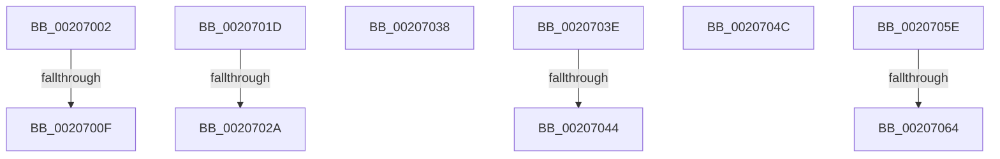

# sub_00207002

- RVA: `0x00207002`–`0x0020706C` (길이 `106` bytes)
- VA: `0x0000000140207002`
- 실행 섹션: `.text`
- PDB 이름 있음: `아니요`; PDB Function 태그: `아니요`
- unwind 정보 RVA: `0x0005D070`
- 디코드: `24`개 명령, `106/106` bytes 표시
- 미해석 바이트: `0` (있으면 어셈블리에 `.byte`로 보존)

> 이 문서는 커널 이미지의 기계어와 PDB 기호를 분석해 생성했습니다. 4번과 5번은 함수 원형과 자료형을 바이너리 사용 방식에서 추정한 C 해석이며 원본 소스 복구 결과는 아닙니다.

## 1. Dependencies

- 직접 호출 지점: **3**; 고유 호출 대상: **2**
- 직접 호출자로 확인된 함수: **0**
- RIP 상대 이미지 참조: **0**

### Outgoing calls
- `0x00207013` → [KxWaitForSpinLockAndAcquire](KxWaitForSpinLockAndAcquire_function_002085C0.md) (function, `0x002085C0`)
- `0x0020702E` → [KxWaitForSpinLockAndAcquire](KxWaitForSpinLockAndAcquire_function_002085C0.md) (function, `0x002085C0`)
- `0x00207054` → [KiRaiseIrqlProcessIrqlFlags](../4F/KiRaiseIrqlProcessIrqlFlags_function_004F56FC.md) (function, `0x004F56FC`)

### Direct callers
- 이 함수 시작 RVA로 연결되는 직접 call은 확인되지 않았습니다. 간접 호출은 완전히 역산할 수 없습니다.

### Static image references
- 디코드된 RIP-relative 메모리 참조가 없습니다.

## 2. Other-region calls and transfers

- 다른 실행 섹션으로 향하는 call: **0**
- call이 아닌 외부 분기/꼬리 이동: **10**
  - `0x00207009` → [sub_00206E35 + 0x151](Unknown_function_00206E35.md) (`tail-transfer`)
  - `0x00207018` → [sub_00206E35 + 0x151](Unknown_function_00206E35.md) (`tail-transfer`)
  - `0x00207024` → [sub_00206E35 + 0x59](Unknown_function_00206E35.md) (`tail-transfer`)
  - `0x00207033` → [sub_00206E35 + 0x59](Unknown_function_00206E35.md) (`tail-transfer`)
  - `0x0020703C` → [sub_00206E35 + 0x1A9](Unknown_function_00206E35.md) (`tail-transfer`)
  - `0x00207042` → [sub_00207070 + 0x1A](Unknown_function_00207070.md) (`tail-transfer`)
  - `0x00207047` → [sub_00206E35 + 0x157](Unknown_function_00206E35.md) (`tail-transfer`)
  - `0x00207059` → [sub_00206E35 + 0x12D](Unknown_function_00206E35.md) (`tail-transfer`)
  - `0x00207062` → [sub_00207070 + 0x39](Unknown_function_00207070.md) (`tail-transfer`)
  - `0x00207067` → [sub_00206E35 + 0x5F](Unknown_function_00206E35.md) (`tail-transfer`)

## 3. Assembly (complete function range)

```asm
00207002  F0 48 0F BA 6E 10 00            lock bts qword ptr [rsi + 0x10], 0
00207009  0F 83 77 FF FF FF               jae 0x140206f86
0020700F  48 8D 4E 10                     lea rcx, [rsi + 0x10]
00207013  E8 A8 15 00 00                  call 0x1402085c0
00207018  E9 69 FF FF FF                  jmp 0x140206f86
0020701D  F0 49 0F BA 6E 10 00            lock bts qword ptr [r14 + 0x10], 0
00207024  0F 83 64 FE FF FF               jae 0x140206e8e
0020702A  49 8D 4E 10                     lea rcx, [r14 + 0x10]
0020702E  E8 8D 15 00 00                  call 0x1402085c0
00207033  E9 56 FE FF FF                  jmp 0x140206e8e
00207038  4C 8B 7B 18                     mov r15, qword ptr [rbx + 0x18]
0020703C  EB A0                           jmp 0x140206fde
0020703E  4C 39 68 10                     cmp qword ptr [rax + 0x10], r13
00207042  74 46                           je 0x14020708a
00207044  48 8B 00                        mov rax, qword ptr [rax]
00207047  E9 40 FF FF FF                  jmp 0x140206f8c
0020704C  41 0F B6 D6                     movzx edx, r14b
00207050  40 0F B6 CD                     movzx ecx, bpl
00207054  E8 A3 E6 2E 00                  call 0x1404f56fc
00207059  E9 04 FF FF FF                  jmp 0x140206f62
0020705E  4C 39 68 10                     cmp qword ptr [rax + 0x10], r13
00207062  74 45                           je 0x1402070a9
00207064  48 8B 00                        mov rax, qword ptr [rax]
00207067  E9 28 FE FF FF                  jmp 0x140206e94
```

## 4. C-style interpretation (structured pseudocode)

```c
__int64 __fastcall sub_00207002(void)
{
    __int64 result;

    result = KxWaitForSpinLockAndAcquire(v_rsi + 16, a2, a3, a4);
}
```

## 5. (Beta) C Style

```c
void sub_00207002(void)
{
    int64_t result;

    result = KxWaitForSpinLockAndAcquire(local_rsi + 16, a2, a3, a4);
}
```

## 6. Execution-region graph

[열기: 2D/3D 그래프와 함수 탐색 컨트롤 패널](../../../control-panel.html?section=text&rva=0x00207002&view=graph)

- 2D 그래프는 위에서 아래로 흐르고, 3D 그래프는 빈 공간을 드래그해 회전합니다. Shift+드래그는 이동, 휠은 확대·축소, 함수 노드 선택은 대상 보고서 이동입니다.

### Static fallback


