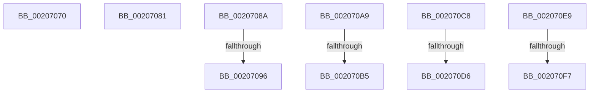

# sub_00207070

- RVA: `0x00207070`–`0x0020710A` (길이 `154` bytes)
- VA: `0x0000000140207070`
- 실행 섹션: `.text`
- PDB 이름 있음: `아니요`; PDB Function 태그: `아니요`
- unwind 정보 RVA: `0x0005D0A0`
- 디코드: `34`개 명령, `154/154` bytes 표시
- 미해석 바이트: `0` (있으면 어셈블리에 `.byte`로 보존)

> 이 문서는 커널 이미지의 기계어와 PDB 기호를 분석해 생성했습니다. 4번과 5번은 함수 원형과 자료형을 바이너리 사용 방식에서 추정한 C 해석이며 원본 소스 복구 결과는 아닙니다.

## 1. Dependencies

- 직접 호출 지점: **5**; 고유 호출 대상: **3**
- 직접 호출자로 확인된 함수: **0**
- RIP 상대 이미지 참조: **1**

### Outgoing calls
- `0x00207077` → [KiRaiseIrqlProcessIrqlFlags](../4F/KiRaiseIrqlProcessIrqlFlags_function_004F56FC.md) (function, `0x004F56FC`)
- `0x0020709F` → [ObfReferenceObjectWithTag](../21/ObfReferenceObjectWithTag_function_00210710.md) (function, `0x00210710`)
- `0x002070BE` → [ObfReferenceObjectWithTag](../21/ObfReferenceObjectWithTag_function_00210710.md) (function, `0x00210710`)
- `0x002070DF` → [KiReleaseSpinLockInstrumented](../39/KiReleaseSpinLockInstrumented_function_00392EF0.md) (function, `0x00392EF0`)
- `0x00207100` → [KiReleaseSpinLockInstrumented](../39/KiReleaseSpinLockInstrumented_function_00392EF0.md) (function, `0x00392EF0`)

### Direct callers
- 이 함수 시작 RVA로 연결되는 직접 call은 확인되지 않았습니다. 간접 호출은 완전히 역산할 수 없습니다.

### Static image references
- `0x002070C8` → RVA `0x00F0DE58` (`.data`; read)

## 2. Other-region calls and transfers

- 다른 실행 섹션으로 향하는 call: **0**
- call이 아닌 외부 분기/꼬리 이동: **10**
  - `0x0020707C` → [sub_00206E35 + 0x35](Unknown_function_00206E35.md) (`tail-transfer`)
  - `0x00207085` → [sub_00206E35 + 0x1A9](Unknown_function_00206E35.md) (`tail-transfer`)
  - `0x00207090` → [sub_00206E35 + 0x160](Unknown_function_00206E35.md) (`tail-transfer`)
  - `0x002070A4` → [sub_00206E35 + 0x160](Unknown_function_00206E35.md) (`tail-transfer`)
  - `0x002070AF` → [sub_00206E35 + 0x68](Unknown_function_00206E35.md) (`tail-transfer`)
  - `0x002070C3` → [sub_00206E35 + 0x68](Unknown_function_00206E35.md) (`tail-transfer`)
  - `0x002070D0` → [sub_00206E35 + 0x16D](Unknown_function_00206E35.md) (`tail-transfer`)
  - `0x002070E4` → [sub_00206E35 + 0x172](Unknown_function_00206E35.md) (`tail-transfer`)
  - `0x002070F1` → [sub_00206E35 + 0x75](Unknown_function_00206E35.md) (`tail-transfer`)
  - `0x00207105` → [sub_00206E35 + 0x7A](Unknown_function_00206E35.md) (`tail-transfer`)

## 3. Assembly (complete function range)

```asm
00207070  0F B6 D0                        movzx edx, al
00207073  40 0F B6 CD                     movzx ecx, bpl
00207077  E8 80 E6 2E 00                  call 0x1404f56fc
0020707C  E9 E9 FD FF FF                  jmp 0x140206e6a
00207081  4C 8B 7F 18                     mov r15, qword ptr [rdi + 0x18]
00207085  E9 54 FF FF FF                  jmp 0x140206fde
0020708A  48 8B F8                        mov rdi, rax
0020708D  48 85 C0                        test rax, rax
00207090  0F 84 FF FE FF FF               je 0x140206f95
00207096  48 8B 48 18                     mov rcx, qword ptr [rax + 0x18]
0020709A  BA 50 73 50 72                  mov edx, 0x72507350
0020709F  E8 6C 96 00 00                  call 0x140210710
002070A4  E9 EC FE FF FF                  jmp 0x140206f95
002070A9  48 8B D8                        mov rbx, rax
002070AC  48 85 C0                        test rax, rax
002070AF  0F 84 E8 FD FF FF               je 0x140206e9d
002070B5  48 8B 48 18                     mov rcx, qword ptr [rax + 0x18]
002070B9  BA 50 73 50 72                  mov edx, 0x72507350
002070BE  E8 4D 96 00 00                  call 0x140210710
002070C3  E9 D5 FD FF FF                  jmp 0x140206e9d
002070C8  8B 05 8A 6D D0 00               mov eax, dword ptr [rip + 0xd06d8a]
002070CE  85 C0                           test eax, eax
002070D0  0F 85 CC FE FF FF               jne 0x140206fa2
002070D6  48 8B 54 24 48                  mov rdx, qword ptr [rsp + 0x48]
002070DB  48 8D 4E 10                     lea rcx, [rsi + 0x10]
002070DF  E8 0C BE 18 00                  call 0x140392ef0
002070E4  E9 BE FE FF FF                  jmp 0x140206fa7
002070E9  8B 05 69 6D D0 00               mov eax, dword ptr [rip + 0xd06d69]
002070EF  85 C0                           test eax, eax
002070F1  0F 85 B3 FD FF FF               jne 0x140206eaa
002070F7  48 8B 54 24 48                  mov rdx, qword ptr [rsp + 0x48]
002070FC  49 8D 4E 10                     lea rcx, [r14 + 0x10]
00207100  E8 EB BD 18 00                  call 0x140392ef0
00207105  E9 A5 FD FF FF                  jmp 0x140206eaf
```

## 4. C-style interpretation (structured pseudocode)

```c
__int64 __fastcall sub_00207070(void)
{
    __int64 result;
    unsigned __int64 v_stack_p48;

    result = KiRaiseIrqlProcessIrqlFlags((unsigned __int8)(v_rbp), (unsigned __int8)(result), a3, a4);
}
```

## 5. (Beta) C Style

```c
void sub_00207070(void)
{
    int64_t result;
    uint64_t v_stack_p48;

    result = KiRaiseIrqlProcessIrqlFlags((uint8_t)(local_rbp), (uint8_t)(result), a3, a4);
}
```

## 6. Execution-region graph

[열기: 2D/3D 그래프와 함수 탐색 컨트롤 패널](../../../control-panel.html?section=text&rva=0x00207070&view=graph)

- 2D 그래프는 위에서 아래로 흐르고, 3D 그래프는 빈 공간을 드래그해 회전합니다. Shift+드래그는 이동, 휠은 확대·축소, 함수 노드 선택은 대상 보고서 이동입니다.

### Static fallback


