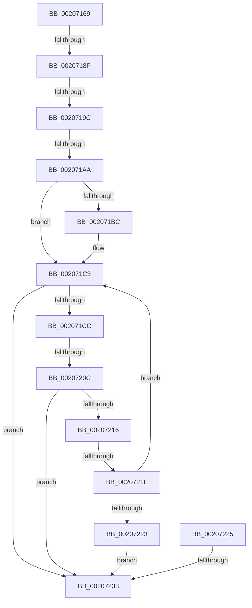

# sub_00207169

- RVA: `0x00207169`–`0x00207241` (길이 `216` bytes)
- VA: `0x0000000140207169`
- 실행 섹션: `.text`
- PDB 이름 있음: `아니요`; PDB Function 태그: `아니요`
- unwind 정보 RVA: `0x0005D0E8`
- 디코드: `45`개 명령, `216/216` bytes 표시
- 미해석 바이트: `0` (있으면 어셈블리에 `.byte`로 보존)

> 이 문서는 커널 이미지의 기계어와 PDB 기호를 분석해 생성했습니다. 4번과 5번은 함수 원형과 자료형을 바이너리 사용 방식에서 추정한 C 해석이며 원본 소스 복구 결과는 아닙니다.

## 1. Dependencies

- 직접 호출 지점: **2**; 고유 호출 대상: **2**
- 직접 호출자로 확인된 함수: **0**
- RIP 상대 이미지 참조: **3**

### Outgoing calls
- `0x002071AD` → [KiAcquireSpinLockInstrumented](KiAcquireSpinLockInstrumented_function_002084F0.md) (function, `0x002084F0`)
- `0x002071F1` → [IopCheckListForCancelableIrp](../48/IopCheckListForCancelableIrp_function_00488E60.md) (function, `0x00488E60`)

### Direct callers
- 이 함수 시작 RVA로 연결되는 직접 call은 확인되지 않았습니다. 간접 호출은 완전히 역산할 수 없습니다.

### Static image references
- `0x00207182` → RVA `0x00FC6D20` (`ALMOSTRO`; read)
- `0x0020718F` → RVA `0x00FC6B06` (`ALMOSTRO`; read)
- `0x0020719C` → RVA `0x00F0DE58` (`.data`; read)

## 2. Other-region calls and transfers

- 다른 실행 섹션으로 향하는 call: **0**
- call이 아닌 외부 분기/꼬리 이동: **7**
  - `0x00207189` → [sub_00207282 + 0x19](Unknown_function_00207282.md) (`tail-transfer`)
  - `0x00207196` → [sub_00207282](Unknown_function_00207282.md) (`tail-transfer`)
  - `0x002071A4` → [sub_00207282](Unknown_function_00207282.md) (`tail-transfer`)
  - `0x00207206` → [sub_002072CB](Unknown_function_002072CB.md) (`tail-transfer`)
  - `0x00207218` → [sub_002072CB + 0x94](Unknown_function_002072CB.md) (`tail-transfer`)
  - `0x0020722D` → [sub_002072CB + 0xF2](Unknown_function_002072CB.md) (`tail-transfer`)
  - `0x0020723F` → [sub_002072AC](Unknown_function_002072AC.md) (`tail-transfer`)

## 3. Assembly (complete function range)

```asm
00207169  4D 89 63 C8                     mov qword ptr [r11 - 0x38], r12
0020716D  49 C7 43 B8 F0 D8 FF FF         mov qword ptr [r11 - 0x48], 0xffffffffffffd8f0
00207175  44 0F 20 C6                     mov rsi, cr8
00207179  B8 02 00 00 00                  mov eax, 2
0020717E  44 0F 22 C0                     mov cr8, rax
00207182  44 39 35 97 FB DB 00            cmp dword ptr [rip + 0xdbfb97], r14d
00207189  0F 85 0C 01 00 00               jne 0x14020729b
0020718F  F6 05 70 F9 DB 00 21            test byte ptr [rip + 0xdbf970], 0x21
00207196  0F 84 E6 00 00 00               je 0x140207282
0020719C  8B 05 B6 6C D0 00               mov eax, dword ptr [rip + 0xd06cb6]
002071A2  85 C0                           test eax, eax
002071A4  0F 85 D8 00 00 00               jne 0x140207282
002071AA  48 8B CB                        mov rcx, rbx
002071AD  E8 3E 13 00 00                  call 0x1402084f0
002071B2  44 38 B4 24 B8 00 00 00         cmp byte ptr [rsp + 0xb8], r14b
002071BA  74 07                           je 0x1402071c3
002071BC  81 4F 50 00 04 00 00            or dword ptr [rdi + 0x50], 0x400
002071C3  4D 8B E7                        mov r12, r15
002071C6  48 39 6D 00                     cmp qword ptr [rbp], rbp
002071CA  74 67                           je 0x140207233
002071CC  4C 8B 84 24 A0 00 00 00         mov r8, qword ptr [rsp + 0xa0]
002071D4  48 8D 44 24 30                  lea rax, [rsp + 0x30]
002071D9  48 8B 94 24 98 00 00 00         mov rdx, qword ptr [rsp + 0x98]
002071E1  4D 8B CD                        mov r9, r13
002071E4  48 89 44 24 28                  mov qword ptr [rsp + 0x28], rax
002071E9  48 8B CD                        mov rcx, rbp
002071EC  4C 89 7C 24 20                  mov qword ptr [rsp + 0x20], r15
002071F1  E8 6A 1C 28 00                  call 0x140488e60
002071F6  4C 8B 44 24 30                  mov r8, qword ptr [rsp + 0x30]
002071FB  45 33 FF                        xor r15d, r15d
002071FE  4C 89 44 24 38                  mov qword ptr [rsp + 0x38], r8
00207203  4D 85 C0                        test r8, r8
00207206  0F 85 BF 00 00 00               jne 0x1402072cb
0020720C  44 38 BC 24 B0 00 00 00         cmp byte ptr [rsp + 0xb0], r15b
00207214  74 1D                           je 0x140207233
00207216  84 C0                           test al, al
00207218  0F 84 41 01 00 00               je 0x14020735f
0020721E  4D 85 E4                        test r12, r12
00207221  75 A0                           jne 0x1402071c3
00207223  EB 0E                           jmp 0x140207233
00207225  80 BC 24 B0 00 00 00 00         cmp byte ptr [rsp + 0xb0], 0
0020722D  0F 85 8A 01 00 00               jne 0x1402073bd
00207233  F6 05 CC F8 DB 00 01            test byte ptr [rip + 0xdbf8cc], 1
0020723A  4C 8B 64 24 50                  mov r12, qword ptr [rsp + 0x50]
0020723F  75 6B                           jne 0x1402072ac
```

## 4. C-style interpretation (structured pseudocode)

```c
__int64 __fastcall sub_00207169(__int64 a1, __int64 a2, __int64 a3, __int64 a4, __int64 a5, __int64 a6, __int64 a7, __int64 a8, __int64 a9, __int64 a10, __int64 a11, __int64 a12, __int64 a13, __int64 a14, __int64 a15, __int64 a16, __int64 a17, __int64 a18, __int64 a19, __int64 a20, __int64 a21, unsigned __int8 a22, unsigned __int8 a23)
{
    __int64 result;
    __int64 v_r15;
    unsigned __int64 v_stack_p20;
    unsigned __int64 v_stack_p28;
    unsigned __int64 v_stack_p38;
    unsigned __int8 v_stack_pB0;

    *(unsigned __int64 *)(v_r11 - 56) = v_r12;
    *(unsigned __int64 *)(v_r11 - 72) = 0xFFFFFFFFFFFFD8F0ULL;
    result = KiAcquireSpinLockInstrumented(v_rbx, a2, a3, a4);
    if (a23 != ((unsigned __int8)(v_r14))) {
    }
    if ((*(unsigned __int64 *)(v_rbp)) == v_rbp) goto loc_00207233;
    v_stack_p28 = a6;
    v_stack_p20 = v_r15;
    result = IopCheckListForCancelableIrp(v_rbp, a19, a20, v_r13);
    v_r15 = 0;
    v_stack_p38 = a6;
    if (a22 == 0) goto loc_00207233;
    if (0 != 0) goto loc_002071C3;
    goto loc_00207233;
loc_00207233:
}
```

## 5. (Beta) C Style

```c
int64_t sub_00207169(int64_t Arg1, int64_t Arg2, int64_t Arg3, int64_t Arg4, uint64_t Arg5, int64_t Arg6, uint64_t Arg7, uint64_t Arg8, uint64_t Arg9, int64_t Arg10, uint64_t Arg11, uint64_t Arg12, uint64_t Arg13, uint64_t Arg14, uint64_t Arg15, uint64_t Arg16, uint64_t Arg17, uint64_t Arg18, int64_t Arg19, int64_t Arg20, uint64_t Arg21, uint8_t Arg22, uint8_t Arg23)
{
    int64_t result;
    int64_t local_r15;
    uint64_t v_stack_p20;
    uint64_t v_stack_p28;
    uint64_t v_stack_p38;
    uint8_t v_stack_pB0;

    *(uint64_t *)(local_r11 - 0x38) = local_r12;
    *(uint64_t *)(local_r11 - 0x48) = 0xFFFFFFFFFFFFD8F0ULL;
    result = KiAcquireSpinLockInstrumented(local_rbx, Arg2, Arg3, Arg4);
    if (Arg23 != ((uint8_t)(local_r14))) {
    }
    if ((*(uint64_t *)(local_rbp)) == local_rbp) goto loc_00207233;
    v_stack_p28 = Arg6;
    v_stack_p20 = local_r15;
    result = IopCheckListForCancelableIrp(local_rbp, Arg19, Arg20, local_r13);
    local_r15 = 0;
    v_stack_p38 = Arg6;
    if (Arg22 == 0) goto loc_00207233;
    if (0 != 0) goto loc_002071C3;
    goto loc_00207233;
loc_00207233:
}
```

## 6. Execution-region graph

[열기: 2D/3D 그래프와 함수 탐색 컨트롤 패널](../../../control-panel.html?section=text&rva=0x00207169&view=graph)

- 2D 그래프는 위에서 아래로 흐르고, 3D 그래프는 빈 공간을 드래그해 회전합니다. Shift+드래그는 이동, 휠은 확대·축소, 함수 노드 선택은 대상 보고서 이동입니다.

### Static fallback


