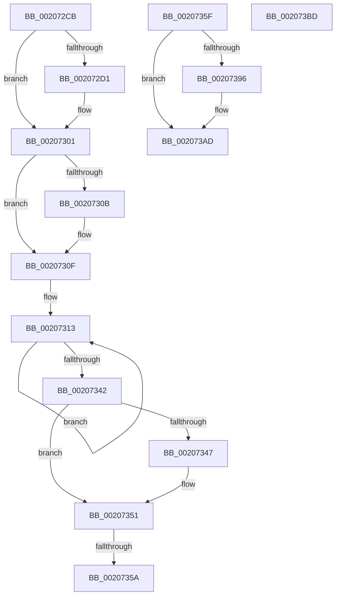

# sub_002072CB

- RVA: `0x002072CB`–`0x002073C5` (길이 `250` bytes)
- VA: `0x00000001402072CB`
- 실행 섹션: `.text`
- PDB 이름 있음: `아니요`; PDB Function 태그: `아니요`
- unwind 정보 RVA: `0x0005D168`
- 디코드: `63`개 명령, `250/250` bytes 표시
- 미해석 바이트: `0` (있으면 어셈블리에 `.byte`로 보존)

> 이 문서는 커널 이미지의 기계어와 PDB 기호를 분석해 생성했습니다. 4번과 5번은 함수 원형과 자료형을 바이너리 사용 방식에서 추정한 C 해석이며 원본 소스 복구 결과는 아닙니다.

## 1. Dependencies

- 직접 호출 지점: **7**; 고유 호출 대상: **5**
- 직접 호출자로 확인된 함수: **0**
- RIP 상대 이미지 참조: **0**

### Outgoing calls
- `0x002072E2` → [KeReleaseSpinLock](../39/KeReleaseSpinLock_function_00392BA0.md) (function, `0x00392BA0`)
- `0x002072EC` → [IoCancelIrp](../27/IoCancelIrp_function_002720E0.md) (function, `0x002720E0`)
- `0x002072F4` → [KeAcquireSpinLockRaiseToDpc](KeAcquireSpinLockRaiseToDpc_function_00208470.md) (function, `0x00208470`)
- `0x0020734C` → [IoFreeIrp](../24/IoFreeIrp_function_0024DF70.md) (function, `0x0024DF70`)
- `0x00207377` → [KeReleaseSpinLock](../39/KeReleaseSpinLock_function_00392BA0.md) (function, `0x00392BA0`)
- `0x00207385` → [KeDelayExecutionThread](KeDelayExecutionThread_function_00209550.md) (function, `0x00209550`)
- `0x002073B0` → [KeAcquireSpinLockRaiseToDpc](KeAcquireSpinLockRaiseToDpc_function_00208470.md) (function, `0x00208470`)

### Direct callers
- 이 함수 시작 RVA로 연결되는 직접 call은 확인되지 않았습니다. 간접 호출은 완전히 역산할 수 없습니다.

### Static image references
- 디코드된 RIP-relative 메모리 참조가 없습니다.

## 2. Other-region calls and transfers

- 다른 실행 섹션으로 향하는 call: **0**
- call이 아닌 외부 분기/꼬리 이동: **4**
  - `0x00207354` → [sub_00207169 + 0x5A](Unknown_function_00207169.md) (`tail-transfer`)
  - `0x0020735A` → [sub_00207169 + 0xBC](Unknown_function_00207169.md) (`tail-transfer`)
  - `0x002073B8` → [sub_00207169 + 0x5A](Unknown_function_00207169.md) (`tail-transfer`)
  - `0x002073C0` → [sub_00207169 + 0x5A](Unknown_function_00207169.md) (`tail-transfer`)

## 3. Assembly (complete function range)

```asm
002072CB  45 38 78 44                     cmp byte ptr [r8 + 0x44], r15b
002072CF  75 30                           jne 0x140207301
002072D1  41 BE 01 00 00 00               mov r14d, 1
002072D7  40 0F B6 D6                     movzx edx, sil
002072DB  48 8B CB                        mov rcx, rbx
002072DE  45 88 70 44                     mov byte ptr [r8 + 0x44], r14b
002072E2  E8 B9 B8 18 00                  call 0x140392ba0
002072E7  48 8B 4C 24 38                  mov rcx, qword ptr [rsp + 0x38]
002072EC  E8 EF AD 06 00                  call 0x1402720e0
002072F1  48 8B CB                        mov rcx, rbx
002072F4  E8 77 11 00 00                  call 0x140208470
002072F9  4C 8B 44 24 38                  mov r8, qword ptr [rsp + 0x38]
002072FE  0F B6 F0                        movzx esi, al
00207301  41 F7 40 10 00 20 00 00         test dword ptr [r8 + 0x10], 0x2000
00207309  74 04                           je 0x14020730f
0020730B  4D 8B 78 20                     mov r15, qword ptr [r8 + 0x20]
0020730F  4D 8B 50 58                     mov r10, qword ptr [r8 + 0x58]
00207313  4D 8B CA                        mov r9, r10
00207316  49 8B C2                        mov rax, r10
00207319  49 D1 E9                        shr r9, 1
0020731C  48 83 E0 F9                     and rax, 0xfffffffffffffff9
00207320  41 83 E1 03                     and r9d, 3
00207324  49 8B D2                        mov rdx, r10
00207327  49 FF C9                        dec r9
0020732A  4B 8D 0C 09                     lea rcx, [r9 + r9]
0020732E  48 0B C8                        or rcx, rax
00207331  49 8B C2                        mov rax, r10
00207334  F0 49 0F B1 48 58               lock cmpxchg qword ptr [r8 + 0x58], rcx
0020733A  4C 8B D0                        mov r10, rax
0020733D  48 3B D0                        cmp rdx, rax
00207340  75 D1                           jne 0x140207313
00207342  45 85 C9                        test r9d, r9d
00207345  75 0A                           jne 0x140207351
00207347  48 8B 4C 24 30                  mov rcx, qword ptr [rsp + 0x30]
0020734C  E8 1F 6C 04 00                  call 0x14024df70
00207351  4C 3B FD                        cmp r15, rbp
00207354  0F 85 69 FE FF FF               jne 0x1402071c3
0020735A  E9 C6 FE FF FF                  jmp 0x140207225
0020735F  48 8B 47 08                     mov rax, qword ptr [rdi + 8]
00207363  40 0F B6 D6                     movzx edx, sil
00207367  48 8B 48 08                     mov rcx, qword ptr [rax + 8]
0020736B  48 8B 41 58                     mov rax, qword ptr [rcx + 0x58]
0020736F  48 8B CB                        mov rcx, rbx
00207372  48 89 44 24 38                  mov qword ptr [rsp + 0x38], rax
00207377  E8 24 B8 18 00                  call 0x140392ba0
0020737C  4C 8D 44 24 40                  lea r8, [rsp + 0x40]
00207381  33 D2                           xor edx, edx
00207383  33 C9                           xor ecx, ecx
00207385  E8 C6 21 00 00                  call 0x140209550
0020738A  8B 84 24 90 00 00 00            mov eax, dword ptr [rsp + 0x90]
00207391  83 F8 64                        cmp eax, 0x64
00207394  7D 17                           jge 0x1402073ad
00207396  03 C0                           add eax, eax
00207398  89 84 24 90 00 00 00            mov dword ptr [rsp + 0x90], eax
0020739F  69 C0 F0 D8 FF FF               imul eax, eax, 0xffffd8f0
002073A5  48 63 C8                        movsxd rcx, eax
002073A8  48 89 4C 24 40                  mov qword ptr [rsp + 0x40], rcx
002073AD  48 8B CB                        mov rcx, rbx
002073B0  E8 BB 10 00 00                  call 0x140208470
002073B5  0F B6 F0                        movzx esi, al
002073B8  E9 06 FE FF FF                  jmp 0x1402071c3
002073BD  45 33 FF                        xor r15d, r15d
002073C0  E9 FE FD FF FF                  jmp 0x1402071c3
```

## 4. C-style interpretation (structured pseudocode)

```c
__int64 __fastcall sub_002072CB(__int64 a1, __int64 a2, __int64 a3, __int64 a4, __int64 a5, __int64 a6, __int64 a7)
{
    __int64 result;
    __int64 v_r14;
    __int64 v_r15;
    __int64 v_rsi;
    unsigned __int64 v_stack_p38;
    unsigned __int64 v_stack_p40;
    unsigned int v_stack_p90;

    if ((*(unsigned __int8 *)(a3 + 68)) == ((unsigned __int8)(v_r15))) {
        v_r14 = 1;
        a2 = (unsigned __int8)(v_rsi);
        a1 = v_rbx;
        *(unsigned __int8 *)(a3 + 68) = (unsigned __int8)(v_r14);
        result = KeReleaseSpinLock(a1, a2, a3, a4);
        a1 = a7;
        result = IoCancelIrp(a1, a2, a3, a4);
        a1 = v_rbx;
        result = KeAcquireSpinLockRaiseToDpc(a1, a2, a3, a4);
        a3 = a7;
        v_rsi = (unsigned __int8)(result);
    }
    if (((*(unsigned int *)(a3 + 16)) & (0x2000ULL)) != 0) {
        v_r15 = *(unsigned __int64 *)(a3 + 32);
    }
loc_00207313:
    a4 = (*(unsigned __int64 *)(a3 + 88)) >> (1);
    result = (*(unsigned __int64 *)(a3 + 88)) & (-7);
    a4 = (unsigned int)((a4) & (3));
    a4 = (a4) - 1;
    a1 = (a4 + a4 * 1) | (result);
    if ((*(unsigned __int64 *)(a3 + 88)) != (*(unsigned __int64 *)(a3 + 88))) goto loc_00207313;
    result = *(unsigned __int64 *)(a3 + 88);
    if ((unsigned int)(a4) == 0) {
        a1 = a6;
        result = IoFreeIrp(a1, *(unsigned __int64 *)(a3 + 88), a3, a4);
    }
}
```

## 5. (Beta) C Style

```c
int64_t sub_002072CB(int64_t Arg1, int64_t Arg2, void *Arg3, int64_t Arg4, uint64_t Arg5, int64_t Arg6, int64_t Arg7)
{
    uint8_t *arg3 = (uint8_t *)Arg3;

    int64_t result;
    int64_t local_r14;
    int64_t local_r15;
    int64_t local_rsi;
    uint64_t v_stack_p38;
    uint64_t v_stack_p40;
    uint32_t v_stack_p90;

    if ((*(uint8_t *)(arg3 + 0x44)) == ((uint8_t)(local_r15))) {
        local_r14 = 1;
        Arg2 = (uint8_t)(local_rsi);
        Arg1 = local_rbx;
        *(uint8_t *)(arg3 + 0x44) = (uint8_t)(local_r14);
        result = KeReleaseSpinLock(Arg1, Arg2, Arg3, Arg4);
        Arg1 = Arg7;
        result = IoCancelIrp(Arg1, Arg2, Arg3, Arg4);
        Arg1 = local_rbx;
        result = KeAcquireSpinLockRaiseToDpc(Arg1, Arg2, Arg3, Arg4);
        Arg3 = Arg7;
        local_rsi = (uint8_t)(result);
    }
    if (((*(uint32_t *)(arg3 + 0x10)) & (0x2000ULL)) != 0) {
        local_r15 = *(uint64_t *)(arg3 + 0x20);
    }
loc_00207313:
    Arg4 = (*(uint64_t *)(arg3 + 0x58)) >> (1);
    result = (*(uint64_t *)(arg3 + 0x58)) & (-7);
    Arg4 = (uint32_t)((Arg4) & (3));
    Arg4 = (Arg4) - 1;
    Arg1 = (Arg4 + Arg4 * 1) | (result);
    if ((*(uint64_t *)(arg3 + 0x58)) != (*(uint64_t *)(arg3 + 0x58))) goto loc_00207313;
    result = *(uint64_t *)(arg3 + 0x58);
    if ((uint32_t)(Arg4) == 0) {
        Arg1 = Arg6;
        result = IoFreeIrp(Arg1, *(uint64_t *)(arg3 + 0x58), Arg3, Arg4);
    }
}
```

### 관측된 메모리 오프셋

구조체 형식이 확인되지 않은 접근은 인자 기준의 오프셋으로만 기록했습니다.

| 기준 인자 | 오프셋 표현 | 폭 (bit) | 접근 |
|---|---:|---:|---|
| `Arg3` | `+ 0x44` | `8` | `R` |
| `Arg3` | `+ 0x44` | `8` | `W` |

## 6. Execution-region graph

[열기: 2D/3D 그래프와 함수 탐색 컨트롤 패널](../../../control-panel.html?section=text&rva=0x002072CB&view=graph)

- 2D 그래프는 위에서 아래로 흐르고, 3D 그래프는 빈 공간을 드래그해 회전합니다. Shift+드래그는 이동, 휠은 확대·축소, 함수 노드 선택은 대상 보고서 이동입니다.

### Static fallback


