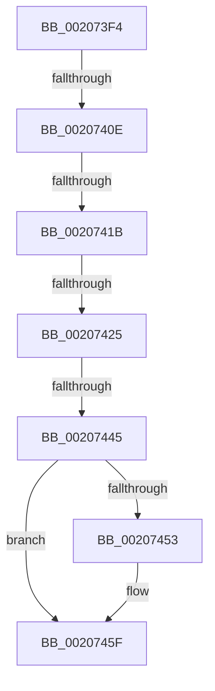

# sub_002073F4

- RVA: `0x002073F4`–`0x0020746F` (길이 `123` bytes)
- VA: `0x00000001402073F4`
- 실행 섹션: `.text`
- PDB 이름 있음: `아니요`; PDB Function 태그: `아니요`
- unwind 정보 RVA: `0x0005D194`
- 디코드: `29`개 명령, `123/123` bytes 표시
- 미해석 바이트: `0` (있으면 어셈블리에 `.byte`로 보존)

> 이 문서는 커널 이미지의 기계어와 PDB 기호를 분석해 생성했습니다. 4번과 5번은 함수 원형과 자료형을 바이너리 사용 방식에서 추정한 C 해석이며 원본 소스 복구 결과는 아닙니다.

## 1. Dependencies

- 직접 호출 지점: **3**; 고유 호출 대상: **3**
- 직접 호출자로 확인된 함수: **0**
- RIP 상대 이미지 참조: **3**

### Outgoing calls
- `0x00207425` → [KiAcquireSpinLockInstrumented](KiAcquireSpinLockInstrumented_function_002084F0.md) (function, `0x002084F0`)
- `0x00207430` → [guard_dispatch_icall](../6B/guard_dispatch_icall_function_006BAAD0.md) (function, `0x006BAAD0`)
- `0x0020745A` → [KiLowerIrqlProcessIrqlFlags](../4F/KiLowerIrqlProcessIrqlFlags_function_004F5698.md) (function, `0x004F5698`)

### Direct callers
- 이 함수 시작 RVA로 연결되는 직접 call은 확인되지 않았습니다. 간접 호출은 완전히 역산할 수 없습니다.

### Static image references
- `0x00207401` → RVA `0x00FC6D20` (`ALMOSTRO`; read)
- `0x0020740E` → RVA `0x00FC6B06` (`ALMOSTRO`; read)
- `0x0020741B` → RVA `0x00F0DE58` (`.data`; read)

## 2. Other-region calls and transfers

- 다른 실행 섹션으로 향하는 call: **0**
- call이 아닌 외부 분기/꼬리 이동: **4**
  - `0x00207408` → [sub_00207480 + 0xF](Unknown_function_00207480.md) (`tail-transfer`)
  - `0x00207419` → [sub_00207480](Unknown_function_00207480.md) (`tail-transfer`)
  - `0x00207423` → [sub_00207480](Unknown_function_00207480.md) (`tail-transfer`)
  - `0x00207443` → [sub_00207480 + 0x1C](Unknown_function_00207480.md) (`tail-transfer`)

## 3. Assembly (complete function range)

```asm
002073F4  48 89 5C 24 30                  mov qword ptr [rsp + 0x30], rbx
002073F9  44 0F 20 C3                     mov rbx, cr8
002073FD  44 0F 22 C2                     mov cr8, rdx
00207401  83 3D 18 F9 DB 00 00            cmp dword ptr [rip + 0xdbf918], 0
00207408  0F 85 81 00 00 00               jne 0x14020748f
0020740E  F6 05 F1 F6 DB 00 21            test byte ptr [rip + 0xdbf6f1], 0x21
00207415  48 8B 4F 48                     mov rcx, qword ptr [rdi + 0x48]
00207419  74 65                           je 0x140207480
0020741B  8B 05 37 6A D0 00               mov eax, dword ptr [rip + 0xd06a37]
00207421  85 C0                           test eax, eax
00207423  75 5B                           jne 0x140207480
00207425  E8 C6 10 00 00                  call 0x1402084f0
0020742A  48 8B CE                        mov rcx, rsi
0020742D  48 8B C5                        mov rax, rbp
00207430  E8 9B 36 4B 00                  call 0x1406baad0
00207435  F6 05 CA F6 DB 00 01            test byte ptr [rip + 0xdbf6ca], 1
0020743C  0F B6 F0                        movzx esi, al
0020743F  48 8B 4F 48                     mov rcx, qword ptr [rdi + 0x48]
00207443  75 57                           jne 0x14020749c
00207445  F0 48 83 21 00                  lock and qword ptr [rcx], 0
0020744A  83 3D CF F8 DB 00 00            cmp dword ptr [rip + 0xdbf8cf], 0
00207451  74 0C                           je 0x14020745f
00207453  44 0F 20 C1                     mov rcx, cr8
00207457  0F B6 D3                        movzx edx, bl
0020745A  E8 39 E2 2E 00                  call 0x1404f5698
0020745F  0F B6 C3                        movzx eax, bl
00207462  44 0F 22 C0                     mov cr8, rax
00207466  48 8B 5C 24 30                  mov rbx, qword ptr [rsp + 0x30]
0020746B  40 0F B6 C6                     movzx eax, sil
```

## 4. C-style interpretation (structured pseudocode)

```c
__int64 __fastcall sub_002073F4(__int64 a1, __int64 a2, __int64 a3, __int64 a4, __int64 a5, __int64 a6)
{
    __int64 result;
    unsigned __int64 v_stack_p30;

    v_stack_p30 = v_rbx;
    result = KiAcquireSpinLockInstrumented(*(unsigned __int64 *)(v_rdi + 72), a2, a3, a4);
    result = guard_dispatch_icall(v_rsi, a2, a3, a4);
    if ((*(unsigned int *)(v_rip + 14416079)) != 0) {
        a1 = a2;
        a2 = (unsigned __int8)(v_cr8);
        result = KiLowerIrqlProcessIrqlFlags(a1, a2, a3, a4);
    }
    return (unsigned __int8)((unsigned __int8)(result));
}
```

## 5. (Beta) C Style

```c
int64_t sub_002073F4(int64_t Arg1, int64_t Arg2, int64_t Arg3, int64_t Arg4, uint64_t Arg5, int64_t Arg6)
{
    int64_t result;
    uint64_t v_stack_p30;

    v_stack_p30 = local_rbx;
    result = KiAcquireSpinLockInstrumented(*(uint64_t *)(local_rdi + 0x48), Arg2, Arg3, Arg4);
    result = guard_dispatch_icall(local_rsi, Arg2, Arg3, Arg4);
    if ((*(uint32_t *)(v_rip + 0xDBF8CF)) != 0) {
        Arg1 = Arg2;
        Arg2 = (uint8_t)(v_cr8);
        result = KiLowerIrqlProcessIrqlFlags(Arg1, Arg2, Arg3, Arg4);
    }
    return (uint8_t)((uint8_t)(result));
}
```

## 6. Execution-region graph

[열기: 2D/3D 그래프와 함수 탐색 컨트롤 패널](../../../control-panel.html?section=text&rva=0x002073F4&view=graph)

- 2D 그래프는 위에서 아래로 흐르고, 3D 그래프는 빈 공간을 드래그해 회전합니다. Shift+드래그는 이동, 휠은 확대·축소, 함수 노드 선택은 대상 보고서 이동입니다.

### Static fallback


