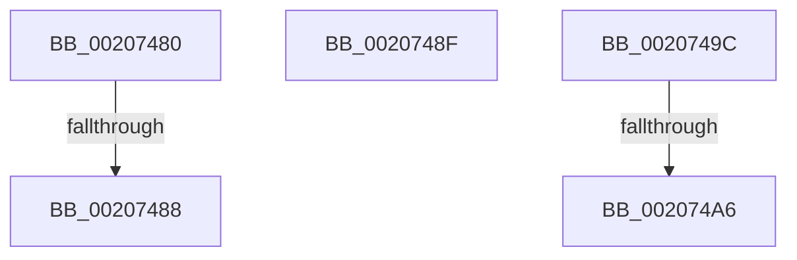

# sub_00207480

- RVA: `0x00207480`–`0x002074B2` (길이 `50` bytes)
- VA: `0x0000000140207480`
- 실행 섹션: `.text`
- PDB 이름 있음: `아니요`; PDB Function 태그: `아니요`
- unwind 정보 RVA: `0x0005D1BC`
- 디코드: `13`개 명령, `50/50` bytes 표시
- 미해석 바이트: `0` (있으면 어셈블리에 `.byte`로 보존)

> 이 문서는 커널 이미지의 기계어와 PDB 기호를 분석해 생성했습니다. 4번과 5번은 함수 원형과 자료형을 바이너리 사용 방식에서 추정한 C 해석이며 원본 소스 복구 결과는 아닙니다.

## 1. Dependencies

- 직접 호출 지점: **3**; 고유 호출 대상: **3**
- 직접 호출자로 확인된 함수: **0**
- RIP 상대 이미지 참조: **1**

### Outgoing calls
- `0x00207488` → [KxWaitForSpinLockAndAcquire](KxWaitForSpinLockAndAcquire_function_002085C0.md) (function, `0x002085C0`)
- `0x00207492` → [KiRaiseIrqlProcessIrqlFlags](../4F/KiRaiseIrqlProcessIrqlFlags_function_004F56FC.md) (function, `0x004F56FC`)
- `0x002074AB` → [KiReleaseSpinLockInstrumented](../39/KiReleaseSpinLockInstrumented_function_00392EF0.md) (function, `0x00392EF0`)

### Direct callers
- 이 함수 시작 RVA로 연결되는 직접 call은 확인되지 않았습니다. 간접 호출은 완전히 역산할 수 없습니다.

### Static image references
- `0x0020749C` → RVA `0x00F0DE58` (`.data`; read)

## 2. Other-region calls and transfers

- 다른 실행 섹션으로 향하는 call: **0**
- call이 아닌 외부 분기/꼬리 이동: **5**
  - `0x00207486` → [sub_002073F4 + 0x36](Unknown_function_002073F4.md) (`tail-transfer`)
  - `0x0020748D` → [sub_002073F4 + 0x36](Unknown_function_002073F4.md) (`tail-transfer`)
  - `0x00207497` → [sub_002073F4 + 0x1A](Unknown_function_002073F4.md) (`tail-transfer`)
  - `0x002074A4` → [sub_002073F4 + 0x51](Unknown_function_002073F4.md) (`tail-transfer`)
  - `0x002074B0` → [sub_002073F4 + 0x56](Unknown_function_002073F4.md) (`tail-transfer`)

## 3. Assembly (complete function range)

```asm
00207480  F0 48 0F BA 29 00               lock bts qword ptr [rcx], 0
00207486  73 A2                           jae 0x14020742a
00207488  E8 33 11 00 00                  call 0x1402085c0
0020748D  EB 9B                           jmp 0x14020742a
0020748F  0F B6 CB                        movzx ecx, bl
00207492  E8 65 E2 2E 00                  call 0x1404f56fc
00207497  E9 72 FF FF FF                  jmp 0x14020740e
0020749C  8B 15 B6 69 D0 00               mov edx, dword ptr [rip + 0xd069b6]
002074A2  85 D2                           test edx, edx
002074A4  75 9F                           jne 0x140207445
002074A6  48 8B 54 24 28                  mov rdx, qword ptr [rsp + 0x28]
002074AB  E8 40 BA 18 00                  call 0x140392ef0
002074B0  EB 98                           jmp 0x14020744a
```

## 4. C-style interpretation (structured pseudocode)

```c
__int64 __fastcall sub_00207480(__int64 a1)
{
    __int64 result;
    unsigned __int64 v_stack_p28;

    result = KxWaitForSpinLockAndAcquire(a1, a2, a3, a4);
}
```

## 5. (Beta) C Style

```c
int64_t sub_00207480(void *Arg1)
{
    uint8_t *arg1 = (uint8_t *)Arg1;

    int64_t result;
    uint64_t v_stack_p28;

    result = KxWaitForSpinLockAndAcquire(Arg1, a2, a3, a4);
}
```

### 관측된 메모리 오프셋

구조체 형식이 확인되지 않은 접근은 인자 기준의 오프셋으로만 기록했습니다.

| 기준 인자 | 오프셋 표현 | 폭 (bit) | 접근 |
|---|---:|---:|---|
| `Arg1` | `+ 0x0` | `64` | `R/W` |

## 6. Execution-region graph

[열기: 2D/3D 그래프와 함수 탐색 컨트롤 패널](../../../control-panel.html?section=text&rva=0x00207480&view=graph)

- 2D 그래프는 위에서 아래로 흐르고, 3D 그래프는 빈 공간을 드래그해 회전합니다. Shift+드래그는 이동, 휠은 확대·축소, 함수 노드 선택은 대상 보고서 이동입니다.

### Static fallback


