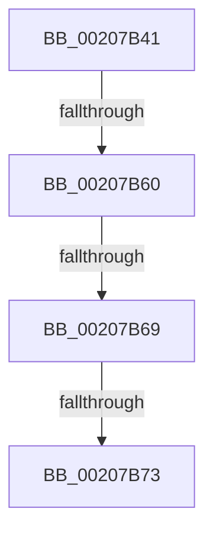

# sub_00207B41

- RVA: `0x00207B41`–`0x00207B84` (길이 `67` bytes)
- VA: `0x0000000140207B41`
- 실행 섹션: `.text`
- PDB 이름 있음: `아니요`; PDB Function 태그: `아니요`
- unwind 정보 RVA: `0x0005D26C`
- 디코드: `14`개 명령, `67/67` bytes 표시
- 미해석 바이트: `0` (있으면 어셈블리에 `.byte`로 보존)

> 이 문서는 커널 이미지의 기계어와 PDB 기호를 분석해 생성했습니다. 4번과 5번은 함수 원형과 자료형을 바이너리 사용 방식에서 추정한 C 해석이며 원본 소스 복구 결과는 아닙니다.

## 1. Dependencies

- 직접 호출 지점: **1**; 고유 호출 대상: **1**
- 직접 호출자로 확인된 함수: **0**
- RIP 상대 이미지 참조: **3**

### Outgoing calls
- `0x00207B7A` → [KiAcquireSpinLockInstrumented](KiAcquireSpinLockInstrumented_function_002084F0.md) (function, `0x002084F0`)

### Direct callers
- 이 함수 시작 RVA로 연결되는 직접 call은 확인되지 않았습니다. 간접 호출은 완전히 역산할 수 없습니다.

### Static image references
- `0x00207B53` → RVA `0x00FC6D20` (`ALMOSTRO`; read)
- `0x00207B60` → RVA `0x00FC6B06` (`ALMOSTRO`; read)
- `0x00207B69` → RVA `0x00F0DE58` (`.data`; read)

## 2. Other-region calls and transfers

- 다른 실행 섹션으로 향하는 call: **0**
- call이 아닌 외부 분기/꼬리 이동: **3**
  - `0x00207B5A` → [sub_00207C10](Unknown_function_00207C10.md) (`tail-transfer`)
  - `0x00207B67` → [sub_00207BA7](Unknown_function_00207BA7.md) (`tail-transfer`)
  - `0x00207B71` → [sub_00207BA7](Unknown_function_00207BA7.md) (`tail-transfer`)

## 3. Assembly (complete function range)

```asm
00207B41  48 89 74 24 38                  mov qword ptr [rsp + 0x38], rsi
00207B46  44 0F 20 C7                     mov rdi, cr8
00207B4A  B8 02 00 00 00                  mov eax, 2
00207B4F  44 0F 22 C0                     mov cr8, rax
00207B53  83 3D C6 F1 DB 00 00            cmp dword ptr [rip + 0xdbf1c6], 0
00207B5A  0F 85 B0 00 00 00               jne 0x140207c10
00207B60  F6 05 9F EF DB 00 21            test byte ptr [rip + 0xdbef9f], 0x21
00207B67  74 3E                           je 0x140207ba7
00207B69  8B 05 E9 62 D0 00               mov eax, dword ptr [rip + 0xd062e9]
00207B6F  85 C0                           test eax, eax
00207B71  75 34                           jne 0x140207ba7
00207B73  48 8D 8B 18 06 00 00            lea rcx, [rbx + 0x618]
00207B7A  E8 71 09 00 00                  call 0x1402084f0
00207B7F  48 8B 74 24 38                  mov rsi, qword ptr [rsp + 0x38]
```

## 4. C-style interpretation (structured pseudocode)

```c
__int64 __fastcall sub_00207B41(__int64 a1, __int64 a2, __int64 a3, __int64 a4, __int64 a5, __int64 a6, __int64 a7)
{
    __int64 result;
    unsigned __int64 v_stack_p38;

    v_stack_p38 = v_rsi;
    result = KiAcquireSpinLockInstrumented(v_rbx + 1560, a2, a3, a4);
    return result;
}
```

## 5. (Beta) C Style

```c
int64_t sub_00207B41(int64_t Arg1, int64_t Arg2, int64_t Arg3, int64_t Arg4, uint64_t Arg5, uint64_t Arg6, int64_t Arg7)
{
    int64_t result;
    uint64_t v_stack_p38;

    v_stack_p38 = local_rsi;
    result = KiAcquireSpinLockInstrumented(local_rbx + 1560, Arg2, Arg3, Arg4);
    return result;
}
```

## 6. Execution-region graph

[열기: 2D/3D 그래프와 함수 탐색 컨트롤 패널](../../../control-panel.html?section=text&rva=0x00207B41&view=graph)

- 2D 그래프는 위에서 아래로 흐르고, 3D 그래프는 빈 공간을 드래그해 회전합니다. Shift+드래그는 이동, 휠은 확대·축소, 함수 노드 선택은 대상 보고서 이동입니다.

### Static fallback


