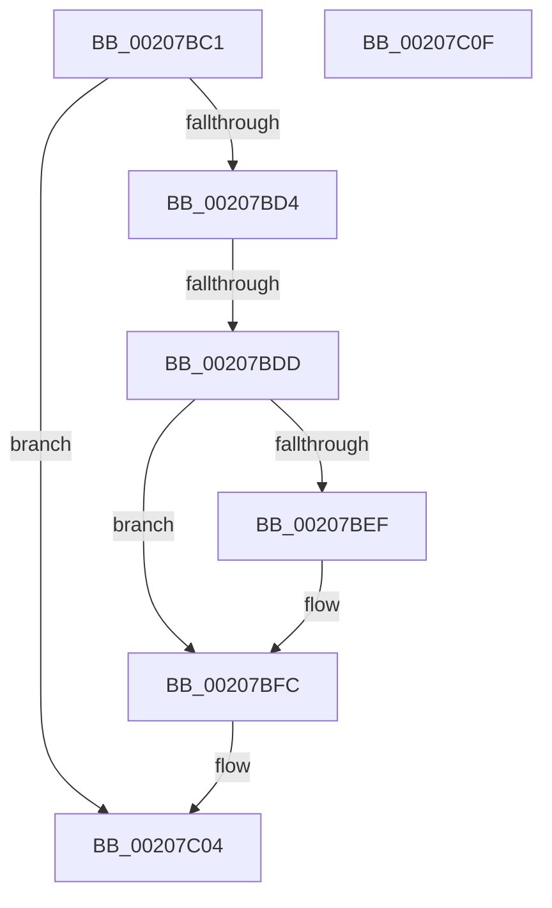

# sub_00207BC1

- RVA: `0x00207BC1`–`0x00207C10` (길이 `79` bytes)
- VA: `0x0000000140207BC1`
- 실행 섹션: `.text`
- PDB 이름 있음: `아니요`; PDB Function 태그: `아니요`
- unwind 정보 RVA: `0x0005D2B8`
- 디코드: `21`개 명령, `79/79` bytes 표시
- 미해석 바이트: `0` (있으면 어셈블리에 `.byte`로 보존)

> 이 문서는 커널 이미지의 기계어와 PDB 기호를 분석해 생성했습니다. 4번과 5번은 함수 원형과 자료형을 바이너리 사용 방식에서 추정한 C 해석이며 원본 소스 복구 결과는 아닙니다.

## 1. Dependencies

- 직접 호출 지점: **1**; 고유 호출 대상: **1**
- 직접 호출자로 확인된 함수: **0**
- RIP 상대 이미지 참조: **2**

### Outgoing calls
- `0x00207BF7` → [KiLowerIrqlProcessIrqlFlags](../4F/KiLowerIrqlProcessIrqlFlags_function_004F5698.md) (function, `0x004F5698`)

### Direct callers
- 이 함수 시작 RVA로 연결되는 직접 call은 확인되지 않았습니다. 간접 호출은 완전히 역산할 수 없습니다.

### Static image references
- `0x00207BD4` → RVA `0x00FC6B06` (`ALMOSTRO`; read)
- `0x00207BE6` → RVA `0x00FC6D20` (`ALMOSTRO`; read)

## 2. Other-region calls and transfers

- 다른 실행 섹션으로 향하는 call: **0**
- call이 아닌 외부 분기/꼬리 이동: **1**
  - `0x00207BDB` → [sub_00207C21](Unknown_function_00207C21.md) (`tail-transfer`)

## 3. Assembly (complete function range)

```asm
00207BC1  48 89 11                        mov qword ptr [rcx], rdx
00207BC4  48 89 4A 08                     mov qword ptr [rdx + 8], rcx
00207BC8  48 89 40 08                     mov qword ptr [rax + 8], rax
00207BCC  48 89 00                        mov qword ptr [rax], rax
00207BCF  48 85 DB                        test rbx, rbx
00207BD2  74 30                           je 0x140207c04
00207BD4  F6 05 2B EF DB 00 01            test byte ptr [rip + 0xdbef2b], 1
00207BDB  75 44                           jne 0x140207c21
00207BDD  F0 48 83 A3 18 06 00 00 00      lock and qword ptr [rbx + 0x618], 0
00207BE6  83 3D 33 F1 DB 00 00            cmp dword ptr [rip + 0xdbf133], 0
00207BED  74 0D                           je 0x140207bfc
00207BEF  44 0F 20 C1                     mov rcx, cr8
00207BF3  40 0F B6 D7                     movzx edx, dil
00207BF7  E8 9C DA 2E 00                  call 0x1404f5698
00207BFC  40 0F B6 C7                     movzx eax, dil
00207C00  44 0F 22 C0                     mov cr8, rax
00207C04  48 8B 5C 24 40                  mov rbx, qword ptr [rsp + 0x40]
00207C09  48 83 C4 20                     add rsp, 0x20
00207C0D  5F                              pop rdi
00207C0E  C3                              ret
00207C0F  CC                              int3
```

## 4. C-style interpretation (structured pseudocode)

```c
__int64 __fastcall sub_00207BC1(__int64 a1, __int64 a2, __int64 a3, __int64 a4, __int64 a5, __int64 a6, __int64 a7, __int64 a8)
{
    __int64 result;
    __int64 v_rsp;

    *(unsigned __int64 *)(a1) = a2;
    *(unsigned __int64 *)(a2 + 8) = a1;
    *(unsigned __int64 *)(result + 8) = result;
    *(unsigned __int64 *)(result) = result;
    if (v_rbx == 0) goto loc_00207C04;
    if ((*(unsigned int *)(v_rip + 14414131)) != 0) {
        a1 = v_cr8;
        a2 = (unsigned __int8)(v_rdi);
        result = KiLowerIrqlProcessIrqlFlags(a1, a2, a3, a4);
    }
loc_00207C04:
    v_rsp = (v_rsp) + (32);
    return (unsigned __int8)(v_rdi);
}
```

## 5. (Beta) C Style

```c
int64_t sub_00207BC1(void *Arg1, void *Arg2, int64_t Arg3, int64_t Arg4, uint64_t Arg5, uint64_t Arg6, uint64_t Arg7, int64_t Arg8)
{
    uint8_t *arg1 = (uint8_t *)Arg1;
    uint8_t *arg2 = (uint8_t *)Arg2;

    int64_t result;
    int64_t local_rsp;

    *(void **)(arg1) = Arg2;
    *(void **)(arg2 + 0x8) = Arg1;
    *(uint64_t *)(result + 0x8) = result;
    *(uint64_t *)(result) = result;
    if (local_rbx == 0) goto loc_00207C04;
    if ((*(uint32_t *)(v_rip + 0xDBF133)) != 0) {
        Arg1 = v_cr8;
        Arg2 = (uint8_t)(local_rdi);
        result = KiLowerIrqlProcessIrqlFlags(Arg1, Arg2, Arg3, Arg4);
    }
loc_00207C04:
    local_rsp = (local_rsp) + (32);
    return (uint8_t)(local_rdi);
}
```

### 관측된 메모리 오프셋

구조체 형식이 확인되지 않은 접근은 인자 기준의 오프셋으로만 기록했습니다.

| 기준 인자 | 오프셋 표현 | 폭 (bit) | 접근 |
|---|---:|---:|---|
| `Arg1` | `+ 0x0` | `64` | `W` |
| `Arg2` | `+ 0x8` | `64` | `W` |

## 6. Execution-region graph

[열기: 2D/3D 그래프와 함수 탐색 컨트롤 패널](../../../control-panel.html?section=text&rva=0x00207BC1&view=graph)

- 2D 그래프는 위에서 아래로 흐르고, 3D 그래프는 빈 공간을 드래그해 회전합니다. Shift+드래그는 이동, 휠은 확대·축소, 함수 노드 선택은 대상 보고서 이동입니다.

### Static fallback


