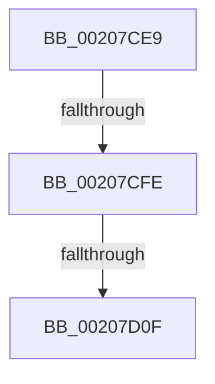

# sub_00207CE9

- RVA: `0x00207CE9`–`0x00207D2E` (길이 `69` bytes)
- VA: `0x0000000140207CE9`
- 실행 섹션: `.text`
- PDB 이름 있음: `아니요`; PDB Function 태그: `아니요`
- unwind 정보 RVA: `0x0005D314`
- 디코드: `17`개 명령, `69/69` bytes 표시
- 미해석 바이트: `0` (있으면 어셈블리에 `.byte`로 보존)

> 이 문서는 커널 이미지의 기계어와 PDB 기호를 분석해 생성했습니다. 4번과 5번은 함수 원형과 자료형을 바이너리 사용 방식에서 추정한 C 해석이며 원본 소스 복구 결과는 아닙니다.

## 1. Dependencies

- 직접 호출 지점: **1**; 고유 호출 대상: **1**
- 직접 호출자로 확인된 함수: **0**
- RIP 상대 이미지 참조: **1**

### Outgoing calls
- `0x00207D28` → [KeBugCheckEx](../4F/KeBugCheckEx_function_004FD660.md) (function, `0x004FD660`)

### Direct callers
- 이 함수 시작 RVA로 연결되는 직접 call은 확인되지 않았습니다. 간접 호출은 완전히 역산할 수 없습니다.

### Static image references
- `0x00207D0F` → RVA `0x00FC6A80` (`ALMOSTRO`; read)

## 2. Other-region calls and transfers

- 다른 실행 섹션으로 향하는 call: **0**
- call이 아닌 외부 분기/꼬리 이동: **2**
  - `0x00207CFC` → [sub_00207D3E](Unknown_function_00207D3E.md) (`tail-transfer`)
  - `0x00207D0D` → [sub_00207D3E + 0x14](Unknown_function_00207D3E.md) (`tail-transfer`)

## 3. Assembly (complete function range)

```asm
00207CE9  48 89 AC 24 08 01 00 00         mov qword ptr [rsp + 0x108], rbp
00207CF1  48 89 BC 24 B8 00 00 00         mov qword ptr [rsp + 0xb8], rdi
00207CF9  66 3B F0                        cmp si, ax
00207CFC  72 40                           jb 0x140207d3e
00207CFE  8B EE                           mov ebp, esi
00207D00  2B E8                           sub ebp, eax
00207D02  48 8B BC E9 40 8C FC 00         mov rdi, qword ptr [rcx + rbp*8 + 0xfc8c40]
00207D0A  48 85 FF                        test rdi, rdi
00207D0D  75 43                           jne 0x140207d52
00207D0F  8B 05 6B ED DB 00               mov eax, dword ptr [rip + 0xdbed6b]
00207D15  8D 57 03                        lea edx, [rdi + 3]
00207D18  4C 8B CE                        mov r9, rsi
00207D1B  48 89 44 24 20                  mov qword ptr [rsp + 0x20], rax
00207D20  4C 8B C3                        mov r8, rbx
00207D23  B9 C7 00 00 00                  mov ecx, 0xc7
00207D28  E8 33 59 2F 00                  call 0x1404fd660
00207D2D  CC                              int3
```

## 4. C-style interpretation (structured pseudocode)

```c
__int64 __fastcall sub_00207CE9(__int64 a1)
{
    __int64 result;
    __int64 v_rbp;
    unsigned __int64 v_stack_p108;
    unsigned __int64 v_stack_p20;
    unsigned __int64 v_stack_pB8;

    v_stack_p108 = v_rbp;
    v_stack_pB8 = v_rdi;
    v_rbp = (unsigned int)(((unsigned int)((unsigned int)(v_rsi))) - ((unsigned int)(result)));
    v_stack_p20 = (unsigned int)(*(unsigned int *)(v_rip + 14413163));
    result = KeBugCheckEx(199, *(unsigned __int64 *)(a1 + v_rbp * 8 + 16550976) + 3, v_rbx, v_rsi);
    return result;
}
```

## 5. (Beta) C Style

```c
int64_t sub_00207CE9(void *Arg1)
{
    uint8_t *arg1 = (uint8_t *)Arg1;

    int64_t result;
    int64_t local_rbp;
    uint64_t v_stack_p108;
    uint64_t v_stack_p20;
    uint64_t v_stack_pB8;

    v_stack_p108 = local_rbp;
    v_stack_pB8 = local_rdi;
    local_rbp = (uint32_t)(((uint32_t)((uint32_t)(local_rsi))) - ((uint32_t)(result)));
    v_stack_p20 = (uint32_t)(*(uint32_t *)(v_rip + 0xDBED6B));
    result = KeBugCheckEx(199, *(uint64_t *)(arg1 + local_rbp * 8 + 0xFC8C40) + 3, local_rbx, local_rsi);
    return result;
}
```

### 관측된 메모리 오프셋

구조체 형식이 확인되지 않은 접근은 인자 기준의 오프셋으로만 기록했습니다.

| 기준 인자 | 오프셋 표현 | 폭 (bit) | 접근 |
|---|---:|---:|---|
| `Arg1` | `+ 0xFC8C40 + rbp*8` | `64` | `R` |

## 6. Execution-region graph

[열기: 2D/3D 그래프와 함수 탐색 컨트롤 패널](../../../control-panel.html?section=text&rva=0x00207CE9&view=graph)

- 2D 그래프는 위에서 아래로 흐르고, 3D 그래프는 빈 공간을 드래그해 회전합니다. Shift+드래그는 이동, 휠은 확대·축소, 함수 노드 선택은 대상 보고서 이동입니다.

### Static fallback


