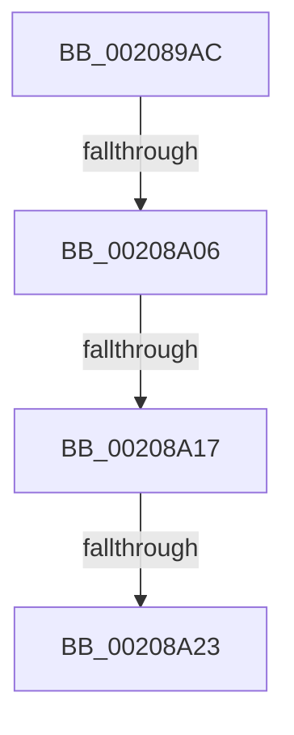

# sub_002089AC

- RVA: `0x002089AC`–`0x00208A2D` (길이 `129` bytes)
- VA: `0x00000001402089AC`
- 실행 섹션: `.text`
- PDB 이름 있음: `아니요`; PDB Function 태그: `아니요`
- unwind 정보 RVA: `0x0005D3C8`
- 디코드: `24`개 명령, `129/129` bytes 표시
- 미해석 바이트: `0` (있으면 어셈블리에 `.byte`로 보존)

> 이 문서는 커널 이미지의 기계어와 PDB 기호를 분석해 생성했습니다. 4번과 5번은 함수 원형과 자료형을 바이너리 사용 방식에서 추정한 C 해석이며 원본 소스 복구 결과는 아닙니다.

## 1. Dependencies

- 직접 호출 지점: **1**; 고유 호출 대상: **1**
- 직접 호출자로 확인된 함수: **0**
- RIP 상대 이미지 참조: **1**

### Outgoing calls
- `0x00208A23` → [KxWaitForSpinLockAndAcquire](KxWaitForSpinLockAndAcquire_function_002085C0.md) (function, `0x002085C0`)

### Direct callers
- 이 함수 시작 RVA로 연결되는 직접 call은 확인되지 않았습니다. 간접 호출은 완전히 역산할 수 없습니다.

### Static image references
- `0x00208A06` → RVA `0x00FC6B06` (`ALMOSTRO`; read)

## 2. Other-region calls and transfers

- 다른 실행 섹션으로 향하는 call: **0**
- call이 아닌 외부 분기/꼬리 이동: **4**
  - `0x00208A00` → [sub_00208A9F + 0x13](Unknown_function_00208A9F.md) (`tail-transfer`)
  - `0x00208A11` → [sub_00208A9F](Unknown_function_00208A9F.md) (`tail-transfer`)
  - `0x00208A1D` → [sub_00208A9F + 0x13](Unknown_function_00208A9F.md) (`tail-transfer`)
  - `0x00208A28` → [sub_00208A9F + 0x13](Unknown_function_00208A9F.md) (`tail-transfer`)

## 3. Assembly (complete function range)

```asm
002089AC  48 89 74 24 78                  mov qword ptr [rsp + 0x78], rsi
002089B1  48 8D B3 B0 00 00 00            lea rsi, [rbx + 0xb0]
002089B8  4C 89 64 24 40                  mov qword ptr [rsp + 0x40], r12
002089BD  4C 89 6C 24 38                  mov qword ptr [rsp + 0x38], r13
002089C2  4C 89 74 24 30                  mov qword ptr [rsp + 0x30], r14
002089C7  65 4C 8B 34 25 20 00 00 00      mov r14, qword ptr gs:[0x20]
002089D0  4D 8B A6 90 2D 00 00            mov r12, qword ptr [r14 + 0x2d90]
002089D7  44 88 BB E0 00 00 00            mov byte ptr [rbx + 0xe0], r15b
002089DE  49 89 B6 90 2D 00 00            mov qword ptr [r14 + 0x2d90], rsi
002089E5  0F 31                           rdtsc
002089E7  48 C1 E2 20                     shl rdx, 0x20
002089EB  48 0B C2                        or rax, rdx
002089EE  48 89 44 24 20                  mov qword ptr [rsp + 0x20], rax
002089F3  4C 8B E8                        mov r13, rax
002089F6  48 89 83 B8 00 00 00            mov qword ptr [rbx + 0xb8], rax
002089FD  40 84 ED                        test bpl, bpl
00208A00  0F 84 AC 00 00 00               je 0x140208ab2
00208A06  F6 05 F9 E0 DB 00 21            test byte ptr [rip + 0xdbe0f9], 0x21
00208A0D  48 8B 4B 48                     mov rcx, qword ptr [rbx + 0x48]
00208A11  0F 85 88 00 00 00               jne 0x140208a9f
00208A17  F0 48 0F BA 29 00               lock bts qword ptr [rcx], 0
00208A1D  0F 83 8F 00 00 00               jae 0x140208ab2
00208A23  E8 98 FB FF FF                  call 0x1402085c0
00208A28  E9 85 00 00 00                  jmp 0x140208ab2
```

## 4. C-style interpretation (structured pseudocode)

```c
__int64 __fastcall sub_002089AC(__int64 a1, __int64 a2)
{
    __int64 result;
    unsigned __int64 v_stack_p20;
    unsigned __int64 v_stack_p30;
    unsigned __int64 v_stack_p38;
    unsigned __int64 v_stack_p40;
    unsigned __int64 v_stack_p78;

    v_stack_p78 = v_rsi;
    v_stack_p40 = v_r12;
    v_stack_p38 = v_r13;
    v_stack_p30 = v_r14;
    *(unsigned __int8 *)(v_rbx + 224) = (unsigned __int8)(v_r15);
    *(unsigned __int64 *)(*(unsigned __int64 *)(gs_base + (0 + 32)) + 11664) = v_rbx + 176;
    a2 = (a2) << (32);
    result = (result) | (a2);
    v_stack_p20 = result;
    *(unsigned __int64 *)(v_rbx + 184) = result;
    result = KxWaitForSpinLockAndAcquire(*(unsigned __int64 *)(v_rbx + 72), a2, a3, a4);
}
```

## 5. (Beta) C Style

```c
int64_t sub_002089AC(int64_t Arg1, int64_t Arg2)
{
    int64_t result;
    uint64_t v_stack_p20;
    uint64_t v_stack_p30;
    uint64_t v_stack_p38;
    uint64_t v_stack_p40;
    uint64_t v_stack_p78;

    v_stack_p78 = local_rsi;
    v_stack_p40 = local_r12;
    v_stack_p38 = local_r13;
    v_stack_p30 = local_r14;
    *(uint8_t *)(local_rbx + 0xE0) = (uint8_t)(local_r15);
    *(uint64_t *)(*(uint64_t *)(gs_base + (0 + 0x20)) + 0x2D90) = local_rbx + 176;
    Arg2 = (Arg2) << (32);
    result = (result) | (Arg2);
    v_stack_p20 = result;
    *(uint64_t *)(local_rbx + 0xB8) = result;
    result = KxWaitForSpinLockAndAcquire(*(uint64_t *)(local_rbx + 0x48), Arg2, a3, a4);
}
```

## 6. Execution-region graph

[열기: 2D/3D 그래프와 함수 탐색 컨트롤 패널](../../../control-panel.html?section=text&rva=0x002089AC&view=graph)

- 2D 그래프는 위에서 아래로 흐르고, 3D 그래프는 빈 공간을 드래그해 회전합니다. Shift+드래그는 이동, 휠은 확대·축소, 함수 노드 선택은 대상 보고서 이동입니다.

### Static fallback


