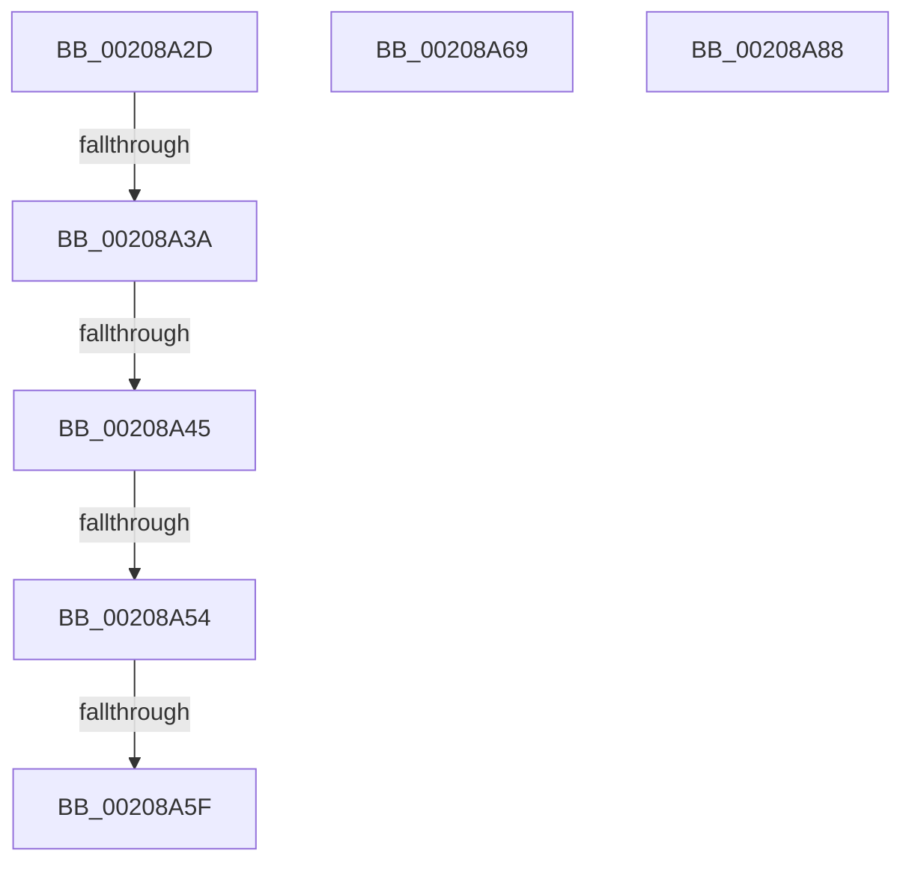

# sub_00208A2D

- RVA: `0x00208A2D`–`0x00208A89` (길이 `92` bytes)
- VA: `0x0000000140208A2D`
- 실행 섹션: `.text`
- PDB 이름 있음: `아니요`; PDB Function 태그: `아니요`
- unwind 정보 RVA: `0x0005D3E8`
- 디코드: `25`개 명령, `92/92` bytes 표시
- 미해석 바이트: `0` (있으면 어셈블리에 `.byte`로 보존)

> 이 문서는 커널 이미지의 기계어와 PDB 기호를 분석해 생성했습니다. 4번과 5번은 함수 원형과 자료형을 바이너리 사용 방식에서 추정한 C 해석이며 원본 소스 복구 결과는 아닙니다.

## 1. Dependencies

- 직접 호출 지점: **2**; 고유 호출 대상: **2**
- 직접 호출자로 확인된 함수: **0**
- RIP 상대 이미지 참조: **2**

### Outgoing calls
- `0x00208A5F` → [KiCheckAndRearmForceIdle](../3A/KiCheckAndRearmForceIdle_function_003A1C58.md) (function, `0x003A1C58`)
- `0x00208A74` → [guard_dispatch_icall](../6B/guard_dispatch_icall_function_006BAAD0.md) (function, `0x006BAAD0`)

### Direct callers
- 이 함수 시작 RVA로 연결되는 직접 call은 확인되지 않았습니다. 간접 호출은 완전히 역산할 수 없습니다.

### Static image references
- `0x00208A2D` → RVA `0x00FC6FF0` (`ALMOSTRO`; read)
- `0x00208A45` → RVA `0x00F233CC` (`.data`; read)

## 2. Other-region calls and transfers

- 다른 실행 섹션으로 향하는 call: **0**
- call이 아닌 외부 분기/꼬리 이동: **5**
  - `0x00208A34` → [KiCallInterruptServiceRoutine + 0x22](KiCallInterruptServiceRoutine_function_00208970.md) (`tail-transfer`)
  - `0x00208A3F` → [KiCallInterruptServiceRoutine + 0x22](KiCallInterruptServiceRoutine_function_00208970.md) (`tail-transfer`)
  - `0x00208A4E` → [sub_00208EAD](Unknown_function_00208EAD.md) (`tail-transfer`)
  - `0x00208A59` → [KiCallInterruptServiceRoutine + 0x22](KiCallInterruptServiceRoutine_function_00208970.md) (`tail-transfer`)
  - `0x00208A64` → [KiCallInterruptServiceRoutine + 0x22](KiCallInterruptServiceRoutine_function_00208970.md) (`tail-transfer`)

## 3. Assembly (complete function range)

```asm
00208A2D  83 3D BC E5 DB 00 00            cmp dword ptr [rip + 0xdbe5bc], 0
00208A34  0F 85 58 FF FF FF               jne 0x140208992
00208A3A  3D CF 00 00 00                  cmp eax, 0xcf
00208A3F  0F 87 4D FF FF FF               ja 0x140208992
00208A45  8B 05 81 A9 D1 00               mov eax, dword ptr [rip + 0xd1a981]
00208A4B  83 F8 04                        cmp eax, 4
00208A4E  0F 84 59 04 00 00               je 0x140208ead
00208A54  FF C8                           dec eax
00208A56  41 3B C7                        cmp eax, r15d
00208A59  0F 87 33 FF FF FF               ja 0x140208992
00208A5F  E8 F4 91 19 00                  call 0x1403a1c58
00208A64  E9 29 FF FF FF                  jmp 0x140208992
00208A69  48 8B 43 18                     mov rax, qword ptr [rbx + 0x18]
00208A6D  48 8B CB                        mov rcx, rbx
00208A70  48 8B 53 30                     mov rdx, qword ptr [rbx + 0x30]
00208A74  E8 57 20 4B 00                  call 0x1406baad0
00208A79  84 C0                           test al, al
00208A7B  0F 95 C0                        setne al
00208A7E  48 83 C4 48                     add rsp, 0x48
00208A82  41 5F                           pop r15
00208A84  5F                              pop rdi
00208A85  5D                              pop rbp
00208A86  5B                              pop rbx
00208A87  C3                              ret
00208A88  CC                              int3
```

## 4. C-style interpretation (structured pseudocode)

```c
__int64 __fastcall sub_00208A2D(void)
{
    __int64 result;

    result = (unsigned int)(((unsigned int)(*(unsigned int *)(v_rip + 13740417))) - 1);
    result = KiCheckAndRearmForceIdle(a1, a2, a3, a4);
}
```

## 5. (Beta) C Style

```c
void sub_00208A2D(void)
{
    int64_t result;

    result = (uint32_t)(((uint32_t)(*(uint32_t *)(v_rip + 0xD1A981))) - 1);
    result = KiCheckAndRearmForceIdle(a1, a2, a3, a4);
}
```

## 6. Execution-region graph

[열기: 2D/3D 그래프와 함수 탐색 컨트롤 패널](../../../control-panel.html?section=text&rva=0x00208A2D&view=graph)

- 2D 그래프는 위에서 아래로 흐르고, 3D 그래프는 빈 공간을 드래그해 회전합니다. Shift+드래그는 이동, 휠은 확대·축소, 함수 노드 선택은 대상 보고서 이동입니다.

### Static fallback


