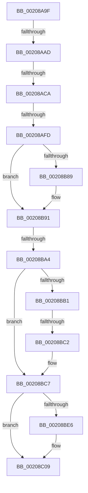

# sub_00208A9F

- RVA: `0x00208A9F`–`0x00208C2C` (길이 `397` bytes)
- VA: `0x0000000140208A9F`
- 실행 섹션: `.text`
- PDB 이름 있음: `아니요`; PDB Function 태그: `아니요`
- unwind 정보 RVA: `0x0005D424`
- 디코드: `82`개 명령, `397/397` bytes 표시
- 미해석 바이트: `0` (있으면 어셈블리에 `.byte`로 보존)

> 이 문서는 커널 이미지의 기계어와 PDB 기호를 분석해 생성했습니다. 4번과 5번은 함수 원형과 자료형을 바이너리 사용 방식에서 추정한 C 해석이며 원본 소스 복구 결과는 아닙니다.

## 1. Dependencies

- 직접 호출 지점: **4**; 고유 호출 대상: **4**
- 직접 호출자로 확인된 함수: **0**
- RIP 상대 이미지 참조: **8**

### Outgoing calls
- `0x00208AAD` → [KiAcquireSpinLockInstrumented](KiAcquireSpinLockInstrumented_function_002084F0.md) (function, `0x002084F0`)
- `0x00208AE4` → [HalpTimerGetInternalData](HalpTimerGetInternalData_function_00209500.md) (function, `0x00209500`)
- `0x00208B00` → [HalpHvTimerAcknowledgeInterrupt](HalpHvTimerAcknowledgeInterrupt_function_00208920.md) (function, `0x00208920`)
- `0x00208B29` → [RtlGetInterruptTimePrecise](RtlGetInterruptTimePrecise_function_0020A4C0.md) (function, `0x0020A4C0`)

### Direct callers
- 이 함수 시작 RVA로 연결되는 직접 call은 확인되지 않았습니다. 간접 호출은 완전히 역산할 수 없습니다.

### Static image references
- `0x00208A9F` → RVA `0x00F0DE58` (`.data`; read)
- `0x00208AB6` → RVA `0x002086A0` (`HalpTimerClockInterrupt`; read)
- `0x00208AD1` → RVA `0x00FC40F0` (`.data`; read)
- `0x00208AED` → RVA `0x00208920` (`HalpHvTimerAcknowledgeInterrupt`; read)
- `0x00208B05` → RVA `0x00E0A838` (`.data`; read/write)
- `0x00208B15` → RVA `0x00F8FC60` (`.data`; read)
- `0x00208B3C` → RVA `0x00F21FB0` (`.data`; read)
- `0x00208BB1` → RVA `0x00FC6B06` (`ALMOSTRO`; read)

## 2. Other-region calls and transfers

- 다른 실행 섹션으로 향하는 call: **0**
- call이 아닌 외부 분기/꼬리 이동: **6**
  - `0x00208AA7` → [sub_002089AC + 0x6B](Unknown_function_002089AC.md) (`tail-transfer`)
  - `0x00208AC4` → [sub_00208E4A + 0x26](Unknown_function_00208E4A.md) (`tail-transfer`)
  - `0x00208AF7` → [sub_00208E4A](Unknown_function_00208E4A.md) (`tail-transfer`)
  - `0x00208B9E` → [sub_00208C94](Unknown_function_00208C94.md) (`tail-transfer`)
  - `0x00208BBC` → [sub_00208E4A + 0x46](Unknown_function_00208E4A.md) (`tail-transfer`)
  - `0x00208C2A` → [sub_00208C2C + 0x14](Unknown_function_00208C2C.md) (`tail-transfer`)

## 3. Assembly (complete function range)

```asm
00208A9F  8B 15 B3 53 D0 00               mov edx, dword ptr [rip + 0xd053b3]
00208AA5  85 D2                           test edx, edx
00208AA7  0F 85 6A FF FF FF               jne 0x140208a17
00208AAD  E8 3E FA FF FF                  call 0x1402084f0
00208AB2  48 8B 43 18                     mov rax, qword ptr [rbx + 0x18]
00208AB6  48 8D 0D E3 FB FF FF            lea rcx, [rip - 0x41d]
00208ABD  48 8B 53 30                     mov rdx, qword ptr [rbx + 0x30]
00208AC1  48 3B C1                        cmp rax, rcx
00208AC4  0F 85 A6 03 00 00               jne 0x140208e70
00208ACA  4C 8B AB 88 00 00 00            mov r13, qword ptr [rbx + 0x88]
00208AD1  48 8B 3D 18 B6 DB 00            mov rdi, qword ptr [rip + 0xdbb618]
00208AD8  48 8B CF                        mov rcx, rdi
00208ADB  41 0F B6 45 29                  movzx eax, byte ptr [r13 + 0x29]
00208AE0  88 44 24 70                     mov byte ptr [rsp + 0x70], al
00208AE4  E8 17 0A 00 00                  call 0x140209500
00208AE9  48 8B 57 78                     mov rdx, qword ptr [rdi + 0x78]
00208AED  48 8D 0D 2C FE FF FF            lea rcx, [rip - 0x1d4]
00208AF4  48 3B D1                        cmp rdx, rcx
00208AF7  0F 85 4D 03 00 00               jne 0x140208e4a
00208AFD  48 8B C8                        mov rcx, rax
00208B00  E8 1B FE FF FF                  call 0x140208920
00208B05  F0 44 0F C1 3D 2A 1D C0 00      lock xadd dword ptr [rip + 0xc01d2a], r15d
00208B0E  41 8D 47 01                     lea eax, [r15 + 1]
00208B12  83 E0 0F                        and eax, 0xf
00208B15  48 8D 0D 44 71 D8 00            lea rcx, [rip + 0xd87144]
00208B1C  48 8D 04 40                     lea rax, [rax + rax*2]
00208B20  48 8D 3C C1                     lea rdi, [rcx + rax*8]
00208B24  48 8D 4C 24 28                  lea rcx, [rsp + 0x28]
00208B29  E8 92 19 00 00                  call 0x14020a4c0
00208B2E  48 89 07                        mov qword ptr [rdi], rax
00208B31  65 8B 04 25 A4 01 00 00         mov eax, dword ptr gs:[0x1a4]
00208B39  89 47 08                        mov dword ptr [rdi + 8], eax
00208B3C  8B 05 6E 94 D1 00               mov eax, dword ptr [rip + 0xd1946e]
00208B42  89 47 0C                        mov dword ptr [rdi + 0xc], eax
00208B45  C6 47 10 00                     mov byte ptr [rdi + 0x10], 0
00208B49  65 48 8B 04 25 20 00 00 00      mov rax, qword ptr gs:[0x20]
00208B52  0F B6 48 22                     movzx ecx, byte ptr [rax + 0x22]
00208B56  0F B6 C1                        movzx eax, cl
00208B59  80 E1 01                        and cl, 1
00208B5C  24 01                           and al, 1
00208B5E  88 47 10                        mov byte ptr [rdi + 0x10], al
00208B61  65 48 8B 04 25 20 00 00 00      mov rax, qword ptr gs:[0x20]
00208B6A  44 0F B6 40 22                  movzx r8d, byte ptr [rax + 0x22]
00208B6F  41 80 E0 02                     and r8b, 2
00208B73  44 0A C1                        or r8b, cl
00208B76  44 88 47 10                     mov byte ptr [rdi + 0x10], r8b
00208B7A  65 48 8B 04 25 20 00 00 00      mov rax, qword ptr gs:[0x20]
00208B83  80 78 21 00                     cmp byte ptr [rax + 0x21], 0
00208B87  74 08                           je 0x140208b91
00208B89  41 80 C8 04                     or r8b, 4
00208B8D  44 88 47 10                     mov byte ptr [rdi + 0x10], r8b
00208B91  65 48 8B 04 25 20 00 00 00      mov rax, qword ptr gs:[0x20]
00208B9A  F6 40 22 01                     test byte ptr [rax + 0x22], 1
00208B9E  0F 85 F0 00 00 00               jne 0x140208c94
00208BA4  4C 8B 6C 24 20                  mov r13, qword ptr [rsp + 0x20]
00208BA9  40 B7 01                        mov dil, 1
00208BAC  40 84 ED                        test bpl, bpl
00208BAF  74 16                           je 0x140208bc7
00208BB1  F6 05 4E DF DB 00 01            test byte ptr [rip + 0xdbdf4e], 1
00208BB8  48 8B 4B 48                     mov rcx, qword ptr [rbx + 0x48]
00208BBC  0F 85 CE 02 00 00               jne 0x140208e90
00208BC2  F0 48 83 21 00                  lock and qword ptr [rcx], 0
00208BC7  0F 31                           rdtsc
00208BC9  48 C1 E2 20                     shl rdx, 0x20
00208BCD  48 0B C2                        or rax, rdx
00208BD0  41 8B 96 EC 83 00 00            mov edx, dword ptr [r14 + 0x83ec]
00208BD7  48 8B C8                        mov rcx, rax
00208BDA  48 2B 8B B8 00 00 00            sub rcx, qword ptr [rbx + 0xb8]
00208BE1  3B 56 38                        cmp edx, dword ptr [rsi + 0x38]
00208BE4  74 23                           je 0x140208c09
00208BE6  89 56 38                        mov dword ptr [rsi + 0x38], edx
00208BE9  48 C7 46 40 00 00 00 00         mov qword ptr [rsi + 0x40], 0
00208BF1  48 C7 46 48 00 00 00 00         mov qword ptr [rsi + 0x48], 0
00208BF9  48 C7 46 50 00 00 00 00         mov qword ptr [rsi + 0x50], 0
00208C01  48 C7 46 58 00 00 00 00         mov qword ptr [rsi + 0x58], 0
00208C09  48 01 0E                        add qword ptr [rsi], rcx
00208C0C  48 01 8B F0 00 00 00            add qword ptr [rbx + 0xf0], rcx
00208C13  48 FF 83 C0 00 00 00            inc qword ptr [rbx + 0xc0]
00208C1A  48 FF 83 F8 00 00 00            inc qword ptr [rbx + 0xf8]
00208C21  48 8B 74 24 78                  mov rsi, qword ptr [rsp + 0x78]
00208C26  49 83 FC 01                     cmp r12, 1
00208C2A  74 14                           je 0x140208c40
```

## 4. C-style interpretation (structured pseudocode)

```c
__int64 __fastcall sub_00208A9F(__int64 a1, __int64 a2, __int64 a3, __int64 a4, __int64 a5, __int64 a6, __int64 a7, __int64 a8, __int64 a9, __int64 a10, __int64 a11, __int64 a12, __int64 a13, __int64 a14, __int64 a15)
{
    __int64 result;
    unsigned __int64 v_stack_p20;
    unsigned __int8 v_stack_p70;

    result = KiAcquireSpinLockInstrumented(a1, (unsigned int)(*(unsigned int *)(v_rip + 13652915)), a3, a4);
    v_stack_p70 = (unsigned __int8)(*(unsigned __int8 *)(*(unsigned __int64 *)(v_rbx + 136) + 41));
    result = HalpTimerGetInternalData(*(unsigned __int64 *)(v_rip + 14399000), *(unsigned __int64 *)(v_rbx + 48), a3, a4);
    result = HalpHvTimerAcknowledgeInterrupt(result, *(unsigned __int64 *)(*(unsigned __int64 *)(v_rip + 14399000) + 120), a3, a4);
    result = (unsigned int)((v_r15 + 1) & (15));
    result = RtlGetInterruptTimePrecise(a5, *(unsigned __int64 *)(*(unsigned __int64 *)(v_rip + 14399000) + 120), a3, a4);
    *(unsigned __int64 *)(v_rip + 14184772 + result + result * 2 * 8) = result;
    *(unsigned int *)(v_rip + 14184772 + result + result * 2 * 8 + 8) = (unsigned int)((unsigned int)(*(unsigned int *)(gs_base + (0 + 420))));
    *(unsigned int *)(v_rip + 14184772 + result + result * 2 * 8 + 12) = (unsigned int)((unsigned int)(*(unsigned int *)(v_rip + 13735022)));
    *(unsigned __int8 *)(v_rip + 14184772 + result + result * 2 * 8 + 16) = 0;
    a1 = (unsigned __int8)((*(unsigned __int8 *)(*(unsigned __int64 *)(gs_base + (0 + 32)) + 34)) & (1));
    result = (unsigned __int8)(((unsigned __int8)(*(unsigned __int8 *)(*(unsigned __int64 *)(gs_base + (0 + 32)) + 34))) & (1));
    *(unsigned __int8 *)(v_rip + 14184772 + result + result * 2 * 8 + 16) = (unsigned __int8)(result);
    a3 = (unsigned __int8)((*(unsigned __int8 *)(*(unsigned __int64 *)(gs_base + (0 + 32)) + 34)) & (2));
    a3 = (unsigned __int8)((a3) | ((unsigned __int8)(a1)));
    *(unsigned __int8 *)(v_rip + 14184772 + result + result * 2 * 8 + 16) = (unsigned __int8)(a3);
    if ((*(unsigned __int8 *)(*(unsigned __int64 *)(gs_base + (0 + 32)) + 33)) != 0) {
        a3 = (unsigned __int8)((a3) | (4));
        *(unsigned __int8 *)(v_rip + 14184772 + result + result * 2 * 8 + 16) = (unsigned __int8)(a3);
    }
    if ((unsigned __int8)(v_rbp) == 0) goto loc_00208BC7;
loc_00208BC7:
    a2 = (*(unsigned __int64 *)(*(unsigned __int64 *)(v_rip + 14399000) + 120)) << (32);
    result = (*(unsigned __int64 *)(gs_base + (0 + 32))) | (a2);
    a1 = (result) - (*(unsigned __int64 *)(v_rbx + 184));
    if (((unsigned int)((unsigned int)(*(unsigned int *)(v_r14 + 33772)))) != (*(unsigned int *)(v_rsi + 56))) {
        *(unsigned int *)(v_rsi + 56) = (unsigned int)((unsigned int)(*(unsigned int *)(v_r14 + 33772)));
        *(unsigned __int64 *)(v_rsi + 64) = 0;
        *(unsigned __int64 *)(v_rsi + 72) = 0;
        *(unsigned __int64 *)(v_rsi + 80) = 0;
        *(unsigned __int64 *)(v_rsi + 88) = 0;
    }
}
```

## 5. (Beta) C Style

```c
int64_t sub_00208A9F(int64_t Arg1, int64_t Arg2, int64_t Arg3, int64_t Arg4, int64_t Arg5, uint64_t Arg6, uint64_t Arg7, uint64_t Arg8, uint64_t Arg9, uint64_t Arg10, uint64_t Arg11, uint64_t Arg12, uint64_t Arg13, uint64_t Arg14, int64_t Arg15)
{
    int64_t result;
    uint64_t v_stack_p20;
    uint8_t v_stack_p70;

    result = KiAcquireSpinLockInstrumented(Arg1, (uint32_t)(*(uint32_t *)(v_rip + 0xD053B3)), Arg3, Arg4);
    v_stack_p70 = (uint8_t)(*(uint8_t *)(*(uint64_t *)(local_rbx + 0x88) + 0x29));
    result = HalpTimerGetInternalData(*(uint64_t *)(v_rip + 0xDBB618), *(uint64_t *)(local_rbx + 0x30), Arg3, Arg4);
    result = HalpHvTimerAcknowledgeInterrupt(result, *(uint64_t *)(*(uint64_t *)(v_rip + 0xDBB618) + 0x78), Arg3, Arg4);
    result = (uint32_t)((local_r15 + 1) & (15));
    result = RtlGetInterruptTimePrecise(Arg5, *(uint64_t *)(*(uint64_t *)(v_rip + 0xDBB618) + 0x78), Arg3, Arg4);
    *(uint64_t *)(v_rip + 0xD87144 + result + result * 2 * 8) = result;
    *(uint32_t *)(v_rip + 0xD87144 + result + result * 2 * 8 + 0x8) = (uint32_t)((uint32_t)(*(uint32_t *)(gs_base + (0 + 0x1A4))));
    *(uint32_t *)(v_rip + 0xD87144 + result + result * 2 * 8 + 0xC) = (uint32_t)((uint32_t)(*(uint32_t *)(v_rip + 0xD1946E)));
    *(uint8_t *)(v_rip + 0xD87144 + result + result * 2 * 8 + 0x10) = 0;
    Arg1 = (uint8_t)((*(uint8_t *)(*(uint64_t *)(gs_base + (0 + 0x20)) + 0x22)) & (1));
    result = (uint8_t)(((uint8_t)(*(uint8_t *)(*(uint64_t *)(gs_base + (0 + 0x20)) + 0x22))) & (1));
    *(uint8_t *)(v_rip + 0xD87144 + result + result * 2 * 8 + 0x10) = (uint8_t)(result);
    Arg3 = (uint8_t)((*(uint8_t *)(*(uint64_t *)(gs_base + (0 + 0x20)) + 0x22)) & (2));
    Arg3 = (uint8_t)((Arg3) | ((uint8_t)(Arg1)));
    *(uint8_t *)(v_rip + 0xD87144 + result + result * 2 * 8 + 0x10) = (uint8_t)(Arg3);
    if ((*(uint8_t *)(*(uint64_t *)(gs_base + (0 + 0x20)) + 0x21)) != 0) {
        Arg3 = (uint8_t)((Arg3) | (4));
        *(uint8_t *)(v_rip + 0xD87144 + result + result * 2 * 8 + 0x10) = (uint8_t)(Arg3);
    }
    if ((uint8_t)(local_rbp) == 0) goto loc_00208BC7;
loc_00208BC7:
    Arg2 = (*(uint64_t *)(*(uint64_t *)(v_rip + 0xDBB618) + 0x78)) << (32);
    result = (*(uint64_t *)(gs_base + (0 + 0x20))) | (Arg2);
    Arg1 = (result) - (*(uint64_t *)(local_rbx + 0xB8));
    if (((uint32_t)((uint32_t)(*(uint32_t *)(local_r14 + 0x83EC)))) != (*(uint32_t *)(local_rsi + 0x38))) {
        *(uint32_t *)(local_rsi + 0x38) = (uint32_t)((uint32_t)(*(uint32_t *)(local_r14 + 0x83EC)));
        *(uint64_t *)(local_rsi + 0x40) = 0;
        *(uint64_t *)(local_rsi + 0x48) = 0;
        *(uint64_t *)(local_rsi + 0x50) = 0;
        *(uint64_t *)(local_rsi + 0x58) = 0;
    }
}
```

## 6. Execution-region graph

[열기: 2D/3D 그래프와 함수 탐색 컨트롤 패널](../../../control-panel.html?section=text&rva=0x00208A9F&view=graph)

- 2D 그래프는 위에서 아래로 흐르고, 3D 그래프는 빈 공간을 드래그해 회전합니다. Shift+드래그는 이동, 휠은 확대·축소, 함수 노드 선택은 대상 보고서 이동입니다.

### Static fallback


