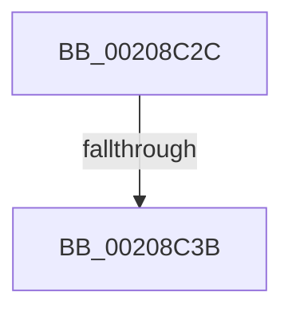

# sub_00208C2C

- RVA: `0x00208C2C`–`0x00208C68` (길이 `60` bytes)
- VA: `0x0000000140208C2C`
- 실행 섹션: `.text`
- PDB 이름 있음: `아니요`; PDB Function 태그: `아니요`
- unwind 정보 RVA: `0x0005D444`
- 디코드: `11`개 명령, `60/60` bytes 표시
- 미해석 바이트: `0` (있으면 어셈블리에 `.byte`로 보존)

> 이 문서는 커널 이미지의 기계어와 PDB 기호를 분석해 생성했습니다. 4번과 5번은 함수 원형과 자료형을 바이너리 사용 방식에서 추정한 C 해석이며 원본 소스 복구 결과는 아닙니다.

## 1. Dependencies

- 직접 호출 지점: **0**; 고유 호출 대상: **0**
- 직접 호출자로 확인된 함수: **0**
- RIP 상대 이미지 참조: **1**

### Outgoing calls
- 직접 디코드된 call 명령이 없습니다.

### Direct callers
- 이 함수 시작 RVA로 연결되는 직접 call은 확인되지 않았습니다. 간접 호출은 완전히 역산할 수 없습니다.

### Static image references
- `0x00208C58` → RVA `0x00F10850` (`.data`; read)

## 2. Other-region calls and transfers

- 다른 실행 섹션으로 향하는 call: **0**
- call이 아닌 외부 분기/꼬리 이동: **2**
  - `0x00208C35` → [sub_00208D8F](Unknown_function_00208D8F.md) (`tail-transfer`)
  - `0x00208C62` → [sub_00208A89](Unknown_function_00208A89.md) (`tail-transfer`)

## 3. Assembly (complete function range)

```asm
00208C2C  49 2B C5                        sub rax, r13
00208C2F  41 80 7C 24 30 00               cmp byte ptr [r12 + 0x30], 0
00208C35  0F 85 54 01 00 00               jne 0x140208d8f
00208C3B  49 01 44 24 20                  add qword ptr [r12 + 0x20], rax
00208C40  4C 8B 6C 24 38                  mov r13, qword ptr [rsp + 0x38]
00208C45  4D 89 A6 90 2D 00 00            mov qword ptr [r14 + 0x2d90], r12
00208C4C  4C 8B 64 24 40                  mov r12, qword ptr [rsp + 0x40]
00208C51  C6 83 E0 00 00 00 00            mov byte ptr [rbx + 0xe0], 0
00208C58  48 8B 05 F1 7B D0 00            mov rax, qword ptr [rip + 0xd07bf1]
00208C5F  4C 3B F0                        cmp r14, rax
00208C62  0F 85 21 FE FF FF               jne 0x140208a89
```

## 4. C-style interpretation (structured pseudocode)

```c
__int64 __fastcall sub_00208C2C(__int64 a1, __int64 a2, __int64 a3, __int64 a4, __int64 a5, __int64 a6, __int64 a7, __int64 a8)
{
    __int64 result;

    result = (result) - (v_r13);
    *(unsigned __int64 *)(v_r14 + 11664) = v_r12;
    *(unsigned __int8 *)(v_rbx + 224) = 0;
}
```

## 5. (Beta) C Style

```c
int64_t sub_00208C2C(int64_t Arg1, int64_t Arg2, int64_t Arg3, int64_t Arg4, uint64_t Arg5, uint64_t Arg6, int64_t Arg7, int64_t Arg8)
{
    int64_t result;

    result = (result) - (local_r13);
    *(uint64_t *)(local_r14 + 0x2D90) = local_r12;
    *(uint8_t *)(local_rbx + 0xE0) = 0;
}
```

## 6. Execution-region graph

[열기: 2D/3D 그래프와 함수 탐색 컨트롤 패널](../../../control-panel.html?section=text&rva=0x00208C2C&view=graph)

- 2D 그래프는 위에서 아래로 흐르고, 3D 그래프는 빈 공간을 드래그해 회전합니다. Shift+드래그는 이동, 휠은 확대·축소, 함수 노드 선택은 대상 보고서 이동입니다.

### Static fallback


