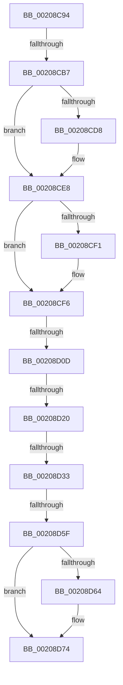

# sub_00208C94

- RVA: `0x00208C94`–`0x00208D8F` (길이 `251` bytes)
- VA: `0x0000000140208C94`
- 실행 섹션: `.text`
- PDB 이름 있음: `아니요`; PDB Function 태그: `아니요`
- unwind 정보 RVA: `0x0005D474`
- 디코드: `48`개 명령, `251/251` bytes 표시
- 미해석 바이트: `0` (있으면 어셈블리에 `.byte`로 보존)

> 이 문서는 커널 이미지의 기계어와 PDB 기호를 분석해 생성했습니다. 4번과 5번은 함수 원형과 자료형을 바이너리 사용 방식에서 추정한 C 해석이며 원본 소스 복구 결과는 아닙니다.

## 1. Dependencies

- 직접 호출 지점: **4**; 고유 호출 대상: **4**
- 직접 호출자로 확인된 함수: **0**
- RIP 상대 이미지 참조: **6**

### Outgoing calls
- `0x00208C9F` → [KeClockInterruptNotify](../39/KeClockInterruptNotify_function_0039A970.md) (function, `0x0039A970`)
- `0x00208CF1` → [HalpTimerClockInterruptWork](../39/HalpTimerClockInterruptWork_function_0039B310.md) (function, `0x0039B310`)
- `0x00208D6F` → [guard_dispatch_icall](../6B/guard_dispatch_icall_function_006BAAD0.md) (function, `0x006BAAD0`)
- `0x00208D77` → [HalpScanForProfilingCorruption](../44/HalpScanForProfilingCorruption_function_00445A00.md) (function, `0x00445A00`)

### Direct callers
- 이 함수 시작 RVA로 연결되는 직접 call은 확인되지 않았습니다. 간접 호출은 완전히 역산할 수 없습니다.

### Static image references
- `0x00208CB7` → RVA `0x00FC40F0` (`.data`; read)
- `0x00208CDE` → RVA `0x00FC22E1` (`.data`; write)
- `0x00208CE8` → RVA `0x00FC22E0` (`.data`; read)
- `0x00208CFF` → RVA `0x00FC4028` (`.data`; read)
- `0x00208D3C` → RVA `0x00FC2C30` (`.data`; read)
- `0x00208D64` → RVA `0x00E00A38` (`.data`; read)

## 2. Other-region calls and transfers

- 다른 실행 섹션으로 향하는 call: **0**
- call이 아닌 외부 분기/꼬리 이동: **6**
  - `0x00208CB1` → [sub_00208A9F + 0x105](Unknown_function_00208A9F.md) (`tail-transfer`)
  - `0x00208D07` → [sub_00208D99](Unknown_function_00208D99.md) (`tail-transfer`)
  - `0x00208D1A` → [sub_00208A9F + 0x105](Unknown_function_00208A9F.md) (`tail-transfer`)
  - `0x00208D2D` → [sub_00208A9F + 0x105](Unknown_function_00208A9F.md) (`tail-transfer`)
  - `0x00208D59` → [sub_00208A9F + 0x105](Unknown_function_00208A9F.md) (`tail-transfer`)
  - `0x00208D8A` → [sub_00208A9F + 0x105](Unknown_function_00208A9F.md) (`tail-transfer`)

## 3. Assembly (complete function range)

```asm
00208C94  0F B6 54 24 70                  movzx edx, byte ptr [rsp + 0x70]
00208C99  45 33 C0                        xor r8d, r8d
00208C9C  49 8B CD                        mov rcx, r13
00208C9F  E8 CC 1C 19 00                  call 0x14039a970
00208CA4  65 48 8B 04 25 20 00 00 00      mov rax, qword ptr gs:[0x20]
00208CAD  80 78 21 00                     cmp byte ptr [rax + 0x21], 0
00208CB1  0F 84 ED FE FF FF               je 0x140208ba4
00208CB7  48 8B 0D 32 B4 DB 00            mov rcx, qword ptr [rip + 0xdbb432]
00208CBE  49 BD 08 00 00 00 80 F7 FF FF   movabs r13, 0xfffff78000000008
00208CC8  49 8B 55 00                     mov rdx, qword ptr [r13]
00208CCC  8B 41 3C                        mov eax, dword ptr [rcx + 0x3c]
00208CCF  2B C2                           sub eax, edx
00208CD1  3D 00 8C 86 47                  cmp eax, 0x47868c00
00208CD6  76 10                           jbe 0x140208ce8
00208CD8  8D 82 00 8C 86 47               lea eax, [rdx + 0x47868c00]
00208CDE  C6 05 FC 95 DB 00 01            mov byte ptr [rip + 0xdb95fc], 1
00208CE5  89 41 3C                        mov dword ptr [rcx + 0x3c], eax
00208CE8  83 3D F1 95 DB 00 00            cmp dword ptr [rip + 0xdb95f1], 0
00208CEF  74 05                           je 0x140208cf6
00208CF1  E8 1A 26 19 00                  call 0x14039b310
00208CF6  65 48 8B 04 25 20 00 00 00      mov rax, qword ptr gs:[0x20]
00208CFF  48 83 3D 21 B3 DB 00 00         cmp qword ptr [rip + 0xdbb321], 0
00208D07  0F 85 8C 00 00 00               jne 0x140208d99
00208D0D  65 48 8B 04 25 20 00 00 00      mov rax, qword ptr gs:[0x20]
00208D16  83 78 60 00                     cmp dword ptr [rax + 0x60], 0
00208D1A  0F 8E 84 FE FF FF               jle 0x140208ba4
00208D20  65 48 8B 04 25 20 00 00 00      mov rax, qword ptr gs:[0x20]
00208D29  F6 40 60 01                     test byte ptr [rax + 0x60], 1
00208D2D  0F 85 71 FE FF FF               jne 0x140208ba4
00208D33  65 44 8B 3C 25 A4 01 00 00      mov r15d, dword ptr gs:[0x1a4]
00208D3C  48 8B 05 ED 9E DB 00            mov rax, qword ptr [rip + 0xdb9eed]
00208D43  4B 8D 0C 7F                     lea rcx, [r15 + r15*2]
00208D47  48 8D 3C C8                     lea rdi, [rax + rcx*8]
00208D4B  49 8B 45 00                     mov rax, qword ptr [r13]
00208D4F  48 2B 47 10                     sub rax, qword ptr [rdi + 0x10]
00208D53  48 3D 40 4B 4C 00               cmp rax, 0x4c4b40
00208D59  0F 82 45 FE FF FF               jb 0x140208ba4
00208D5F  48 39 3F                        cmp qword ptr [rdi], rdi
00208D62  74 10                           je 0x140208d74
00208D64  48 8B 05 CD 7C BF 00            mov rax, qword ptr [rip + 0xbf7ccd]
00208D6B  33 D2                           xor edx, edx
00208D6D  33 C9                           xor ecx, ecx
00208D6F  E8 5C 1D 4B 00                  call 0x1406baad0
00208D74  41 8B CF                        mov ecx, r15d
00208D77  E8 84 CC 23 00                  call 0x140445a00
00208D7C  48 A1 08 00 00 00 80 F7 FF FF   movabs rax, qword ptr [0xfffff78000000008]
00208D86  48 89 47 10                     mov qword ptr [rdi + 0x10], rax
00208D8A  E9 15 FE FF FF                  jmp 0x140208ba4
```

## 4. C-style interpretation (structured pseudocode)

```c
__int64 __fastcall sub_00208C94(__int64 a1, __int64 a2, int a3, __int64 a4, __int64 a5, __int64 a6, __int64 a7, __int64 a8, __int64 a9, __int64 a10, __int64 a11, __int64 a12, __int64 a13, unsigned __int8 a14)
{
    __int64 result;

    a3 = 0;
    result = KeClockInterruptNotify(v_r13, a14, a3, a4);
    result = (unsigned int)(((unsigned int)(*(unsigned int *)(*(unsigned __int64 *)(v_rip + 14398514) + 60))) - ((unsigned int)(*(unsigned __int64 *)(v_r13))));
    if (((unsigned int)(result)) >= = 0x47868C00ULL) {
        result = *(unsigned __int64 *)(v_r13) + 1200000000;
        *(unsigned __int8 *)(v_rip + 14390780) = 1;
        *(unsigned int *)(*(unsigned __int64 *)(v_rip + 14398514) + 60) = (unsigned int)(result);
    }
    if ((*(unsigned int *)(v_rip + 14390769)) != 0) {
        result = HalpTimerClockInterruptWork(*(unsigned __int64 *)(v_rip + 14398514), *(unsigned __int64 *)(v_r13), a3, a4);
    }
    result = (*(unsigned __int64 *)(v_r13)) - (*(unsigned __int64 *)(*(unsigned __int64 *)(v_rip + 14393069) + (unsigned int)(*(unsigned int *)(gs_base + (0 + 420))) + (unsigned int)(*(unsigned int *)(gs_base + (0 + 420))) * 2 * 8 + 16));
    if ((*(unsigned __int64 *)(*(unsigned __int64 *)(v_rip + 14393069) + (unsigned int)(*(unsigned int *)(gs_base + (0 + 420))) + (unsigned int)(*(unsigned int *)(gs_base + (0 + 420))) * 2 * 8)) != (*(unsigned __int64 *)(v_rip + 14393069) + (unsigned int)(*(unsigned int *)(gs_base + (0 + 420))) + (unsigned int)(*(unsigned int *)(gs_base + (0 + 420))) * 2 * 8)) {
        result = *(unsigned __int64 *)(v_rip + 12549325);
        a2 = 0;
        a1 = 0;
        result = guard_dispatch_icall(a1, a2, a3, a4);
    }
    result = HalpScanForProfilingCorruption((unsigned int)((unsigned int)((unsigned int)(*(unsigned int *)(gs_base + (0 + 420))))), a2, a3, a4);
    *(unsigned __int64 *)(*(unsigned __int64 *)(v_rip + 14393069) + (unsigned int)(*(unsigned int *)(gs_base + (0 + 420))) + (unsigned int)(*(unsigned int *)(gs_base + (0 + 420))) * 2 * 8 + 16) = result;
}
```

## 5. (Beta) C Style

```c
int64_t sub_00208C94(int64_t Arg1, int64_t Arg2, int32_t Arg3, int64_t Arg4, uint64_t Arg5, uint64_t Arg6, uint64_t Arg7, uint64_t Arg8, uint64_t Arg9, uint64_t Arg10, uint64_t Arg11, uint64_t Arg12, uint64_t Arg13, uint8_t Arg14)
{
    int64_t result;

    Arg3 = 0;
    result = KeClockInterruptNotify(local_r13, Arg14, Arg3, Arg4);
    result = (uint32_t)(((uint32_t)(*(uint32_t *)(*(uint64_t *)(v_rip + 0xDBB432) + 0x3C))) - ((uint32_t)(*(uint64_t *)(local_r13))));
    if (((uint32_t)(result)) >= = 0x47868C00ULL) {
        result = *(uint64_t *)(local_r13) + 1200000000;
        *(uint8_t *)(v_rip + 0xDB95FC) = 1;
        *(uint32_t *)(*(uint64_t *)(v_rip + 0xDBB432) + 0x3C) = (uint32_t)(result);
    }
    if ((*(uint32_t *)(v_rip + 0xDB95F1)) != 0) {
        result = HalpTimerClockInterruptWork(*(uint64_t *)(v_rip + 0xDBB432), *(uint64_t *)(local_r13), Arg3, Arg4);
    }
    result = (*(uint64_t *)(local_r13)) - (*(uint64_t *)(*(uint64_t *)(v_rip + 0xDB9EED) + (uint32_t)(*(uint32_t *)(gs_base + (0 + 0x1A4))) + (uint32_t)(*(uint32_t *)(gs_base + (0 + 0x1A4))) * 2 * 8 + 0x10));
    if ((*(uint64_t *)(*(uint64_t *)(v_rip + 0xDB9EED) + (uint32_t)(*(uint32_t *)(gs_base + (0 + 0x1A4))) + (uint32_t)(*(uint32_t *)(gs_base + (0 + 0x1A4))) * 2 * 8)) != (*(uint64_t *)(v_rip + 0xDB9EED) + (uint32_t)(*(uint32_t *)(gs_base + (0 + 0x1A4))) + (uint32_t)(*(uint32_t *)(gs_base + (0 + 0x1A4))) * 2 * 8)) {
        result = *(uint64_t *)(v_rip + 0xBF7CCD);
        Arg2 = 0;
        Arg1 = 0;
        result = guard_dispatch_icall(Arg1, Arg2, Arg3, Arg4);
    }
    result = HalpScanForProfilingCorruption((uint32_t)((uint32_t)((uint32_t)(*(uint32_t *)(gs_base + (0 + 0x1A4))))), Arg2, Arg3, Arg4);
    *(uint64_t *)(*(uint64_t *)(v_rip + 0xDB9EED) + (uint32_t)(*(uint32_t *)(gs_base + (0 + 0x1A4))) + (uint32_t)(*(uint32_t *)(gs_base + (0 + 0x1A4))) * 2 * 8 + 0x10) = result;
}
```

## 6. Execution-region graph

[열기: 2D/3D 그래프와 함수 탐색 컨트롤 패널](../../../control-panel.html?section=text&rva=0x00208C94&view=graph)

- 2D 그래프는 위에서 아래로 흐르고, 3D 그래프는 빈 공간을 드래그해 회전합니다. Shift+드래그는 이동, 휠은 확대·축소, 함수 노드 선택은 대상 보고서 이동입니다.

### Static fallback


