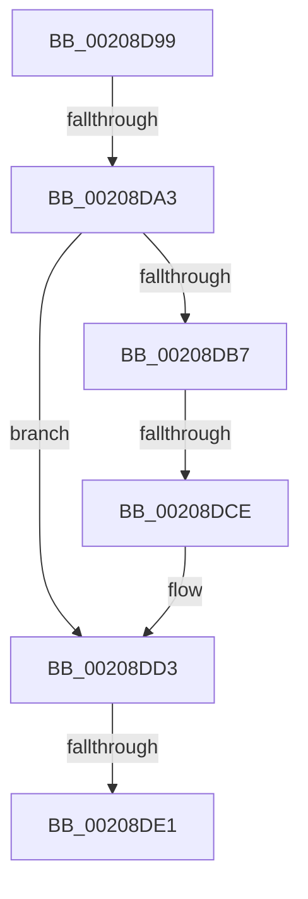

# sub_00208D99

- RVA: `0x00208D99`–`0x00208DED` (길이 `84` bytes)
- VA: `0x0000000140208D99`
- 실행 섹션: `.text`
- PDB 이름 있음: `아니요`; PDB Function 태그: `아니요`
- unwind 정보 RVA: `0x0005D4B0`
- 디코드: `16`개 명령, `84/84` bytes 표시
- 미해석 바이트: `0` (있으면 어셈블리에 `.byte`로 보존)

> 이 문서는 커널 이미지의 기계어와 PDB 기호를 분석해 생성했습니다. 4번과 5번은 함수 원형과 자료형을 바이너리 사용 방식에서 추정한 C 해석이며 원본 소스 복구 결과는 아닙니다.

## 1. Dependencies

- 직접 호출 지점: **2**; 고유 호출 대상: **2**
- 직접 호출자로 확인된 함수: **0**
- RIP 상대 이미지 참조: **4**

### Outgoing calls
- `0x00208DCE` → [HalpTimerWatchdogResetCountdown](../39/HalpTimerWatchdogResetCountdown_function_0039B3B0.md) (function, `0x0039B3B0`)
- `0x00208DE3` → [HalpTimerWatchdogTriggerSystemReset](../39/HalpTimerWatchdogTriggerSystemReset_function_0039B410.md) (function, `0x0039B410`)

### Direct callers
- 이 함수 시작 RVA로 연결되는 직접 call은 확인되지 않았습니다. 간접 호출은 완전히 역산할 수 없습니다.

### Static image references
- `0x00208DA7` → RVA `0x00FC2188` (`.data`; read)
- `0x00208DAE` → RVA `0x00FC2178` (`.data`; read)
- `0x00208DB7` → RVA `0x00E00B20` (`.data`; read)
- `0x00208DBE` → RVA `0x0039B3B0` (`HalpTimerWatchdogResetCountdown`; read)

## 2. Other-region calls and transfers

- 다른 실행 섹션으로 향하는 call: **0**
- call이 아닌 외부 분기/꼬리 이동: **4**
  - `0x00208D9D` → [sub_00208C94 + 0x79](Unknown_function_00208C94.md) (`tail-transfer`)
  - `0x00208DC8` → [sub_00208F20 + 0x26](Unknown_function_00208F20.md) (`tail-transfer`)
  - `0x00208DDB` → [sub_00208C94 + 0x79](Unknown_function_00208C94.md) (`tail-transfer`)
  - `0x00208DE8` → [sub_00208C94 + 0x79](Unknown_function_00208C94.md) (`tail-transfer`)

## 3. Assembly (complete function range)

```asm
00208D99  80 78 21 00                     cmp byte ptr [rax + 0x21], 0
00208D9D  0F 84 6A FF FF FF               je 0x140208d0d
00208DA3  49 8B 45 00                     mov rax, qword ptr [r13]
00208DA7  48 2B 05 DA 93 DB 00            sub rax, qword ptr [rip + 0xdb93da]
00208DAE  48 3B 05 C3 93 DB 00            cmp rax, qword ptr [rip + 0xdb93c3]
00208DB5  76 1C                           jbe 0x140208dd3
00208DB7  48 8B 05 62 7D BF 00            mov rax, qword ptr [rip + 0xbf7d62]
00208DBE  48 8D 0D EB 25 19 00            lea rcx, [rip + 0x1925eb]
00208DC5  48 3B C1                        cmp rax, rcx
00208DC8  0F 85 78 01 00 00               jne 0x140208f46
00208DCE  E8 DD 25 19 00                  call 0x14039b3b0
00208DD3  48 83 3D 9D 93 DB 00 FF         cmp qword ptr [rip + 0xdb939d], -1
00208DDB  0F 85 2C FF FF FF               jne 0x140208d0d
00208DE1  33 C9                           xor ecx, ecx
00208DE3  E8 28 26 19 00                  call 0x14039b410
00208DE8  E9 20 FF FF FF                  jmp 0x140208d0d
```

## 4. C-style interpretation (structured pseudocode)

```c
__int64 __fastcall sub_00208D99(void)
{
    __int64 result;

    result = (*(unsigned __int64 *)(v_r13)) - (*(unsigned __int64 *)(v_rip + 14390234));
    if (result <= (*(unsigned __int64 *)(v_rip + 14390211))) goto loc_00208DD3;
    result = HalpTimerWatchdogResetCountdown(v_rip + 1648107, a2, a3, a4);
loc_00208DD3:
    a1 = 0;
    result = HalpTimerWatchdogTriggerSystemReset(a1, a2, a3, a4);
}
```

## 5. (Beta) C Style

```c
void sub_00208D99(void)
{
    int64_t result;

    result = (*(uint64_t *)(local_r13)) - (*(uint64_t *)(v_rip + 0xDB93DA));
    if (result <= (*(uint64_t *)(v_rip + 0xDB93C3))) goto loc_00208DD3;
    result = HalpTimerWatchdogResetCountdown(v_rip + 1648107, a2, a3, a4);
loc_00208DD3:
    a1 = 0;
    result = HalpTimerWatchdogTriggerSystemReset(a1, a2, a3, a4);
}
```

## 6. Execution-region graph

[열기: 2D/3D 그래프와 함수 탐색 컨트롤 패널](../../../control-panel.html?section=text&rva=0x00208D99&view=graph)

- 2D 그래프는 위에서 아래로 흐르고, 3D 그래프는 빈 공간을 드래그해 회전합니다. Shift+드래그는 이동, 휠은 확대·축소, 함수 노드 선택은 대상 보고서 이동입니다.

### Static fallback


