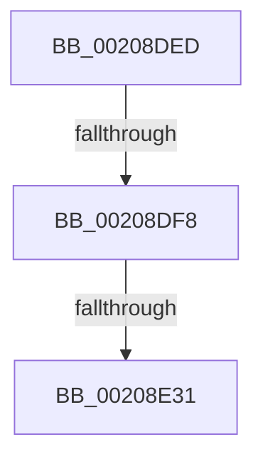

# sub_00208DED

- RVA: `0x00208DED`–`0x00208E4A` (길이 `93` bytes)
- VA: `0x0000000140208DED`
- 실행 섹션: `.text`
- PDB 이름 있음: `아니요`; PDB Function 태그: `아니요`
- unwind 정보 RVA: `0x0005D4D0`
- 디코드: `24`개 명령, `93/93` bytes 표시
- 미해석 바이트: `0` (있으면 어셈블리에 `.byte`로 보존)

> 이 문서는 커널 이미지의 기계어와 PDB 기호를 분석해 생성했습니다. 4번과 5번은 함수 원형과 자료형을 바이너리 사용 방식에서 추정한 C 해석이며 원본 소스 복구 결과는 아닙니다.

## 1. Dependencies

- 직접 호출 지점: **2**; 고유 호출 대상: **2**
- 직접 호출자로 확인된 함수: **0**
- RIP 상대 이미지 참조: **1**

### Outgoing calls
- `0x00208E34` → [KeFindFirstSetRightGroupAffinity](../2C/KeFindFirstSetRightGroupAffinity_function_002CFB10.md) (function, `0x002CFB10`)
- `0x00208E3E` → [KiIntRedirectQueueRequestOnProcessor](../2D/KiIntRedirectQueueRequestOnProcessor_function_002D1240.md) (function, `0x002D1240`)

### Direct callers
- 이 함수 시작 RVA로 연결되는 직접 call은 확인되지 않았습니다. 간접 호출은 완전히 역산할 수 없습니다.

### Static image references
- `0x00208E04` → RVA `0x00F231B0` (`.data`; read)

## 2. Other-region calls and transfers

- 다른 실행 섹션으로 향하는 call: **0**
- call이 아닌 외부 분기/꼬리 이동: **3**
  - `0x00208DF2` → [sub_002089AC](Unknown_function_002089AC.md) (`tail-transfer`)
  - `0x00208E2B` → [sub_002089AC](Unknown_function_002089AC.md) (`tail-transfer`)
  - `0x00208E45` → [sub_00208A8E + 0x6](Unknown_function_00208A8E.md) (`tail-transfer`)

## 3. Assembly (complete function range)

```asm
00208DED  41 80 79 10 00                  cmp byte ptr [r9 + 0x10], 0
00208DF2  0F 84 B4 FB FF FF               je 0x1402089ac
00208DF8  65 8B 04 25 A4 01 00 00         mov eax, dword ptr gs:[0x1a4]
00208E00  33 D2                           xor edx, edx
00208E02  8B C8                           mov ecx, eax
00208E04  48 8B 05 A5 A3 D1 00            mov rax, qword ptr [rip + 0xd1a3a5]
00208E0B  8B 0C 88                        mov ecx, dword ptr [rax + rcx*4]
00208E0E  44 8B C1                        mov r8d, ecx
00208E11  41 0F B7 41 08                  movzx eax, word ptr [r9 + 8]
00208E16  83 E1 3F                        and ecx, 0x3f
00208E19  41 C1 E8 06                     shr r8d, 6
00208E1D  44 3B C0                        cmp r8d, eax
00208E20  49 8B 01                        mov rax, qword ptr [r9]
00208E23  0F 94 C2                        sete dl
00208E26  48 D3 E8                        shr rax, cl
00208E29  85 D0                           test eax, edx
00208E2B  0F 85 7B FB FF FF               jne 0x1402089ac
00208E31  49 8B C9                        mov rcx, r9
00208E34  E8 D7 6C 0C 00                  call 0x1402cfb10
00208E39  8B 53 58                        mov edx, dword ptr [rbx + 0x58]
00208E3C  8B C8                           mov ecx, eax
00208E3E  E8 FD 83 0C 00                  call 0x1402d1240
00208E43  B0 02                           mov al, 2
00208E45  E9 4A FC FF FF                  jmp 0x140208a94
```

## 4. C-style interpretation (structured pseudocode)

```c
__int64 __fastcall sub_00208DED(__int64 a1, int a2, __int64 a3, __int64 a4)
{
    __int64 result;

    a2 = 0;
    a1 = (unsigned int)(((unsigned int)(*(unsigned int *)(*(unsigned __int64 *)(v_rip + 13738917) + (unsigned int)((unsigned int)((unsigned int)(*(unsigned int *)(gs_base + (0 + 420))))) * 4))) & (63));
    a3 = (unsigned int)(((unsigned int)((unsigned int)((unsigned int)(*(unsigned int *)(*(unsigned __int64 *)(v_rip + 13738917) + (unsigned int)((unsigned int)((unsigned int)(*(unsigned int *)(gs_base + (0 + 420))))) * 4))))) >> (6));
    a2 = (((unsigned int)(a3)) == ((unsigned int)(*(unsigned __int16 *)(a4 + 8)))) ? 1 : 0;
    result = (*(unsigned __int64 *)(a4)) >> ((unsigned __int8)(a1));
    result = KeFindFirstSetRightGroupAffinity(a4, a2, a3, a4);
    result = KiIntRedirectQueueRequestOnProcessor((unsigned int)((unsigned int)(result)), (unsigned int)(*(unsigned int *)(v_rbx + 88)), a3, a4);
}
```

## 5. (Beta) C Style

```c
int64_t sub_00208DED(int64_t Arg1, int32_t Arg2, int64_t Arg3, void *Arg4)
{
    uint8_t *arg4 = (uint8_t *)Arg4;

    int64_t result;

    Arg2 = 0;
    Arg1 = (uint32_t)(((uint32_t)(*(uint32_t *)(*(uint64_t *)(v_rip + 0xD1A3A5) + (uint32_t)((uint32_t)((uint32_t)(*(uint32_t *)(gs_base + (0 + 0x1A4))))) * 4))) & (63));
    Arg3 = (uint32_t)(((uint32_t)((uint32_t)((uint32_t)(*(uint32_t *)(*(uint64_t *)(v_rip + 0xD1A3A5) + (uint32_t)((uint32_t)((uint32_t)(*(uint32_t *)(gs_base + (0 + 0x1A4))))) * 4))))) >> (6));
    Arg2 = (((uint32_t)(Arg3)) == ((uint32_t)(*(uint16_t *)(arg4 + 0x8)))) ? 1 : 0;
    result = (*(uint64_t *)(arg4)) >> ((uint8_t)(Arg1));
    result = KeFindFirstSetRightGroupAffinity(Arg4, Arg2, Arg3, Arg4);
    result = KiIntRedirectQueueRequestOnProcessor((uint32_t)((uint32_t)(result)), (uint32_t)(*(uint32_t *)(local_rbx + 0x58)), Arg3, Arg4);
}
```

### 관측된 메모리 오프셋

구조체 형식이 확인되지 않은 접근은 인자 기준의 오프셋으로만 기록했습니다.

| 기준 인자 | 오프셋 표현 | 폭 (bit) | 접근 |
|---|---:|---:|---|
| `Arg4` | `+ 0x0` | `64` | `R` |
| `Arg4` | `+ 0x8` | `16` | `R` |
| `Arg4` | `+ 0x10` | `8` | `R` |

## 6. Execution-region graph

[열기: 2D/3D 그래프와 함수 탐색 컨트롤 패널](../../../control-panel.html?section=text&rva=0x00208DED&view=graph)

- 2D 그래프는 위에서 아래로 흐르고, 3D 그래프는 빈 공간을 드래그해 회전합니다. Shift+드래그는 이동, 휠은 확대·축소, 함수 노드 선택은 대상 보고서 이동입니다.

### Static fallback


