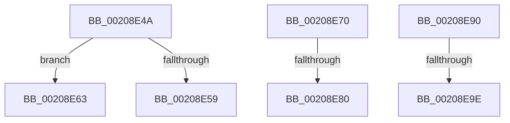

# sub_00208E4A

- RVA: `0x00208E4A`–`0x00208EAD` (길이 `99` bytes)
- VA: `0x0000000140208E4A`
- 실행 섹션: `.text`
- PDB 이름 있음: `아니요`; PDB Function 태그: `아니요`
- unwind 정보 RVA: `0x0005D4E0`
- 디코드: `22`개 명령, `99/99` bytes 표시
- 미해석 바이트: `0` (있으면 어셈블리에 `.byte`로 보존)

> 이 문서는 커널 이미지의 기계어와 PDB 기호를 분석해 생성했습니다. 4번과 5번은 함수 원형과 자료형을 바이너리 사용 방식에서 추정한 C 해석이며 원본 소스 복구 결과는 아닙니다.

## 1. Dependencies

- 직접 호출 지점: **4**; 고유 호출 대상: **4**
- 직접 호출자로 확인된 함수: **0**
- RIP 상대 이미지 참조: **3**

### Outgoing calls
- `0x00208E59` → [HalpVpptAcknowledgeInterrupt](../2D/HalpVpptAcknowledgeInterrupt_function_002D2230.md) (function, `0x002D2230`)
- `0x00208E66` → [guard_dispatch_icall](../6B/guard_dispatch_icall_function_006BAAD0.md) (function, `0x006BAAD0`)
- `0x00208E83` → [KiInterruptMessageDispatch](../44/KiInterruptMessageDispatch_function_00444DC0.md) (function, `0x00444DC0`)
- `0x00208EA3` → [KiReleaseSpinLockInstrumented](../39/KiReleaseSpinLockInstrumented_function_00392EF0.md) (function, `0x00392EF0`)

### Direct callers
- 이 함수 시작 RVA로 연결되는 직접 call은 확인되지 않았습니다. 간접 호출은 완전히 역산할 수 없습니다.

### Static image references
- `0x00208E4A` → RVA `0x002D2230` (`HalpVpptAcknowledgeInterrupt`; read)
- `0x00208E70` → RVA `0x00444DC0` (`KiInterruptMessageDispatch`; read)
- `0x00208E90` → RVA `0x00F0DE58` (`.data`; read)

## 2. Other-region calls and transfers

- 다른 실행 섹션으로 향하는 call: **0**
- call이 아닌 외부 분기/꼬리 이동: **6**
  - `0x00208E5E` → [sub_00208A9F + 0x66](Unknown_function_00208A9F.md) (`tail-transfer`)
  - `0x00208E6B` → [sub_00208A9F + 0x66](Unknown_function_00208A9F.md) (`tail-transfer`)
  - `0x00208E7A` → [sub_00208F20](Unknown_function_00208F20.md) (`tail-transfer`)
  - `0x00208E8B` → [sub_00208A9F + 0x10D](Unknown_function_00208A9F.md) (`tail-transfer`)
  - `0x00208E98` → [sub_00208A9F + 0x123](Unknown_function_00208A9F.md) (`tail-transfer`)
  - `0x00208EA8` → [sub_00208A9F + 0x128](Unknown_function_00208A9F.md) (`tail-transfer`)

## 3. Assembly (complete function range)

```asm
00208E4A  48 8D 0D DF 93 0C 00            lea rcx, [rip + 0xc93df]
00208E51  48 3B D1                        cmp rdx, rcx
00208E54  48 8B C8                        mov rcx, rax
00208E57  75 0A                           jne 0x140208e63
00208E59  E8 D2 93 0C 00                  call 0x1402d2230
00208E5E  E9 A2 FC FF FF                  jmp 0x140208b05
00208E63  48 8B C2                        mov rax, rdx
00208E66  E8 65 1C 4B 00                  call 0x1406baad0
00208E6B  E9 95 FC FF FF                  jmp 0x140208b05
00208E70  48 8D 0D 49 BF 23 00            lea rcx, [rip + 0x23bf49]
00208E77  48 3B C1                        cmp rax, rcx
00208E7A  0F 85 A0 00 00 00               jne 0x140208f20
00208E80  48 8B CB                        mov rcx, rbx
00208E83  E8 38 BF 23 00                  call 0x140444dc0
00208E88  0F B6 F8                        movzx edi, al
00208E8B  E9 1C FD FF FF                  jmp 0x140208bac
00208E90  8B 05 C2 4F D0 00               mov eax, dword ptr [rip + 0xd04fc2]
00208E96  85 C0                           test eax, eax
00208E98  0F 85 24 FD FF FF               jne 0x140208bc2
00208E9E  48 8B 54 24 68                  mov rdx, qword ptr [rsp + 0x68]
00208EA3  E8 48 A0 18 00                  call 0x140392ef0
00208EA8  E9 1A FD FF FF                  jmp 0x140208bc7
```

## 4. C-style interpretation (structured pseudocode)

```c
__int64 __fastcall sub_00208E4A(__int64 a1, __int64 a2)
{
    __int64 result;
    unsigned __int64 v_stack_p68;

    if (a2 != (v_rip + 824287)) goto loc_00208E63;
    result = HalpVpptAcknowledgeInterrupt(result, a2, a3, a4);
loc_00208E63:
    result = guard_dispatch_icall(result, a2, a3, a4);
}
```

## 5. (Beta) C Style

```c
int64_t sub_00208E4A(int64_t Arg1, int64_t Arg2)
{
    int64_t result;
    uint64_t v_stack_p68;

    if (Arg2 != (v_rip + 824287)) goto loc_00208E63;
    result = HalpVpptAcknowledgeInterrupt(result, Arg2, a3, a4);
loc_00208E63:
    result = guard_dispatch_icall(result, Arg2, a3, a4);
}
```

## 6. Execution-region graph

[열기: 2D/3D 그래프와 함수 탐색 컨트롤 패널](../../../control-panel.html?section=text&rva=0x00208E4A&view=graph)

- 2D 그래프는 위에서 아래로 흐르고, 3D 그래프는 빈 공간을 드래그해 회전합니다. Shift+드래그는 이동, 휠은 확대·축소, 함수 노드 선택은 대상 보고서 이동입니다.

### Static fallback


