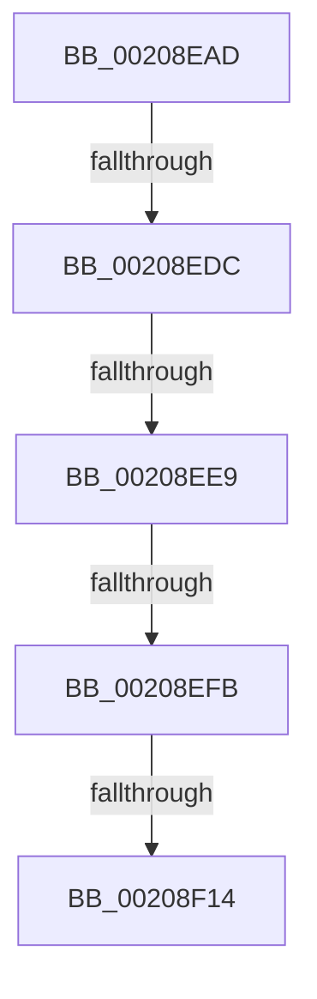

# sub_00208EAD

- RVA: `0x00208EAD`–`0x00208F20` (길이 `115` bytes)
- VA: `0x0000000140208EAD`
- 실행 섹션: `.text`
- PDB 이름 있음: `아니요`; PDB Function 태그: `아니요`
- unwind 정보 RVA: `0x0005D500`
- 디코드: `19`개 명령, `115/115` bytes 표시
- 미해석 바이트: `0` (있으면 어셈블리에 `.byte`로 보존)

> 이 문서는 커널 이미지의 기계어와 PDB 기호를 분석해 생성했습니다. 4번과 5번은 함수 원형과 자료형을 바이너리 사용 방식에서 추정한 C 해석이며 원본 소스 복구 결과는 아닙니다.

## 1. Dependencies

- 직접 호출 지점: **2**; 고유 호출 대상: **2**
- 직접 호출자로 확인된 함수: **0**
- RIP 상대 이미지 참조: **1**

### Outgoing calls
- `0x00208EB9` → [KeDisableInterrupts](../21/KeDisableInterrupts_function_00217BE0.md) (function, `0x00217BE0`)
- `0x00208EDC` → [KeIsForceIdleEngaged](../3A/KeIsForceIdleEngaged_function_003A38D0.md) (function, `0x003A38D0`)

### Direct callers
- 이 함수 시작 RVA로 연결되는 직접 call은 확인되지 않았습니다. 간접 호출은 완전히 역산할 수 없습니다.

### Static image references
- `0x00208ECC` → RVA `0x00F23140` (`.data`; read/write)

## 2. Other-region calls and transfers

- 다른 실행 섹션으로 향하는 call: **0**
- call이 아닌 외부 분기/꼬리 이동: **5**
  - `0x00208ED6` → [sub_006D6552](../6D/Unknown_function_006D6552.md) (`tail-transfer`)
  - `0x00208EE3` → [sub_006D6552 + 0x1E](../6D/Unknown_function_006D6552.md) (`tail-transfer`)
  - `0x00208EF5` → [KiCallInterruptServiceRoutine + 0x22](KiCallInterruptServiceRoutine_function_00208970.md) (`tail-transfer`)
  - `0x00208F0E` → [sub_006D6552 + 0xA4](../6D/Unknown_function_006D6552.md) (`tail-transfer`)
  - `0x00208F1B` → [sub_006D6552 + 0x8C](../6D/Unknown_function_006D6552.md) (`tail-transfer`)

## 3. Assembly (complete function range)

```asm
00208EAD  48 C7 84 24 88 00 00 00 00 00 00 00  mov qword ptr [rsp + 0x88], 0
00208EB9  E8 22 ED 00 00                  call 0x140217be0
00208EBE  0F B6 F8                        movzx edi, al
00208EC1  C7 84 24 80 00 00 00 00 00 00 00  mov dword ptr [rsp + 0x80], 0
00208ECC  F0 48 0F BA 2D 6A A2 D1 00 00   lock bts qword ptr [rip + 0xd1a26a], 0
00208ED6  0F 82 76 D6 4C 00               jb 0x1406d6552
00208EDC  E8 EF A9 19 00                  call 0x1403a38d0
00208EE1  84 C0                           test al, al
00208EE3  0F 85 87 D6 4C 00               jne 0x1406d6570
00208EE9  F0 48 83 25 4E A2 D1 00 00      lock and qword ptr [rip + 0xd1a24e], 0
00208EF2  40 84 FF                        test dil, dil
00208EF5  0F 84 97 FA FF FF               je 0x140208992
00208EFB  65 48 8B 0C 25 20 00 00 00      mov rcx, qword ptr gs:[0x20]
00208F04  4C 8B 81 B8 8E 00 00            mov r8, qword ptr [rcx + 0x8eb8]
00208F0B  4D 85 C0                        test r8, r8
00208F0E  0F 84 E2 D6 4C 00               je 0x1406d65f6
00208F14  41 0F 0D 08                     prefetchw byte ptr [r8]
00208F18  41 8B 00                        mov eax, dword ptr [r8]
00208F1B  E9 BE D6 4C 00                  jmp 0x1406d65de
```

## 4. C-style interpretation (structured pseudocode)

```c
__int64 __fastcall sub_00208EAD(void)
{
    __int64 result;
    unsigned int v_stack_p80;
    unsigned __int64 v_stack_p88;

    v_stack_p88 = 0;
    result = KeDisableInterrupts(a1, a2, a3, a4);
    v_stack_p80 = 0;
    result = KeIsForceIdleEngaged(a1, a2, a3, a4);
}
```

## 5. (Beta) C Style

```c
void sub_00208EAD(void)
{
    int64_t result;
    uint32_t v_stack_p80;
    uint64_t v_stack_p88;

    v_stack_p88 = 0;
    result = KeDisableInterrupts(a1, a2, a3, a4);
    v_stack_p80 = 0;
    result = KeIsForceIdleEngaged(a1, a2, a3, a4);
}
```

## 6. Execution-region graph

[열기: 2D/3D 그래프와 함수 탐색 컨트롤 패널](../../../control-panel.html?section=text&rva=0x00208EAD&view=graph)

- 2D 그래프는 위에서 아래로 흐르고, 3D 그래프는 빈 공간을 드래그해 회전합니다. Shift+드래그는 이동, 휠은 확대·축소, 함수 노드 선택은 대상 보고서 이동입니다.

### Static fallback


