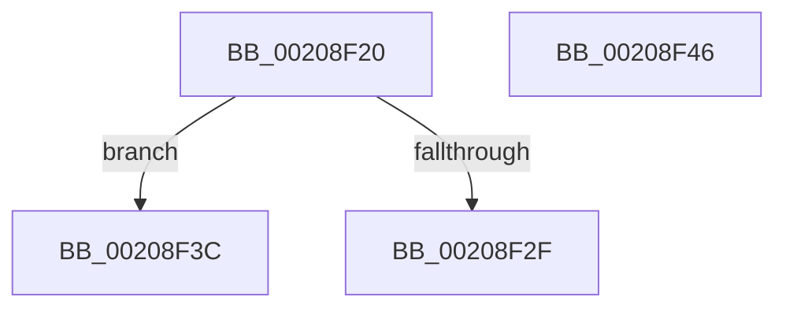

# sub_00208F20

- RVA: `0x00208F20`–`0x00208F50` (길이 `48` bytes)
- VA: `0x0000000140208F20`
- 실행 섹션: `.text`
- PDB 이름 있음: `아니요`; PDB Function 태그: `아니요`
- unwind 정보 RVA: `0x0005D510`
- 디코드: `11`개 명령, `48/48` bytes 표시
- 미해석 바이트: `0` (있으면 어셈블리에 `.byte`로 보존)

> 이 문서는 커널 이미지의 기계어와 PDB 기호를 분석해 생성했습니다. 4번과 5번은 함수 원형과 자료형을 바이너리 사용 방식에서 추정한 C 해석이며 원본 소스 복구 결과는 아닙니다.

## 1. Dependencies

- 직접 호출 지점: **3**; 고유 호출 대상: **2**
- 직접 호출자로 확인된 함수: **0**
- RIP 상대 이미지 참조: **1**

### Outgoing calls
- `0x00208F2F` → [HalpTimerClockIpiRoutine](../39/HalpTimerClockIpiRoutine_function_00399CC0.md) (function, `0x00399CC0`)
- `0x00208F3C` → [guard_dispatch_icall](../6B/guard_dispatch_icall_function_006BAAD0.md) (function, `0x006BAAD0`)
- `0x00208F46` → [guard_dispatch_icall](../6B/guard_dispatch_icall_function_006BAAD0.md) (function, `0x006BAAD0`)

### Direct callers
- 이 함수 시작 RVA로 연결되는 직접 call은 확인되지 않았습니다. 간접 호출은 완전히 역산할 수 없습니다.

### Static image references
- `0x00208F20` → RVA `0x00399CC0` (`HalpTimerClockIpiRoutine`; read)

## 2. Other-region calls and transfers

- 다른 실행 섹션으로 향하는 call: **0**
- call이 아닌 외부 분기/꼬리 이동: **3**
  - `0x00208F37` → [sub_00208A9F + 0x10D](Unknown_function_00208A9F.md) (`tail-transfer`)
  - `0x00208F41` → [sub_00208E4A + 0x3E](Unknown_function_00208E4A.md) (`tail-transfer`)
  - `0x00208F4B` → [sub_00208D99 + 0x3A](Unknown_function_00208D99.md) (`tail-transfer`)

## 3. Assembly (complete function range)

```asm
00208F20  48 8D 0D 99 0D 19 00            lea rcx, [rip + 0x190d99]
00208F27  48 3B C1                        cmp rax, rcx
00208F2A  48 8B CB                        mov rcx, rbx
00208F2D  75 0D                           jne 0x140208f3c
00208F2F  E8 8C 0D 19 00                  call 0x140399cc0
00208F34  0F B6 F8                        movzx edi, al
00208F37  E9 70 FC FF FF                  jmp 0x140208bac
00208F3C  E8 8F 1B 4B 00                  call 0x1406baad0
00208F41  E9 42 FF FF FF                  jmp 0x140208e88
00208F46  E8 85 1B 4B 00                  call 0x1406baad0
00208F4B  E9 83 FE FF FF                  jmp 0x140208dd3
```

## 4. C-style interpretation (structured pseudocode)

```c
__int64 __fastcall sub_00208F20(void)
{
    __int64 result;

    if (result != (v_rip + 1641881)) goto loc_00208F3C;
    result = HalpTimerClockIpiRoutine(v_rbx, a2, a3, a4);
loc_00208F3C:
    result = guard_dispatch_icall(v_rbx, a2, a3, a4);
}
```

## 5. (Beta) C Style

```c
void sub_00208F20(void)
{
    int64_t result;

    if (result != (v_rip + 1641881)) goto loc_00208F3C;
    result = HalpTimerClockIpiRoutine(local_rbx, a2, a3, a4);
loc_00208F3C:
    result = guard_dispatch_icall(local_rbx, a2, a3, a4);
}
```

## 6. Execution-region graph

[열기: 2D/3D 그래프와 함수 탐색 컨트롤 패널](../../../control-panel.html?section=text&rva=0x00208F20&view=graph)

- 2D 그래프는 위에서 아래로 흐르고, 3D 그래프는 빈 공간을 드래그해 회전합니다. Shift+드래그는 이동, 휠은 확대·축소, 함수 노드 선택은 대상 보고서 이동입니다.

### Static fallback


