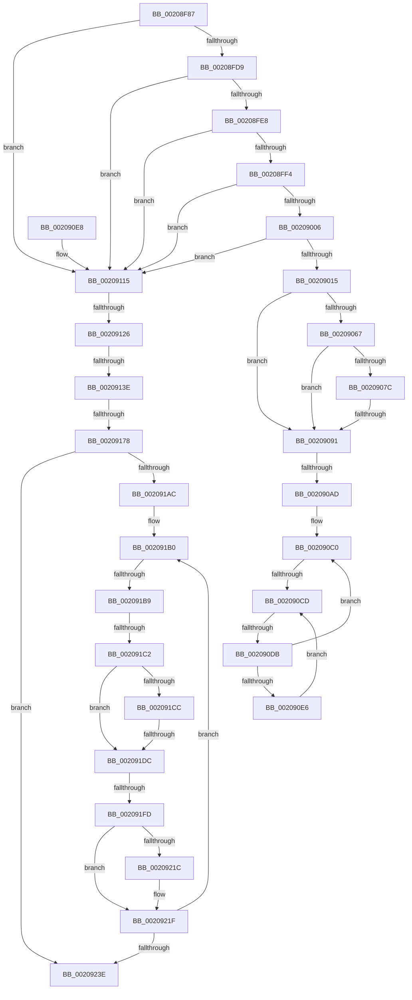

# sub_00208F87

- RVA: `0x00208F87`–`0x00209285` (길이 `766` bytes)
- VA: `0x0000000140208F87`
- 실행 섹션: `.text`
- PDB 이름 있음: `아니요`; PDB Function 태그: `아니요`
- unwind 정보 RVA: `0x0005D554`
- 디코드: `166`개 명령, `766/766` bytes 표시
- 미해석 바이트: `0` (있으면 어셈블리에 `.byte`로 보존)

> 이 문서는 커널 이미지의 기계어와 PDB 기호를 분석해 생성했습니다. 4번과 5번은 함수 원형과 자료형을 바이너리 사용 방식에서 추정한 C 해석이며 원본 소스 복구 결과는 아닙니다.

## 1. Dependencies

- 직접 호출 지점: **4**; 고유 호출 대상: **4**
- 직접 호출자로 확인된 함수: **0**
- RIP 상대 이미지 참조: **9**

### Outgoing calls
- `0x002090EF` → [KiFlushSoftwareInterruptBatch](../25/KiFlushSoftwareInterruptBatch_function_00252200.md) (function, `0x00252200`)
- `0x002090FB` → [KiCheckForThreadDispatch](../25/KiCheckForThreadDispatch_function_00250648.md) (function, `0x00250648`)
- `0x0020913E` → [HalpTscQueryCounterOrdered](../41/HalpTscQueryCounterOrdered_function_0041FD10.md) (function, `0x0041FD10`)
- `0x002091E1` → [HalpTimerGetInternalData](HalpTimerGetInternalData_function_00209500.md) (function, `0x00209500`)

### Direct callers
- 이 함수 시작 RVA로 연결되는 직접 call은 확인되지 않았습니다. 간접 호출은 완전히 역산할 수 없습니다.

### Static image references
- `0x00208FD9` → RVA `0x00FC6A80` (`ALMOSTRO`; read)
- `0x00209021` → RVA `0x00F231B0` (`.data`; read)
- `0x00209051` → RVA `0x00FC7120` (`ALMOSTRO`; read)
- `0x002090A1` → RVA `0x00FC6D20` (`ALMOSTRO`; read)
- `0x002090CF` → RVA `0x00FC52AC` (`ALMOSTRO`; reference)
- `0x0020912E` → RVA `0x0041FD10` (`HalpTscQueryCounterOrdered`; read)
- `0x00209161` → RVA `0x00FC6B60` (`ALMOSTRO`; read)
- `0x002091C4` → RVA `0x00FC1C7C` (`.data`; reference)
- `0x002091CC` → RVA `0x00FC1C80` (`.data`; read)

## 2. Other-region calls and transfers

- 다른 실행 섹션으로 향하는 call: **0**
- call이 아닌 외부 분기/꼬리 이동: **12**
  - `0x0020908B` → [sub_002092A9 + 0xFB](Unknown_function_002092A9.md) (`tail-transfer`)
  - `0x002090A7` → [sub_002092A9 + 0x159](Unknown_function_002092A9.md) (`tail-transfer`)
  - `0x002090C7` → [sub_002092A9 + 0x4B](Unknown_function_002092A9.md) (`tail-transfer`)
  - `0x002090D5` → [sub_002092A9 + 0x19E](Unknown_function_002092A9.md) (`tail-transfer`)
  - `0x00209120` → [sub_002092A9 + 0x1D8](Unknown_function_002092A9.md) (`tail-transfer`)
  - `0x00209138` → [sub_002092A9 + 0x22E](Unknown_function_002092A9.md) (`tail-transfer`)
  - `0x00209172` → [sub_002092A9 + 0x16A](Unknown_function_002092A9.md) (`tail-transfer`)
  - `0x002091B3` → [sub_002092A9](Unknown_function_002092A9.md) (`tail-transfer`)
  - `0x002091BC` → [sub_002092A9 + 0x26](Unknown_function_002092A9.md) (`tail-transfer`)
  - `0x002091D6` → [sub_002092A9 + 0x37](Unknown_function_002092A9.md) (`tail-transfer`)
  - `0x002091F7` → [sub_002092A9 + 0x238](Unknown_function_002092A9.md) (`tail-transfer`)
  - `0x00209283` → [sub_00209285 + 0xA](Unknown_function_00209285.md) (`tail-transfer`)

## 3. Assembly (complete function range)

```asm
00208F87  49 89 5B 10                     mov qword ptr [r11 + 0x10], rbx
00208F8B  0F 57 C9                        xorps xmm1, xmm1
00208F8E  49 89 6B 18                     mov qword ptr [r11 + 0x18], rbp
00208F92  49 89 73 F0                     mov qword ptr [r11 - 0x10], rsi
00208F96  49 89 7B E8                     mov qword ptr [r11 - 0x18], rdi
00208F9A  33 FF                           xor edi, edi
00208F9C  4D 89 63 E0                     mov qword ptr [r11 - 0x20], r12
00208FA0  41 BC 01 00 00 00               mov r12d, 1
00208FA6  4D 89 6B D8                     mov qword ptr [r11 - 0x28], r13
00208FAA  4C 8B E9                        mov r13, rcx
00208FAD  4D 89 73 D0                     mov qword ptr [r11 - 0x30], r14
00208FB1  45 0F B6 F0                     movzx r14d, r8b
00208FB5  4D 89 7B C8                     mov qword ptr [r11 - 0x38], r15
00208FB9  4C 8B FA                        mov r15, rdx
00208FBC  44 88 44 24 31                  mov byte ptr [rsp + 0x31], r8b
00208FC1  C6 44 24 30 00                  mov byte ptr [rsp + 0x30], 0
00208FC6  0F 11 44 24 40                  movups xmmword ptr [rsp + 0x40], xmm0
00208FCB  0F 11 4C 24 70                  movups xmmword ptr [rsp + 0x70], xmm1
00208FD0  41 84 C4                        test r12b, al
00208FD3  0F 84 3C 01 00 00               je 0x140209115
00208FD9  8B 05 A1 DA DB 00               mov eax, dword ptr [rip + 0xdbdaa1]
00208FDF  83 F8 02                        cmp eax, 2
00208FE2  0F 82 2D 01 00 00               jb 0x140209115
00208FE8  44 0F 20 C0                     mov rax, cr8
00208FEC  3C 02                           cmp al, 2
00208FEE  0F 83 21 01 00 00               jae 0x140209115
00208FF4  B9 00 02 00 00                  mov ecx, 0x200
00208FF9  85 8C 24 C0 00 00 00            test dword ptr [rsp + 0xc0], ecx
00209000  0F 84 0F 01 00 00               je 0x140209115
00209006  41 8B 85 B8 00 00 00            mov eax, dword ptr [r13 + 0xb8]
0020900D  A8 20                           test al, 0x20
0020900F  0F 85 00 01 00 00               jne 0x140209115
00209015  65 8B 04 25 A4 01 00 00         mov eax, dword ptr gs:[0x1a4]
0020901D  33 D2                           xor edx, edx
0020901F  8B C8                           mov ecx, eax
00209021  48 8B 05 88 A1 D1 00            mov rax, qword ptr [rip + 0xd1a188]
00209028  89 54 24 4A                     mov dword ptr [rsp + 0x4a], edx
0020902C  66 89 54 24 4E                  mov word ptr [rsp + 0x4e], dx
00209031  44 88 64 24 30                  mov byte ptr [rsp + 0x30], r12b
00209036  8B 0C 88                        mov ecx, dword ptr [rax + rcx*4]
00209039  8B C1                           mov eax, ecx
0020903B  C1 E8 06                        shr eax, 6
0020903E  83 E1 3F                        and ecx, 0x3f
00209041  66 89 44 24 48                  mov word ptr [rsp + 0x48], ax
00209046  41 8B C4                        mov eax, r12d
00209049  48 D3 E0                        shl rax, cl
0020904C  48 89 44 24 40                  mov qword ptr [rsp + 0x40], rax
00209051  0F B7 05 C8 E0 DB 00            movzx eax, word ptr [rip + 0xdbe0c8]
00209058  41 0F B7 4B 80                  movzx ecx, word ptr [r11 - 0x80]
0020905D  0F 11 44 24 60                  movups xmmword ptr [rsp + 0x60], xmm0
00209062  66 3B C8                        cmp cx, ax
00209065  73 2A                           jae 0x140209091
00209067  8B C1                           mov eax, ecx
00209069  48 8D 0D B0 E0 DB 00            lea rcx, [rip + 0xdbe0b0]
00209070  48 8B 44 C1 08                  mov rax, qword ptr [rcx + rax*8 + 8]
00209075  48 85 44 24 40                  test qword ptr [rsp + 0x40], rax
0020907A  74 15                           je 0x140209091
0020907C  0F B7 44 24 4A                  movzx eax, word ptr [rsp + 0x4a]
00209081  66 0B 44 24 4C                  or ax, word ptr [rsp + 0x4c]
00209086  66 0B 44 24 4E                  or ax, word ptr [rsp + 0x4e]
0020908B  0F 84 13 03 00 00               je 0x1402093a4
00209091  40 32 ED                        xor bpl, bpl
00209094  45 0F 20 C6                     mov r14, cr8
00209098  B8 02 00 00 00                  mov eax, 2
0020909D  44 0F 22 C0                     mov cr8, rax
002090A1  39 15 79 DC DB 00               cmp dword ptr [rip + 0xdbdc79], edx
002090A7  0F 85 55 03 00 00               jne 0x140209402
002090AD  65 48 8B 34 25 20 00 00 00      mov rsi, qword ptr gs:[0x20]
002090B6  48 8B 5E 08                     mov rbx, qword ptr [rsi + 8]
002090BA  66 0F 1F 44 00 00               nop word ptr [rax + rax]
002090C0  F0 48 0F BA 6B 40 00            lock bts qword ptr [rbx + 0x40], 0
002090C7  0F 83 27 02 00 00               jae 0x1402092f4
002090CD  FF C7                           inc edi
002090CF  85 3D D7 C1 DB 00               test dword ptr [rip + 0xdbc1d7], edi
002090D5  0F 84 6C 03 00 00               je 0x140209447
002090DB  F3 90                           pause
002090DD  48 8B 43 40                     mov rax, qword ptr [rbx + 0x40]
002090E1  48 85 C0                        test rax, rax
002090E4  74 DA                           je 0x1402090c0
002090E6  EB E5                           jmp 0x1402090cd
002090E8  48 8D 8E D8 35 00 00            lea rcx, [rsi + 0x35d8]
002090EF  E8 0C 91 04 00                  call 0x140252200
002090F4  41 0F B6 D6                     movzx edx, r14b
002090F8  48 8B CE                        mov rcx, rsi
002090FB  E8 48 75 04 00                  call 0x140250648
00209100  0F 28 44 24 60                  movaps xmm0, xmmword ptr [rsp + 0x60]
00209105  66 0F 7F 44 24 70               movdqa xmmword ptr [rsp + 0x70], xmm0
0020910B  44 0F 20 C0                     mov rax, cr8
0020910F  44 0F B6 74 24 31               movzx r14d, byte ptr [rsp + 0x31]
00209115  41 F7 85 E0 00 00 00 00 00 01 00  test dword ptr [r13 + 0xe0], 0x10000
00209120  0F 85 5B 03 00 00               jne 0x140209481
00209126  49 8B 4D 48                     mov rcx, qword ptr [r13 + 0x48]
0020912A  49 8B 45 70                     mov rax, qword ptr [r13 + 0x70]
0020912E  48 8D 15 DB 6B 21 00            lea rdx, [rip + 0x216bdb]
00209135  48 3B C2                        cmp rax, rdx
00209138  0F 85 99 03 00 00               jne 0x1402094d7
0020913E  E8 CD 6B 21 00                  call 0x14041fd10
00209143  4C 8B C0                        mov r8, rax
00209146  48 89 44 24 58                  mov qword ptr [rsp + 0x58], rax
0020914B  0F 20 D0                        mov rax, cr2
0020914E  0F 22 D0                        mov cr2, rax
00209151  41 8B 8D DC 00 00 00            mov ecx, dword ptr [r13 + 0xdc]
00209158  45 33 C9                        xor r9d, r9d
0020915B  49 D3 E4                        shl r12, cl
0020915E  49 8B F0                        mov rsi, r8
00209161  48 F7 05 F4 D9 DB 00 00 00 80 00  test qword ptr [rip + 0xdbd9f4], 0x800000
0020916C  41 8B D9                        mov ebx, r9d
0020916F  41 8B F9                        mov edi, r9d
00209172  0F 85 9B 02 00 00               jne 0x140209413
00209178  40 32 ED                        xor bpl, bpl
0020917B  4D 0F AF BD C0 00 00 00         imul r15, qword ptr [r13 + 0xc0]
00209183  48 B8 BD 42 7A E5 D5 94 BF D6   movabs rax, 0xd6bf94d5e57a42bd
0020918D  49 81 C7 7F 96 98 00            add r15, 0x98967f
00209194  49 F7 E7                        mul r15
00209197  4C 8B FA                        mov r15, rdx
0020919A  49 C1 EF 17                     shr r15, 0x17
0020919E  49 83 C7 01                     add r15, 1
002091A2  4B 8D 04 38                     lea rax, [r8 + r15]
002091A6  0F 84 92 00 00 00               je 0x14020923e
002091AC  0F 1F 40 00                     nop dword ptr [rax]
002091B0  45 84 F6                        test r14b, r14b
002091B3  0F 84 F0 00 00 00               je 0x1402092a9
002091B9  40 84 ED                        test bpl, bpl
002091BC  0F 85 0D 01 00 00               jne 0x1402092cf
002091C2  FF C7                           inc edi
002091C4  85 3D B2 8A DB 00               test dword ptr [rip + 0xdb8ab2], edi
002091CA  75 10                           jne 0x1402091dc
002091CC  48 8B 05 AD 8A DB 00            mov rax, qword ptr [rip + 0xdb8aad]
002091D3  48 85 C0                        test rax, rax
002091D6  0F 85 04 01 00 00               jne 0x1402092e0
002091DC  F3 90                           pause
002091DE  49 8B CD                        mov rcx, r13
002091E1  E8 1A 03 00 00                  call 0x140209500
002091E6  48 8B C8                        mov rcx, rax
002091E9  48 8D 15 20 6B 21 00            lea rdx, [rip + 0x216b20]
002091F0  49 8B 45 70                     mov rax, qword ptr [r13 + 0x70]
002091F4  48 3B C2                        cmp rax, rdx
002091F7  0F 85 E4 02 00 00               jne 0x1402094e1
002091FD  44 89 4C 24 50                  mov dword ptr [rsp + 0x50], r9d
00209202  0F 01 F9                        rdtscp
00209205  4C 8D 4C 24 50                  lea r9, [rsp + 0x50]
0020920A  48 C1 E2 20                     shl rdx, 0x20
0020920E  41 89 09                        mov dword ptr [r9], ecx
00209211  48 0B C2                        or rax, rdx
00209214  48 8B C8                        mov rcx, rax
00209217  48 3B C6                        cmp rax, rsi
0020921A  73 03                           jae 0x14020921f
0020921C  49 03 DC                        add rbx, r12
0020921F  48 8B C3                        mov rax, rbx
00209222  48 8B F1                        mov rsi, rcx
00209225  49 2B C0                        sub rax, r8
00209228  41 B9 00 00 00 00               mov r9d, 0
0020922E  48 03 C1                        add rax, rcx
00209231  49 3B C7                        cmp rax, r15
00209234  4B 8D 04 38                     lea rax, [r8 + r15]
00209238  0F 82 72 FF FF FF               jb 0x1402091b0
0020923E  80 7C 24 30 00                  cmp byte ptr [rsp + 0x30], 0
00209243  4C 8B BC 24 90 00 00 00         mov r15, qword ptr [rsp + 0x90]
0020924B  4C 8B B4 24 98 00 00 00         mov r14, qword ptr [rsp + 0x98]
00209253  4C 8B AC 24 A0 00 00 00         mov r13, qword ptr [rsp + 0xa0]
0020925B  4C 8B A4 24 A8 00 00 00         mov r12, qword ptr [rsp + 0xa8]
00209263  48 8B BC 24 B0 00 00 00         mov rdi, qword ptr [rsp + 0xb0]
0020926B  48 8B B4 24 B8 00 00 00         mov rsi, qword ptr [rsp + 0xb8]
00209273  48 8B AC 24 E0 00 00 00         mov rbp, qword ptr [rsp + 0xe0]
0020927B  48 8B 9C 24 D8 00 00 00         mov rbx, qword ptr [rsp + 0xd8]
00209283  74 0A                           je 0x14020928f
```

## 4. C-style interpretation (structured pseudocode)

```c
__int64 __fastcall sub_00208F87(__int64 a1, __int64 a2, unsigned __int8 a3, int a4, __int64 a5, unsigned __int8 a6, __int64 a7, __int64 a8, __int64 a9, __int64 a10, __int64 a11, __int64 a12, __int64 a13, __int64 a14, __int64 a15, __int64 a16, __int64 a17, __int64 a18, __int64 a19, __int64 a20, __int64 a21, __int64 a22, __int64 a23, __int64 a24, __int64 a25, __int64 a26, __int64 a27, __int64 a28)
{
    __int64 result;
    __int64 v_r12;
    __int64 v_r15;
    __int64 v_rbp;
    __int64 v_rbx;
    __int64 v_rdi;
    unsigned __int8 v_stack_p30;
    unsigned __int8 v_stack_p31;
    unsigned __int64 v_stack_p40;
    unsigned __int16 v_stack_p48;
    unsigned int v_stack_p4A;
    unsigned __int16 v_stack_p4C;
    unsigned __int16 v_stack_p4E;
    unsigned int v_stack_p50;
    unsigned __int64 v_stack_p58;
    unsigned __int64 v_stack_p60;
    unsigned __int64 v_stack_p70;
    unsigned int v_stack_pC0;

    *(unsigned __int64 *)(v_r11 + 16) = v_rbx;
    *(unsigned __int64 *)(v_r11 + 24) = v_rbp;
    *(unsigned __int64 *)(v_r11 - 16) = v_rsi;
    *(unsigned __int64 *)(v_r11 - 24) = v_rdi;
    v_rdi = 0;
    *(unsigned __int64 *)(v_r11 - 32) = v_r12;
    *(unsigned __int64 *)(v_r11 - 40) = v_r13;
    *(unsigned __int64 *)(v_r11 - 48) = v_r14;
    *(unsigned __int64 *)(v_r11 - 56) = v_r15;
    v_stack_p31 = a3;
    v_stack_p30 = 0;
    a8 = v_xmm0;
    a14 = v_xmm1;
    if (((1) & ((unsigned __int8)(result))) == 0) goto loc_00209115;
    if (((unsigned int)((unsigned int)(*(unsigned int *)(v_rip + 14408353)))) < 2) goto loc_00209115;
    if (((unsigned __int8)(v_cr8)) >= 2) goto loc_00209115;
    if (((v_stack_pC0) & (512)) == 0) goto loc_00209115;
    if ((((unsigned __int8)((unsigned int)(*(unsigned int *)(a1 + 184)))) & (32)) != 0) goto loc_00209115;
    a2 = 0;
    v_stack_p4A = 0;
    v_stack_p4E = 0;
    v_stack_p30 = 1;
    result = (unsigned int)(((unsigned int)((unsigned int)((unsigned int)(*(unsigned int *)(*(unsigned __int64 *)(v_rip + 13738376) + (unsigned int)((unsigned int)((unsigned int)(*(unsigned int *)(gs_base + (0 + 420))))) * 4))))) >> (6));
    a1 = (unsigned int)(((unsigned int)(*(unsigned int *)(*(unsigned __int64 *)(v_rip + 13738376) + (unsigned int)((unsigned int)((unsigned int)(*(unsigned int *)(gs_base + (0 + 420))))) * 4))) & (63));
    v_stack_p48 = (unsigned __int16)(result);
    result = (1) << ((unsigned __int8)(a1));
    v_stack_p40 = result;
    a12 = v_xmm0;
    if (((unsigned __int16)(*(unsigned __int16 *)(v_r11 - 128))) >= ((unsigned __int16)(*(unsigned __int16 *)(v_rip + 14409928)))) goto loc_00209091;
    if (((a8) & (*(unsigned __int64 *)(v_rip + 14409904 + (unsigned int)((unsigned int)(*(unsigned __int16 *)(v_r11 - 128))) * 8 + 8))) == 0) goto loc_00209091;
    result = (unsigned __int16)((v_stack_p4A) | (v_stack_p4C));
    result = (unsigned __int16)((result) | (v_stack_p4E));
loc_00209091:
    v_rbp = 0;
loc_002090C0:
loc_002090CD:
    v_rdi = (unsigned int)((v_rdi) + 1);
    if (*(unsigned __int64 *)(*(unsigned __int64 *)(*(unsigned __int64 *)(gs_base + (0 + 32)) + 8) + 64) == 0) goto loc_002090C0;
    goto loc_002090CD;
loc_00209115:
    result = HalpTscQueryCounterOrdered(*(unsigned __int64 *)(a1 + 72), v_rip + 2190299, a3, a4);
    v_stack_p58 = result;
    a4 = 0;
    v_r12 = (1) << ((unsigned __int8)((unsigned int)(*(unsigned int *)(a1 + 220))));
    v_rbp = 0;
    v_r15 = (a2) * (*(unsigned __int64 *)(a1 + 192));
    v_r15 = (v_r15) + (0x98967FULL);
    v_r15 = (v_rip + 2190299) >> (23);
    v_r15 = (v_r15) + (1);
    if (condition_is_equal) goto loc_0020923E;
loc_002091B0:
    v_rdi = (unsigned int)((0) + 1);
    if (((*(unsigned int *)(v_rip + 14387890)) & ((unsigned int)(v_rdi))) != 0) goto loc_002091DC;
loc_002091DC:
    result = HalpTimerGetInternalData(a1, v_rip + 2190299, result, a4);
    v_stack_p50 = 0;
    a2 = (v_rip + 2190112) << (32);
    *(unsigned int *)(a10) = (unsigned int)(result);
    result = (*(unsigned __int64 *)(a1 + 112)) | (a2);
    v_rbx = 0;
    if (result < result) {
        v_rbx = (0) + (v_r12);
    }
    result = (v_rbx) - (result);
    result = (result) + (result);
    if (result < v_r15) goto loc_002091B0;
loc_0020923E:
}
```

## 5. (Beta) C Style

```c
int64_t sub_00208F87(void *Arg1, int64_t Arg2, uint8_t Arg3, int32_t Arg4, uint64_t Arg5, uint8_t Arg6, uint64_t Arg7, int64_t Arg8, uint64_t Arg9, int64_t Arg10, uint64_t Arg11, int64_t Arg12, uint64_t Arg13, int64_t Arg14, uint64_t Arg15, uint64_t Arg16, uint64_t Arg17, int64_t Arg18, int64_t Arg19, int64_t Arg20, int64_t Arg21, int64_t Arg22, int64_t Arg23, uint64_t Arg24, uint64_t Arg25, uint64_t Arg26, int64_t Arg27, int64_t Arg28)
{
    uint8_t *arg1 = (uint8_t *)Arg1;

    int64_t result;
    int64_t local_r12;
    int64_t local_r15;
    int64_t local_rbp;
    int64_t local_rbx;
    int64_t local_rdi;
    uint8_t v_stack_p30;
    uint8_t v_stack_p31;
    uint64_t v_stack_p40;
    uint16_t v_stack_p48;
    uint32_t v_stack_p4A;
    uint16_t v_stack_p4C;
    uint16_t v_stack_p4E;
    uint32_t v_stack_p50;
    uint64_t v_stack_p58;
    uint64_t v_stack_p60;
    uint64_t v_stack_p70;
    uint32_t v_stack_pC0;

    *(uint64_t *)(local_r11 + 0x10) = local_rbx;
    *(uint64_t *)(local_r11 + 0x18) = local_rbp;
    *(uint64_t *)(local_r11 - 0x10) = local_rsi;
    *(uint64_t *)(local_r11 - 0x18) = local_rdi;
    local_rdi = 0;
    *(uint64_t *)(local_r11 - 0x20) = local_r12;
    *(uint64_t *)(local_r11 - 0x28) = local_r13;
    *(uint64_t *)(local_r11 - 0x30) = local_r14;
    *(uint64_t *)(local_r11 - 0x38) = local_r15;
    v_stack_p31 = Arg3;
    v_stack_p30 = 0;
    Arg8 = v_xmm0;
    Arg14 = v_xmm1;
    if (((1) & ((uint8_t)(result))) == 0) goto loc_00209115;
    if (((uint32_t)((uint32_t)(*(uint32_t *)(v_rip + 0xDBDAA1)))) < 2) goto loc_00209115;
    if (((uint8_t)(v_cr8)) >= 2) goto loc_00209115;
    if (((v_stack_pC0) & (512)) == 0) goto loc_00209115;
    if ((((uint8_t)((uint32_t)(*(uint32_t *)(arg1 + 0xB8)))) & (32)) != 0) goto loc_00209115;
    Arg2 = 0;
    v_stack_p4A = 0;
    v_stack_p4E = 0;
    v_stack_p30 = 1;
    result = (uint32_t)(((uint32_t)((uint32_t)((uint32_t)(*(uint32_t *)(*(uint64_t *)(v_rip + 0xD1A188) + (uint32_t)((uint32_t)((uint32_t)(*(uint32_t *)(gs_base + (0 + 0x1A4))))) * 4))))) >> (6));
    Arg1 = (uint32_t)(((uint32_t)(*(uint32_t *)(*(uint64_t *)(v_rip + 0xD1A188) + (uint32_t)((uint32_t)((uint32_t)(*(uint32_t *)(gs_base + (0 + 0x1A4))))) * 4))) & (63));
    v_stack_p48 = (uint16_t)(result);
    result = (1) << ((uint8_t)(Arg1));
    v_stack_p40 = result;
    Arg12 = v_xmm0;
    if (((uint16_t)(*(uint16_t *)(local_r11 - 0x80))) >= ((uint16_t)(*(uint16_t *)(v_rip + 0xDBE0C8)))) goto loc_00209091;
    if (((Arg8) & (*(uint64_t *)(v_rip + 0xDBE0B0 + (uint32_t)((uint32_t)(*(uint16_t *)(local_r11 - 0x80))) * 8 + 0x8))) == 0) goto loc_00209091;
    result = (uint16_t)((v_stack_p4A) | (v_stack_p4C));
    result = (uint16_t)((result) | (v_stack_p4E));
loc_00209091:
    local_rbp = 0;
loc_002090C0:
loc_002090CD:
    local_rdi = (uint32_t)((local_rdi) + 1);
    if (*(uint64_t *)(*(uint64_t *)(*(uint64_t *)(gs_base + (0 + 0x20)) + 0x8) + 0x40) == 0) goto loc_002090C0;
    goto loc_002090CD;
loc_00209115:
    result = HalpTscQueryCounterOrdered(*(uint64_t *)(arg1 + 0x48), v_rip + 2190299, Arg3, Arg4);
    v_stack_p58 = result;
    Arg4 = 0;
    local_r12 = (1) << ((uint8_t)((uint32_t)(*(uint32_t *)(arg1 + 0xDC))));
    local_rbp = 0;
    local_r15 = (Arg2) * (*(uint64_t *)(arg1 + 0xC0));
    local_r15 = (local_r15) + (0x98967FULL);
    local_r15 = (v_rip + 2190299) >> (23);
    local_r15 = (local_r15) + (1);
    if (condition_is_equal) goto loc_0020923E;
loc_002091B0:
    local_rdi = (uint32_t)((0) + 1);
    if (((*(uint32_t *)(v_rip + 0xDB8AB2)) & ((uint32_t)(local_rdi))) != 0) goto loc_002091DC;
loc_002091DC:
    result = HalpTimerGetInternalData(Arg1, v_rip + 2190299, result, Arg4);
    v_stack_p50 = 0;
    Arg2 = (v_rip + 2190112) << (32);
    *(uint32_t *)(Arg10) = (uint32_t)(result);
    result = (*(uint64_t *)(arg1 + 0x70)) | (Arg2);
    local_rbx = 0;
    if (result < result) {
        local_rbx = (0) + (local_r12);
    }
    result = (local_rbx) - (result);
    result = (result) + (result);
    if (result < local_r15) goto loc_002091B0;
loc_0020923E:
}
```

### 관측된 메모리 오프셋

구조체 형식이 확인되지 않은 접근은 인자 기준의 오프셋으로만 기록했습니다.

| 기준 인자 | 오프셋 표현 | 폭 (bit) | 접근 |
|---|---:|---:|---|
| `Arg1` | `+ 0x48` | `64` | `R` |
| `Arg1` | `+ 0x70` | `64` | `R` |
| `Arg1` | `+ 0xB8` | `32` | `R` |
| `Arg1` | `+ 0xC0` | `64` | `R` |
| `Arg1` | `+ 0xDC` | `32` | `R` |
| `Arg1` | `+ 0xE0` | `32` | `R` |

## 6. Execution-region graph

[열기: 2D/3D 그래프와 함수 탐색 컨트롤 패널](../../../control-panel.html?section=text&rva=0x00208F87&view=graph)

- 2D 그래프는 위에서 아래로 흐르고, 3D 그래프는 빈 공간을 드래그해 회전합니다. Shift+드래그는 이동, 휠은 확대·축소, 함수 노드 선택은 대상 보고서 이동입니다.

### Static fallback


