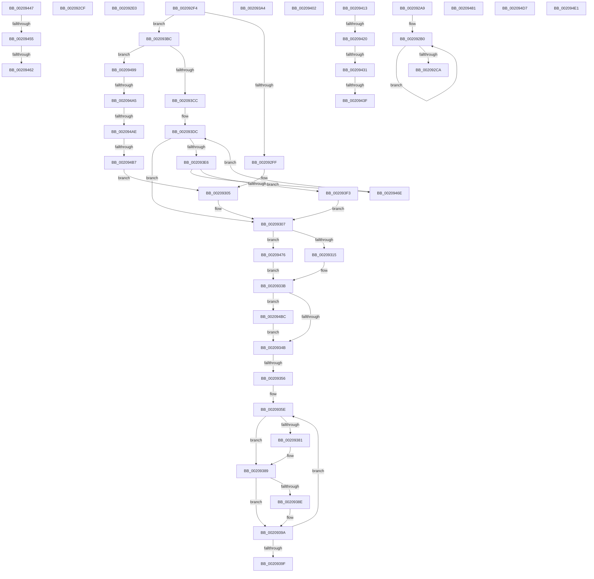

# sub_002092A9

- RVA: `0x002092A9`–`0x002094F0` (길이 `583` bytes)
- VA: `0x00000001402092A9`
- 실행 섹션: `.text`
- PDB 이름 있음: `아니요`; PDB Function 태그: `아니요`
- unwind 정보 RVA: `0x0005D598`
- 디코드: `133`개 명령, `583/583` bytes 표시
- 미해석 바이트: `0` (있으면 어셈블리에 `.byte`로 보존)

> 이 문서는 커널 이미지의 기계어와 PDB 기호를 분석해 생성했습니다. 4번과 5번은 함수 원형과 자료형을 바이너리 사용 방식에서 추정한 C 해석이며 원본 소스 복구 결과는 아닙니다.

## 1. Dependencies

- 직접 호출 지점: **10**; 고유 호출 대상: **8**
- 직접 호출자로 확인된 함수: **0**
- RIP 상대 이미지 참조: **5**

### Outgoing calls
- `0x002092E2` → [guard_dispatch_icall](../6B/guard_dispatch_icall_function_006BAAD0.md) (function, `0x006BAAD0`)
- `0x00209331` → [KiSetSystemAffinityThread](../39/KiSetSystemAffinityThread_function_003993E0.md) (function, `0x003993E0`)
- `0x00209370` → [KiDeferredReadySingleThread](../25/KiDeferredReadySingleThread_function_00252FE0.md) (function, `0x00252FE0`)
- `0x00209395` → [KiFlushSoftwareInterruptBatch](../25/KiFlushSoftwareInterruptBatch_function_00252200.md) (function, `0x00252200`)
- `0x00209409` → [KiRaiseIrqlProcessIrqlFlags](../4F/KiRaiseIrqlProcessIrqlFlags_function_004F56FC.md) (function, `0x004F56FC`)
- `0x00209455` → [KiCheckVpBackingLongSpinWaitHypercall](../30/KiCheckVpBackingLongSpinWaitHypercall_function_0030F490.md) (function, `0x0030F490`)
- `0x00209464` → [HvlNotifyLongSpinWait](../30/HvlNotifyLongSpinWait_function_0030F460.md) (function, `0x0030F460`)
- `0x002094CD` → [KiCpuPartitionCheckAffinitization](../5C/KiCpuPartitionCheckAffinitization_function_005C1420.md) (function, `0x005C1420`)
- `0x002094D7` → [guard_dispatch_icall](../6B/guard_dispatch_icall_function_006BAAD0.md) (function, `0x006BAAD0`)
- `0x002094E1` → [guard_dispatch_icall](../6B/guard_dispatch_icall_function_006BAAD0.md) (function, `0x006BAAD0`)

### Direct callers
- 이 함수 시작 RVA로 연결되는 직접 call은 확인되지 않았습니다. 간접 호출은 완전히 역산할 수 없습니다.

### Static image references
- `0x002092B2` → RVA `0x00FC22B0` (`.data`; read)
- `0x002092BD` → RVA `0x00FC22B0` (`.data`; write)
- `0x0020933B` → RVA `0x00FC6B14` (`ALMOSTRO`; read)
- `0x00209413` → RVA `0x00FC1C80` (`.data`; read)
- `0x00209447` → RVA `0x00FC6AB8` (`ALMOSTRO`; read)

## 2. Other-region calls and transfers

- 다른 실행 섹션으로 향하는 call: **0**
- call이 아닌 외부 분기/꼬리 이동: **20**
  - `0x002092CA` → [sub_00208F87 + 0x257](Unknown_function_00208F87.md) (`tail-transfer`)
  - `0x002092DB` → [sub_00208F87 + 0x257](Unknown_function_00208F87.md) (`tail-transfer`)
  - `0x002092EF` → [sub_00208F87 + 0x257](Unknown_function_00208F87.md) (`tail-transfer`)
  - `0x00209350` → [sub_00208F87 + 0x161](Unknown_function_00208F87.md) (`tail-transfer`)
  - `0x0020939F` → [sub_00208F87 + 0x161](Unknown_function_00208F87.md) (`tail-transfer`)
  - `0x002093B7` → [sub_00208F87 + 0x10D](Unknown_function_00208F87.md) (`tail-transfer`)
  - `0x0020940E` → [sub_00208F87 + 0x126](Unknown_function_00208F87.md) (`tail-transfer`)
  - `0x0020941A` → [sub_00208F87 + 0x1F1](Unknown_function_00208F87.md) (`tail-transfer`)
  - `0x0020942B` → [sub_00208F87 + 0x1F1](Unknown_function_00208F87.md) (`tail-transfer`)
  - `0x00209439` → [sub_00208F87 + 0x1F1](Unknown_function_00208F87.md) (`tail-transfer`)
  - `0x00209442` → [sub_00208F87 + 0x1F4](Unknown_function_00208F87.md) (`tail-transfer`)
  - `0x0020944F` → [sub_00208F87 + 0x154](Unknown_function_00208F87.md) (`tail-transfer`)
  - `0x0020945C` → [sub_00208F87 + 0x154](Unknown_function_00208F87.md) (`tail-transfer`)
  - `0x00209469` → [sub_00208F87 + 0x156](Unknown_function_00208F87.md) (`tail-transfer`)
  - `0x00209494` → [sub_00208F87 + 0x1A3](Unknown_function_00208F87.md) (`tail-transfer`)
  - `0x0020949F` → [sub_006D65FC + 0x17](../6D/Unknown_function_006D65FC.md) (`tail-transfer`)
  - `0x002094A8` → [sub_006D65FC](../6D/Unknown_function_006D65FC.md) (`tail-transfer`)
  - `0x002094B1` → [sub_006D65FC + 0x17](../6D/Unknown_function_006D65FC.md) (`tail-transfer`)
  - `0x002094DC` → [sub_00208F87 + 0x1BC](Unknown_function_00208F87.md) (`tail-transfer`)
  - `0x002094EB` → [sub_00208F87 + 0x28D](Unknown_function_00208F87.md) (`tail-transfer`)

## 3. Assembly (complete function range)

```asm
002092A9  41 8B C1                        mov eax, r9d
002092AC  0F 1F 40 00                     nop dword ptr [rax]
002092B0  F3 90                           pause
002092B2  8B 0D F8 8F DB 00               mov ecx, dword ptr [rip + 0xdb8ff8]
002092B8  0F AF C8                        imul ecx, eax
002092BB  FF C0                           inc eax
002092BD  89 0D ED 8F DB 00               mov dword ptr [rip + 0xdb8fed], ecx
002092C3  3D C8 00 00 00                  cmp eax, 0xc8
002092C8  72 E6                           jb 0x1402092b0
002092CA  E9 0F FF FF FF                  jmp 0x1402091de
002092CF  48 8B D0                        mov rdx, rax
002092D2  48 C1 EA 20                     shr rdx, 0x20
002092D6  66 41 0F AE F1                  tpause r9d
002092DB  E9 FE FE FF FF                  jmp 0x1402091de
002092E0  8B CF                           mov ecx, edi
002092E2  E8 E9 17 4B 00                  call 0x1406baad0
002092E7  4C 8B 44 24 58                  mov r8, qword ptr [rsp + 0x58]
002092EC  45 33 C9                        xor r9d, r9d
002092EF  E9 EA FE FF FF                  jmp 0x1402091de
002092F4  8B 43 74                        mov eax, dword ptr [rbx + 0x74]
002092F7  A8 08                           test al, 8
002092F9  0F 85 BD 00 00 00               jne 0x1402093bc
002092FF  83 C8 08                        or eax, 8
00209302  89 43 74                        mov dword ptr [rbx + 0x74], eax
00209305  33 FF                           xor edi, edi
00209307  48 89 7C 24 38                  mov qword ptr [rsp + 0x38], rdi
0020930C  40 84 ED                        test bpl, bpl
0020930F  0F 84 61 01 00 00               je 0x140209476
00209315  33 ED                           xor ebp, ebp
00209317  48 8D 44 24 38                  lea rax, [rsp + 0x38]
0020931C  41 B9 00 08 00 00               mov r9d, 0x800
00209322  4C 8D 44 24 40                  lea r8, [rsp + 0x40]
00209327  48 89 44 24 20                  mov qword ptr [rsp + 0x20], rax
0020932C  33 D2                           xor edx, edx
0020932E  48 8B CE                        mov rcx, rsi
00209331  E8 AA 00 19 00                  call 0x1403993e0
00209336  48 8B 7C 24 38                  mov rdi, qword ptr [rsp + 0x38]
0020933B  F7 05 CF D7 DB 00 00 02 00 00   test dword ptr [rip + 0xdbd7cf], 0x200
00209345  0F 85 71 01 00 00               jne 0x1402094bc
0020934B  8B DD                           mov ebx, ebp
0020934D  48 85 FF                        test rdi, rdi
00209350  0F 84 92 FD FF FF               je 0x1402090e8
00209356  48 8B 07                        mov rax, qword ptr [rdi]
00209359  48 89 44 24 38                  mov qword ptr [rsp + 0x38], rax
0020935E  48 8D 97 28 FF FF FF            lea rdx, [rdi - 0xd8]
00209365  45 33 C9                        xor r9d, r9d
00209368  4C 8D 44 24 38                  lea r8, [rsp + 0x38]
0020936D  48 8B CE                        mov rcx, rsi
00209370  E8 6B 9C 04 00                  call 0x140252fe0
00209375  48 8B 7C 24 38                  mov rdi, qword ptr [rsp + 0x38]
0020937A  FF C3                           inc ebx
0020937C  48 85 FF                        test rdi, rdi
0020937F  74 08                           je 0x140209389
00209381  48 8B 07                        mov rax, qword ptr [rdi]
00209384  48 89 44 24 38                  mov qword ptr [rsp + 0x38], rax
00209389  F6 C3 0F                        test bl, 0xf
0020938C  75 0C                           jne 0x14020939a
0020938E  48 8D 8E D8 35 00 00            lea rcx, [rsi + 0x35d8]
00209395  E8 66 8E 04 00                  call 0x140252200
0020939A  48 85 FF                        test rdi, rdi
0020939D  75 BF                           jne 0x14020935e
0020939F  E9 44 FD FF FF                  jmp 0x1402090e8
002093A4  0F B7 44 24 48                  movzx eax, word ptr [rsp + 0x48]
002093A9  41 0F B6 EC                     movzx ebp, r12b
002093AD  48 8B 44 C1 08                  mov rax, qword ptr [rcx + rax*8 + 8]
002093B2  48 21 44 24 40                  and qword ptr [rsp + 0x40], rax
002093B7  E9 D8 FC FF FF                  jmp 0x140209094
002093BC  48 8B 8B 50 04 00 00            mov rcx, qword ptr [rbx + 0x450]
002093C3  48 85 C9                        test rcx, rcx
002093C6  0F 85 CD 00 00 00               jne 0x140209499
002093CC  4C 8B 83 40 02 00 00            mov r8, qword ptr [rbx + 0x240]
002093D3  33 FF                           xor edi, edi
002093D5  0F B7 CF                        movzx ecx, di
002093D8  45 0F B7 08                     movzx r9d, word ptr [r8]
002093DC  66 41 3B C9                     cmp cx, r9w
002093E0  0F 83 21 FF FF FF               jae 0x140209307
002093E6  0F B7 C1                        movzx eax, cx
002093E9  49 8B 54 C0 08                  mov rdx, qword ptr [r8 + rax*8 + 8]
002093EE  48 85 D2                        test rdx, rdx
002093F1  74 7B                           je 0x14020946e
002093F3  66 89 4C 24 68                  mov word ptr [rsp + 0x68], cx
002093F8  48 89 54 24 60                  mov qword ptr [rsp + 0x60], rdx
002093FD  E9 05 FF FF FF                  jmp 0x140209307
00209402  0F B6 D0                        movzx edx, al
00209405  41 0F B6 CE                     movzx ecx, r14b
00209409  E8 EE C2 2E 00                  call 0x1404f56fc
0020940E  E9 9A FC FF FF                  jmp 0x1402090ad
00209413  48 39 1D 66 88 DB 00            cmp qword ptr [rip + 0xdb8866], rbx
0020941A  0F 85 58 FD FF FF               jne 0x140209178
00209420  41 F7 85 E0 00 00 00 00 60 00 00  test dword ptr [r13 + 0xe0], 0x6000
0020942B  0F 85 47 FD FF FF               jne 0x140209178
00209431  41 83 BD E4 00 00 00 05         cmp dword ptr [r13 + 0xe4], 5
00209439  0F 85 39 FD FF FF               jne 0x140209178
0020943F  40 B5 01                        mov bpl, 1
00209442  E9 34 FD FF FF                  jmp 0x14020917b
00209447  8B 05 6B D6 DB 00               mov eax, dword ptr [rip + 0xdbd66b]
0020944D  A8 40                           test al, 0x40
0020944F  0F 84 86 FC FF FF               je 0x1402090db
00209455  E8 36 60 10 00                  call 0x14030f490
0020945A  84 C0                           test al, al
0020945C  0F 84 79 FC FF FF               je 0x1402090db
00209462  8B CF                           mov ecx, edi
00209464  E8 F7 5F 10 00                  call 0x14030f460
00209469  E9 6F FC FF FF                  jmp 0x1402090dd
0020946E  66 FF C1                        inc cx
00209471  E9 66 FF FF FF                  jmp 0x1402093dc
00209476  33 ED                           xor ebp, ebp
00209478  48 89 6B 40                     mov qword ptr [rbx + 0x40], rbp
0020947C  E9 BA FE FF FF                  jmp 0x14020933b
00209481  65 8B 04 25 A4 01 00 00         mov eax, dword ptr gs:[0x1a4]
00209489  41 0F AF 45 50                  imul eax, dword ptr [r13 + 0x50]
0020948E  8B C8                           mov ecx, eax
00209490  49 03 4D 48                     add rcx, qword ptr [r13 + 0x48]
00209494  E9 91 FC FF FF                  jmp 0x14020912a
00209499  0F B6 51 12                     movzx edx, byte ptr [rcx + 0x12]
0020949D  85 D2                           test edx, edx
0020949F  0F 84 6E D1 4C 00               je 0x1406d6613
002094A5  41 2B D4                        sub edx, r12d
002094A8  0F 84 4E D1 4C 00               je 0x1406d65fc
002094AE  41 3B D4                        cmp edx, r12d
002094B1  0F 84 5C D1 4C 00               je 0x1406d6613
002094B7  E9 49 FE FF FF                  jmp 0x140209305
002094BC  48 8B 93 40 02 00 00            mov rdx, qword ptr [rbx + 0x240]
002094C3  45 33 C9                        xor r9d, r9d
002094C6  45 0F B6 C4                     movzx r8d, r12b
002094CA  48 8B CB                        mov rcx, rbx
002094CD  E8 4E 7F 3B 00                  call 0x1405c1420
002094D2  E9 74 FE FF FF                  jmp 0x14020934b
002094D7  E8 F4 15 4B 00                  call 0x1406baad0
002094DC  E9 62 FC FF FF                  jmp 0x140209143
002094E1  E8 EA 15 4B 00                  call 0x1406baad0
002094E6  4C 8B 44 24 58                  mov r8, qword ptr [rsp + 0x58]
002094EB  E9 24 FD FF FF                  jmp 0x140209214
```

## 4. C-style interpretation (structured pseudocode)

```c
__int64 __fastcall sub_002092A9(__int64 a1, __int64 a2, __int64 a3, int a4)
{
    __int64 result;
    unsigned __int64 v_stack_p20;
    unsigned __int64 v_stack_p38;
    unsigned __int64 v_stack_p40;
    unsigned __int16 v_stack_p48;
    unsigned __int64 v_stack_p58;
    unsigned __int64 v_stack_p60;
    unsigned __int16 v_stack_p68;

loc_002092B0:
    a1 = (unsigned int)(((unsigned int)(*(unsigned int *)(v_rip + 14389240))) * ((unsigned int)((unsigned int)(a4))));
    result = (unsigned int)(((unsigned int)(a4)) + 1);
    *(unsigned int *)(v_rip + 14389229) = (unsigned int)(a1);
    if (((unsigned int)(result)) < 200) goto loc_002092B0;
}
```

## 5. (Beta) C Style

```c
int64_t sub_002092A9(int64_t Arg1, int64_t Arg2, int64_t Arg3, void *Arg4)
{
    uint8_t *arg4 = (uint8_t *)Arg4;

    int64_t result;
    uint64_t v_stack_p20;
    uint64_t v_stack_p38;
    uint64_t v_stack_p40;
    uint16_t v_stack_p48;
    uint64_t v_stack_p58;
    uint64_t v_stack_p60;
    uint16_t v_stack_p68;

loc_002092B0:
    Arg1 = (uint32_t)(((uint32_t)(*(uint32_t *)(v_rip + 0xDB8FF8))) * ((uint32_t)((uint32_t)(Arg4))));
    result = (uint32_t)(((uint32_t)(Arg4)) + 1);
    *(uint32_t *)(v_rip + 0xDB8FED) = (uint32_t)(Arg1);
    if (((uint32_t)(result)) < 200) goto loc_002092B0;
}
```

### 관측된 메모리 오프셋

구조체 형식이 확인되지 않은 접근은 인자 기준의 오프셋으로만 기록했습니다.

| 기준 인자 | 오프셋 표현 | 폭 (bit) | 접근 |
|---|---:|---:|---|
| `Arg4` | `+ 0x0` | `32` | `R` |

## 6. Execution-region graph

[열기: 2D/3D 그래프와 함수 탐색 컨트롤 패널](../../../control-panel.html?section=text&rva=0x002092A9&view=graph)

- 2D 그래프는 위에서 아래로 흐르고, 3D 그래프는 빈 공간을 드래그해 회전합니다. Shift+드래그는 이동, 휠은 확대·축소, 함수 노드 선택은 대상 보고서 이동입니다.

### Static fallback


