# sub_0020959D

- RVA: `0x0020959D`–`0x00209822` (길이 `645` bytes)
- VA: `0x000000014020959D`
- 실행 섹션: `.text`
- PDB 이름 있음: `아니요`; PDB Function 태그: `아니요`
- unwind 정보 RVA: `0x0005D60C`
- 디코드: `141`개 명령, `645/645` bytes 표시
- 미해석 바이트: `0` (있으면 어셈블리에 `.byte`로 보존)

> 이 문서는 커널 이미지의 기계어와 PDB 기호를 분석해 생성했습니다. 4번과 5번은 함수 원형과 자료형을 바이너리 사용 방식에서 추정한 C 해석이며 원본 소스 복구 결과는 아닙니다.

## 1. Dependencies

- 직접 호출 지점: **4**; 고유 호출 대상: **3**
- 직접 호출자로 확인된 함수: **0**
- RIP 상대 이미지 참조: **2**

### Outgoing calls
- `0x002096EF` → [KiPerformWaitDeferredWork](../22/KiPerformWaitDeferredWork_function_00220480.md) (function, `0x00220480`)
- `0x00209718` → [KiLowerIrqlProcessIrqlFlags](../4F/KiLowerIrqlProcessIrqlFlags_function_004F5698.md) (function, `0x004F5698`)
- `0x002097EA` → [KiLowerIrqlProcessIrqlFlags](../4F/KiLowerIrqlProcessIrqlFlags_function_004F5698.md) (function, `0x004F5698`)
- `0x002097FB` → [KeYieldExecution](KeYieldExecution_function_00209FA0.md) (function, `0x00209FA0`)

### Direct callers
- 이 함수 시작 RVA로 연결되는 직접 call은 확인되지 않았습니다. 간접 호출은 완전히 역산할 수 없습니다.

### Static image references
- `0x002095DA` → RVA `0x00FC6D20` (`ALMOSTRO`; read)
- `0x0020968F` → RVA `0x00FC52AC` (`ALMOSTRO`; reference)

## 2. Other-region calls and transfers

- 다른 실행 섹션으로 향하는 call: **0**
- call이 아닌 외부 분기/꼬리 이동: **18**
  - `0x002095CC` → [sub_002099E1](Unknown_function_002099E1.md) (`tail-transfer`)
  - `0x002095E0` → [sub_002098EE](Unknown_function_002098EE.md) (`tail-transfer`)
  - `0x00209608` → [sub_002099FA + 0x2F4](Unknown_function_002099FA.md) (`tail-transfer`)
  - `0x00209615` → [sub_002099FA + 0x3E6](Unknown_function_002099FA.md) (`tail-transfer`)
  - `0x00209629` → [sub_00209822 + 0x8C](Unknown_function_00209822.md) (`tail-transfer`)
  - `0x00209639` → [sub_00209822 + 0x54](Unknown_function_00209822.md) (`tail-transfer`)
  - `0x00209695` → [sub_002098FF + 0xBB](Unknown_function_002098FF.md) (`tail-transfer`)
  - `0x002096AF` → [sub_002099FA + 0x71](Unknown_function_002099FA.md) (`tail-transfer`)
  - `0x002096C9` → [sub_00209822 + 0x1F](Unknown_function_00209822.md) (`tail-transfer`)
  - `0x002096FA` → [sub_002099FA + 0x274](Unknown_function_002099FA.md) (`tail-transfer`)
  - `0x0020972F` → [sub_002099FA + 0x2B0](Unknown_function_002099FA.md) (`tail-transfer`)
  - `0x0020976A` → [sub_002098FF](Unknown_function_002098FF.md) (`tail-transfer`)
  - `0x00209773` → [sub_002099FA](Unknown_function_002099FA.md) (`tail-transfer`)
  - `0x002097A7` → [sub_00209822](Unknown_function_00209822.md) (`tail-transfer`)
  - `0x002097B5` → [sub_002099FA + 0x12](Unknown_function_002099FA.md) (`tail-transfer`)
  - `0x002097C4` → [sub_002099FA + 0x297](Unknown_function_002099FA.md) (`tail-transfer`)
  - `0x002097D3` → [sub_002099FA + 0x25E](Unknown_function_002099FA.md) (`tail-transfer`)
  - `0x0020981D` → [KeDelayExecutionThread + 0x41](KeDelayExecutionThread_function_00209550.md) (`tail-transfer`)

## 3. Assembly (complete function range)

```asm
0020959D  48 89 9C 24 A0 00 00 00         mov qword ptr [rsp + 0xa0], rbx
002095A5  48 89 74 24 70                  mov qword ptr [rsp + 0x70], rsi
002095AA  4C 89 7C 24 60                  mov qword ptr [rsp + 0x60], r15
002095AF  45 33 FF                        xor r15d, r15d
002095B2  0F BA 77 74 02                  btr dword ptr [rdi + 0x74], 2
002095B7  41 8B DF                        mov ebx, r15d
002095BA  4C 89 7C 24 58                  mov qword ptr [rsp + 0x58], r15
002095BF  0F 92 C0                        setb al
002095C2  89 5C 24 34                     mov dword ptr [rsp + 0x34], ebx
002095C6  41 8D 4F 02                     lea ecx, [r15 + 2]
002095CA  84 C0                           test al, al
002095CC  0F 85 0F 04 00 00               jne 0x1402099e1
002095D2  44 0F 20 C6                     mov rsi, cr8
002095D6  44 0F 22 C1                     mov cr8, rcx
002095DA  39 1D 40 D7 DB 00               cmp dword ptr [rip + 0xdbd740], ebx
002095E0  0F 85 08 03 00 00               jne 0x1402098ee
002095E6  40 88 B7 86 01 00 00            mov byte ptr [rdi + 0x186], sil
002095ED  65 48 8B 34 25 20 00 00 00      mov rsi, qword ptr gs:[0x20]
002095F6  4C 89 6C 24 68                  mov qword ptr [rsp + 0x68], r13
002095FB  80 7E 20 01                     cmp byte ptr [rsi + 0x20], 1
002095FF  77 2E                           ja 0x14020962f
00209601  4C 39 BE F8 38 00 00            cmp qword ptr [rsi + 0x38f8], r15
00209608  0F 85 E0 06 00 00               jne 0x140209cee
0020960E  44 38 BE E5 38 00 00            cmp byte ptr [rsi + 0x38e5], r15b
00209615  0F 85 C5 07 00 00               jne 0x140209de0
0020961B  48 8B 96 E8 38 00 00            mov rdx, qword ptr [rsi + 0x38e8]
00209622  48 3B 96 F0 38 00 00            cmp rdx, qword ptr [rsi + 0x38f0]
00209629  0F 85 7F 02 00 00               jne 0x1402098ae
0020962F  BB 01 00 00 00                  mov ebx, 1
00209634  45 39 7C 24 04                  cmp dword ptr [r12 + 4], r15d
00209639  0F 8C 37 02 00 00               jl 0x140209876
0020963F  4D 8B 2C 24                     mov r13, qword ptr [r12]
00209643  89 5C 24 30                     mov dword ptr [rsp + 0x30], ebx
00209647  4C 89 6C 24 48                  mov qword ptr [rsp + 0x48], r13
0020964C  0F B6 8F 86 01 00 00            movzx ecx, byte ptr [rdi + 0x186]
00209653  41 BC 02 00 00 00               mov r12d, 2
00209659  88 8C 24 B8 00 00 00            mov byte ptr [rsp + 0xb8], cl
00209660  44 0F B6 E9                     movzx r13d, cl
00209664  4C 89 7C 24 50                  mov qword ptr [rsp + 0x50], r15
00209669  83 67 74 EF                     and dword ptr [rdi + 0x74], 0xffffffef
0020966D  44 88 7F 70                     mov byte ptr [rdi + 0x70], r15b
00209671  40 88 AF 87 01 00 00            mov byte ptr [rdi + 0x187], bpl
00209678  45 84 F6                        test r14b, r14b
0020967B  74 04                           je 0x140209681
0020967D  83 4F 74 10                     or dword ptr [rdi + 0x74], 0x10
00209681  41 8B F7                        mov esi, r15d
00209684  F0 48 0F BA 6F 40 00            lock bts qword ptr [rdi + 0x40], 0
0020968B  73 1B                           jae 0x1402096a8
0020968D  FF C6                           inc esi
0020968F  85 35 17 BC DB 00               test dword ptr [rip + 0xdbbc17], esi
00209695  0F 84 1F 03 00 00               je 0x1402099ba
0020969B  F3 90                           pause
0020969D  48 8B 47 40                     mov rax, qword ptr [rdi + 0x40]
002096A1  48 85 C0                        test rax, rax
002096A4  74 DE                           je 0x140209684
002096A6  EB E5                           jmp 0x14020968d
002096A8  44 38 BF C1 00 00 00            cmp byte ptr [rdi + 0xc1], r15b
002096AF  0F 85 B6 03 00 00               jne 0x140209a6b
002096B5  8B 5C 24 34                     mov ebx, dword ptr [rsp + 0x34]
002096B9  4C 8B A4 24 B0 00 00 00         mov r12, qword ptr [rsp + 0xb0]
002096C1  4C 8B 6C 24 48                  mov r13, qword ptr [rsp + 0x48]
002096C6  45 84 F6                        test r14b, r14b
002096C9  0F 85 72 01 00 00               jne 0x140209841
002096CF  F6 87 C2 00 00 00 02            test byte ptr [rdi + 0xc2], 2
002096D6  74 64                           je 0x14020973c
002096D8  40 84 ED                        test bpl, bpl
002096DB  74 5F                           je 0x14020973c
002096DD  BE C0 00 00 00                  mov esi, 0xc0
002096E2  4C 8D 4C 24 50                  lea r9, [rsp + 0x50]
002096E7  41 B0 01                        mov r8b, 1
002096EA  8B D3                           mov edx, ebx
002096EC  48 8B CF                        mov rcx, rdi
002096EF  E8 8C 6D 01 00                  call 0x140220480
002096F4  4C 89 7F 40                     mov qword ptr [rdi + 0x40], r15
002096F8  85 C0                           test eax, eax
002096FA  0F 85 6E 05 00 00               jne 0x140209c6e
00209700  44 39 3D 19 D6 DB 00            cmp dword ptr [rip + 0xdbd619], r15d
00209707  0F B6 9C 24 B8 00 00 00         movzx ebx, byte ptr [rsp + 0xb8]
0020970F  74 0C                           je 0x14020971d
00209711  44 0F 20 C1                     mov rcx, cr8
00209715  0F B6 D3                        movzx edx, bl
00209718  E8 7B BF 2E 00                  call 0x1404f5698
0020971D  0F B6 CB                        movzx ecx, bl
00209720  44 0F 22 C1                     mov cr8, rcx
00209724  8B C6                           mov eax, esi
00209726  E9 DB 00 00 00                  jmp 0x140209806
0020972B  44 38 7F 72                     cmp byte ptr [rdi + 0x72], r15b
0020972F  0F 85 75 05 00 00               jne 0x140209caa
00209735  41 8B F7                        mov esi, r15d
00209738  85 F6                           test esi, esi
0020973A  75 A6                           jne 0x1402096e2
0020973C  8B 54 24 30                     mov edx, dword ptr [rsp + 0x30]
00209740  48 B8 20 03 00 00 80 F7 FF FF   movabs rax, 0xfffff78000000320
0020974A  C6 87 84 01 00 00 05            mov byte ptr [rdi + 0x184], 5
00209751  C6 87 83 02 00 00 04            mov byte ptr [rdi + 0x283], 4
00209758  8B 00                           mov eax, dword ptr [rax]
0020975A  89 87 B4 01 00 00               mov dword ptr [rdi + 0x1b4], eax
00209760  49 8B C5                        mov rax, r13
00209763  4C 89 7F 40                     mov qword ptr [rdi + 0x40], r15
00209767  83 FA 02                        cmp edx, 2
0020976A  0F 84 8F 01 00 00               je 0x1402098ff
00209770  4D 85 ED                        test r13, r13
00209773  0F 85 81 02 00 00               jne 0x1402099fa
00209779  65 48 8B 2C 25 20 00 00 00      mov rbp, qword ptr gs:[0x20]
00209782  C6 87 84 01 00 00 02            mov byte ptr [rdi + 0x184], 2
00209789  F0 44 09 3C 24                  lock or dword ptr [rsp], r15d
0020978E  48 8B 47 40                     mov rax, qword ptr [rdi + 0x40]
00209792  48 85 C0                        test rax, rax
00209795  74 16                           je 0x1402097ad
00209797  41 8B F7                        mov esi, r15d
0020979A  66 0F 1F 44 00 00               nop word ptr [rax + rax]
002097A0  F0 48 0F BA 6F 40 00            lock bts qword ptr [rdi + 0x40], 0
002097A7  72 79                           jb 0x140209822
002097A9  4C 89 7F 40                     mov qword ptr [rdi + 0x40], r15
002097AD  4C 89 7C 24 40                  mov qword ptr [rsp + 0x40], r15
002097B2  83 FB 02                        cmp ebx, 2
002097B5  0F 83 51 02 00 00               jae 0x140209a0c
002097BB  0F B6 47 70                     movzx eax, byte ptr [rdi + 0x70]
002097BF  83 E3 01                        and ebx, 1
002097C2  A8 38                           test al, 0x38
002097C4  0F 85 C7 04 00 00               jne 0x140209c91
002097CA  0F B6 BF 86 01 00 00            movzx edi, byte ptr [rdi + 0x186]
002097D1  85 DB                           test ebx, ebx
002097D3  0F 85 7F 04 00 00               jne 0x140209c58
002097D9  44 39 3D 40 D5 DB 00            cmp dword ptr [rip + 0xdbd540], r15d
002097E0  74 0D                           je 0x1402097ef
002097E2  44 0F 20 C1                     mov rcx, cr8
002097E6  40 0F B6 D7                     movzx edx, dil
002097EA  E8 A9 BE 2E 00                  call 0x1404f5698
002097EF  44 0F 22 C7                     mov cr8, rdi
002097F3  4D 39 3C 24                     cmp qword ptr [r12], r15
002097F7  75 0A                           jne 0x140209803
002097F9  33 C9                           xor ecx, ecx
002097FB  E8 A0 07 00 00                  call 0x140209fa0
00209800  44 8B F8                        mov r15d, eax
00209803  41 8B C7                        mov eax, r15d
00209806  4C 8B 6C 24 68                  mov r13, qword ptr [rsp + 0x68]
0020980B  48 8B 74 24 70                  mov rsi, qword ptr [rsp + 0x70]
00209810  48 8B 9C 24 A0 00 00 00         mov rbx, qword ptr [rsp + 0xa0]
00209818  4C 8B 7C 24 60                  mov r15, qword ptr [rsp + 0x60]
0020981D  E9 6F FD FF FF                  jmp 0x140209591
```

## 4. C-style interpretation (structured pseudocode)

```c
__int64 __fastcall sub_0020959D(__int64 a1, __int64 a2, __int64 a3, __int64 a4, __int64 a5, unsigned int a6, __int64 a7, __int64 a8, __int64 a9, __int64 a10, __int64 a11, __int64 a12, __int64 a13, __int64 a14, __int64 a15, __int64 a16, __int64 a17, __int64 a18, __int64 a19, __int64 a20, __int64 a21, __int64 a22, unsigned __int8 a23)
{
    __int64 result;
    __int64 v_r15;
    __int64 v_rbx;
    __int64 v_rsi;
    unsigned int v_stack_p0;
    unsigned int v_stack_p30;
    unsigned int v_stack_p34;
    unsigned __int64 v_stack_p40;
    unsigned __int64 v_stack_p48;
    unsigned __int64 v_stack_p50;
    unsigned __int64 v_stack_p58;
    unsigned __int64 v_stack_p60;
    unsigned __int64 v_stack_p68;
    unsigned __int64 v_stack_p70;
    unsigned __int64 v_stack_pA0;
    unsigned __int8 v_stack_pB8;

    v_stack_pA0 = v_rbx;
    v_stack_p70 = v_rsi;
    v_stack_p60 = v_r15;
    v_r15 = 0;
    v_stack_p58 = 0;
    result = (condition_is_below) ? 1 : 0;
    v_stack_p34 = 0;
    *(unsigned __int8 *)(v_rdi + 390) = (unsigned __int8)(v_cr8);
    v_stack_p68 = v_r13;
    if ((*(unsigned __int8 *)(*(unsigned __int64 *)(gs_base + (0 + 32)) + 32)) > 1) goto loc_0020962F;
loc_0020962F:
    v_stack_p30 = 1;
    v_stack_p48 = *(unsigned __int64 *)(v_r12);
    v_stack_pB8 = (unsigned __int8)(*(unsigned __int8 *)(v_rdi + 390));
    v_stack_p50 = 0;
    *(unsigned __int8 *)(v_rdi + 112) = 0;
    *(unsigned __int8 *)(v_rdi + 391) = (unsigned __int8)(v_rbp);
    if ((unsigned __int8)(v_r14) != 0) {
    }
loc_00209684:
    if (condition_is_above_or_equal) goto loc_002096A8;
loc_0020968D:
    v_rsi = (unsigned int)((0) + 1);
    if (*(unsigned __int64 *)(v_rdi + 64) == 0) goto loc_00209684;
    goto loc_0020968D;
loc_002096A8:
    if (((*(unsigned __int8 *)(v_rdi + 194)) & (2)) == 0) goto loc_0020973C;
    if ((unsigned __int8)(v_rbp) == 0) goto loc_0020973C;
loc_002096E2:
    result = KiPerformWaitDeferredWork(v_rdi, (unsigned int)((unsigned int)((unsigned int)(v_stack_p34))), 1, a10);
    *(unsigned __int64 *)(v_rdi + 64) = 0;
    if ((*(unsigned int *)(v_rip + 14407193)) != 0) {
        a1 = v_r15 + 2;
        a2 = a23;
        result = KiLowerIrqlProcessIrqlFlags(a1, a2, 1, a10);
    }
    goto loc_00209806;
loc_0020973C:
    *(unsigned __int8 *)(v_rdi + 388) = 5;
    *(unsigned __int8 *)(v_rdi + 643) = 4;
    *(unsigned int *)(v_rdi + 436) = (unsigned int)((unsigned int)(*(unsigned int *)(192)));
    *(unsigned __int64 *)(v_rdi + 64) = 0;
    *(unsigned __int8 *)(v_rdi + 388) = 2;
    if (*(unsigned __int64 *)(v_rdi + 64) == 0) goto loc_002097AD;
    *(unsigned __int64 *)(v_rdi + 64) = 0;
loc_002097AD:
    v_stack_p40 = 0;
    v_rbx = (unsigned int)((a23) & (1));
    result = *(unsigned __int8 *)(v_rdi + 112);
    if ((*(unsigned int *)(v_rip + 14406976)) != 0) {
        a1 = a23;
        a2 = (unsigned __int8)(*(unsigned __int8 *)(v_rdi + 390));
        result = KiLowerIrqlProcessIrqlFlags(a1, a2, 1, a10);
    }
    if ((*(unsigned __int64 *)(a22)) == 0) {
        a1 = 0;
        result = KeYieldExecution(a1, a2, 1, a10);
        v_r15 = (unsigned int)(result);
    }
loc_00209806:
}
```

## 5. (Beta) C Style

```c
int64_t sub_0020959D(int64_t Arg1, int64_t Arg2, int64_t Arg3, int64_t Arg4, uint64_t Arg5, uint32_t Arg6, uint64_t Arg7, uint64_t Arg8, int64_t Arg9, int64_t Arg10, uint64_t Arg11, int64_t Arg12, int64_t Arg13, int64_t Arg14, uint64_t Arg15, uint64_t Arg16, uint64_t Arg17, uint64_t Arg18, uint64_t Arg19, int64_t Arg20, uint64_t Arg21, void *Arg22, uint8_t Arg23)
{
    uint8_t *arg22 = (uint8_t *)Arg22;

    int64_t result;
    int64_t local_r15;
    int64_t local_rbx;
    int64_t local_rsi;
    uint32_t v_stack_p0;
    uint32_t v_stack_p30;
    uint32_t v_stack_p34;
    uint64_t v_stack_p40;
    uint64_t v_stack_p48;
    uint64_t v_stack_p50;
    uint64_t v_stack_p58;
    uint64_t v_stack_p60;
    uint64_t v_stack_p68;
    uint64_t v_stack_p70;
    uint64_t v_stack_pA0;
    uint8_t v_stack_pB8;

    v_stack_pA0 = local_rbx;
    v_stack_p70 = local_rsi;
    v_stack_p60 = local_r15;
    local_r15 = 0;
    v_stack_p58 = 0;
    result = (condition_is_below) ? 1 : 0;
    v_stack_p34 = 0;
    *(uint8_t *)(local_rdi + 0x186) = (uint8_t)(v_cr8);
    v_stack_p68 = local_r13;
    if ((*(uint8_t *)(*(uint64_t *)(gs_base + (0 + 0x20)) + 0x20)) > 1) goto loc_0020962F;
loc_0020962F:
    v_stack_p30 = 1;
    v_stack_p48 = *(uint64_t *)(local_r12);
    v_stack_pB8 = (uint8_t)(*(uint8_t *)(local_rdi + 0x186));
    v_stack_p50 = 0;
    *(uint8_t *)(local_rdi + 0x70) = 0;
    *(uint8_t *)(local_rdi + 0x187) = (uint8_t)(local_rbp);
    if ((uint8_t)(local_r14) != 0) {
    }
loc_00209684:
    if (condition_is_above_or_equal) goto loc_002096A8;
loc_0020968D:
    local_rsi = (uint32_t)((0) + 1);
    if (*(uint64_t *)(local_rdi + 0x40) == 0) goto loc_00209684;
    goto loc_0020968D;
loc_002096A8:
    if (((*(uint8_t *)(local_rdi + 0xC2)) & (2)) == 0) goto loc_0020973C;
    if ((uint8_t)(local_rbp) == 0) goto loc_0020973C;
loc_002096E2:
    result = KiPerformWaitDeferredWork(local_rdi, (uint32_t)((uint32_t)((uint32_t)(v_stack_p34))), 1, Arg10);
    *(uint64_t *)(local_rdi + 0x40) = 0;
    if ((*(uint32_t *)(v_rip + 0xDBD619)) != 0) {
        Arg1 = local_r15 + 2;
        Arg2 = Arg23;
        result = KiLowerIrqlProcessIrqlFlags(Arg1, Arg2, 1, Arg10);
    }
    goto loc_00209806;
loc_0020973C:
    *(uint8_t *)(local_rdi + 0x184) = 5;
    *(uint8_t *)(local_rdi + 0x283) = 4;
    *(uint32_t *)(local_rdi + 0x1B4) = (uint32_t)((uint32_t)(*(uint32_t *)(192)));
    *(uint64_t *)(local_rdi + 0x40) = 0;
    *(uint8_t *)(local_rdi + 0x184) = 2;
    if (*(uint64_t *)(local_rdi + 0x40) == 0) goto loc_002097AD;
    *(uint64_t *)(local_rdi + 0x40) = 0;
loc_002097AD:
    v_stack_p40 = 0;
    local_rbx = (uint32_t)((Arg23) & (1));
    result = *(uint8_t *)(local_rdi + 0x70);
    if ((*(uint32_t *)(v_rip + 0xDBD540)) != 0) {
        Arg1 = Arg23;
        Arg2 = (uint8_t)(*(uint8_t *)(local_rdi + 0x186));
        result = KiLowerIrqlProcessIrqlFlags(Arg1, Arg2, 1, Arg10);
    }
    if ((*(uint64_t *)(arg22)) == 0) {
        Arg1 = 0;
        result = KeYieldExecution(Arg1, Arg2, 1, Arg10);
        local_r15 = (uint32_t)(result);
    }
loc_00209806:
}
```

### 관측된 메모리 오프셋

구조체 형식이 확인되지 않은 접근은 인자 기준의 오프셋으로만 기록했습니다.

| 기준 인자 | 오프셋 표현 | 폭 (bit) | 접근 |
|---|---:|---:|---|
| `Arg22` | `+ 0x0` | `64` | `R` |

## 6. Execution-region graph

[열기: 2D/3D 그래프와 함수 탐색 컨트롤 패널](../../../control-panel.html?section=text&rva=0x0020959D&view=graph)

- 2D 그래프는 위에서 아래로 흐르고, 3D 그래프는 빈 공간을 드래그해 회전합니다. Shift+드래그는 이동, 휠은 확대·축소, 함수 노드 선택은 대상 보고서 이동입니다.

### Static fallback

```mermaid
flowchart TD
  bb_0020959D[BB_0020959D]
  bb_002095D2[BB_002095D2]
  bb_002095E6[BB_002095E6]
  bb_00209601[BB_00209601]
  bb_0020960E[BB_0020960E]
  bb_0020961B[BB_0020961B]
  bb_0020962F[BB_0020962F]
  bb_0020963F[BB_0020963F]
  bb_0020967D[BB_0020967D]
  bb_00209681[BB_00209681]
  bb_00209684[BB_00209684]
  bb_0020968D[BB_0020968D]
  bb_0020969B[BB_0020969B]
  bb_002096A6[BB_002096A6]
  bb_002096A8[BB_002096A8]
  bb_002096B5[BB_002096B5]
  bb_002096CF[BB_002096CF]
  bb_002096D8[BB_002096D8]
  bb_002096DD[BB_002096DD]
  bb_002096E2[BB_002096E2]
  bb_00209700[BB_00209700]
  bb_00209711[BB_00209711]
  bb_0020971D[BB_0020971D]
  bb_0020972B[BB_0020972B]
  bb_00209735[BB_00209735]
  bb_0020973C[BB_0020973C]
  bb_00209770[BB_00209770]
  bb_00209779[BB_00209779]
  bb_00209797[BB_00209797]
  bb_002097A9[BB_002097A9]
  bb_002097AD[BB_002097AD]
  bb_002097BB[BB_002097BB]
  bb_002097CA[BB_002097CA]
  bb_002097D9[BB_002097D9]
  bb_002097E2[BB_002097E2]
  bb_002097EF[BB_002097EF]
  bb_002097F9[BB_002097F9]
  bb_00209803[BB_00209803]
  bb_00209806[BB_00209806]
  bb_0020959D -->|fallthrough| bb_002095D2
  bb_002095D2 -->|fallthrough| bb_002095E6
  bb_002095E6 -->|branch| bb_0020962F
  bb_002095E6 -->|fallthrough| bb_00209601
  bb_00209601 -->|fallthrough| bb_0020960E
  bb_0020960E -->|fallthrough| bb_0020961B
  bb_0020961B -->|fallthrough| bb_0020962F
  bb_0020962F -->|fallthrough| bb_0020963F
  bb_0020963F -->|branch| bb_00209681
  bb_0020963F -->|fallthrough| bb_0020967D
  bb_0020967D -->|flow| bb_00209681
  bb_00209681 -->|flow| bb_00209684
  bb_00209684 -->|branch| bb_002096A8
  bb_00209684 -->|fallthrough| bb_0020968D
  bb_0020968D -->|fallthrough| bb_0020969B
  bb_0020969B -->|branch| bb_00209684
  bb_0020969B -->|fallthrough| bb_002096A6
  bb_002096A6 -->|branch| bb_0020968D
  bb_002096A8 -->|fallthrough| bb_002096B5
  bb_002096B5 -->|fallthrough| bb_002096CF
  bb_002096CF -->|branch| bb_0020973C
  bb_002096CF -->|fallthrough| bb_002096D8
  bb_002096D8 -->|branch| bb_0020973C
  bb_002096D8 -->|fallthrough| bb_002096DD
  bb_002096DD -->|flow| bb_002096E2
  bb_002096E2 -->|fallthrough| bb_00209700
  bb_00209700 -->|branch| bb_0020971D
  bb_00209700 -->|fallthrough| bb_00209711
  bb_00209711 -->|flow| bb_0020971D
  bb_0020971D -->|branch| bb_00209806
  bb_0020972B -->|fallthrough| bb_00209735
  bb_00209735 -->|branch| bb_002096E2
  bb_00209735 -->|fallthrough| bb_0020973C
  bb_0020973C -->|fallthrough| bb_00209770
  bb_00209770 -->|fallthrough| bb_00209779
  bb_00209779 -->|branch| bb_002097AD
  bb_00209779 -->|fallthrough| bb_00209797
  bb_00209797 -->|fallthrough| bb_002097A9
  bb_002097A9 -->|flow| bb_002097AD
  bb_002097AD -->|fallthrough| bb_002097BB
  bb_002097BB -->|fallthrough| bb_002097CA
  bb_002097CA -->|fallthrough| bb_002097D9
  bb_002097D9 -->|branch| bb_002097EF
  bb_002097D9 -->|fallthrough| bb_002097E2
  bb_002097E2 -->|flow| bb_002097EF
  bb_002097EF -->|branch| bb_00209803
  bb_002097EF -->|fallthrough| bb_002097F9
  bb_002097F9 -->|flow| bb_00209803
  bb_00209803 -->|flow| bb_00209806
```


