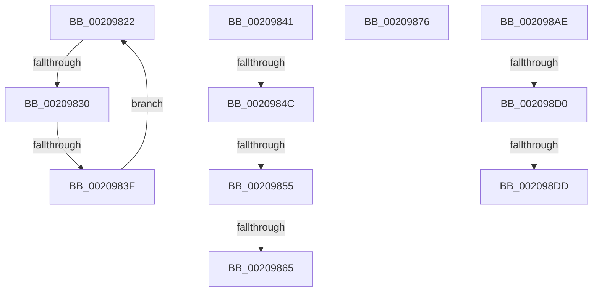

# sub_00209822

- RVA: `0x00209822`–`0x002098EE` (길이 `204` bytes)
- VA: `0x0000000140209822`
- 실행 섹션: `.text`
- PDB 이름 있음: `아니요`; PDB Function 태그: `아니요`
- unwind 정보 RVA: `0x0005D62C`
- 디코드: `43`개 명령, `204/204` bytes 표시
- 미해석 바이트: `0` (있으면 어셈블리에 `.byte`로 보존)

> 이 문서는 커널 이미지의 기계어와 PDB 기호를 분석해 생성했습니다. 4번과 5번은 함수 원형과 자료형을 바이너리 사용 방식에서 추정한 C 해석이며 원본 소스 복구 결과는 아닙니다.

## 1. Dependencies

- 직접 호출 지점: **3**; 고유 호출 대상: **3**
- 직접 호출자로 확인된 함수: **0**
- RIP 상대 이미지 참조: **2**

### Outgoing calls
- `0x0020987B` → [RtlGetInterruptTimePrecise](RtlGetInterruptTimePrecise_function_0020A4C0.md) (function, `0x0020A4C0`)
- `0x002098D0` → [KiRcuReportQuiescentState](KiRcuReportQuiescentState_function_0020AB8C.md) (function, `0x0020AB8C`)
- `0x002098E4` → [KiRcuFlushCompleted](KiRcuFlushCompleted_function_0020AD38.md) (function, `0x0020AD38`)

### Direct callers
- 이 함수 시작 RVA로 연결되는 직접 call은 확인되지 않았습니다. 간접 호출은 완전히 역산할 수 없습니다.

### Static image references
- `0x00209824` → RVA `0x00FC52AC` (`ALMOSTRO`; reference)
- `0x002098B1` → RVA `0x00F110C0` (`.data`; read)

## 2. Other-region calls and transfers

- 다른 실행 섹션으로 향하는 call: **0**
- call이 아닌 외부 분기/꼬리 이동: **10**
  - `0x0020982A` → [sub_002099FA + 0xCE](Unknown_function_002099FA.md) (`tail-transfer`)
  - `0x00209839` → [sub_0020959D + 0x203](Unknown_function_0020959D.md) (`tail-transfer`)
  - `0x00209846` → [sub_002099FA + 0x11C](Unknown_function_002099FA.md) (`tail-transfer`)
  - `0x0020984F` → [sub_0020959D + 0x18E](Unknown_function_0020959D.md) (`tail-transfer`)
  - `0x0020985F` → [sub_0020959D + 0x18E](Unknown_function_0020959D.md) (`tail-transfer`)
  - `0x00209871` → [sub_0020959D + 0x19B](Unknown_function_0020959D.md) (`tail-transfer`)
  - `0x002098A9` → [sub_0020959D + 0xAA](Unknown_function_0020959D.md) (`tail-transfer`)
  - `0x002098CA` → [sub_0020959D + 0x92](Unknown_function_0020959D.md) (`tail-transfer`)
  - `0x002098D7` → [sub_0020959D + 0x92](Unknown_function_0020959D.md) (`tail-transfer`)
  - `0x002098E9` → [sub_0020959D + 0x92](Unknown_function_0020959D.md) (`tail-transfer`)

## 3. Assembly (complete function range)

```asm
00209822  FF C6                           inc esi
00209824  85 35 82 BA DB 00               test dword ptr [rip + 0xdbba82], esi
0020982A  0F 84 98 02 00 00               je 0x140209ac8
00209830  F3 90                           pause
00209832  48 8B 47 40                     mov rax, qword ptr [rdi + 0x40]
00209836  48 85 C0                        test rax, rax
00209839  0F 84 61 FF FF FF               je 0x1402097a0
0020983F  EB E1                           jmp 0x140209822
00209841  44 38 7C 3D 72                  cmp byte ptr [rbp + rdi + 0x72], r15b
00209846  0F 85 CA 02 00 00               jne 0x140209b16
0020984C  40 84 ED                        test bpl, bpl
0020984F  0F 84 D6 FE FF FF               je 0x14020972b
00209855  48 8D 87 A8 00 00 00            lea rax, [rdi + 0xa8]
0020985C  48 39 00                        cmp qword ptr [rax], rax
0020985F  0F 84 C6 FE FF FF               je 0x14020972b
00209865  80 8F C2 00 00 00 02            or byte ptr [rdi + 0xc2], 2
0020986C  BE C0 00 00 00                  mov esi, 0xc0
00209871  E9 C2 FE FF FF                  jmp 0x140209738
00209876  48 8D 4C 24 58                  lea rcx, [rsp + 0x58]
0020987B  E8 40 0C 00 00                  call 0x14020a4c0
00209880  49 B8 B0 03 00 00 80 F7 FF FF   movabs r8, 0xfffff780000003b0
0020988A  C7 44 24 30 02 00 00 00         mov dword ptr [rsp + 0x30], 2
00209892  4C 8B E8                        mov r13, rax
00209895  49 8B 08                        mov rcx, qword ptr [r8]
00209898  4C 2B E9                        sub r13, rcx
0020989B  48 8B 8F F8 00 00 00            mov rcx, qword ptr [rdi + 0xf8]
002098A2  49 03 0C 24                     add rcx, qword ptr [r12]
002098A6  4C 2B E9                        sub r13, rcx
002098A9  E9 99 FD FF FF                  jmp 0x140209647
002098AE  8B 4E 24                        mov ecx, dword ptr [rsi + 0x24]
002098B1  48 8D 05 08 78 D0 00            lea rax, [rip + 0xd07808]
002098B8  48 C1 E1 05                     shl rcx, 5
002098BC  48 03 C8                        add rcx, rax
002098BF  48 8B 41 08                     mov rax, qword ptr [rcx + 8]
002098C3  4C 8B 01                        mov r8, qword ptr [rcx]
002098C6  4C 85 40 38                     test qword ptr [rax + 0x38], r8
002098CA  0F 85 5F FD FF FF               jne 0x14020962f
002098D0  E8 B7 12 00 00                  call 0x14020ab8c
002098D5  85 C0                           test eax, eax
002098D7  0F 84 52 FD FF FF               je 0x14020962f
002098DD  0F B6 8E E6 38 00 00            movzx ecx, byte ptr [rsi + 0x38e6]
002098E4  E8 4F 14 00 00                  call 0x14020ad38
002098E9  E9 41 FD FF FF                  jmp 0x14020962f
```

## 4. C-style interpretation (structured pseudocode)

```c
__int64 __fastcall sub_00209822(void)
{
    __int64 v_rsi;
    unsigned int v_stack_p30;
    unsigned __int64 v_stack_p58;

    v_rsi = (unsigned int)((v_rsi) + 1);
    goto loc_00209822;
}
```

## 5. (Beta) C Style

```c
void sub_00209822(void)
{
    int64_t local_rsi;
    uint32_t v_stack_p30;
    uint64_t v_stack_p58;

    local_rsi = (uint32_t)((local_rsi) + 1);
    goto loc_00209822;
}
```

## 6. Execution-region graph

[열기: 2D/3D 그래프와 함수 탐색 컨트롤 패널](../../../control-panel.html?section=text&rva=0x00209822&view=graph)

- 2D 그래프는 위에서 아래로 흐르고, 3D 그래프는 빈 공간을 드래그해 회전합니다. Shift+드래그는 이동, 휠은 확대·축소, 함수 노드 선택은 대상 보고서 이동입니다.

### Static fallback


