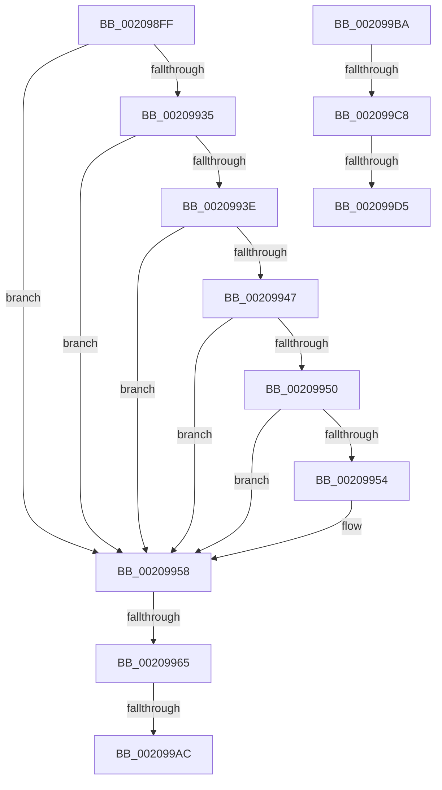

# sub_002098FF

- RVA: `0x002098FF`–`0x002099E1` (길이 `226` bytes)
- VA: `0x00000001402098FF`
- 실행 섹션: `.text`
- PDB 이름 있음: `아니요`; PDB Function 태그: `아니요`
- unwind 정보 RVA: `0x0005D668`
- 디코드: `47`개 명령, `226/226` bytes 표시
- 미해석 바이트: `0` (있으면 어셈블리에 `.byte`로 보존)

> 이 문서는 커널 이미지의 기계어와 PDB 기호를 분석해 생성했습니다. 4번과 5번은 함수 원형과 자료형을 바이너리 사용 방식에서 추정한 C 해석이며 원본 소스 복구 결과는 아닙니다.

## 1. Dependencies

- 직접 호출 지점: **3**; 고유 호출 대상: **3**
- 직접 호출자로 확인된 함수: **0**
- RIP 상대 이미지 참조: **1**

### Outgoing calls
- `0x00209997` → [KiCommitThreadWait](KiCommitThreadWait_function_0020DFE0.md) (function, `0x0020DFE0`)
- `0x002099C8` → [KiCheckVpBackingLongSpinWaitHypercall](../30/KiCheckVpBackingLongSpinWaitHypercall_function_0030F490.md) (function, `0x0030F490`)
- `0x002099D7` → [HvlNotifyLongSpinWait](../30/HvlNotifyLongSpinWait_function_0030F460.md) (function, `0x0030F460`)

### Direct callers
- 이 함수 시작 RVA로 연결되는 직접 call은 확인되지 않았습니다. 간접 호출은 완전히 역산할 수 없습니다.

### Static image references
- `0x002099BA` → RVA `0x00FC6AB8` (`ALMOSTRO`; read)

## 2. Other-region calls and transfers

- 다른 실행 섹션으로 향하는 call: **0**
- call이 아닌 외부 분기/꼬리 이동: **6**
  - `0x0020995F` → [sub_0020959D + 0x1DC](Unknown_function_0020959D.md) (`tail-transfer`)
  - `0x002099A6` → [sub_002099FA + 0xF5](Unknown_function_002099FA.md) (`tail-transfer`)
  - `0x002099B5` → [sub_0020959D + 0x266](Unknown_function_0020959D.md) (`tail-transfer`)
  - `0x002099C2` → [sub_0020959D + 0xFE](Unknown_function_0020959D.md) (`tail-transfer`)
  - `0x002099CF` → [sub_0020959D + 0xFE](Unknown_function_0020959D.md) (`tail-transfer`)
  - `0x002099DC` → [sub_0020959D + 0x100](Unknown_function_0020959D.md) (`tail-transfer`)

## 3. Assembly (complete function range)

```asm
002098FF  48 B8 B0 03 00 00 80 F7 FF FF   movabs rax, 0xfffff780000003b0
00209909  48 B9 08 00 00 00 80 F7 FF FF   movabs rcx, 0xfffff78000000008
00209913  48 8B 00                        mov rax, qword ptr [rax]
00209916  48 8B 09                        mov rcx, qword ptr [rcx]
00209919  48 2B 8F F8 00 00 00            sub rcx, qword ptr [rdi + 0xf8]
00209920  8B 97 B8 03 00 00               mov edx, dword ptr [rdi + 0x3b8]
00209926  48 2B C8                        sub rcx, rax
00209929  49 8B C5                        mov rax, r13
0020992C  44 38 BF 87 01 00 00            cmp byte ptr [rdi + 0x187], r15b
00209933  74 23                           je 0x140209958
00209935  44 39 BF E4 01 00 00            cmp dword ptr [rdi + 0x1e4], r15d
0020993C  75 1A                           jne 0x140209958
0020993E  44 38 BF 86 01 00 00            cmp byte ptr [rdi + 0x186], r15b
00209945  75 11                           jne 0x140209958
00209947  44 38 BF C0 00 00 00            cmp byte ptr [rdi + 0xc0], r15b
0020994E  75 08                           jne 0x140209958
00209950  85 D2                           test edx, edx
00209952  74 04                           je 0x140209958
00209954  4A 8D 04 2A                     lea rax, [rdx + r13]
00209958  8B 54 24 30                     mov edx, dword ptr [rsp + 0x30]
0020995C  48 3B C8                        cmp rcx, rax
0020995F  0F 87 14 FE FF FF               ja 0x140209779
00209965  44 8B C2                        mov r8d, edx
00209968  48 C7 87 60 01 00 00 FF FF FF FF  mov qword ptr [rdi + 0x160], 0xffffffffffffffff
00209973  C6 87 51 01 00 00 05            mov byte ptr [rdi + 0x151], 5
0020997A  48 8D 97 40 01 00 00            lea rdx, [rdi + 0x140]
00209981  4C 89 7C 24 28                  mov qword ptr [rsp + 0x28], r15
00209986  4D 8B CD                        mov r9, r13
00209989  48 8B CF                        mov rcx, rdi
0020998C  C6 87 4B 02 00 00 01            mov byte ptr [rdi + 0x24b], 1
00209993  89 5C 24 20                     mov dword ptr [rsp + 0x20], ebx
00209997  E8 44 46 00 00                  call 0x14020dfe0
0020999C  44 89 7C 24 34                  mov dword ptr [rsp + 0x34], r15d
002099A1  3D 00 01 00 00                  cmp eax, 0x100
002099A6  0F 84 43 01 00 00               je 0x140209aef
002099AC  3D 02 01 00 00                  cmp eax, 0x102
002099B1  44 0F 45 F8                     cmovne r15d, eax
002099B5  E9 49 FE FF FF                  jmp 0x140209803
002099BA  8B 05 F8 D0 DB 00               mov eax, dword ptr [rip + 0xdbd0f8]
002099C0  A8 40                           test al, 0x40
002099C2  0F 84 D3 FC FF FF               je 0x14020969b
002099C8  E8 C3 5A 10 00                  call 0x14030f490
002099CD  84 C0                           test al, al
002099CF  0F 84 C6 FC FF FF               je 0x14020969b
002099D5  8B CE                           mov ecx, esi
002099D7  E8 84 5A 10 00                  call 0x14030f460
002099DC  E9 BC FC FF FF                  jmp 0x14020969d
```

## 4. C-style interpretation (structured pseudocode)

```c
__int64 __fastcall sub_002098FF(__int64 a1, __int64 a2, __int64 a3, __int64 a4, __int64 a5, unsigned int a6)
{
    __int64 result;
    __int64 v_r15;
    unsigned int v_stack_p20;
    unsigned __int64 v_stack_p28;
    unsigned int v_stack_p34;

    a1 = (*(unsigned __int64 *)(a1)) - (*(unsigned __int64 *)(v_rdi + 248));
    a1 = (a1) - (*(unsigned __int64 *)(result));
    if ((*(unsigned __int8 *)(v_rdi + 391)) == ((unsigned __int8)(v_r15))) goto loc_00209958;
    if ((*(unsigned int *)(v_rdi + 484)) != ((unsigned int)(v_r15))) goto loc_00209958;
    if ((*(unsigned __int8 *)(v_rdi + 390)) != ((unsigned __int8)(v_r15))) goto loc_00209958;
    if ((*(unsigned __int8 *)(v_rdi + 192)) != ((unsigned __int8)(v_r15))) goto loc_00209958;
    result = v_r13;
    if ((unsigned int)((unsigned int)(*(unsigned int *)(v_rdi + 952))) != 0) {
        result = (unsigned int)(*(unsigned int *)(v_rdi + 952)) + v_r13 * 1;
    }
    *(unsigned __int64 *)(v_rdi + 352) = -1;
    *(unsigned __int8 *)(v_rdi + 337) = 5;
    v_stack_p28 = v_r15;
    *(unsigned __int8 *)(v_rdi + 587) = 1;
    v_stack_p20 = (unsigned int)(v_rbx);
    result = KiCommitThreadWait(v_rdi, v_rdi + 320, (unsigned int)((unsigned int)((unsigned int)(a6))), v_r13);
    v_stack_p34 = (unsigned int)(v_r15);
    if (((unsigned int)(result)) != 258) { v_r15 = (unsigned int)(result); }
}
```

## 5. (Beta) C Style

```c
int64_t sub_002098FF(int64_t Arg1, int64_t Arg2, int64_t Arg3, int64_t Arg4, uint64_t Arg5, uint32_t Arg6)
{
    int64_t result;
    int64_t local_r15;
    uint32_t v_stack_p20;
    uint64_t v_stack_p28;
    uint32_t v_stack_p34;

    Arg1 = (*(uint64_t *)(Arg1)) - (*(uint64_t *)(local_rdi + 0xF8));
    Arg1 = (Arg1) - (*(uint64_t *)(result));
    if ((*(uint8_t *)(local_rdi + 0x187)) == ((uint8_t)(local_r15))) goto loc_00209958;
    if ((*(uint32_t *)(local_rdi + 0x1E4)) != ((uint32_t)(local_r15))) goto loc_00209958;
    if ((*(uint8_t *)(local_rdi + 0x186)) != ((uint8_t)(local_r15))) goto loc_00209958;
    if ((*(uint8_t *)(local_rdi + 0xC0)) != ((uint8_t)(local_r15))) goto loc_00209958;
    result = local_r13;
    if ((uint32_t)((uint32_t)(*(uint32_t *)(local_rdi + 0x3B8))) != 0) {
        result = (uint32_t)(*(uint32_t *)(local_rdi + 0x3B8)) + local_r13 * 1;
    }
    *(uint64_t *)(local_rdi + 0x160) = -1;
    *(uint8_t *)(local_rdi + 0x151) = 5;
    v_stack_p28 = local_r15;
    *(uint8_t *)(local_rdi + 0x24B) = 1;
    v_stack_p20 = (uint32_t)(local_rbx);
    result = KiCommitThreadWait(local_rdi, local_rdi + 320, (uint32_t)((uint32_t)((uint32_t)(Arg6))), local_r13);
    v_stack_p34 = (uint32_t)(local_r15);
    if (((uint32_t)(result)) != 258) { local_r15 = (uint32_t)(result); }
}
```

## 6. Execution-region graph

[열기: 2D/3D 그래프와 함수 탐색 컨트롤 패널](../../../control-panel.html?section=text&rva=0x002098FF&view=graph)

- 2D 그래프는 위에서 아래로 흐르고, 3D 그래프는 빈 공간을 드래그해 회전합니다. Shift+드래그는 이동, 휠은 확대·축소, 함수 노드 선택은 대상 보고서 이동입니다.

### Static fallback


